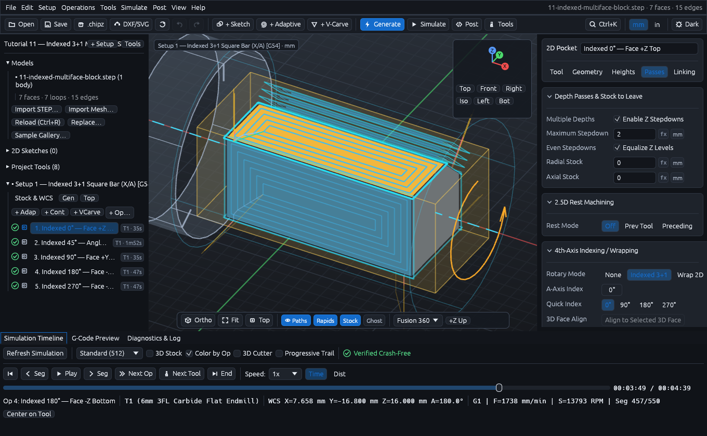
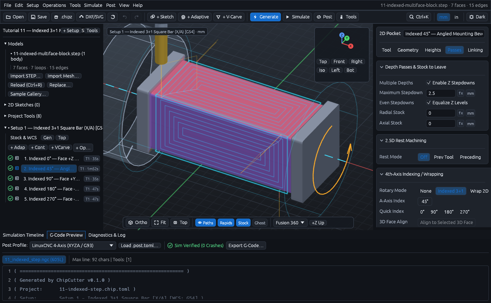

# Tutorial 11 — Indexed `3+1` Multi-Face Milling: Cardinal Flats & Prismatic STEP Face Alignment

## 1. Goal & What You'll Learn

Re-clamping a part four or five times in a bench vise introduces alignment stack-up errors and wastes setup time. With **Indexed `3+1` Positioning (`OperationRotaryMode::Indexed3Plus1`)**, your 4th axis rotates the workpiece to a fixed angle at safe clearance radius, locks in place, and lets you run standard 2.5D milling strategies (`2D Pocket`, `2D Contour`, `Drilling / Helical Bore`, `Edge Chamfer`) straight down along `+Z`—all in a **single chucking**.

In this tutorial you will practice two real-world `3+1` workflows:

- **Part A — Prismatic Multi-Face STEP Block (`11-indexed-multiface-block.step`):** Chucking square `90 × 36 × 36 mm` bar stock on `X/A`, clicking planar B-Rep faces in 3D, and using **`Align to Selected 3D Face`** (powered by `compute_index_angle_for_normal`) to compute exact **`0°`, `45°`, `90°`, `180°`, and `270°`** index angles—including a non-cardinal **`45°` angled mounting bevel**!
- **Part B — Cardinal `0° / 90° / 180° / 270°` Wrench Flats on a Cylindrical Shaft (`09-rotary-shaft.stl`):** Combining **`Quick Index`** (`0°/90°/180°/270°`) 2D pockets with continuous rotary spiral surfacing on the same shaft.
- Verifying safe clearance-radius retracts between every face rotation in **`CylindricalStock`** and inspecting clean `G0 Z` + `G0 A<angle>` index blocks in **`linuxcnc_4axis`** G-code.

---

## 2. Prerequisites & Starter Projects

Open the included prismatic multi-face STEP fixture ([`assets/11-indexed-multiface-block.step`](assets/11-indexed-multiface-block.step) — a `70 × 32 × 32 mm` block aligned along `X` with four cardinal faces plus a generous `45°` beveled mounting facet) or generate the seeded projects via `chipcutter`:

```bash
# Part A — Open the bare 11-indexed-multiface-block.step in an empty workspace:
cargo run --release -p chip-gui -- docs/tutorials/assets/11-indexed-multiface-block.step

# Or generate & open the complete 5-face Indexed 3+1 STEP project (0° / 45° / 90° / 180° / 270°):
cargo run -p chip-cli -- generate-sample-step /tmp/11-indexed-multiface-block.step \
  --tutorial 11-indexed-step --project-out /tmp/11-indexed-step.chip.toml
cargo run --release -p chip-gui -- /tmp/11-indexed-step.chip.toml

# Part B — Launch the Rotary Indexed Shaft showcase (Continuous Spiral + 4× Cardinal Wrench Flats):
cargo run --release -p chip-gui -- --sample rotary-shaft
```

---

## 3. Step-by-Step GUI Walkthrough

### Step 1 — Chuck Square Bar Stock in an `Indexed 3+1` Setup (`Setup 1 → 4th Axis`)

1. Import **`docs/tutorials/assets/11-indexed-multiface-block.step`** (`70 × 32 × 32 mm`, `X ∈ [-35, +35], Y ∈ [-16, +16], Z ∈ [-16, +16]`).
2. Select **`Stock & WCS`**:
   - On **`WCS & Post`**, set **`Origin = Stock Volumetric Center`** (`X=0, Y=0, Z=0` centered on the rotary axis) and **`Post Profile = linuxcnc_4axis`**.
   - On **`Stock`**, set **`Stock Mode = Fixed Size Box`** with **`Width X = 90 mm`**, **`Depth Y = 36 mm`**, **`Height Z = 36 mm`**, centered on `XY` and `Z`. The extra `10 mm` of bar length on `-X` keeps the cutter safely clear of the chuck jaws while leaving `2 mm` of machining stock on all four cardinal sides.
3. Switch to the **`4th Axis`** tab:
   - **`Rotary Mode`:** `Indexed 3+1 Positioning`
   - **`Rotary Axis`:** `X Axis (A-Axis)`
   - **`Direction`:** `Right-Hand Rule (CCW)`
   - **`Clearance Margin`:** `10 mm` above the square bar's outer corner radius (`R_corner = √(18² + 18²) ≈ 25.46 mm` -> `R_clearance ≈ 35.46 mm` so rotating a square bar never clips the retracted tool!)
   - **`Chuck Diameter`:** `65 mm`, **`Chuck Length`:** `20 mm`, **`Chuck Side`:** `-End`.


### Step 2 — Align an Operation to an Angled `45°` 3D STEP Face (`Align to Selected 3D Face`)

1. Add **`Op 2: Indexed 45° — Angled Mounting Bevel`** (`2D Pocket`, `T1` `Ø6 mm` 3FL Carbide Flat Endmill).
2. On the **`Geometry`** tab, click the **`45°` beveled planar facet** on the upper-back corner of the STEP block in the 3D viewport.
3. Switch to the **`Passes`** tab:
   - Enable **`Multiple Depths`** with **`Maximum Stepdown = 2.5 mm`** (`Equalize Z Levels` checked) so the square bar corner is stepped down cleanly to the beveled facet.
   - Expand **`4th-Axis Indexing / Wrapping`** and click **`Indexed 3+1`**.
   - Notice the **`Quick Index`** row (`0°`, `90°`, `180°`, `270°`) for cardinal faces, and right beneath it **`3D Face Align → Align to Selected 3D Face`**: clicking it evaluates the selected planar face's exact B-Rep normal `(0, +1/√2, +1/√2)` against your Setup's rotary axis & polarity (`compute_index_angle_for_normal`) and sets **`A-Axis Index = 45°`** automatically!
4. Press **`Ctrl+G`** and isolate `Op 2`:


Look at the viewport: ChipCutter constructs a rotated virtual Setup (`build_indexed_virtual_setup`), computes exact multi-depth `2D Pocket` passes parallel to the `45°` bevel, and prepends a safe clearance-radius rapid retract before rotating `A` to `45°`.

### Step 3 — Machine All Five Faces (`0°`, `45°`, `90°`, `180°`, `270°`) in One Chucking

Repeat Step 2 for the four cardinal planar faces using either **`Quick Index`** or **`Align to Selected 3D Face`**:

- **`Op 1 (0°)`:** Select the `+Z` top face (`Z = +16 mm`) -> **`A = 0°`** (`2.0 mm` stepdown).
- **`Op 2 (45°)`:** Select the `(+Y, +Z)` angled mounting bevel -> **`A = 45°`** (`2.5 mm` stepdown).
- **`Op 3 (90°)`:** Select the `+Y` side face (`Y = +16 mm`) -> **`A = 90°`** (`2.0 mm` stepdown).
- **`Op 4 (180°)`:** Select the `-Z` bottom face (`Z = -16 mm`) -> **`A = 180°`** (`2.0 mm` stepdown).
- **`Op 5 (270°)`:** Select the `-Y` side face (`Y = -16 mm`) -> **`A = 270°`** (`2.0 mm` stepdown).

Press **`Ctrl+G`** with all five operations visible:



Every operation's toolpath wraps cleanly onto its target face around the prismatic solid, and `validate_project` automatically validates every face normal and Z-height hierarchy inside each operation's rotated `3+1` frame.

### Step 4 — Part B: Cardinal `0° / 90° / 180° / 270°` Wrench Flats on a Cylindrical Shaft (`--sample rotary-shaft`)

You can also mix **`Indexed 3+1`** operations with **`4th-Axis Rotary Surfacing`** inside a single Setup! Open `--sample rotary-shaft` (or generate via `--tutorial 11-indexed-shaft` on `09-rotary-shaft.stl`):

1. **`Op 1`** runs **`Continuous Spiral`** surfacing (`T4` `Ø6 mm` Ball Endmill) over the central collar groove and 3-lobe cam.
2. **`Ops 2–5`** target a single **`Wrench Flat Window`** 2D sketch (`18 × 36 mm` rectangle over `X ∈ [-24.5, -6.5]`) with `T1` (`Ø6 mm` Flat Endmill), cutting `6.0 mm` deep from `StockTop + 0.5 mm` in `2.0 mm` stepdowns at **`0°`**, **`90°`**, **`180°`**, and **`270°`** using the **`Quick Index`** buttons.
3. Open **`Simulation Timeline`** and scrub to ~92%:


Watch the live HUD report **`Op 4: Indexed 3+1 Flat (180°) | WCS X=-16.500 mm Y=6.293 mm Z=15.000 mm A=180.0°`** alongside **`✓ Verified Crash-Free`**—proving all four flats, the spiral cam, and the `T4 → T1` tool change clear the stock and chuck cleanly.

---

## 4. Key Parameters Reference

| Section | Parameter | Recommended Value | Purpose & Safety Notes |
|---|---|---|---|
| `Setup → Stock` | `Fixed Size Box` | Part `Y/Z` + `4 mm`, `X` + `20 mm` | Extra `-X` bar stickout keeps open-edge face passes safely away from the chuck |
| `Setup → 4th Axis` | `Clearance Margin` | `>= 10 mm` above stock corner radius | For square stock (`36 × 36 mm`), `R_corner = 25.46 mm` -> `R_clearance = 35.46 mm` |
| `Passes → 4th-Axis` | `Rotary Mode` | `Indexed 3+1` | Rotates chuck at safe clearance Z, locks angle, then runs 2.5D/3-axis passes along `+Z` |
| `Passes → 4th-Axis` | `Quick Index` | `0° / 90° / 180° / 270°` | One-click cardinal face indexing for 4-sided blocks and wrench flats |
| `Passes → 4th-Axis` | `Align to Selected 3D Face` | Any planar STEP face | Computes exact `deg ∈ [0, 360)` aligning the picked B-Rep normal to `+Z` spindle |

---

## 5. Generate (`Ctrl+G`) & Cylindrical 3D Simulation

1. Press **`Ctrl+G`** and open **`Simulation Timeline`** on either project.
2. Enable **`3D Stock`**, **`Color by Op`**, and **`3D Cutter`** and verify **`✓ Verified Crash-Free`**:
   - On the square bar STEP job, `CylindricalStock` initializes the exact square bar cross-section (`90 × 36 × 36 mm`) and carves all five indexed faces cleanly into the finished chamfered prism while leaving unmachined chucking stubs on both ends.
   - Zero `RapidIntoStock`, zero `TargetModelGouge`, and zero `HolderCollision` diagnostics are reported.

---

## 6. Post-Processing (`linuxcnc_4axis` & `grblhal_4axis`)

Switch to **`G-Code Preview`** with **`LinuxCNC 4-Axis (XYZA / G93)`** (`linuxcnc_4axis`) selected:



Inspect the transitions between indexed operations in the generated `.ngc` program:
1. Before every angular index, ChipCutter emits an explicit rapid retract above the clearance cylinder (`G0 Z35.456`) in **`G94`** feed mode.
2. Only once retracted does the post emit the pure rotational index block (`G0 A45.000`, `G0 A90.000`, `G0 A180.000`, `G0 A270.000`).
3. Once indexed, standard `X / Y / Z` milling passes run along the newly aligned `+Z` spindle axis with full `G2`/`G3` arc preservation.

---

## 7. Headless CLI Equivalent (`chipcutter`)

Generate, validate, simulate, and post-process both the 5-face prismatic STEP job and the 4-flat rotary shaft job headlessly:

```bash
# 1. Generate 11-indexed-multiface-block.step + 5-op Indexed 3+1 project (0°/45°/90°/180°/270°)
cargo run -p chip-cli -- generate-sample-step /tmp/11-indexed-multiface-block.step \
  --tutorial 11-indexed-step --project-out /tmp/11-indexed-step.chip.toml

# 2. Generate 11-rotary-shaft.stl + 5-op Spiral + 4× Cardinal Wrench Flats project
cargo run -p chip-cli -- generate-sample-step /tmp/11-rotary-shaft.stl \
  --tutorial 11-indexed-shaft --project-out /tmp/11-indexed-shaft.chip.toml

# 3. Validate, verify crash-free in CylindricalStock, and build LinuxCNC 4-Axis G-code
cargo run -p chip-cli -- validate --generate /tmp/11-indexed-step.chip.toml
cargo run -p chip-cli -- simulate /tmp/11-indexed-step.chip.toml --resolution standard
cargo run -p chip-cli -- build /tmp/11-indexed-step.chip.toml -o /tmp/out_11_step --post linuxcnc_4axis

cargo run -p chip-cli -- validate --generate /tmp/11-indexed-shaft.chip.toml
cargo run -p chip-cli -- simulate /tmp/11-indexed-shaft.chip.toml --resolution standard
cargo run -p chip-cli -- build /tmp/11-indexed-shaft.chip.toml -o /tmp/out_11_shaft --post linuxcnc_4axis
```

---

## Next Steps

- **Previous:** [Tutorial 10 — 4th-Axis Rotary Wrapping & Surfacing](10-rotary-wrapping-surfacing.md)
- **Next:** [Tutorial 12 — Simultaneous 4-Axis Milling (`X+Y+Z+A/B`)](12-simultaneous-4axis-milling.md)
- **Index:** [All Tutorials](README.md)
