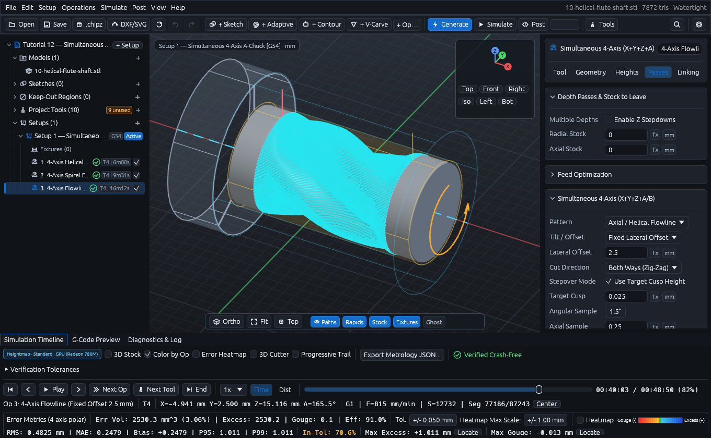
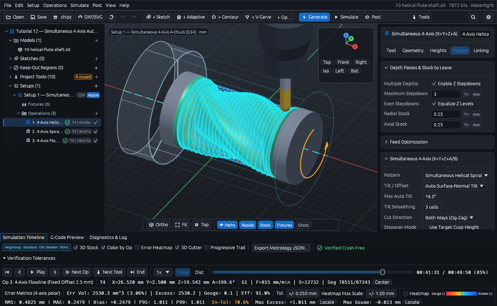

# Tutorial 12 — Simultaneous 4-Axis Milling (`X + Y + Z + A/B`): Auto Surface-Normal Tilt, Fixed Lateral Offset, & Helical Flowlines

## 1. Goal & What You'll Learn

When machining deep multi-start helical flutes, twisted impeller channels, or steep cam flanks, locking a ball endmill dead-center over the rotary axis (`Y = 0`) drags the zero-surface-speed tip center and restricts flank clearance. **Simultaneous 4-Axis Milling (`OperationKind::Rotary4AxisSim`)** drives **`X`, `Y`, `Z`, and `A` (or `B`) continuously together**, shifting the cross-axis off centerline so the cutter's high-SFM periphery engages steep helical walls smoothly.

In this tutorial you will work on the 3-start helical flute shaft ([`assets/10-helical-flute-shaft.stl`](assets/10-helical-flute-shaft.stl)) and learn how to:

- Configure a **`Simultaneous 4-Axis (X+Y+Z+R)`** Setup (`X/A` or `Y/B`) and understand why ChipCutter's validator enforces Setup drive-mode compatibility.
- Compare **`Auto Surface-Normal Tilt`** (`Max Auto Tilt`, `Tilt Smoothing`) against **`Fixed Lateral Offset`** (`Lateral Offset = 2.5 mm`).
- Compare **`Simultaneous Helical Spiral`** against **`Axial / Helical Flowline`** pass patterns.
- Verify off-centerline cutter flanks, tool holder clearance, chuck clearance, and target-STL gouge freedom (`<= 0.02 mm`) in **`CylindricalStock`** while watching live **`X`, `Y ≠ 0`, `Z`, `A`** HUD readouts.
- Inspect true simultaneous **`G93` inverse-time `X... Y... Z... A... F...`** G-code on **`grblhal_4axis`** and **`linuxcnc_4axis`**.

---

## 2. Prerequisites & Starter Project

Generate and launch the complete 3-operation Tutorial 12 comparison project (Auto-Tilt Roughing + Auto-Tilt Spiral Finish + Fixed-Offset Helical Flowline), or launch the built-in `--sample rotary-4axis` showcase:

```bash
# Generate & open the 3-op Tutorial 12 project (Auto-Tilt Spiral + Fixed-Offset Helical Flowline):
chipcutter generate-sample-step /tmp/12-helical-flute.stl \
  --tutorial 12-simultaneous-4axis --project-out /tmp/12-sim4ax.chip.toml
chip-gui /tmp/12-sim4ax.chip.toml

# Or launch the built-in 2-op Simultaneous 4-Axis showcase directly (Dark or Daylight Light theme):
chip-gui --sample rotary-4axis
chip-gui --sample rotary-4axis --theme light

# Or open the bare starter STL in an empty workspace:
chip-gui docs/tutorials/assets/10-helical-flute-shaft.stl
```

---

## 3. Step-by-Step GUI Walkthrough

### Step 1 — Configure a `Simultaneous 4-Axis` Setup (`Setup 1 → 4th Axis`)

1. Open `10-helical-flute-shaft.stl` (`Ø40 × 80 mm` watertight 3-start helical flute shaft aligned along `X`) via **`Import 3D Mesh (STL / OBJ / 3MF)…`** on the **Welcome to ChipCutter** overlay, **`File → Import 3D Mesh (.stl / .obj / .3mf)…`** in the **top menu bar**, or **`Import Mesh…`** under **`Models`** in the left **CAM Browser**.
2. In the left **CAM Browser**, click **`Stock & WCS`** under `Setup 1`:
   - On the **`WCS & Post`** tab in the right **Inspector**: under **`WCS Origin (X0 Y0 Z0)`**, select **`Origin Reference`** = **`Stock 27-Pt`**, set **`Z Level:`** = **`Mid-Z`**, and click **`C`** in the **`Center Y`** row (`Active Anchor` shows `Mid-Z Center`); under **`Post-Processor & Output`**, set **`Post Profile`** = **`grblHAL / FluidNC 4-Axis (XYZA / G93) (grblhal_4axis)`** (or **`LinuxCNC 4-Axis (XYZA / G93) (linuxcnc_4axis)`**).
   - On the **`Stock`** tab in the right **Inspector**: under **`Stock Geometry & Dimensions`**, change **`Stock Mode`** to **`Fixed Cylindrical Stock`** **first** so **`Bar Axis`**, **`Bar Diameter`**, and **`Bar Length`** appear below it, then set **`Bar Axis`** = **`WCS X Axis`**, **`Bar Diameter`** = `42 mm`, and **`Bar Length`** = `80 mm`.
3. Switch to the **`4th Axis`** tab in the right **Inspector**:
   - Under **`4th-Axis Rotary Kinematics`**, **first** change **`Rotary Mode`** from `Disabled (3-Axis)` to **`Simultaneous 4-Axis (X+Y+Z+R)`** so **`Rotary Axis`**, **`Direction`**, **`G-Code Letter`**, **`Unwind Mode`**, and the **`Centerline, Clearance & Chuck`** card appear below it.
   - Set **`Rotary Axis`** = **`X Axis (A-Axis)`** and **`Unwind Mode`** = **`Continuous Multi-Turn`**.
   - Under **`Centerline, Clearance & Chuck`**, set **`Clearance Margin`** = `12 mm`, **`Chuck Diameter`** = `65 mm`, and **`Chuck Length`** = `20 mm`.

> [!IMPORTANT]
> If you try to place a **`Simultaneous 4-Axis (X+Y+Z+A)`** operation inside a `2-Linear + Rotary (Z+X / Z+Y)` or `Indexed 3+1 Positioning` Setup, ChipCutter's validator explicitly flags an error before generation—preventing accidental 4-axis cross-axis motion on 2-linear rotary setups.


### Step 2 — Auto Surface-Normal Tilt + Simultaneous Helical Spiral (`Ops 1 & 2`)

1. **`Op 1 — 4-Axis Helical Roughing (Auto-Tilt)`:**
   - Click **`+ Op… → Simultaneous 4-Axis (X+Y+Z+A)`** under `Setup 1` in the left **CAM Browser** (or **`Operations → + Simultaneous 4-Axis (X+Y+Z+A)`** in the **top menu bar**). In the right **Inspector** **`Tool`** tab (`Active Cutter`), choose **`T4 — 6mm 2FL Carbide Ball Endmill`**.
   - Switch to the **`Passes`** tab in the right **Inspector**:
     - Under **`Depth Passes & Stock to Leave`**, keep **`Multiple Depths`** (`Enable Z Stepdowns`) checked so **`Maximum Stepdown`** (`3.0 mm`) is visible, and set **`Radial Stock`** = `0.25 mm` and **`Axial Stock`** = `0.25 mm`.
     - Under **`Simultaneous 4-Axis (X+Y+Z+A/B)`**, set **`Pattern`** = **`Simultaneous Helical Spiral`**, confirm **`Tilt / Offset`** = **`Auto Surface-Normal Tilt`** **first** so **`Max Auto Tilt`** (`16.0°`) and **`Tilt Smoothing`** (`3 cells`) are displayed, leave **`Stepover Mode`** (`Use Target Cusp Height`) unchecked so **`Stepover`** (`2.6 mm`) is displayed, and set **`Start Margin (-U)`** = `11 mm` and **`End Margin (+U)`** = `11 mm` to focus cleanly on the helical flute span.
2. **`Op 2 — 4-Axis Spiral Finish (Auto-Tilt 18°)`:**
   - Duplicate Op 1 via **`Ctrl+D`** (or **`Edit → Duplicate Operation (Ctrl+D)`** in the **top menu bar**, or right-click Op 1 in the left **CAM Browser** → **`Duplicate Operation (Ctrl+D)`**).
   - In the right **Inspector** **`Passes`** tab, uncheck **`Multiple Depths`** (`Enable Z Stepdowns`), set **`Radial Stock`** = `0 mm` and **`Axial Stock`** = `0 mm`, refine **`Stepover`** = `1.5 mm`, and raise **`Max Auto Tilt`** = `18.0°` with **`Tilt Smoothing`** = `3 cells`.
   - Press **`Ctrl+G`** (or click **`Generate`** in the **top toolbar**) and select `Op 2` in the left **CAM Browser**:


At every `(u, θ)` station, ChipCutter estimates the local circumferential flute slope, smooths the lateral cross-axis shift `Y(u, θ)` across neighboring cells (`Tilt Smoothing = 3 cells`) so `Y` and `A` acceleration stay chatter-free, and runs exact `f64` off-centerline Drop-Cutter contact checks against the rotated `MeshBvh`.

### Step 3 — Compare `Fixed Lateral Offset` + `Axial / Helical Flowline` (`Op 3`)

Sometimes you want predictable lengthwise flowline strips with a constant off-centerline shift rather than variable auto-tilt—for example, to keep the cutting contact ring strictly off the zero-RPM ball tip across long straight or lightly twisted flutes:

1. Duplicate Op 2 (`Ctrl+D`) to create **`Op 3 — 4-Axis Flowline (Fixed Offset 2.5 mm)`**.
2. In the right **Inspector** **`Passes`** tab (`Simultaneous 4-Axis (X+Y+Z+A/B)` card):
   - Switch **`Pattern`** to **`Axial / Helical Flowline`**.
   - **First** switch **`Tilt / Offset`** to **`Fixed Lateral Offset`** (which replaces `Max Auto Tilt` / `Tilt Smoothing` with **`Lateral Offset`**), then set **`Lateral Offset`** = `2.5 mm`.
   - Set **`Cut Direction`** = **`Both Ways (Zig-Zag)`** and **`Stepover`** = `2.2 mm` (with **`Use Target Cusp Height`** unchecked).
3. Press **`Ctrl+G`** and select `Op 3` in the left **CAM Browser**:



Compare Shot 2 (`Simultaneous Helical Spiral` + `Auto Surface-Normal Tilt`) with Shot 3 (`Axial / Helical Flowline` + `Fixed Lateral Offset`):
- **`Simultaneous Helical Spiral` + `Auto Surface-Normal Tilt`** produces a single continuous multi-turn helical wrap whose `Y` offset dynamically tracks each flute wall's normal direction—ideal for steep, deeply sculpted 3-start flutes with zero lane-to-lane stepover retracts.
- **`Axial / Helical Flowline` + `Fixed Lateral Offset`** sweeps lengthwise lanes along the shaft with a constant `Y = +2.500 mm` offset—ideal when you want axial tool marks aligned along the flute length and deterministic peripheral tip engagement.

---

## 4. Key Parameters Reference

All strategy parameters below are located in **`Right Inspector → Passes → Simultaneous 4-Axis (X+Y+Z+A/B)`**:

| Parameter | Safe Starting Value | Purpose & Tuning Guidance |
|---|---|---|
| **`Pattern`** | **`Simultaneous Helical Spiral`** / **`Axial / Helical Flowline`** | Spiral gives uninterrupted multi-turn finishing; Flowline runs lengthwise axial strips |
| **`Tilt / Offset`** | **`Auto Surface-Normal Tilt`** / **`Fixed Lateral Offset`** | Selects between **`Max Auto Tilt`** + **`Tilt Smoothing`** vs. explicit **`Lateral Offset`** |
| **`Max Auto Tilt`** | `12° – 20°` | Shown when **`Tilt / Offset`** = **`Auto Surface-Normal Tilt`**; caps maximum effective lateral tilt angle |
| **`Tilt Smoothing`** | `3 – 5 cells` | Shown when **`Tilt / Offset`** = **`Auto Surface-Normal Tilt`**; smooths simultaneous `Y` and `A` velocity |
| **`Lateral Offset`** | `2.0 – 3.5 mm` | Shown when **`Tilt / Offset`** = **`Fixed Lateral Offset`**; constant cross-axis shift (`mm`) off centerline |
| **`Stepover Mode`** (`Use Target Cusp Height`) / **`Stepover`** / **`Target Cusp`** | `1.5 mm` (or `0.03–0.05 mm` cusp) | Unchecked = reveals **`Stepover`**; checked = reveals **`Target Cusp`** |
| **`Start Margin (-U)`** / **`End Margin (+U)`** | `>= 11 mm` (clear of chuck & tailstock) | Trims machining window safely inside the fluted region away from chuck jaws |

---

## 5. Generate (`Ctrl+G`) & Off-Centerline 4-Axis Simulation

1. Press **`Ctrl+G`** (or click **`Generate`** in the **top toolbar**) to compute all three operations in parallel.
2. Click **`Simulate`** in the **top toolbar** (opening the bottom **`Simulation Timeline`** tab), confirm **`3D Stock`**, **`Color by Op`**, and **`3D Cutter`** are checked in the **`Simulation Timeline`** top bar, and scrub into `Op 2` (~72%):



Inspect the **3D CAD Viewport** and **`Simulation Timeline`** telemetry:
- **`WCS X=9.972 mm  Y=5.460 mm  Z=19.008 mm  A=9794.0°`:** All four axes—including **`Y = 5.460 mm ≠ 0`**—move smoothly together! You can visually see the `Ø6 mm` ball endmill shifted off the rotary centerline engaging the helical flute flank cleanly.
- **`Verified Crash-Free`:** `CylindricalStock` verifies off-centerline cutter flanks, tool holder clearance, chuck clearance, and STL target gouges (`<= 0.02 mm`) across the entire polar envelope.

---

## 6. Post-Processing (`grblhal_4axis` & `linuxcnc_4axis`)

Click **`Post`** in the **top toolbar** (or select the bottom **`G-Code Preview`** tab) with **`grblHAL / FluidNC 4-Axis (XYZA / G93)`** (`grblhal_4axis`) chosen in **`Post Profile:`**:


- **Automatic `G93` Inverse-Time Mode:** Before every simultaneous 4-axis cutting block, both `grblhal_4axis` and `linuxcnc_4axis` switch to **`G93`** and emit synchronized **`G1 X... Y... Z... A... F<1/min>`** blocks where `F = 1 / Δt_min` is computed from the true 3D workpiece-surface arc length—keeping real chip load constant even as effective radius and `Y` offset vary continuously!
- **Automatic `G94` Rapid Restoration:** Before any `G0` rapid retract or non-simultaneous positioning move, the post cleanly restores **`G94`** units-per-minute feed mode.

---

## 7. Headless CLI Equivalent (`chipcutter`)

Generate the 3-start helical flute STL and 3-operation Auto-Tilt + Flowline comparison project, validate, run off-centerline `CylindricalStock` verification, and build `G93` G-code for both `grblhal_4axis` and `linuxcnc_4axis`:

```bash
# 1. Generate the starter 3-start helical flute STL + 3-op Simultaneous 4-Axis project
chipcutter generate-sample-step /tmp/12-helical-flute.stl \
  --tutorial 12-simultaneous-4axis --project-out /tmp/12-sim4ax.chip.toml

# 2. Validate, run off-centerline cylindrical verification, and post-process G93 G-code
chipcutter validate --generate /tmp/12-sim4ax.chip.toml
chipcutter simulate /tmp/12-sim4ax.chip.toml --resolution standard
chipcutter build /tmp/12-sim4ax.chip.toml -o /tmp/out_12_grblhal --post grblhal_4axis
chipcutter build /tmp/12-sim4ax.chip.toml -o /tmp/out_12_linuxcnc --post linuxcnc_4axis
```

---

## Next Steps

- **Previous:** [Tutorial 11 — Indexed `3+1` Multi-Face Milling](11-indexed-3plus1-milling.md)
- **Next:** [Tutorial 13 — Pure-2D `DXF` / `SVG` Vector Import & Portable `.chipz` Bundles](13-pure2d-dxf-svg-workflow.md)
- **Index:** [All Tutorials](README.md)
