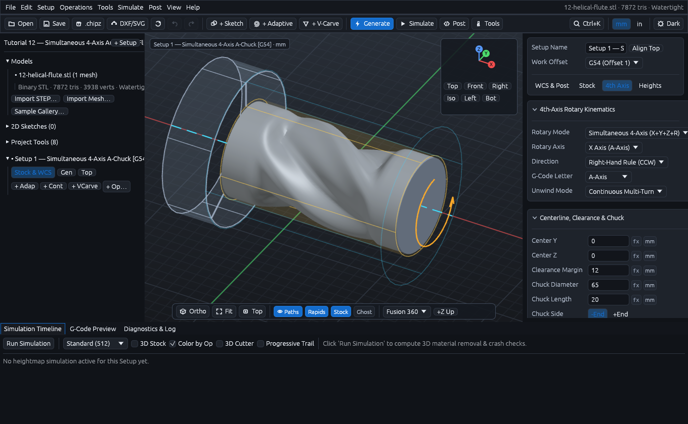
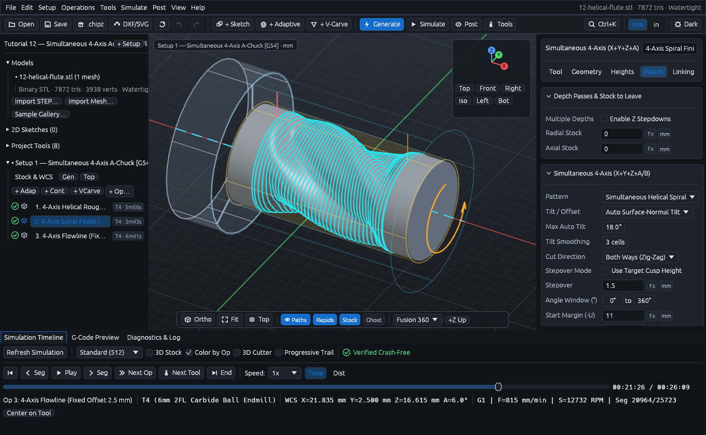
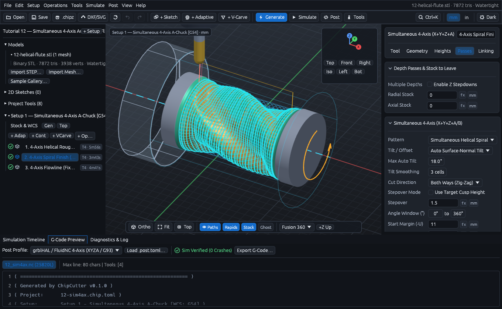

# Tutorial 12 — Simultaneous 4-Axis Milling (`X + Y + Z + A/B`): Auto Surface-Normal Tilt, Fixed Lateral Offset, & Helical Flowlines

## 1. Goal & What You'll Learn

When machining deep multi-start helical flutes, twisted impeller channels, or steep cam flanks, locking a ball endmill dead-center over the rotary axis (`Y = 0`) drags the zero-surface-speed tip center and restricts flank clearance. **Simultaneous 4-Axis Milling (`OperationKind::Rotary4AxisSim`)** drives **`X`, `Y`, `Z`, and `A` (or `B`) continuously together**, shifting the cross-axis off centerline so the cutter's high-SFM periphery engages steep helical walls smoothly.

In this tutorial you will work on the 3-start helical flute shaft ([`assets/10-helical-flute-shaft.stl`](assets/10-helical-flute-shaft.stl)) and learn how to:

- Configure a **`Simultaneous 4-Axis (X+Y+Z+R)`** Setup (`X/A` or `Y/B`) and understand why ChipCutter's validator enforces Setup drive-mode compatibility.
- Compare **`Auto Surface-Normal Tilt`** (`Max Auto Tilt`, `Tilt Smoothing`) against **`Fixed Lateral Offset`** (`Lateral Offset = 2.5 mm`).
- Compare **`Simultaneous Helical Spiral`** against **`Axial / Helical Flowline`** pass patterns.
- Verify off-centerline cutter flanks, tool holder clearance, chuck clearance, and target-STL gouge freedom (`<= 0.02 mm`) in **`CylindricalStock`** while watching live **`X`, `Y ≠ 0`, `Z`, `A`** HUD readouts.
- Inspect true simultaneous **`G93` inverse-time `X... Y... Z... A... F...`** G-code on **`grblhal_4axis`** and **`linuxcnc_4axis`**.

---

## 2. Prerequisites & Starter Project

Generate and launch the complete 3-operation Tutorial 12 comparison project (Auto-Tilt Roughing + Auto-Tilt Spiral Finish + Fixed-Offset Helical Flowline), or launch the built-in `--sample rotary-4axis` showcase:

```bash
# Generate & open the 3-op Tutorial 12 project (Auto-Tilt Spiral + Fixed-Offset Helical Flowline):
cargo run -p chip-cli -- generate-sample-step /tmp/12-helical-flute.stl \
  --tutorial 12-simultaneous-4axis --project-out /tmp/12-sim4ax.chip.toml
cargo run --release -p chip-gui -- /tmp/12-sim4ax.chip.toml

# Or launch the built-in 2-op Simultaneous 4-Axis showcase directly (Dark or Daylight Light theme):
cargo run --release -p chip-gui -- --sample rotary-4axis
cargo run --release -p chip-gui -- --sample rotary-4axis --theme light

# Or open the bare starter STL in an empty workspace:
cargo run --release -p chip-gui -- docs/tutorials/assets/10-helical-flute-shaft.stl
```

---

## 3. Step-by-Step GUI Walkthrough

### Step 1 — Configure a `Simultaneous 4-Axis` Setup (`Setup 1 → 4th Axis`)

1. Open `10-helical-flute-shaft.stl` (`Ø40 × 80 mm` watertight 3-start helical flute shaft aligned along `X`).
2. Select **`Stock & WCS`**:
   - On **`WCS & Post`**, set **`Origin = Stock Volumetric Center`** and **`Post Profile = grblhal_4axis`** (or **`linuxcnc_4axis`**).
   - On **`Stock`**, configure **`Fixed Cylinder`** (`Axis = X`, `Diameter = 42 mm`, `Length = 80 mm`).
3. Switch to the **`4th Axis`** tab:
   - Set **`Rotary Mode = Simultaneous 4-Axis (X+Y+Z+R)`** and **`Rotary Axis = X Axis (A-Axis)`**.
   - Set **`Clearance Margin = 12 mm`**, **`Chuck Diameter = 65 mm`**, **`Chuck Length = 20 mm`**, and **`Unwind Mode = Continuous Multi-Turn`**.

> [!IMPORTANT]
> If you try to place a **`Simultaneous 4-Axis`** operation inside a `2-Linear + Rotary` or `Indexed 3+1` Setup, ChipCutter's validator explicitly flags an error before generation—preventing accidental 4-axis cross-axis motion on 2-linear rotary setups.



### Step 2 — Auto Surface-Normal Tilt + Simultaneous Helical Spiral (`Ops 1 & 2`)

1. **Op 1 — `4-Axis Helical Roughing (Auto-Tilt)`:**
   - Click **`+ Op…` → `Simultaneous 4-Axis (X+Y+Z+A)`** and choose `T4` (`Ø6 mm` 2FL Carbide Ball Endmill).
   - Enable **`Multiple Depths`** (`Maximum Stepdown = 3.0 mm`) and leave **`Radial Stock = 0.25 mm`** / **`Axial Stock = 0.25 mm`**.
   - In **`Simultaneous 4-Axis (X+Y+Z+A/B)`**, set **`Pattern = Simultaneous Helical Spiral`**, **`Tilt / Offset = Auto Surface-Normal Tilt`**, **`Max Auto Tilt = 16.0°`**, **`Tilt Smoothing = 3 cells`**, **`Stepover = 2.6 mm`**, and **`Start / End Margin = 11 mm`** to focus cleanly on the helical flute span.
2. **Op 2 — `4-Axis Spiral Finish (Auto-Tilt 18°)`:**
   - Duplicate Op 1 (`Ctrl+D`), uncheck **`Multiple Depths`**, zero **`Radial / Axial Stock`**, refine **`Stepover = 1.5 mm`**, and raise **`Max Auto Tilt = 18.0°`** with **`Tilt Smoothing = 3 cells`**.
   - Press **`Ctrl+G`** and isolate `Op 2`:



At every `(u, θ)` station, ChipCutter estimates the local circumferential flute slope, smooths the lateral cross-axis shift `Y(u, θ)` across neighboring cells (`Tilt Smoothing = 3 cells`) so `Y` and `A` acceleration stay chatter-free, and runs exact `f64` off-centerline Drop-Cutter contact checks against the rotated `MeshBvh`.

### Step 3 — Compare `Fixed Lateral Offset` + `Axial / Helical Flowline` (`Op 3`)

Sometimes you want predictable lengthwise flowline strips with a constant off-centerline shift rather than variable auto-tilt—for example, to keep the cutting contact ring strictly off the zero-RPM ball tip across long straight or lightly twisted flutes:

1. Duplicate Op 2 (`Ctrl+D`) to create **`Op 3 — 4-Axis Flowline (Fixed Offset 2.5 mm)`**.
2. In **`Simultaneous 4-Axis (X+Y+Z+A/B)`**:
   - Switch **`Pattern`** to **`Axial / Helical Flowline`**.
   - Switch **`Tilt / Offset`** to **`Fixed Lateral Offset`** and set **`Lateral Offset = 2.5 mm`**.
   - Set **`Stepover = 2.2 mm`** (`Both Ways (Zig-Zag)`).
3. Press **`Ctrl+G`** and isolate `Op 3`:


Compare Shot 2 (`SimultaneousSpiral` + `Auto Surface-Normal Tilt`) with Shot 3 (`HelicalFlowline` + `Fixed Lateral Offset`):
- **`SimultaneousSpiral` + `Auto Surface-Normal Tilt`** produces a single continuous multi-turn helical wrap whose `Y` offset dynamically tracks each flute wall's normal direction—ideal for steep, deeply sculpted 3-start flutes with zero lane-to-lane stepover retracts.
- **`HelicalFlowline` + `Fixed Lateral Offset`** sweeps lengthwise lanes along the shaft with a constant `Y = +2.500 mm` offset—ideal when you want axial tool marks aligned along the flute length and deterministic peripheral tip engagement.

---

## 4. Key Parameters Reference

| Parameter | Safe Starting Value | Purpose & Tuning Guidance |
|---|---|---|
| `Pattern` | `Simultaneous Helical Spiral` / `Axial / Helical Flowline` | Spiral gives uninterrupted multi-turn finishing; Flowline runs lengthwise axial strips |
| `Tilt / Offset` | `Auto Surface-Normal Tilt` / `Fixed Lateral Offset` | Auto-Tilt dynamically shifts cross-axis `Y`/`X` toward local flank normals; Fixed Offset applies a constant shift |
| `Max Auto Tilt` | `12° – 20°` | Caps maximum effective lateral tilt angle to maintain tool rigidity and avoid excessive overhang |
| `Tilt Smoothing` | `3 – 5 cells` | Multi-pass grid smoothing radius keeping simultaneous `Y` and `A` velocity/acceleration smooth |
| `Lateral Offset` | `2.0 – 3.5 mm` | Explicit constant cross-axis shift (`mm`) off centerline in `Fixed Lateral Offset` mode |
| `Stepover` / `Target Cusp` | `1.5 mm` (or `0.03–0.05 mm` cusp) | Axial pitch per turn (`Spiral`) or circumferential lane spacing (`Flowline`) |
| `Start / End Margin` | `>= 11 mm` (clear of chuck & tailstock) | Trims machining window safely inside the fluted region away from chuck jaws |

---

## 5. Generate (`Ctrl+G`) & Off-Centerline 4-Axis Simulation

1. Press **`Ctrl+G`** to compute all three operations in parallel.
2. Open **`Simulation Timeline`**, check **`3D Stock`**, **`Color by Op`**, and **`3D Cutter`**, and scrub into `Op 2` (~72%):


Inspect the live viewport and HUD telemetry:
- **`WCS X=9.972 mm  Y=5.460 mm  Z=19.008 mm  A=9794.0°`:** All four axes—including **`Y = 5.460 mm ≠ 0`**—move smoothly together! You can visually see the `Ø6 mm` ball endmill shifted off the rotary centerline engaging the helical flute flank cleanly.
- **`✓ Verified Crash-Free`:** `CylindricalStock` verifies off-centerline cutter flanks, tool holder clearance, chuck clearance, and STL target gouges (`<= 0.02 mm`) across the entire polar envelope.

---

## 6. Post-Processing (`grblhal_4axis` & `linuxcnc_4axis`)

Switch to **`G-Code Preview`** with **`grblHAL / FluidNC 4-Axis (XYZA / G93)`** (`grblhal_4axis`) active:



- **Automatic `G93` Inverse-Time Mode:** Before every simultaneous 4-axis cutting block, both `grblhal_4axis` and `linuxcnc_4axis` switch to **`G93`** and emit synchronized **`G1 X... Y... Z... A... F<1/min>`** blocks where `F = 1 / Δt_min` is computed from the true 3D workpiece-surface arc length—keeping real chip load constant even as effective radius and `Y` offset vary continuously!
- **Automatic `G94` Rapid Restoration:** Before any `G0` rapid retract or non-simultaneous positioning move, the post cleanly restores **`G94`** units-per-minute feed mode.

---

## 7. Headless CLI Equivalent (`chipcutter`)

Generate the 3-start helical flute STL and 3-operation Auto-Tilt + Flowline comparison project, validate, run off-centerline `CylindricalStock` verification, and build `G93` G-code for both `grblhal_4axis` and `linuxcnc_4axis`:

```bash
# 1. Generate the starter 3-start helical flute STL + 3-op Simultaneous 4-Axis project
cargo run -p chip-cli -- generate-sample-step /tmp/12-helical-flute.stl \
  --tutorial 12-simultaneous-4axis --project-out /tmp/12-sim4ax.chip.toml

# 2. Validate, run off-centerline cylindrical verification, and post-process G93 G-code
cargo run -p chip-cli -- validate --generate /tmp/12-sim4ax.chip.toml
cargo run -p chip-cli -- simulate /tmp/12-sim4ax.chip.toml --resolution standard
cargo run -p chip-cli -- build /tmp/12-sim4ax.chip.toml -o /tmp/out_12_grblhal --post grblhal_4axis
cargo run -p chip-cli -- build /tmp/12-sim4ax.chip.toml -o /tmp/out_12_linuxcnc --post linuxcnc_4axis
```

---

## Next Steps

- **Previous:** [Tutorial 11 — Indexed `3+1` Multi-Face Milling](11-indexed-3plus1-milling.md)
- **Next:** [Tutorial 13 — Pure-2D `DXF` / `SVG` Vector Import & Portable `.chipz` Bundles](13-pure2d-dxf-svg-workflow.md)
- **Index:** [All Tutorials](README.md)
