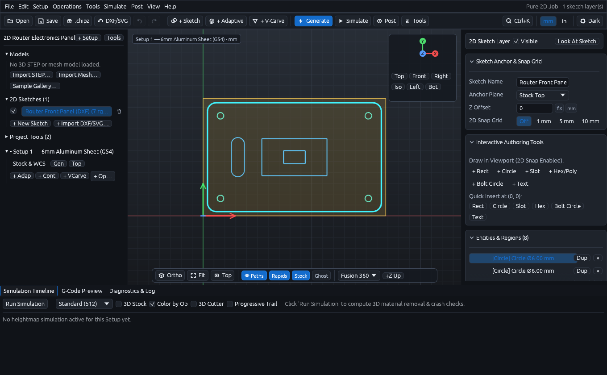
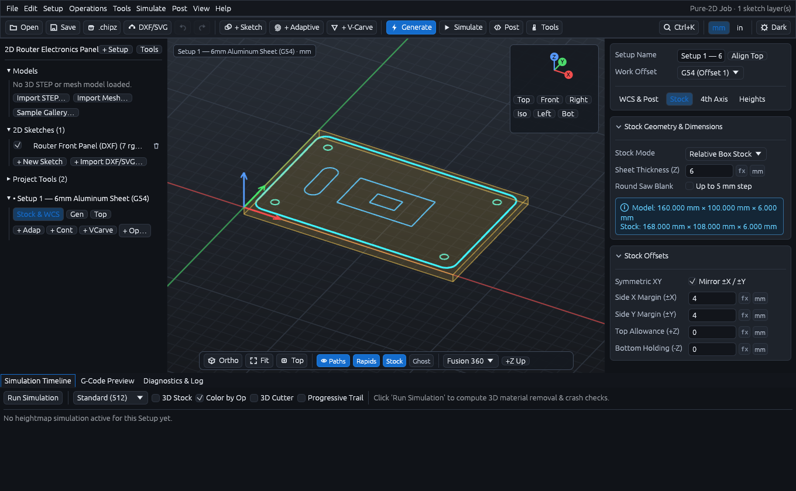
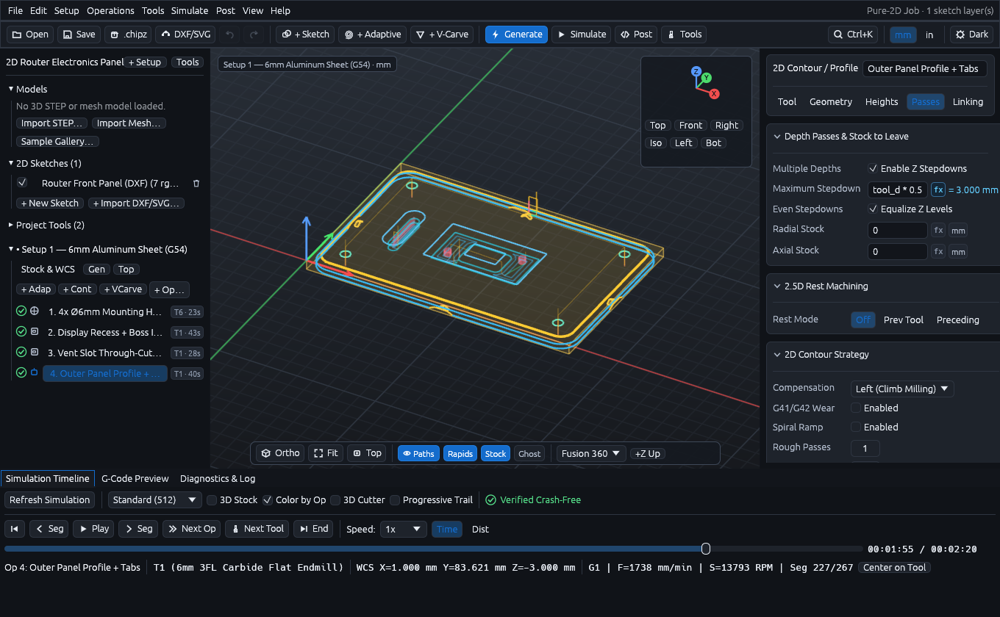
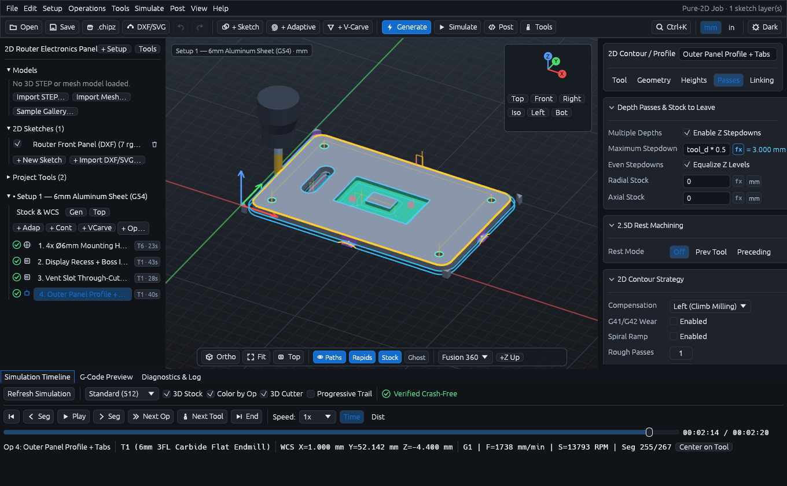
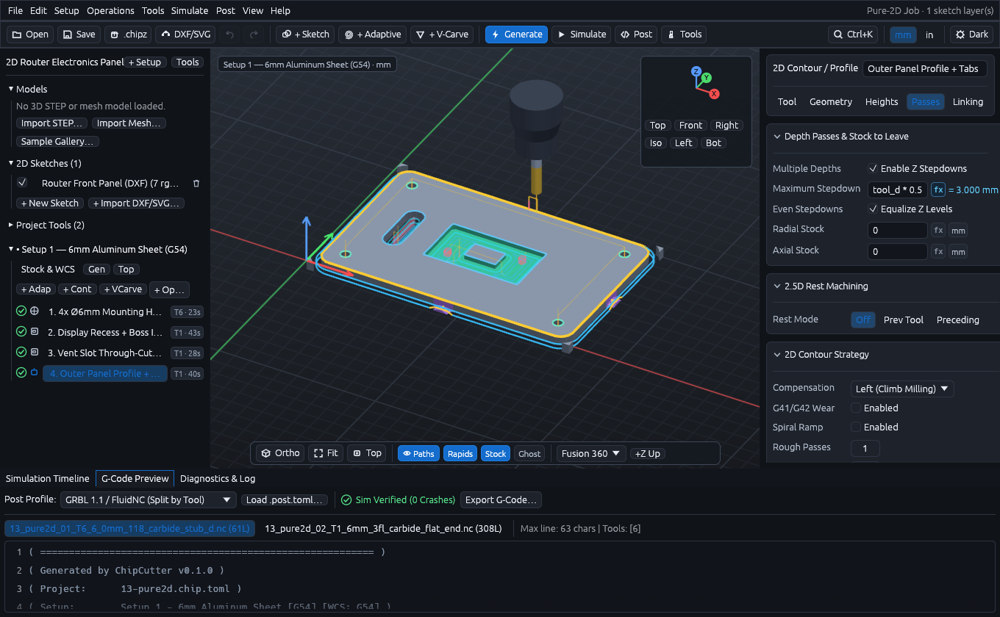

# Tutorial 13 — Pure-2D `DXF` / `SVG` Vector Import & Portable `.chipz` Bundles

## 1. Goal & What You'll Learn

Not every CNC job begins with a 3D STEP solid. Front panels, enclosure cutouts, brackets, signs, and templates are often drafted directly in 2D CAD (`AutoCAD`, `LibreCAD`, `QCAD`, `KiCad`) or vector illustration tools (`Inkscape`, `Adobe Illustrator`). ChipCutter supports **zero-STEP Pure-2D jobs** (`models = []`) that turn `.dxf` and `.svg` drawings into true-arc (`G2`/`G3`) CNC toolpaths on a virtual sheet stock—and lets you archive the entire job (project manifest, vectors, custom fonts, and custom post-processors) into a single byte-deterministic **`.chipz`** portable bundle.

In this tutorial you will start from an **empty Pure-2D workspace**, import the multi-layer router front panel [`13-router-panel.dxf`](assets/13-router-panel.dxf) (`160 × 100 mm`), and learn how to:

- Inspect and import `.dxf` and `.svg` files with automatic unit detection (`$INSUNITS` / SVG CSS DPI), sub-layer filtering, duplicate-segment removal, `0.05 mm` R-tree endpoint gap healing, and even-odd island nesting.
- Configure a **Pure-2D virtual sheet stock** (`Sheet Thickness (Z) = 6.0 mm`, `4 mm` XY margin) and Stock Top WCS origin without loading any 3D model.
- Assign 4 production operations directly to DXF sub-layers (`HOLES`, `POCKETS`, `CUTOUTS`, `OUTLINE`)—including a boss-island pocket and triangular holding tabs.
- Verify virtual-sheet material removal in **3D Simulation (`✓ Verified Crash-Free`)**, post-process split-by-tool **GRBL** and **LinuxCNC** G-code, and pack/build a self-contained **`.chipz`** archive.

---

## 2. Prerequisites & Starter Asset

Start with an **empty project** and load the minimal multi-layer DXF drawing included with this tutorial ([`13-router-panel.dxf`](assets/13-router-panel.dxf)):

- **Outer Contour (`OUTLINE` layer):** `160 × 100 mm` rounded rectangle with exact `R8 mm` `LWPOLYLINE` bulge arcs.
- **Mounting Holes (`HOLES` layer):** `4× Ø6.0 mm` corner `CIRCLE` entities.
- **Display Recess + Island (`POCKETS` layer):** `60 × 34 mm` pocket drafted from individual `LINE` segments containing an intentional `0.03 mm` endpoint gap + reversed duplicate line (demonstrating automatic gap healing and deduplication!) around an inner `20 × 12 mm` boss island.
- **Vent Slot (`CUTOUTS` layer):** Reusable `INSERT`ed `VENT_SLOT` block instance (`12 × 36 mm` stadium).

Open it in `chip-gui`:

- **From the Welcome Overlay or Toolbar:** Launch `cargo run --release -p chip-gui`, click **Import 2D DXF / SVG…** (or click **`DXF/SVG`** in the top toolbar), and select `docs/tutorials/assets/13-router-panel.dxf`.
- **Or open directly from the terminal:**
  ```bash
  cargo run --release -p chip-gui -- docs/tutorials/assets/13-router-panel.dxf
  ```
- **Quick-reference Sample:** You can also inspect the completed job anytime via **`File → Sample Projects Gallery…`** (`Pure-2D Router Front Panel`) or `cargo run --release -p chip-gui -- --sample pure-2d`.

---

## 3. Step-by-Step GUI Walkthrough

### Step 1 — Import `13-router-panel.dxf` & Inspect Planarized Regions (`Sketch Inspector`)

1. In the **DXF / SVG Import** modal, verify:
   - **Units:** `Auto-Detect` detects **`Millimeters ($INSUNITS=4)`** for DXF files (for unitless `.svg` files exported from vector art apps, pick **SVG DPI**: `96 DPI` for CSS / modern Inkscape, `72 DPI` for Adobe Illustrator, or `90 DPI` for legacy Inkscape).
   - **Gap Healing Tolerance:** Keep the default **`0.05 mm`**. ChipCutter's R-tree planarizer automatically removes the overlapping duplicate segment and heals the `0.03 mm` loop closure gap on the `POCKETS` layer into a watertight closed region with `1 interior island`.
   - **Sub-Layers:** Leave all 4 DXF layers (`CUTOUTS`, `HOLES`, `OUTLINE`, `POCKETS`) checked so each layer remains selectable by name in operations.
2. Click **Import into Pure-2D Project** and select **`Router Front Panel (DXF)`** under **`2D Sketches (1)`** in the CAM Browser:



Notice the top-right status indicator reads **`Pure-2D Job · 1 sketch layer(s)`** and **`Models`** confirms **`No 3D STEP or mesh model loaded.`** In the viewport (`Top` view), all `8` imported entities (`4` circles + `4` closed loops, `15` lines, `14` exact circular arcs) are planarized into `7` closed regions anchored to **`Stock Top`**.

> [!TIP]
> **Working with `.svg` Files:** ChipCutter converts SVG cubic/quadratic Bézier paths into tangent-continuous circular **biarcs** (`kurbo` + `ArcPolyline2D`) so smooth logos and curves post as crisp `G2`/`G3` arcs rather than faceted line segments. If an imported SVG is `1.333×` too large or too small, re-import with `--svg-dpi 72` (Illustrator) vs. `96` (Inkscape/CSS) or choose an explicit physical unit override (`mm` / `in`).

### Step 2 — Configure Virtual Sheet Stock & WCS Origin (`Setup 1 → Stock`)

Because there is no 3D solid to infer Z thickness from, Pure-2D jobs define Z depth through the Setup's virtual sheet stock:

1. Click **`Stock & WCS`** under **`Setup 1`** in the CAM Browser and open the **`Stock`** tab.
2. Under **`Stock Geometry & Dimensions`**, keep **`Relative Box Stock`** and set **`Sheet Thickness (Z)`** = `6 mm`.
3. Under **`Stock Offsets`**, check **`Symmetric XY`** and set **`Side X Margin (±X)`** = `4 mm`, **`Side Y Margin (±Y)`** = `4 mm`, **`Top Allowance (+Z)`** = `0 mm`, and **`Bottom Holding (-Z)`** = `0 mm`.
4. In **`WCS & Post`**, set **WCS Origin** to **`Top Front Left`** (a natural spoilboard fence origin for sheet routing; `Stock Top` = `Z 0.000 mm`, `Stock Bottom` = `Z -6.000 mm`):



The read-only summary card confirms **`Model: 160.000 mm × 100.000 mm × 6.000 mm`** and **`Stock: 168.000 mm × 108.000 mm × 6.000 mm`**.

### Step 3 — Assign 4 Pure-2D Operations by DXF Sub-Layer

Targeting DXF sub-layers keeps your CAM tree clean and associative even when a drawing contains dozens of features. Add four operations in order:

1. **Op 1 — `4x Ø6mm Mounting Holes` (`Drill / Helical Bore`):**
   - **Tool:** `T6 — 6.0mm 118° Carbide Stub Drill`.
   - **Geometry:** Select **`Sketch Layer → Router Front Panel (DXF) → HOLES`** (automatically picks all `4× Ø6 mm` corner circles).
2. **Op 2 — `Display Recess + Boss Island` (`2D Pocket`):**
   - **Tool:** `T1 — 6mm 3FL Carbide Flat Endmill`.
   - **Geometry:** Select **`Sketch Layer → POCKETS`** (ChipCutter automatically preserves the inner `20 × 12 mm` boss island!).
   - **Heights:** Set **`Bottom Height`** = `Stock Top` with offset **`-3.0 mm`** (half-depth blind recess).
3. **Op 3 — `Vent Slot Through-Cutout` (`2D Pocket`):**
   - **Tool:** `T1 — 6mm 3FL Carbide Flat Endmill`.
   - **Geometry:** Select **`Sketch Layer → CUTOUTS`** (the expanded `INSERT`ed `VENT_SLOT` stadium).
   - **Heights:** Set **`Bottom Height`** = `Stock Bottom` (`0 mm` offset = full `6.0 mm` through-cutout).
4. **Op 4 — `Outer Panel Profile + Tabs` (`2D Contour / Profile`):**
   - **Tool:** `T1 — 6mm 3FL Carbide Flat Endmill`.
   - **Geometry:** Select **`Sketch Layer → OUTLINE`** (Climb / outside compensation).
   - **Heights:** **`Bottom Height`** = `Stock Bottom` (`0 mm` offset).
   - **Passes:** Enable **`Multiple Depths`** (`Maximum Stepdown = tool_d * 0.5 = 3.000 mm`, `Equalize Z Levels`), and enable **Triangular Holding Tabs** (`25°` ramp angle) so the finished front panel stays anchored to the sheet until cut free.

Press **`Ctrl+G`** to generate all 4 operations in parallel:



Inspect the viewport: clean blue/cyan `G2`/`G3` arc contours around every `R8` corner and stadium end, helical/linear entry ramps into the display recess and vent slot, and triangular holding tabs around the perimeter.

---

## 4. Key Parameters Reference

| Parameter | Location | Purpose & Recommended Starting Values |
|---|---|---|
| **DXF / SVG Units** | `Import 2D` modal / `--units` | `Auto-Detect` reads DXF `$INSUNITS` or SVG physical units (`mm`/`in`/`cm`); override explicitly when importing unitless legacy CAD exports. |
| **SVG DPI** | `Import 2D` modal / `--svg-dpi` | Maps unitless SVG `px` coordinates to millimeters: **`96`** (CSS / Inkscape 0.92+), **`72`** (Adobe Illustrator), **`90`** (legacy Inkscape). |
| **Join / Gap Healing Tolerance** | `Import 2D` modal / `--join-tol` | R-tree endpoint snap radius (`0.05 mm` default) that closes tiny CAD export gaps before even-odd island planarization. Set `0.0` to disable healing. |
| **Sheet Thickness (Z)** | `Setup → Stock` / `--thickness` | Defines virtual sheet Z depth (`6.0 mm` here) for Pure-2D jobs without a 3D STEP model; drives `Stock Bottom` (`Z = -6.0 mm`) and simulation stock volume. |
| **Sub-Layer Selection** | `Op → Geometry` | Binds an operation to an entire DXF layer (`HOLES`, `POCKETS`, `CUTOUTS`, `OUTLINE`) or SVG group so all matching regions/circles update together. |
| **Portable Bundle (`.chipz`)** | `File → Export Portable Bundle (.chipz)…` | Packs `project.chip.toml`, `vectors/*.{dxf,svg}`, `fonts/*.{ttf,otf}`, `models/*`, and custom `posts/*.post.toml` into one deterministic ZIP with SHA-256 verification. |

---

## 5. Generate (`Ctrl+G`) & 3D Simulation Verification

Click **`Simulate`** (`Simulation Timeline` bottom tab) with **`3D Stock`**, **`Color by Op`**, and **`3D Cutter`** checked, and scrub near completion (`96%`):



Even with zero 3D CAD files, ChipCutter runs the full 3D Z-dexel heightmap material-removal simulation and 5-rule physical crash gate:
- All `4× Ø6 mm` corner holes drill cleanly through the `6.0 mm` sheet.
- The `3.0 mm`-deep display recess leaves the crisp central `20 × 12 mm` boss island standing intact.
- The `12 × 36 mm` vent slot clears cleanly through the sheet, and the outer `R8` rounded contour retains the finished panel with triangular holding tabs.
- Status badge reads **`✓ Verified Crash-Free`** (`0` critical crashes/gouges, total cycle time `00:02:20`).

---

## 6. Post-Processing & Portable `.chipz` Bundles

Switch to **`G-Code Preview`** (`GRBL 1.1 / FluidNC (Split by Tool)` shown below):



- **`GRBL 1.1 / FluidNC (Split by Tool)`:** Automatically splits the job into two sequential `.nc` files (`..._01_T6_6_0mm_118_carbide_stub_d.nc` for drilling, followed by `..._02_T1_6mm_3fl_carbide_flat_end.nc` for pocketing, slotting, and profiling), keeping every line under `80` characters (`max 63 chars`) with true `G2`/`G3` circular arcs.
- **`LinuxCNC (RS274NGC)` / `grblHAL ATC`:** Emits a single unified `.ngc` program (`Tools: [6, 1]`) with `M6` tool changes and `G43 H` length offsets.

### Archiving & Sharing with `.chipz`

Relative DXF/SVG paths inside `.chip.toml` are great for Git repositories, but when transferring a job to a shop-floor CNC PC—or archiving a completed production run—export a self-contained **`.chipz`** bundle:

1. Click **`.chipz`** in the top toolbar (or **`File → Export Portable Bundle (.chipz)…`**) and save `router-panel.chipz`.
2. ChipCutter deterministically packs `project.chip.toml` alongside `vectors/13-router-panel.dxf` (plus any custom `.ttf`/`.otf` fonts or `.post.toml` profiles) with SHA-256 integrity checks.
3. On any machine, open `router-panel.chipz` directly via **`File → Open…`**—or build G-code straight from the `.chipz` archive on the command line without even unpacking it first!

---

## 7. Headless CLI Equivalent (`chipcutter`)

Inspect the DXF drawing, test raw Pure-2D import, generate the 4-operation project, validate, simulate, pack a portable `.chipz` bundle, and build verified GRBL + LinuxCNC G-code directly from the `.chipz` archive:

```bash
# 1. Inspect DXF units, bounds, layers, arc preservation, & gap-healing diagnostics
cargo run -p chip-cli -- inspect docs/tutorials/assets/13-router-panel.dxf

# 2. Import any .dxf or .svg into a fresh blank Pure-2D .chip.toml sheet job (6.0 mm thick)
cargo run -p chip-cli -- import-2d docs/tutorials/assets/13-router-panel.dxf \
  -o /tmp/13-panel-blank.chip.toml --thickness 6.0

# 3. Generate the reproducible 4-operation Pure-2D router panel project
cargo run -p chip-cli -- generate-sample-step /tmp/13-router-panel.dxf \
  --tutorial 13-pure2d-dxf --project-out /tmp/13-panel.chip.toml

# 4. Validate, generate toolpaths, and verify zero crashes/gouges in 3D simulation
cargo run -p chip-cli -- validate --generate /tmp/13-panel.chip.toml
cargo run -p chip-cli -- simulate /tmp/13-panel.chip.toml --resolution standard

# 5. Pack a self-contained portable .chipz archive and build G-code directly from it
cargo run -p chip-cli -- bundle pack /tmp/13-panel.chip.toml -o /tmp/13-panel.chipz
cargo run -p chip-cli -- build /tmp/13-panel.chipz -o /tmp/panel_grbl --post grbl
cargo run -p chip-cli -- build /tmp/13-panel.chipz -o /tmp/panel_linuxcnc --post linuxcnc
```

---

## Next Steps

- **Previous:** [Tutorial 12 — Simultaneous 4-Axis Milling (`X + Y + Z + A/B`)](12-simultaneous-4axis-milling.md)
- **Next:** [Tutorial 14 — Associative STEP Revision Reload (`Ctrl+R`) & Re-Pick Recovery](14-associative-step-reload.md)
- **Index:** [All Tutorials](README.md)
