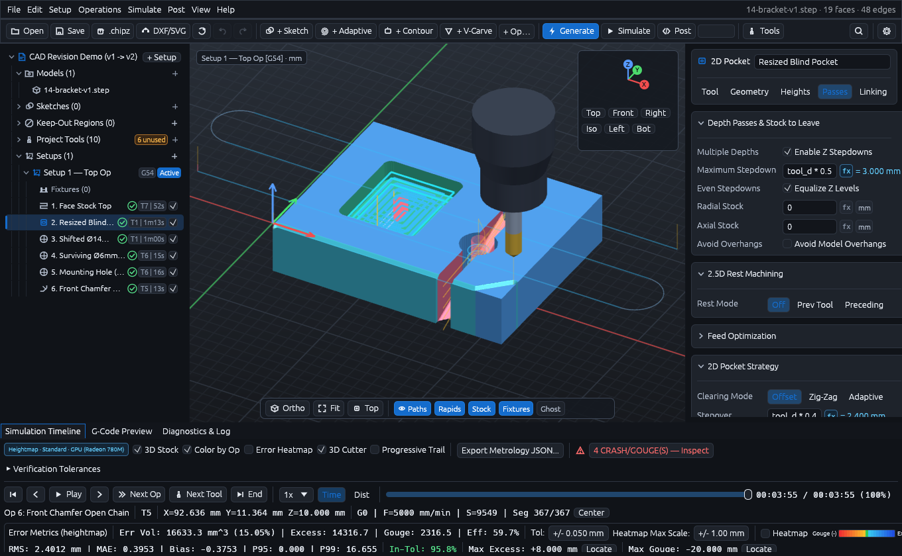
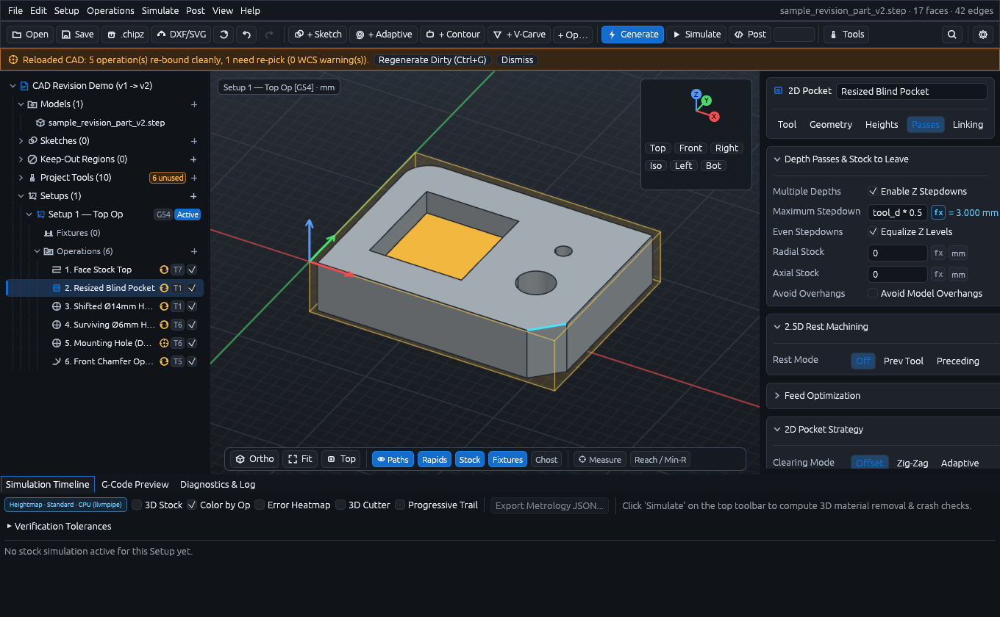
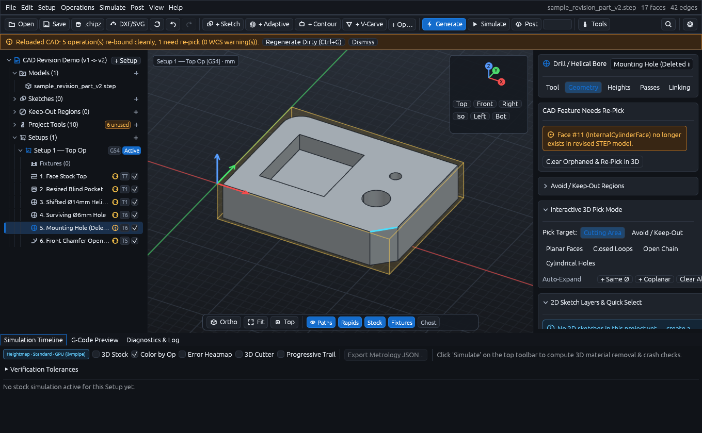
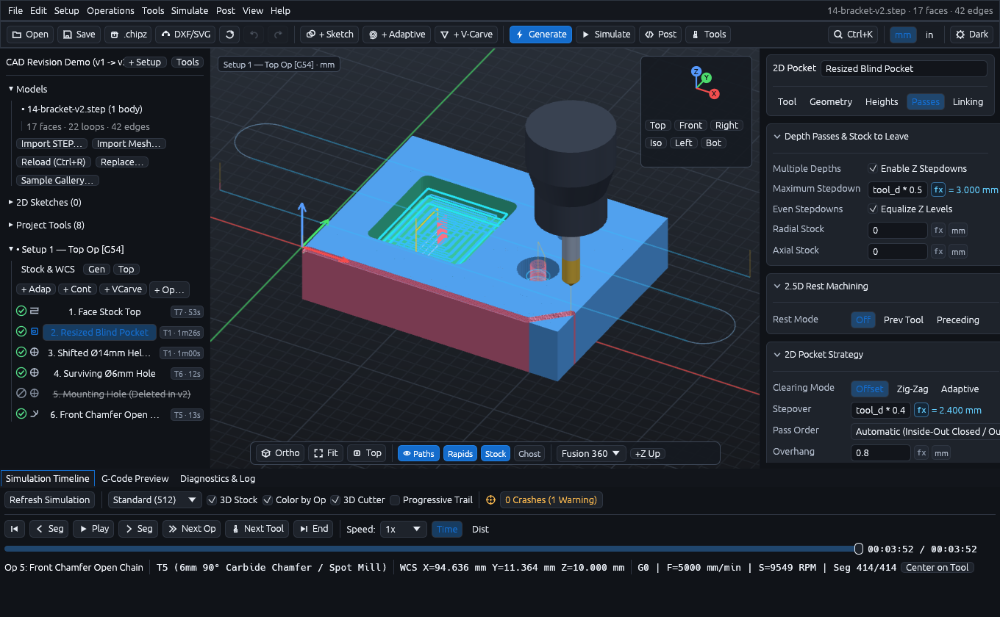

# Tutorial 14 — Associative STEP Revision Reload (`Ctrl+R`) & Re-Pick Recovery

## 1. Goal & What You'll Learn

CAD models almost never stay frozen after the first CAM setup: pockets get widened and deepened, bores shift a few millimeters, mounting holes get added or removed, and re-exporting a STEP file from CAD routinely scrambles internal B-Rep face and edge IDs.

ChipCutter solves this with **WCS-first `GeometricSignature` associative re-matching**. Instead of relying on fragile STEP entity indices, every face, loop, hole, and open edge chain stores a geometric fingerprint (surface type, area, normal, centroid, radius, and local topology). When you reload a revised STEP file (`Ctrl+R` or `chipcutter reload-step`), ChipCutter automatically re-binds surviving and shifted features, marks only affected operations **`Dirty`**, preserves all tool/feed/height/pass/tab settings, and isolates any deleted or ambiguous features for **1-click `NeedsRepick` recovery**.

In this tutorial you will work through a real engineering revision from [`14-bracket-v1.step`](assets/14-bracket-v1.step) to [`14-bracket-v2.step`](assets/14-bracket-v2.step) and learn how to:

- Verify a clean 6-operation `revision-v1` CAM job before an engineering change order (ECO).
- Reload `revision-v2` (where the part widens by `2 mm`, the pocket enlarges and deepens by `1 mm`, the `Ø14 mm` bore and first `Ø6 mm` hole shift, the second `Ø6 mm` hole is **deleted**, and every STEP face/edge index is permuted!).
- Read the non-blocking **Reload Summary Banner** and verify that `5` surviving operations re-bind cleanly (`Dirty`) with all parameters intact.
- Recover the flagged **`NeedsRepick`** operation using **`Clear Orphaned & Re-Pick in 3D`** (or suppress/delete an obsolete feature), regenerate (`Ctrl+G`), and verify the updated `v2` program headlessly with `chipcutter reload-step`.

---

## 2. Prerequisites & Starter Revision Pair

Two matching STEP revisions are included in `docs/tutorials/assets/`:

| Feature | [`14-bracket-v1.step`](assets/14-bracket-v1.step) (`Rev 1`) | [`14-bracket-v2.step`](assets/14-bracket-v2.step) (`Rev 2`) | Expected Associative Outcome |
|---|---|---|---|
| **Overall Solid** | `90 × 70 × 20 mm` (`19` faces, `48` edges) | `92 × 70 × 20 mm` (`17` faces, `42` edges, permuted IDs) | Stock & WCS re-bound cleanly (`0` WCS warnings) |
| **Op 1: Face Stock Top** | Stock XY bounds | Expanded `92 × 70 mm` bounds | **Rebound (`Dirty`)** — automatically covers wider stock |
| **Op 2: Resized Blind Pocket** | `[14..46] × [16..54]` @ `Z = 12.0 mm` | `[12..48] × [15..55]` @ `Z = 11.0 mm` (`1 mm` deeper) | **Rebound (`Dirty`)** — fuzzy-matched planar floor + new Z depth |
| **Op 3: Shifted `Ø14 mm` Bore** | Helical bore at `(68.0, 24.0)` | Shifted to `(71.0, 26.0)` | **Rebound (`Dirty`)** — fuzzy-matched cylinder signature |
| **Op 4: Surviving `Ø6 mm` Hole** | Through-hole at `(68.0, 48.0)` | Shifted to `(70.0, 47.0)` | **Rebound (`Dirty`)** — fuzzy-matched cylinder signature |
| **Op 5: Mounting Hole (Deleted)** | Through-hole at `(68.0, 60.0)` | **Removed in `v2`** | **Flagged `NeedsRepick`** — tool & overrides preserved |
| **Op 6: Front Chamfer Open Chain** | Front + angled `45°` top edges | Widened front + angled top edges | **Rebound (`Dirty`)** — open edge chain healed across topology |

Open the starter `Revision v1` job in `chip-gui`:

- **From the Sample Projects Gallery:** Launch ChipCutter (`chip-gui`), click **`Browse Sample Projects Gallery…`** on the **Welcome to ChipCutter** overlay (or **`File → Sample Projects Gallery…`** / **`Help → Sample Projects Gallery…`** in the **top menu bar**, or **`Sample Gallery…`** under **`Models`** in the left **CAM Browser**), find the **`Associative CAD Revision Reload (v1 -> v2)`** card, and click **`Open Sample`**.
- **Or launch directly from the terminal:**
  ```bash
  chip-gui --sample revision-v1
  ```

---

## 3. Step-by-Step GUI Walkthrough

### Step 1 — Inspect & Simulate the Clean `Revision v1` Baseline

With `14-bracket-v1.step` loaded, press **`Ctrl+G`** (or click **`Generate`** in the **top toolbar**) and click **`Simulate`** in the **top toolbar** (opening the bottom **`Simulation Timeline`** tab) to confirm the baseline `v1` job:



All `6` operations show green **`Clean`** badges in the left **CAM Browser** (`Face Stock Top`, `Resized Blind Pocket` at `1m13s`, `Shifted Ø14mm Helical Bore`, `Surviving Ø6mm Hole`, `Mounting Hole (Deleted in v2)`, and `Front Chamfer Open Chain`), and **`Simulation Timeline`** confirms **`Verified Crash-Free`** across the `90 × 70 × 20 mm` bracket.

### Step 2 — Reload `Revision v2` (`Ctrl+R` / `Replace…`) & Review the Reload Banner

In production, you either overwrite the STEP file on disk and press **`Ctrl+R`** (or click **`Reload (Ctrl+R)`** under **`Models`** in the left **CAM Browser** or **`File → Reload STEP Model (Ctrl+R)`** in the **top menu bar**; ChipCutter also watches the active STEP file SHA-256 every 2 seconds and displays an alert banner with **`Reload & Re-Match (Ctrl+R)`** when CAD changes on disk), or click **`Replace…`** under **`Models`** in the left **CAM Browser** (or **`File → Replace STEP Model (Associative Re-Bind)…`** in the **top menu bar**) and select `docs/tutorials/assets/14-bracket-v2.step`. *(Note: **`Reload (Ctrl+R)`** and **`Replace…`** appear only when a 3D STEP solid is loaded.)*

> [!TIP]
> You can test the exact `v1 → v2` associative reload in one command via `chip-gui --sample revision-v2`, or click **`Reload Rev v2`** on the **`Associative CAD Revision Reload (v1 -> v2)`** card inside **`Sample Projects Gallery`**.

Immediately after loading `v2`, ChipCutter displays the non-blocking **Reload Summary Banner** across the top of the workspace (below the **top toolbar**):



Look closely at what happened automatically—even though **every single STEP face and edge index was permuted** in `v2`:
1. **Top Summary Banner:** `Reloaded CAD: 5 operation(s) re-bound cleanly, 1 need re-pick (0 WCS warning(s)).` with direct **`Regenerate Dirty (Ctrl+G)`** and **`Dismiss`** buttons.
2. **Selective `Dirty` Status:** Operations `1`, `2`, `3`, `4`, and `6` are marked **`Dirty`** in the left **CAM Browser** and re-bound to the updated `v2` geometry—notice the enlarged pocket floor highlighted in gold in the **3D CAD Viewport**!
3. **All CAM Parameters Preserved:** Clicking **`2. Resized Blind Pocket`** in the left **CAM Browser** and opening the **`Passes`** tab in the right **Inspector** confirms that `T1`, `Maximum Stepdown = tool_d * 0.5 (3.000 mm)`, `Stepover = tool_d * 0.4 (2.400 mm)`, and `Overhang = 0.8 mm` remained completely untouched.
4. **Full Undo Safety:** Associative reload is recorded as a single Undo transaction (`Ctrl+Z` restores the exact pre-reload project state if needed).

### Step 3 — Recover the Flagged `NeedsRepick` Operation (`Op 5 → Geometry`)

Click **`5. Mounting Hole (Deleted in v2)`** in the left **CAM Browser** (ChipCutter automatically focuses the first `NeedsRepick` operation after reload):



At the top of the right **Inspector** (above the scrollable tab content), the **`CAD Feature Needs Re-Pick`** card explains the exact cause:
> `Face #11 (InternalCylinderFace) no longer exists in revised STEP model.`

You now have two clean recovery paths depending on the engineering change:
- **If the feature moved drastically or was replaced by a different face/hole:** Click **`Clear Orphaned & Re-Pick in 3D`** inside the **`CAD Feature Needs Re-Pick`** card. ChipCutter clears only the broken selection, activates the appropriate 3D picking mode (`Cylindrical Holes`, `Planar Faces`, etc.), and preserves your tool, speeds/feeds, heights, passes, and holding tabs—click the replacement feature in the **3D CAD Viewport** and press **`Ctrl+G`**.
- **If the feature was intentionally deleted in `v2` (as in this ECO):** Uncheck the checkbox on **`5. Mounting Hole (Deleted in v2)`** in the left **CAM Browser** (or right-click the row and choose **`Suppress Operation`**) to retain the operation for audit history without generating or posting it, or press **`Del`** (or **`Edit → Delete Selected (Del)`** in the **top menu bar**) to remove it. *(Hovering the row and clicking the eye icon only toggles 3D viewport toolpath visibility while keeping the operation active.)*

---

## 4. Key Parameters Reference

| Concept / Control | Location | Behavior & Best Practices |
|---|---|---|
| **`Reload (Ctrl+R)`** / **`Replace…`** | `Left CAM Browser → Models` (or `Top Menu Bar → File → Reload STEP Model (Ctrl+R)` / `Replace STEP Model (Associative Re-Bind)…`) | Shown/enabled when a 3D STEP model is loaded. Re-reads the current STEP file (`Ctrl+R`) or swaps in a new revision path and runs WCS-first associative re-matching. |
| **WCS-First Re-Binding** | Automatic during reload | Re-binds Setup WCS face/edge orientation and origin references **before** evaluating operation signatures so rotated or shifted parts re-match accurately in Setup coordinates. |
| **`GeometricSignature` Matching** | `chip-cad` / `chip-project` | Scores candidate faces/edges by surface/curve kind, normal direction, centroid proximity, area/radius similarity, and local topology—immune to STEP ID shuffling. |
| **Open-Chain Healing** | Automatic for `OpenChain` selections | Re-matches start and end edges independently and runs shortest-path topology search to heal intermediate edges when a chain splits or changes edge count. |
| **`CAD Feature Needs Re-Pick`** card | `Right Inspector` (above operation tabs whenever an op is `NeedsRepick`) | Offers 1-click **`Clear Orphaned & Re-Pick in 3D`** while keeping all parameters intact. |
| **Strict CLI Exit Gate** | `chipcutter reload-step` | Exits non-zero by default if any operation enters `NeedsRepick` or produces a WCS warning (catching breaking CAD revisions in CI); pass `--allow-needs-repick` to save the rebound manifest with exit code `0`. |

---

## 5. Generate (`Ctrl+G`) & 3D Simulation Verification on `Revision v2`

After suppressing **`5. Mounting Hole (Deleted in v2)`**, press **`Ctrl+G`** (or click **`Regenerate Dirty (Ctrl+G)`** in the top reload banner, or **`Generate`** in the **top toolbar**) and click **`Simulate`** in the **top toolbar** (opening the bottom **`Simulation Timeline`** tab) to verify the rebuilt `v2` toolpaths on the updated solid:



Compare `v1` vs. `v2` in the left **CAM Browser** and bottom **`Simulation Timeline`** tab:
- **`5. Mounting Hole (Deleted in v2)`** displays a muted suppressed icon and is cleanly skipped during generation and post-processing.
- **`2. Resized Blind Pocket`** automatically adjusted to the enlarged `[12..48] × [15..55]` boundary and deepened `Z = 11.0 mm` floor (`24` passes, `1m26s` vs. `1m13s` in `v1`).
- **`3. Shifted Ø14mm Helical Bore`** and **`4. Surviving Ø6mm Hole`** tracked their new `v2` centers `(71.0, 26.0)` and `(70.0, 47.0)` automatically.
- **`6. Front Chamfer Open Chain`** expanded smoothly to match the wider `92 mm` front bevel (`103.5 mm` cut length vs. `101.5 mm` in `v1`).
- Verification in **`Simulation Timeline`** reports **`0 Crashes (1 Warning)`**! (Clicking it opens the bottom **`Diagnostics & Log`** tab, where the advisory warning notes that `T1`'s `18 mm` flute length is `2 mm` shy of the `20 mm`-deep through-bore—a helpful reminder to switch to a longer-flute endmill in production, without blocking verification.)

---

## 6. Post-Processing (LinuxCNC & GRBL)

Once `v2` passes simulation with `0 Crashes`:

- Click **`Post`** in the **top toolbar** (or select the bottom **`G-Code Preview`** tab), choose **`LinuxCNC (RS274NGC)`** (`459` lines, single ATC `.ngc` file covering `Tools: [7, 1, 6, 5]`) or **`GRBL 1.1 / FluidNC (Split by Tool)`** (4 sequential `.nc` files for manual tool changes) in **`Post Profile:`**, and click **`Export G-Code…`**.
- Save the updated `.chip.toml` via **`File → Save Project (Ctrl+S)`** in the **top menu bar** (or **`Save`** in the **top toolbar**) so the new `14-bracket-v2.step` SHA-256 hash and updated `GeometricSignature` bindings are committed cleanly to version control (or pack a fresh `.chipz` release bundle).

---

## 7. Headless CLI Equivalent (`chipcutter`)

Reproduce the complete `v1 → v2` inspection, baseline simulation, associative reload, and rebuilt `v2` G-code build from the terminal:

```bash
# 1. Inspect both STEP revisions (compare bounds, face counts, and hole counts)
chipcutter inspect docs/tutorials/assets/14-bracket-v1.step
chipcutter inspect docs/tutorials/assets/14-bracket-v2.step

# 2. Generate the Revision v1 STEP solid + seeded 6-operation project and verify baseline
chipcutter generate-sample-step /tmp/14-bracket-v1.step \
  --tutorial 14-reload-v1 --project-out /tmp/14-bracket-v1.chip.toml
chipcutter validate --generate /tmp/14-bracket-v1.chip.toml
chipcutter simulate /tmp/14-bracket-v1.chip.toml --resolution standard

# 3. Associatively reload Revision v2 (prints per-op [REBOUND] and [REPICK!] report;
#    omit --allow-needs-repick in CI if deleted/ambiguous features should fail the build!)
chipcutter reload-step /tmp/14-bracket-v1.chip.toml \
  --step docs/tutorials/assets/14-bracket-v2.step \
  -o /tmp/14-bracket-v2-rebound.chip.toml --allow-needs-repick

# 4. Generate the resolved Revision v2 project (obsolete hole suppressed), validate,
#    simulate, and build verified LinuxCNC G-code
chipcutter generate-sample-step /tmp/14-bracket-v2.step \
  --tutorial 14-reload-v2 --project-out /tmp/14-bracket-v2-clean.chip.toml
chipcutter validate --generate /tmp/14-bracket-v2-clean.chip.toml
chipcutter simulate /tmp/14-bracket-v2-clean.chip.toml --resolution standard
chipcutter build /tmp/14-bracket-v2-clean.chip.toml \
  -o /tmp/bracket_v2_linuxcnc --post linuxcnc --allow-warnings
```

---

## Next Steps

- **Previous:** [Tutorial 13 — Pure-2D `DXF` / `SVG` Vector Import & Portable `.chipz` Bundles](13-pure2d-dxf-svg-workflow.md)
- **Next:** [Tutorial 15 — Machine Definitions, Per-Machine Tool Sets, & Sharing](15-machine-definitions-tool-sets.md)
- **Index:** [All Tutorials](README.md)
