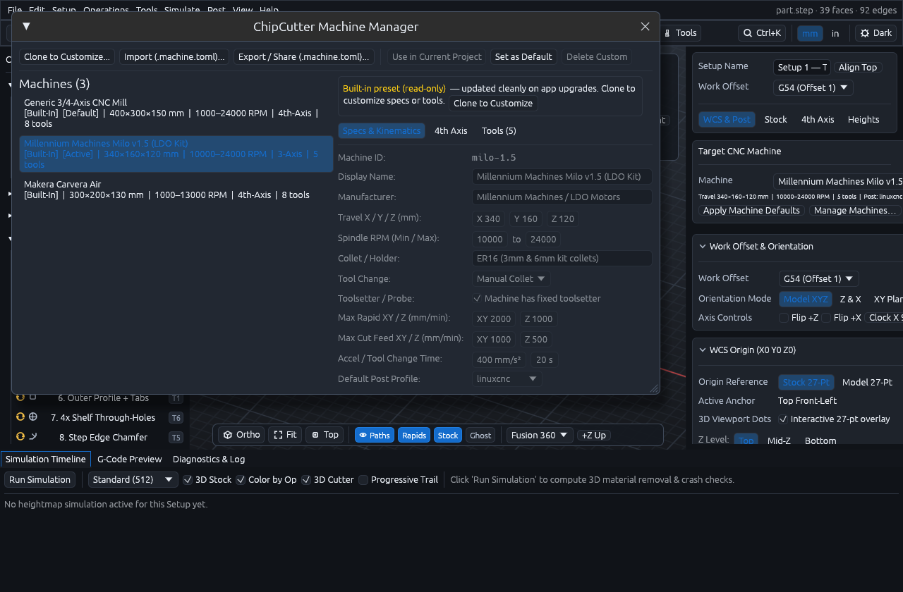
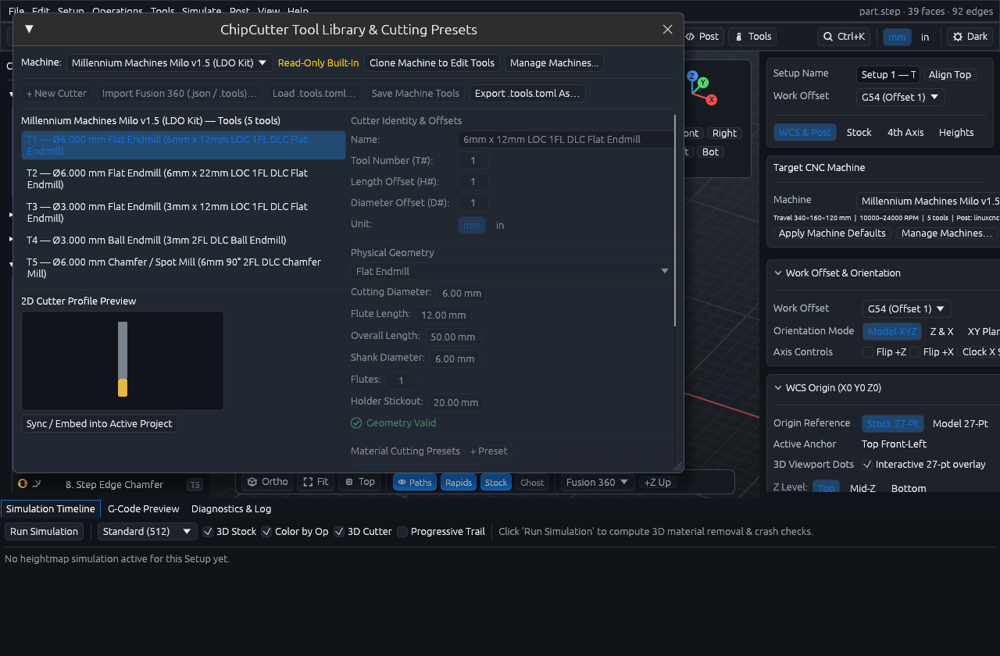
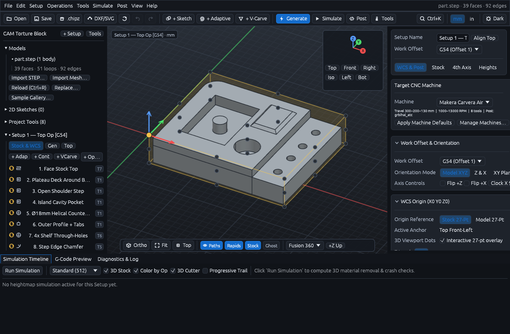

# Tutorial 15: Machine Definitions, Per-Machine Tool Sets, & Sharing

## 1. Goal & What You'll Learn

Real workshops rarely own just one "generic" CNC. A **Millennium Machines Milo v1.5** uses a 1.5 kW ER16 spindle (`10,000–24,000 RPM`) with 3 mm and 6 mm metric collets and an LDO DLC-coated aluminum endmill kit, whereas a **Makera Carvera Air** uses a compact `1/8"` (`3.175 mm`) lever quick-change spindle (`1,000–13,000 RPM`) with an optional harmonic-drive 4th-axis rotary module and a completely different starter bit set.

In this tutorial you will learn how to:

- Select a target CNC machine for your project (`Generic 3/4-Axis CNC Mill`, **Millennium Machines Milo v1.5 (LDO Kit)**, or **Makera Carvera Air**) and apply its default post-processor, 4th-axis rotary defaults, and simulation kinematics.
- Browse **machine-scoped Tool Libraries** so every machine displays only the cutters that fit its collets and spindle.
- Understand why **built-in machine definitions are strictly read-only** (so application upgrades keep them up to date) and **clone any built-in machine** into your upgrade-safe user configuration directory (`~/.config/chipcutter/machines/*.machine.toml`).
- **Export / Share** a single self-contained `.machine.toml` file (containing all machine specs + its entire tool library) and **Import** profiles shared by other machinists.
- Catch stock-envelope, spindle RPM, feedrate, and 4th-axis limit warnings automatically in both **Diagnostics** and the **`chipcutter`** CLI.

---

## 2. Built-In Machine Profiles

ChipCutter ships with three embedded, read-only machine definitions (also mirrored as reference TOML snapshots in [`machines/`](../../machines/)):

| Machine ID | Display Name | Travel X × Y × Z | Spindle | Tool Change | 4th Axis | Default Post | Starter Tools |
|---|---|---|---|---|---|---|---|
| `generic` | **Generic 3/4-Axis CNC Mill** | `400 × 300 × 150 mm` | `1,000–24,000 RPM` (1.5 kW, ER16/ER20) | Manual Collet | Optional `A` (`Ø100 × 250 mm`) | `grbl` | 8 general-purpose cutters |
| `milo-1.5` | **Millennium Machines Milo v1.5 (LDO Kit)** | `340 × 160 × 120 mm` | `10,000–24,000 RPM` (1.5 kW, ER16 `3 mm` & `6 mm`) | Manual Collet + Fixed Toolsetter | 3-Axis only | `linuxcnc` | 5 LDO DLC-coated endmills (`Ø6×12`, `Ø6×22`, `Ø3×12` 1FL flats, `Ø3` 2FL ball, `Ø6 90°` chamfer) |
| `carvera-air` | **Makera Carvera Air** | `300 × 200 × 130 mm` | `1,000–13,000 RPM` (200 W, `1/8"` / `3.175 mm`) | Lever Quick-Change + Auto Probe | Harmonic `A` (`Ø92 × 200 mm`) | `grblhal_atc` (`grblhal_4axis` for rotary) | 8 Makera `1/8"` starter bits (`Ø3.175×12/25` O-flutes, `Ø2`/`Ø1` flats, `Ø3.175` ball, `30°`/`60°` V-bits, `90°` chamfer) |

> [!TIP]
> **Why Built-Ins Are Read-Only:** Upgrading ChipCutter replaces built-in profiles cleanly with improvements or new starter presets without ever clobbering your shop's calibrated settings. Any **cloned** or **imported** custom machine is saved in your OS user configuration folder (`~/.config/chipcutter/machines/` on Linux, `~/Library/Application Support/chipcutter/machines/` on macOS, `%APPDATA%\chipcutter\machines\` on Windows) and is completely safe across upgrades.

---

## 3. Step-by-Step GUI Walkthrough

### Step 1 — Open the Machine Manager (`Tools → Machine Manager…`)

1. Launch ChipCutter (`chip-gui`) and open any project (or press **`Ctrl+K`** and run **Open Machine Manager**).
2. Alternatively, choose **`Tools → Machine Manager…`** from the top menu bar, or click **`Manage Machines…`** inside any Setup's **Target CNC Machine** card.



3. Click **`Millennium Machines Milo v1.5 (LDO Kit)`** in the left pane to inspect its **Specs & Kinematics**, **4th Axis**, and **Tools (5)** tabs.
4. Notice the amber **`Built-in preset (read-only)`** banner at the top of the right pane:
   - Click **`Use in Current Project`** to bind the active project to this machine (updating its `machine_id`, default post-processor, simulation kinematics, and scoped tool library).
   - Click **`Set as Default`** to remember this machine in `prefs.toml` so every new project starts preconfigured for your shop's primary CNC.

### Step 2 — Clone a Built-In Machine to Customize & Add Your Own Cutters

1. With **`Millennium Machines Milo v1.5 (LDO Kit)`** (or **`Makera Carvera Air`**) selected, click **`Clone to Customize…`** in the toolbar (or inside the read-only banner).
2. Enter a custom ID (e.g. `milo-1.5-shop`) and display name (e.g. `Shop Milo v1.5 (ER16 + 2.2kW)`), then click **`Create Editable Clone`**.
3. ChipCutter writes a brand-new, upgrade-safe `~/.config/chipcutter/machines/milo-1.5-shop.machine.toml` containing a full copy of the machine specs **and** all 5 LDO starter tools.
4. You can now edit XYZ travel, spindle RPM limits, max rapid/cutting feeds, acceleration, toolsetter flag, 4th-axis limits, and default post-processor—changes persist automatically when you click **`Save Changes`**.

### Step 3 — Inspect & Manage Per-Machine Tool Sets

1. Open the **Tool Library** from the toolbar (**`Tools`** button) or click **`Open in Tool Library →`** inside the Machine Manager's **`Tools`** tab.



2. Use the **`Machine:`** dropdown at the top of the Tool Library to switch between any installed machine's cutter set:
   - On a **built-in** machine (`Read-Only Built-In`), you can browse every cutter's geometry, cutting presets, and 2D profile preview, and click **`Sync / Embed into Active Project`** to copy a cutter into your project—or click **`Clone Machine to Edit Tools`** to fork an editable custom copy in one click.
   - On a **custom** machine, **`+ New Cutter`**, **Fusion 360 `.json` / `.tools` import**, **`.tools.toml` load**, and **`Save Machine Tools`** are all enabled and persist directly inside your custom `.machine.toml` file.
   - Inside Machine Manager's **`Tools`** tab, you can also **`Copy Tool From Machine`** to pull a single cutter (for example a `30°` V-bit from `carvera-air`) into your custom machine.

### Step 4 — Switch Target Machine per Project in the Setup Inspector

1. Select **`Setup 1`** in the CAM Browser and open the **`WCS & Post`** tab on the right-hand Inspector.



2. In the **`Target CNC Machine`** card:
   - Pick any built-in or custom machine from the **`Machine`** dropdown (for example **`Makera Carvera Air`**).
   - Click **`Apply Machine Defaults`** to align Setup post-processors (and rotary defaults when 4th-axis is active) with the chosen machine.
   - Every operation's **`Tool`** picker now offers that machine's dedicated tool library alongside the project's embedded tools, and **3D Simulation** automatically adopts the machine's rapid feeds, acceleration, and tool-change time for realistic cycle-time estimation.

### Step 5 — Export, Share, & Import `.machine.toml` Files

Because each `.machine.toml` file embeds **both** machine parameters and its complete `[[tools]]` array with per-material presets, sharing a complete shop setup is a single-file transfer:

- **Export / Share:** Open **Machine Manager**, select any built-in or custom machine, and click **`Export / Share (.machine.toml)…`**. Send that file to a friend, makerspace member, or another workstation.
- **Import:** On the receiving workstation, click **`Import (.machine.toml)…`** in **Machine Manager**. ChipCutter validates the schema and every tool, automatically picks a non-colliding custom ID if needed, marks it editable (`is_builtin = false`), and saves it into the recipient's upgrade-safe user configuration directory.
- **Portable `.chipz` Bundles:** Whenever you export a project using a custom machine (`File → Export Portable Bundle (.chipz)…`), ChipCutter automatically packs `machines/<machine_id>.machine.toml` inside the archive so collaborators can open and build the exact same job offline.

---

## 4. Machine Limit Diagnostics

ChipCutter checks your active project against the target machine's physical envelope and limits (shown as non-blocking **`[Machine Limit]`** warnings in the **Diagnostics & Log** pane and via `chipcutter validate`):

| Check | Trigger Condition |
|---|---|
| **XYZ Travel Envelope** | Setup stock `X`, `Y`, or `Z` exceeds `travel_mm.{x_mm, y_mm, z_mm}` |
| **4th-Axis Availability** | Setup enables 4th-axis rotary on a 3-axis-only machine (e.g. `milo-1.5`) |
| **Rotary Capacity** | Cylindrical stock diameter or length exceeds `rotary.{max_stock_diameter_mm, max_stock_length_mm}` |
| **Spindle RPM Window** | Operation RPM falls below `spindle.min_rpm` or above `spindle.max_rpm` (e.g. `18,000 RPM` on a `13,000 RPM` Carvera Air) |
| **Feedrate Ceilings** | Cutting feed exceeds `kinematics.max_cut_feed_xy_mm_min` or plunge feed exceeds `kinematics.max_cut_feed_z_mm_min` |

---

## 5. Headless CLI Equivalent (`chipcutter machines`)

Every Machine Manager workflow is available headlessly from the terminal:

```bash
# 1. List all built-in and user custom machines (with travel, spindle, rotary, and tool count):
chipcutter machines list

# 2. Inspect full specifications and the complete starter tool table for Milo v1.5 or Carvera Air:
chipcutter machines inspect milo-1.5
chipcutter machines inspect carvera-air

# 3. Clone a built-in machine into upgrade-safe user config space (~/.config/chipcutter/machines/):
chipcutter machines clone milo-1.5 my-milo --name "My Shop Milo v1.5"

# 4. Export a self-contained .machine.toml (machine + all tools) to share with others:
chipcutter machines export my-milo -o my-milo.machine.toml

# 5. Import a shared .machine.toml on another workstation (auto-resolves ID collisions):
chipcutter machines import my-milo.machine.toml

# 6. Seed a new sample project targeted at a specific machine, or validate any project against a machine override:
chipcutter generate-sample-step /tmp/part.step --cam-torture --project-out /tmp/job.chip.toml --machine carvera-air
chipcutter validate /tmp/job.chip.toml --machine milo-1.5
```

---

## Navigation

- **Previous:** [Tutorial 14 — Associative STEP Revision Reload (`Ctrl+R`) & Re-Pick Recovery](14-associative-step-reload.md)
- **Index:** [All Tutorials](README.md) — you have completed the entire ChipCutter `00`–`15` curriculum!
