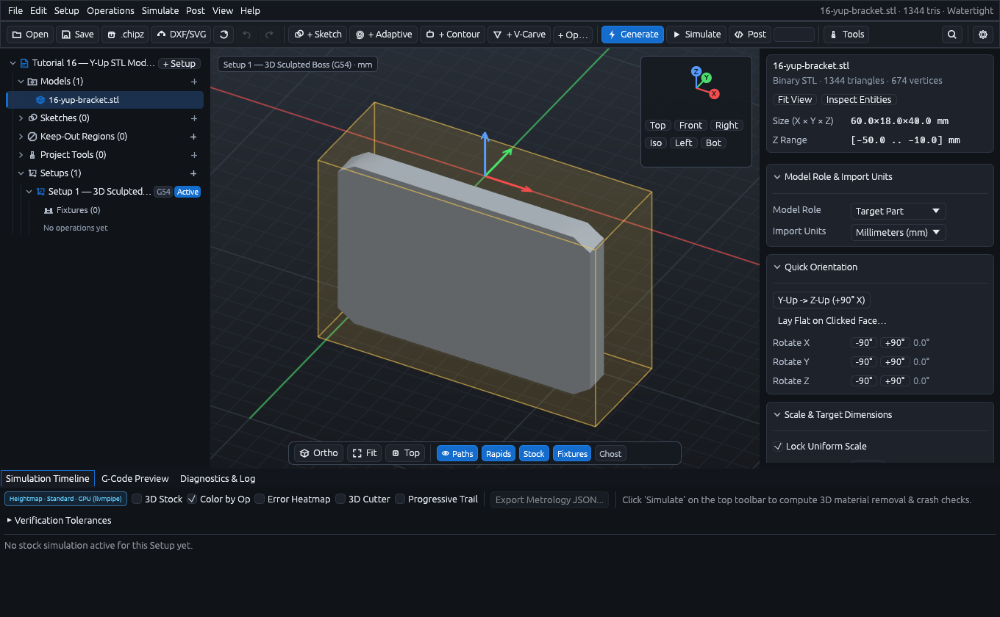
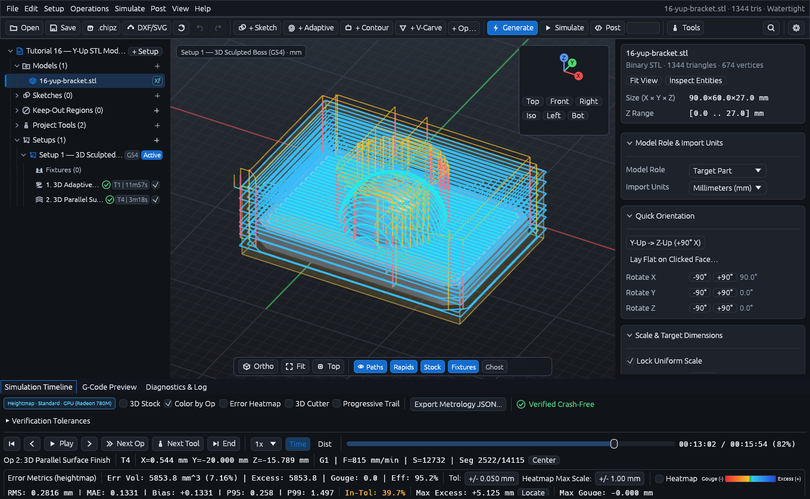
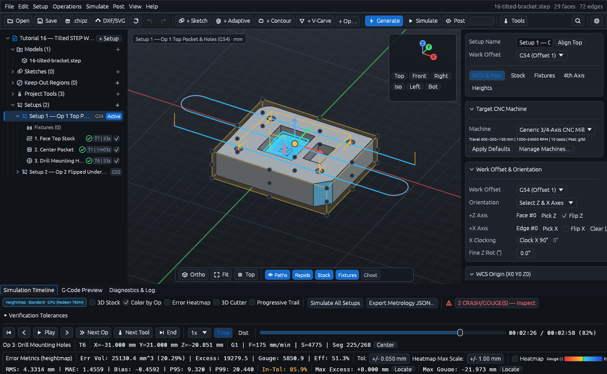
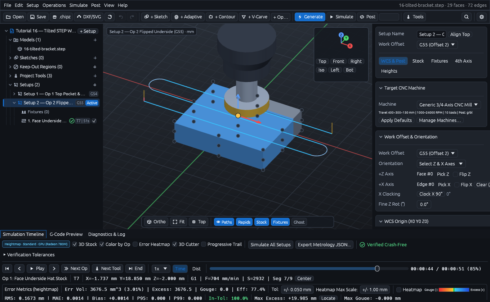

# Tutorial 16: Rotating, Laying Flat, Scaling, & Moving STEP & STL Models

## 1. Goal & What You'll Learn

Real-world 3D CAD and mesh files rarely arrive oriented the way they sit on your CNC table. An **STL** exported from Blender or a 3D-printing slicer often arrives **Y-up** (lying sideways), offset far from the origin, or scaled to the wrong billet size. A **STEP** sub-assembly exported from mechanical CAD may sit at an arbitrary `30°` assembly angle or require machining on both its top (**Op 1 — `G54`**) and flipped underside (**Op 2 — `G55`**).

ChipCutter provides **two complementary, non-destructive workflows**—neither one ever modifies your source `.step`, `.stl`, `.obj`, or `.3mf` file on disk:

| Goal / Scenario | Recommended Tool | Why? |
|---|---|---|
| Fix a **Y-up STL/OBJ/3MF** exported sideways from Blender, Fusion, or a slicer | **Model Transform Inspector** or **Mesh Import Modal** | Permanently converts raw mesh coordinates to CNC `+Z` up across all Setups before toolpathing. |
| **Lay a part flat** on a clicked planar STEP face or STL triangle and drop it to `Z = 0` | **Model Transform** → `Lay Flat on Clicked Face…` | Orients the model flat onto the table in 1 click without changing the source file on disk. |
| **Scale** a mesh or STEP model (`0.5×`, `2×`, `×25.4`, `/25.4`, or exact **`Target Size X/Y/Z`**) | **Model Transform** (`Scale & Target Dimensions`) | Fits decorative reliefs, brackets, or unit-mismatched exports cleanly to your exact stock billet while keeping exact `f64` B-Rep/mesh accuracy. |
| Center an off-origin CAD export at `X=0, Y=0` and `Z=0` (surviving `Ctrl+R` reload) | **Model Transform** (`Center XY`, `Drop Bottom to Z = 0`) | Persists in `.chip.toml` / `.chipz` and is automatically re-applied whenever you press `Ctrl+R` to reload a revised STEP file. |
| Machine a **tilted STEP solid** without altering global coordinates | **Setup → WCS & Post** (`Z & X` or `XY Plane`) | Aligns the spindle `+Z`, table `+X`, and 27-point stock/model origin directly to B-Rep faces and edges. |
| Flip a part upside down for **Op 2 (`G55`)** or clock it in an angled vise | **Setup → WCS & Post** (`Flip +Z`, `Clock X 90°`, `Fine Z Rot (°)`) | Lets Setup 1 (`G54`) and Setup 2 (`G55`) share a single untouched CAD file with independent datums and stock. |

In this tutorial you will learn how to:

1. Orient, lay flat, **uniformly scale to a target stock width**, center in XY, and drop a **Y-up STL mesh** (`16-yup-bracket.stl`) to `Z = 0` using the **Mesh Import Modal** and the **Model Transform Inspector**.
2. Apply non-destructive rotation, scaling, and translation to a **STEP B-Rep solid** while keeping exact analytic hole/face picking and **`Ctrl+R` Associative STEP Reload** intact.
3. Align a tilted `30° X / 25° Z` **STEP bracket** (`16-tilted-bracket.step`) using **Setup WCS (`Z & X` / `XY Plane`, `Flip +Z`, `Clock X 90°`, `Fine Z Rot (°)`, & 27-point Origin)** and add a flipped **Setup 2 (`G55`)** for bottom-side facing.
4. Generate (`Ctrl+G`), verify `0 Crashes` in 3D Simulation, post-process, and automate model transforms headlessly with **`chipcutter transform-model`**.

---

## 2. Prerequisites & Starter Assets

This tutorial uses two minimal, reproducible starter assets included in [`docs/tutorials/assets/`](assets/):

- **Part A (Y-Up STL Mesh):** [`assets/16-yup-bracket.stl`](assets/16-yup-bracket.stl) — a watertight `60 × 40 × 18 mm` sculpted mounting boss exported **Y-up** (lying sideways as `60 × 18 × 40 mm`) and shifted off-origin (`Z ∈ [-50 .. -10] mm`).
- **Part B & C (Tilted STEP Solid):** [`assets/16-tilted-bracket.step`](assets/16-tilted-bracket.step) — a prismatic `90 × 70 × 20 mm` mounting bracket tilted `30° X / 25° Z` with a center pocket and `Ø6 mm` mounting holes.

Launch ChipCutter directly with either asset, or regenerate them anytime via the CLI:

```bash
# Launch Part A (Y-up STL) in the desktop GUI:
chip-gui docs/tutorials/assets/16-yup-bracket.stl

# Launch Part B/C (Tilted STEP) in the desktop GUI:
chip-gui docs/tutorials/assets/16-tilted-bracket.step
```

---

## 3. Step-by-Step GUI Walkthrough

### Part A — Fixing, Laying Flat, & Scaling a Y-Up STL Mesh

#### Step 1 — Preview Orientation & Scale in the Mesh Import Modal

1. In an empty ChipCutter workspace, open the **`+`** or right-click menu on **`Models`** in the left **CAM Browser** and click **`Import Mesh (.stl / .obj / .3mf)…`** (or open `16-yup-bracket.stl` directly).
2. In the **Import 3D Mesh (STL / OBJ / 3MF)** modal:
   - Confirm **Source Coordinate Units** is set to **`Millimeters (mm)`** (STL files do not store physical units, so always check the size readout to avoid a `25.4×` error).
   - Notice the **Initial Orientation, Scale, & Placement** card right inside the modal: you can click **`Y-Up -> Z-Up (+90° X)`**, adjust **`Scale`**, and check **`Center XY`** + **`Drop Bottom to Z = 0`** to see the upright physical bounding box live *before* clicking **Import 3D Mesh**.
3. To see the full **Model Transform Inspector** workflow, leave **As-Is** selected first and click **`Import 3D Mesh`**.
4. In the CAM Browser, click **`16-yup-bracket.stl`** under **`Models`** (or right-click → **`Inspect / Transform`**) to open the **Model Transform, Orientation, & Scaling** Inspector on the right:



Notice two problems immediately visible in the top card:
- **`Size (X × Y × Z)`** reads `60.0×18.0×40.0 mm` (the sculpted dome is facing `+Y` instead of `+Z`).
- **`Z Range`** reads `[-50.0 .. -10.0] mm` (floating off-origin below `Z = 0`).

#### Step 2 — Orient Upright, Scale to Fit Stock (`1.5×`), & Drop to `Z = 0`

1. Under **Quick Orientation**, click **`Y-Up -> Z-Up (+90° X)`**.
   - The mesh rotates cleanly upright so the dome faces `+Z` (`60.0×40.0×18.0 mm`).
   - *(Tip: If an STL is tilted at an arbitrary unknown angle instead of a clean 90° Y-up export, click **`Lay Flat on Clicked Face…`** and click any flat bottom triangle or planar STEP face in the 3D viewport—ChipCutter rotates that surface normal straight to `-Z` and drops the bottom onto `Z = 0` automatically!)*
2. Under **Scale & Target Dimensions**, suppose your aluminum stock blank is `96 × 66 × 32 mm` and you want the finished boss scaled up to **`90.0 mm` wide**:
   - Keep **`Lock Uniform Scale`** checked so X, Y, and Z scale proportionally.
   - Click inside **`Target Size X`** and enter **`90.0 mm`** (or set **`Uniform Scale`** to **`1.50×`**).
   - The live bounding box immediately updates to **`90.0×60.0×27.0 mm`** (`150.0%`).
   - *(Need a quick unit rescue on a mis-exported file? Use the **`×25.4`** or **`/25.4`** preset buttons.)*
3. Under **Quick Placement**, click **`Center XY on Origin`** and **`Drop Bottom to Z = 0`**.
   - **`Z Range`** now reads **`[0.0 .. 27.0] mm`** and the model is centered symmetrically around `X = 0, Y = 0`.
4. Confirm **Setup 1** is the **Active Setup** (`Active` badge in the left **CAM Browser**), add a **`3D Adaptive Roughing`** operation (`+ Op… → 3D Adaptive Roughing` in the **top toolbar**, `Ø6 mm` Flat Endmill) and a **`3D Parallel Finishing`** operation (`+ Op… → 3D Parallel Finishing`, `Ø6 mm` Ball Endmill), then press **`Ctrl+G`** to generate and verify:



Notice the **`Xf`** badge pill on `16-yup-bracket.stl` in the CAM Browser, indicating an active non-destructive `ModelTransform`, and **`Verified Crash-Free`** in the Simulation bar. Press **`Ctrl+Z`** / **`Ctrl+Y`** at any time—model transforms participate in full 100-step Undo/Redo!

---

### Part B — Rotating, Scaling, & Moving a STEP Solid Non-Destructively

Every control in the **Model Transform Inspector** works identically on **STEP B-Rep solids**:

1. Click the STEP model row under **`Models`** (or right-click → **`Inspect / Transform`**).
2. Rotate (`Y-Up -> Z-Up`, `±90° X/Y/Z`, **`Lay Flat on Clicked Face…`**, or exact **`Rotate X/Y/Z (°)`**), **uniformly scale** (`Scale` or `Target Size X/Y/Z`), and translate (`Center XY`, `Drop Bottom to Z = 0`, `Align Top to Z = 0`, or exact **`Move X/Y/Z`**).
3. Under **uniform scaling** (with **`Lock Uniform Scale`** checked), ChipCutter transforms all analytic planes, cylinders, cones, circles, and B-Rep loops in exact `f64` math—so drilling `Ø6 mm` holes (or `Ø9 mm` holes after a `1.5×` uniform scale) still picks true cylindrical B-Rep faces and emits `G2`/`G3` arcs!
4. **Associative Reload (`Ctrl+R`) Preservation:** Because `ModelTransform` is persisted on the `[[models]]` entry in `.chip.toml` (and inside `.chipz` bundles), reloading an edited STEP file from your CAD package (`Ctrl+R`) automatically re-applies your saved orientation, scale, and position before re-matching operations.

> [!NOTE]
> **Non-Uniform Scaling on STEP Solids:** If you uncheck **`Lock Uniform Scale`** on a STEP B-Rep solid to stretch only X or Z, circular cylinders and arcs become elliptical/NURBS surfaces (ChipCutter displays an inline warning banner). Keep **`Lock Uniform Scale`** checked whenever you plan to use 2.5D Drilling or Circular Arc Bore strategies on a STEP part.

---

### Part C — Aligning a Tilted STEP Part via Setup WCS & Multi-Setup Op-2 Flip

When a STEP part is tilted in CAD space—or when you need to flip a part upside down for a second machining operation—use **Setup → WCS & Post** rather than mutating the model between operations.

#### Step 1 — Align Setup 1 (`G54`) to the Tilted Bracket

1. Open [`docs/tutorials/assets/16-tilted-bracket.step`](assets/16-tilted-bracket.step). The `90 × 70 × 20 mm` bracket is tilted `30°` around X and `25°` around Z.
2. In the CAM Browser, select **`Setup 1`** under **`Setups`** and open the **`WCS & Post`** tab.
3. Under **Work Offset & Orientation**:
   - Set **Work Offset** to **`G54 (Offset 1)`**.
   - Switch **Orientation Mode** from `Model XYZ` to **`Z & X`** (or **`XY Plane`**).
   - Click **`Pick Z`** and click the large flat underside face of the bracket (`Face #0`), then check **`Flip Z`** so the blue **`+Z`** spindle arrow points straight up out of the pocketed top face.
   - Click **`Pick X`** and click the long front edge (`Edge #0`) so the red **`+X`** arrow runs cleanly along the vise jaw.
   - *(Need to rotate the part 90° or match an angled fixture plate? Click **`Clock X 90°`** for 90° steps or type any angle into **`Fine Z Rot (°)`**, such as `15°` or `45°`.)*
4. Under **WCS Origin (X0 Y0 Z0)**:
   - Choose **`Stock 27-Pt`** (or **`Model 27-Pt`**) and click the glowing golden **Top Center** anchor dot directly in the 3D viewport (or select `Top Center` in the Inspector).
   - *(Need a fixture shim or edge-finder offset? Use **`Additional Offset X / Y / Z`** right below the origin selector.)*
5. Click **`Align Top`** next to **Setup Name** to snap the 3D camera straight down Setup 1's `+Z` spindle axis.
6. Under **Stock**, set a **`Relative Box`** with `2 mm` side margin, `1.5 mm` top allowance, and `2.0 mm` bottom vise-holding stock ("hat" material to be faced off in Op 2).
7. With **Setup 1** active (`Active` badge in the CAM Browser), use **`+ Op…`** in the **top toolbar** (or the **`Operations`** menu) to add **1. Face Top Stock**, **2. Center Pocket**, and **3. Drill Mounting Holes**, then press **`Ctrl+G`**:



#### Step 2 — Add Setup 2 (`G55`) Flipped Upside Down for Op-2 Underside Facing

1. Click **`+ Setup`** on the Project root row (or **`+`** on **`Setups`**) in the CAM Browser. ChipCutter automatically assigns **`G55 (Offset 2)`**.
2. In Setup 2's **`WCS & Post`** tab, pick the exact same reference face (`Face #0`) and edge (`Edge #0`), but leave **`Flip Z` unchecked** so Setup 2's **`+Z`** spindle arrow points straight out of the *underside* of the bracket!
3. Set **WCS Origin** to **Stock Top Center** and **Stock** to **`Relative Box`** with `0 mm` side margin and **`2.0 mm` Top Offset** (representing the `2.0 mm` vise-holding hat left over from Setup 1).
4. With **Setup 2** now the **Active Setup** (or click **`Setup 2`** under **`Setups`** in the CAM Browser to activate it), add a **`Facing`** operation (`+ Op… → Facing` in the **top toolbar**, `Ø38 mm` Face Mill) to machine off the underside hat stock cleanly to final thickness.
5. Press **`Ctrl+G`** and click **`Simulate`** in the **top toolbar** to verify Setup 2:



Both **Setup 1 (`G54`)** and **Setup 2 (`G55`)** stay linked to the exact same untouched `16-tilted-bracket.step` file!

---

## 4. Key Parameters Reference

### Model Transform Inspector (`Models → <model>`)

| Control | Canonical Order / Behavior | Typical Use |
|---|---|---|
| **`Y-Up -> Z-Up (+90° X)`** | Applies `+90°` X rotation around model center/origin | Fixing Blender, Maya, or slicer STL/OBJ exports |
| **`Lay Flat on Clicked Face…`** | Raycasts any planar STEP face or STL triangle normal → `-Z` + drops bottom to `Z = 0` | Leveling arbitrarily rotated meshes or angled CAD exports in 1 click |
| **`±90° X / Y / Z`** | World-axis `90°` increments around model bounding center | Fast cardinal re-orientation |
| **`Lock Uniform Scale`** / **`Scale`** | Proportional `[s, s, s]` (or unlocked `[sx, sy, sz]`) applied *first* before rotation & translation | Resizing meshes/STEP solids (`0.5×`, `2×`, `×25.4`, `/25.4`) |
| **`Target Size X / Y / Z`** | Auto-computes exact uniform scale so chosen axis equals your desired finished dimension | Fitting a relief or plaque to a specific stock billet |
| **`Center XY` / `Drop Bottom to Z = 0` / `Align Top to Z = 0`** | Shifts `translate_mm` using live transformed bounds | Zeroing off-origin imports cleanly on the table or stock top |
| **`Rotate X / Y / Z (°)` & `Move X / Y / Z`** | Exact TRS (`p' = Rz·Ry·Rx·(S·p) + t`) stored in `.chip.toml` | Fine parametric adjustments |

### Setup WCS Alignment (`Setup → WCS & Post`)

| Control | Behavior | Typical Use |
|---|---|---|
| **`Model XYZ` / `Z & X` / `XY Plane`** | Defines Setup `+Z` spindle axis and `+X` table axis | Aligning tilted STEP assemblies or arbitrary planar faces |
| **`Flip +Z` / `Flip +X`** | Inverts spindle direction or table X direction `180°` | Flipping a part upside down for **Op 2 (`G55`)** |
| **`Clock X 90°` & `Fine Z Rot (°)`** | Rotates Setup `+X`/`+Y` around `+Z` in `90°` steps plus arbitrary degrees | Aligning long parts along the X table travel or an angled fixture plate |
| **`Stock 27-Pt` / `Model 27-Pt` / `CAD Feature`** | Sets `X0 Y0 Z0` on stock corners/centers, model bounds, or a hole/circle center | Matching your physical touch-probe or edge-finder datum |
| **`Additional Offset (X / Y / Z)`** | Extra shift in WCS coordinates (`mm` / `in` / expressions) | Fixture offsets or spoilboard Z shims |

---

## 5. Generate (`Ctrl+G`) & 3D Simulation Verification

1. Press **`Ctrl+G`** to generate all dirty operations in parallel across the active Setup (or hover any Setup row in the CAM Browser and click its **Generate** icon, or right-click → **`Generate Setup`**).
2. Click **`Simulate`** in the **top toolbar** (or **`Simulate → Run / Refresh Simulation`** in the **top menu bar**)—the compact toolbar progress bar tracks execution and lets you cancel anytime with **`Esc`** (or **`Cancel`**), and **`Diagnostics & Log`** records the wall-clock runtime.
3. In the bottom **`Simulation Timeline`** tab, confirm the green **`Verified Crash-Free`** badge (checking rapid-into-stock crashes, target B-Rep/mesh gouges `> 0.02 mm`, flute/shank rubs, holder collisions, and non-center-cutting plunges).
4. Toggle **`3D Stock`** and **`3D Cutter`** and scrub the timeline to verify both Setup 1 (`G54`) and Setup 2 (`G55`) clear cleanly.

---

## 6. Post-Processing (`GRBL` & `LinuxCNC`)

1. Switch to the bottom **`G-Code Preview`** tab (or click **`Post`** in the top toolbar).
2. Confirm Setup 1 emits **`G54`** and Setup 2 emits **`G55`** in the header, and that all coordinates sit squarely in the aligned Setup WCS frame (never in the raw tilted or Y-up source coordinates).
3. Export separate G-code programs per Setup (`grbl` splits multi-tool setups automatically; `linuxcnc` and `grblhal_atc` emit single-file `M6` programs).

---

## 7. Headless CLI Equivalent (`chipcutter`)

Every orientation, scaling, placement, and validation step is scriptable headlessly via **`chipcutter import-mesh`** and **`chipcutter transform-model`**:

```bash
# 1. Regenerate both Tutorial 16 starter assets:
chipcutter generate-sample-step /tmp/16-yup-bracket.stl --tutorial 16-orient-stl
chipcutter generate-sample-step /tmp/16-tilted-bracket.step --tutorial 16-orient-step

# 2. Import the Y-up STL directly upright, scaled 1.5x, centered in XY, and resting at Z = 0:
chipcutter import-mesh /tmp/16-yup-bracket.stl \
  -o /tmp/boss_job.chip.toml \
  --mesh-units mm \
  --y-up-to-z-up \
  --scale 1.5 \
  --center-xy \
  --drop-z0

# 3. Or resize any existing STEP or STL project to an exact finished X width (e.g., 120 mm):
chipcutter transform-model /tmp/boss_job.chip.toml \
  --fit-size-x 120 \
  --center-xy \
  --drop-z0

# 4. Reset a model transform back to raw source coordinates (omitting [models.transform] from TOML):
chipcutter transform-model /tmp/boss_job.chip.toml --reset

# 5. Validate, simulate, and build G-code for the seeded 2-Setup tilted STEP project:
chipcutter generate-sample-step /tmp/16-tilted-bracket.step \
  --tutorial 16-orient-step \
  --project-out /tmp/tilted_2setup.chip.toml
chipcutter validate /tmp/tilted_2setup.chip.toml
chipcutter simulate /tmp/tilted_2setup.chip.toml --setup setup_1
chipcutter simulate /tmp/tilted_2setup.chip.toml --setup setup_2
chipcutter build /tmp/tilted_2setup.chip.toml -o /tmp/tilted_gcode --post linuxcnc
```

---

## Navigation

- **Previous:** [Tutorial 15 — Machine Definitions, Per-Machine Tool Sets, & Sharing](15-machine-definitions-tool-sets.md)
- **Next:** [Tutorial 17 — Tri-Dexel Volumetric Simulation & Quantitative Error-Volume Analysis](17-tridexel-simulation-error-metrics.md)
- **Index:** [All Tutorials](README.md)
