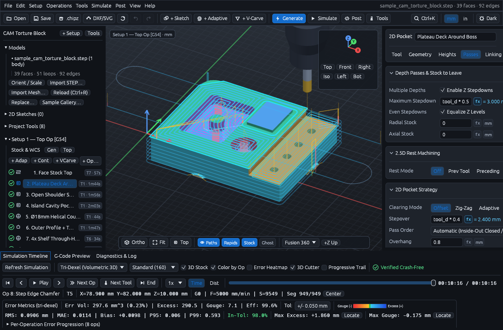
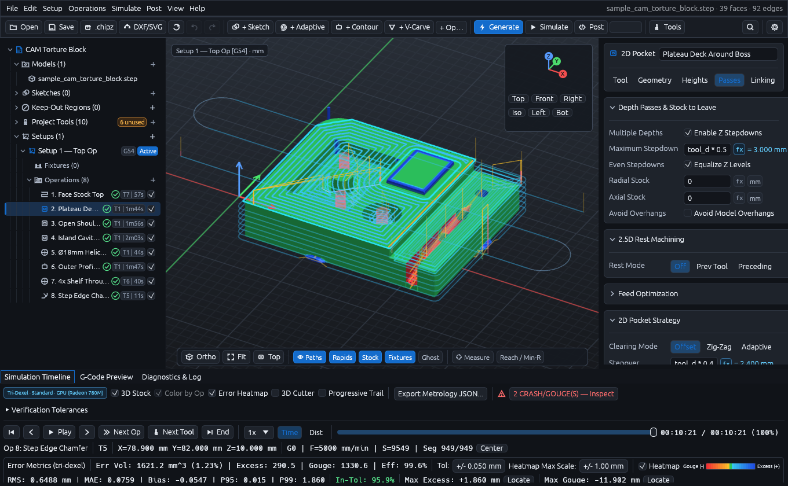
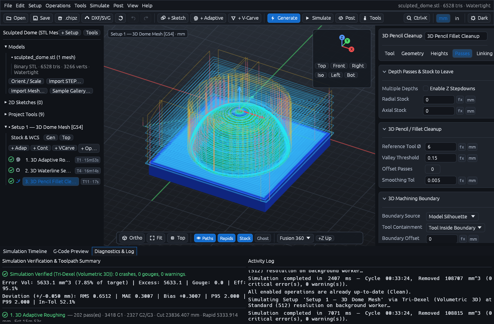

# Tutorial 17: Tri-Dexel Volumetric Simulation & Quantitative Error-Volume Analysis

## 1. Goal & What You'll Learn

Fast 2.5D heightmap simulation is great for rapid interactive iteration, but it only tracks a single top `Z(x, y)` height per column—which can stair-step steep vertical walls and cannot represent multi-interval overhangs or true 3D undercuts.

ChipCutter now offers **two selectable physical stock simulation engines** side-by-side—while keeping the fast **Heightmap** engine as the default option—plus a unified **Quantitative Stock-vs-Target Error Metrics** suite (**Error Volume**, **RMS**, **MAE**, **Signed Bias**, **P95/P99**, **In-Tolerance Surface %**, and **Per-Operation Error Progression**) designed both for machinists tuning real jobs and for benchmarking toolpath algorithm quality over time:

| Engine | Internal Representation | Best Used For | Speed |
|---|---|---|---|
| **`Heightmap (Fast)`** | Single-layer `Z(x, y)` heightfield (or polar `R(u, θ)` on 4th-axis rotary setups) | Instant interactive scrubbing, quick 2.5D crash checks, low-overhead iteration | Fastest |
| **`Tri-Dexel (Volumetric 3D)`** | 3 orthogonal sorted interval grids (`X`-rays, `Y`-rays, `Z`-rays) + sharp Dual-Vertex Surface Nets mesher | Crisp vertical walls with zero stair-stepping, 3D sculpted reliefs, undercuts, and accurate 3D volumetric error/RMS metrology | High-precision 3D |

> [!TIP]
> **Want GPU-accelerated simulation & live `< 0.1 ms` Error Heatmap tuning?** See [**Tutorial 20 — GPU-Accelerated Simulation, Benchmarking, & Feedrate Optimization**](20-gpu-simulation-feed-optimization.md) to configure **`Compute Backend`** (`Auto (GPU with CPU fallback)` / `GPU (Compute)` / `CPU (Exact)`) in **`Edit → Settings… → Simulation`**, benchmark `--backend gpu --benchmark --json` throughput against CPU, and optimize corner/arc cutting feedrates.

In this tutorial you will learn how to:

1. Switch between **`Heightmap (Fast)`** and **`Tri-Dexel (Volumetric 3D)`**, select **`Detail Level`** (`Standard` / `Fine` / `Ultra`), and toggle **`Smooth Skinned Surfaces (Mesh Skinning)`** in **`Edit → Settings… → Simulation`** (`Ctrl+,`, the top toolbar gear icon, **`Simulate → Simulation Settings…`**, or by clicking the compact Simulation status chip on the **`Simulation Timeline`** top bar), with all preferences persisted automatically in `prefs.toml`.
2. Run simulation via **`Simulate`** in the **top toolbar** (with live progress bar, `Esc` cancel, and wall-clock execution time logged in **`Diagnostics & Log`**), toggle the live **`Error Heatmap`** (`Red = Gouge`, `Green = Within ±Tol`, `Blue = Uncut Excess`), and adjust the tolerance band (`+/- 0.050 mm`) to visually pinpoint residual scallops, unmachined bevels, or overcuts on both prismatic STEP solids and 3D STL meshes.
3. Interpret the **Error Metrics** dashboard (**Total / Excess / Gouge Volume**, **Removal Efficiency %**, **RMS**, **MAE**, **Bias**, **P95/P99**, **In-Tolerance %**), click **`Locate`** to snap the camera directly onto the worst excess or gouge spot, and expand **Per-Operation Error Progression**.
4. Export machine-readable `StockErrorReport` JSON via **`chipcutter simulate --engine tri-dexel --tolerance 0.05 --report`** to compare roughing/finishing strategies or benchmark toolpath improvements headlessly.

---

## 2. Prerequisites & Starter Projects

This tutorial uses two built-in sample projects shipped directly inside ChipCutter (zero external downloads needed):

- **Part A (Prismatic Multi-Feature STEP):** **`CAM Torture Block`** (`--sample cam-torture`) — an 8-operation 2.5D job featuring facing, plateau pocket around a `45°` beveled boss, open shoulder step, island cavity pocket, `Ø18 mm` helical counterbore, outer profile with holding tabs, 4× shelf through-holes, and step edge chamfering.
- **Part B (3D Sculpted Mesh):** **`Sculpted Dome (STL Mesh)`** (`--sample mesh-dome`) — a 3-operation 3-axis surfacing job (`Adaptive3D` roughing → `Waterline3D` semi-finish/finish → `Pencil3D` fillet cleanup) over a watertight `80 × 80 × 25 mm` sculpted dome.

Launch either project directly from the terminal or pick it from **`File → Sample Projects Gallery…`**:

```bash
# Part A: Prismatic 8-operation STEP torture block
chip-gui --sample cam-torture

# Part B: 3-axis sculpted STL dome
chip-gui --sample mesh-dome
```

---

## 3. Step-by-Step GUI Walkthrough

### Part A — Running Tri-Dexel Volumetric Simulation on a Multi-Feature STEP Solid

#### Step 1 — Generate Toolpaths & Select `Tri-Dexel (Volumetric 3D)` in Settings

1. Open **`CAM Torture Block`** (`--sample cam-torture`) and press **`Ctrl+G`** (or click **`Generate`** in the **top toolbar**) to generate all 8 operations.
2. Open **`Settings → Simulation`** via any of four shortcuts:
   - Click the compact **Simulation status chip** on the left of the bottom **`Simulation Timeline`** bar (for example **`Heightmap · Standard · GPU (Radeon 780M)`** or **`Heightmap · Standard · CPU`**).
   - Press **`Ctrl+,`** (or click the **gear icon** at the far right of the **top toolbar**, or **`Edit → Settings… (Ctrl+,)`**) and choose **`Simulation`** in the left sidebar.
   - Or choose **`Simulate → Simulation Settings…`** from the **top menu bar**.
3. Under **`Simulation Engine & Detail Level`**:
   - Set **`Simulation Engine`** to **`Tri-Dexel (Volumetric 3D)`**.
   - Choose **`Detail Level`** (`Standard (160)`, `Fine (288)`, or `Ultra (448)`) and **`Compute Backend`** (`Auto (GPU with CPU fallback)`, `GPU (Compute)`, or `CPU (Exact)`).
   - Optionally check **`Surface Display` → `Smooth Skinned Surfaces (Mesh Skinning)`** to apply crease-preserving mesh skinning that visually relaxes smooth curved and helical surfaces while keeping crisp 90° edges sharp *(strictly visual—never alters volumetric gouge checks or quantitative error metrology)*.
   - ChipCutter persists your settings in `~/.config/chipcutter/prefs.toml` and automatically re-runs simulation in the background (or click **`Simulate`** in the **top toolbar** anytime—a live progress bar appears beside **`Simulate`**, press **`Esc`** or click **`Cancel`** to abort, and **`Diagnostics & Log`** logs the exact wall-clock execution time on completion).
4. Confirm the green **`Verified Crash-Free`** badge on **`Simulation Timeline`**, click **`End`** (or scrub the timeline slider) to inspect the finished volumetric stock with crisp vertical walls, circular counterbore, island pocket, and holding tabs:



4. Read the **Error Metrics (`tri-dexel`)** card at the bottom of the **Simulation Timeline** pane:
   - **`Err Vol: 297.6 mm^3 (0.23%)`** — total symmetric-difference volume between the machined stock and the exact target STEP solid (`Excess: 290.5 mm^3` + `Gouge: 7.1 mm^3`, **`Eff: 99.6%`** material removal efficiency).
   - **`RMS: 0.0906 mm | MAE: 0.0114 | Bias: +0.0098 | P95: 0.006 | P99: 0.593`** — 95% of the machined part surface sits within `0.006 mm` of nominal CAD geometry, and **`In-Tol: 98.0%`** lies inside `+/- 0.050 mm`.
   - Click **`Locate`** beside **`Max Excess: +1.860 mm`** to snap the 3D viewport camera straight onto the largest remaining uncut feature (the unmachined `45°` bevel walls around the raised boss!).

#### Step 2 — Enable the Signed Deviation `Error Heatmap`

1. In the **Simulation Timeline** toolbar, check **`Error Heatmap`** (and optionally uncheck **`3D Cutter`** for an unobstructed view).
2. The 3D stock immediately re-colors using the diverging color scale shown in the legend (`Gouge (-) [Red -> Yellow] | Within ±Tol [Green] | Excess (+) [Cyan -> Blue]`):
   - **Emerald Green:** Surfaces within your active **`Tol: +/- 0.050 mm`** band (the top plateau, open step shelf, island pocket, circular counterbore, and outer profile walls).
   - **Cyan → Deep Blue:** Uncut excess material (`+` deviation)—immediately calling attention to the `45°` beveled boss flanks and holding tabs where extra finishing stock remains.
   - **Yellow → Red:** Overcut / gouge (`-` deviation) below the target CAD surface.
3. Drag the **`Tol: +/- 0.050 mm`** field up or down (for example to `+/- 0.025 mm` or `+/- 0.100 mm`) to live-update both the heatmap green pass band and the **`In-Tol %`** metric without re-running the simulation!



4. Expand **`▸ Per-Operation Error Progression (8 ops)`** inside the Error Metrics card to watch how each operation drives down **Excess Volume (`mm³`)**, **Total Error Volume (`mm³`)**, and **RMS (`mm`)** step by step.

---

### Part B — Evaluating 3D Sculpted Surface Finishing & Diagnostics

#### Step 3 — Inspect 3D Scallops & Unmachined Regions on `Sculpted Dome (STL Mesh)`

1. Open **`Sculpted Dome (STL Mesh)`** (`--sample mesh-dome`), press **`Ctrl+G`**, confirm the Simulation status chip shows **`Tri-Dexel`** (click the chip to open **`Settings → Simulation`** if needed—try toggling **`Smooth Skinned Surfaces (Mesh Skinning)`** on this curved dome!), click **`Simulate`** in the **top toolbar**, and check **`Error Heatmap`**.
2. Switch the bottom pane to **`Diagnostics & Log`** to inspect the verified Tri-Dexel crash status, wall-clock simulation execution time, error-volume summary, and per-operation cycle time side by side:



3. Notice how clearly the heatmap separates:
   - The **green** dome crown finished cleanly within `±0.050 mm` by `Waterline3D` + `Pencil3D`.
   - The **blue** unmachined outer pedestal margin (`Excess: 5633.1 mm^3`, `Gouge: 0.0 mm^3`, `RMS: 0.6512 mm`) because the 3D finishing operations use `ToolInsideBoundary` containment over the pedestal silhouette.
4. **Tuning Workflow:** Try tightening the `Waterline3D` stepdown or swapping to **`Scallop3D`** (`Cusp Height = 0.01 mm`), press **`Ctrl+G`**, and watch **Total Error Volume (`mm³`)**, **RMS (`mm`)**, **P95/P99**, and **In-Tol %** improve quantitatively in real time!

---

## 4. Key Metrics & Parameters Reference

| Metric / Control | Formula / Meaning | How to Use It |
|---|---|---|
| **`Simulation Engine`** (`Settings → Simulation`) | **`Heightmap (Fast)`** (2.5D Z-dexel) vs. **`Tri-Dexel (Volumetric 3D)`** (3-axis orthogonal ray grids) | Click the Simulation status chip (or `Ctrl+,`) to switch; keep `Heightmap` for rapid drafts, `Tri-Dexel` for crisp vertical walls, undercuts, and 3D metrology |
| **`Detail Level`** (`Settings → Simulation`) | **`Standard`** (`512` / `160`), **`Fine`** (`1024` / `288`), **`Ultra`** (`2048` / `448`) | Controls volumetric grid resolution; higher detail yields sharper edges and tighter error metrology |
| **`Smooth Skinned Surfaces (Mesh Skinning)`** (`Settings → Simulation`) | Crease-preserving visual mesh skinning & vertex-normal interpolation | Relaxes smooth curved/helical surfaces while keeping 90° corners crisp; purely visual (zero effect on gouge checks or error metrics) |
| **`Total Err Vol (mm³ / %)`** | `Excess Volume + Gouge Volume` (symmetric difference `V(M Δ T)`) and `% of target volume` | Primary single-number volumetric accuracy benchmark across toolpath revisions |
| **`Excess (mm³)`** | Uncut material left outside the target solid (`V(M \ T)`) | Measures remaining rest stock, corner fillets, holding tabs, and 3D scallops |
| **`Gouge (mm³)`** | Material removed from inside the target solid (`V(T \ M)`) | Must be `~0 mm³` on verified production setups (excluding intentional unmodeled edge breaks) |
| **`Removal Eff (%)`** | `100 × (1 − Excess / (Initial − Target))` | Measures how completely the toolpaths cleared intended stock (`100%` = zero uncut excess) |
| **`RMS (mm)`** | `sqrt(mean(d_i²))` over all target surface boundary samples | Industry-standard surface accuracy metric; strongly penalizes localized scallops or spikes |
| **`MAE (mm)` & `Bias (mm)`** | `mean(\|d_i\|)` and `mean(d_i)` (`+` oversize, `-` undersize) | Separates average surface roughness (`MAE`) from systematic stock-to-leave / radial offset drift (`Bias`) |
| **`P95` / `P99 (mm)`** | 95th and 99th percentile absolute surface error | Exposes tail errors (e.g., uncut inside corners or steep-wall cusps) that `MAE` hides |
| **`In-Tol (%)`** | Percentage of sampled target surface within `±tolerance_mm` | Direct pass/fail surface conformance check against your shop tolerance (`±0.05 mm`, `±0.025 mm`, etc.) |
| **`Max Excess` / `Max Gouge` + `Locate`** | Peak `+` uncut thickness and deepest `-` overcut with 3D WCS coordinates | Click **`Locate`** to frame the viewport camera directly on the worst point |
| **`Per-Operation Error Progression`** | Cumulative `Removed`, `Excess`, `Gouge`, `Total Err`, & `RMS` recorded after each op | Quantifies the exact contribution of every roughing, rest-machining, and finishing pass |

---

## 5. Generate (`Ctrl+G`) & 5-Rule Verification Gate

Both **Heightmap** and **Tri-Dexel** engines run ChipCutter's full **5-Rule Physical Verifier** on every segment (`G0`, `G1`, `G2`/`G3`, helical ramps, and rotary moves):

1. **Rule 1 (`RapidIntoStock`):** Blocks `G0` rapid moves colliding with remaining stock.
2. **Rule 2 (`TargetModelGouge`):** Checks penetration into the target STEP/STL solid beyond `0.02 mm` (including **vertical-wall and undercut gouges** along X-rays and Y-rays in Tri-Dexel mode!).
3. **Rule 3 (`FluteLengthExceeded`):** Warns when cut engagement exceeds `tool.flute_length_mm`.
4. **Rule 4 (`HolderCollision`):** Blocks tool holder / collet crashes into uncut stock.
5. **Rule 5 (`UnsafeVerticalPlunge`):** Warns on vertical plunges with non-center-cutting tools or excessive plunge depth.

---

## 6. Post-Processing (`GRBL` & `LinuxCNC`)

Once your Setup shows **`Verified Crash-Free`** and meets your target **Error Volume / RMS / In-Tol %** threshold:

1. Open the bottom **`G-Code Preview`** tab (or click **`Post`** in the top toolbar).
2. Select **`LinuxCNC (RS274NGC)`**, **`grblHAL / FluidNC ATC`**, or **`Grbl 1.1 / FluidNC`** (auto-splitting multi-tool jobs into separate `.nc` files) and export your verified program.

---

## 7. Headless CLI Equivalent (`chipcutter`)

Use **`chipcutter simulate`** with **`--engine`**, **`--resolution`**, **`--tolerance`**, and **`--report`** to benchmark toolpath quality headlessly or automate regression checks in CI:

```bash
# 1. Generate the CAM Torture Block STEP solid + 8-operation project:
chipcutter generate-sample-step /tmp/torture.step \
  --cam-torture \
  --project-out /tmp/torture.chip.toml

# 2. Benchmark with fast Heightmap engine and save structured JSON metrics:
chipcutter simulate /tmp/torture.chip.toml \
  --engine heightmap \
  --resolution standard \
  --tolerance 0.05 \
  --report /tmp/sim_heightmap.json

# 3. Benchmark with full 3D Tri-Dexel volumetric engine at Fine resolution:
chipcutter simulate /tmp/torture.chip.toml \
  --engine tri-dexel \
  --resolution fine \
  --tolerance 0.05 \
  --report /tmp/sim_tridexel.json

# 4. Inspect per-operation error volume & RMS progression directly from JSON:
jq '.setups[0].error_report | {
  total_error_volume_mm3,
  excess_volume_mm3,
  gouge_volume_mm3,
  rms_error_mm,
  mean_abs_error_mm,
  p95_abs_error_mm,
  in_tolerance_surface_pct,
  per_operation
}' /tmp/sim_tridexel.json
```

---

## Navigation

- **Previous:** [Tutorial 16 — Rotating, Laying Flat, Scaling, & Moving STEP & STL Models](16-model-orientation-positioning.md)
- **Next:** [Tutorial 18 — Helical Thread Milling (Internal Holes & External Bosses)](18-thread-milling.md)
- **Index:** [All Tutorials (`00`–`22`)](README.md)
