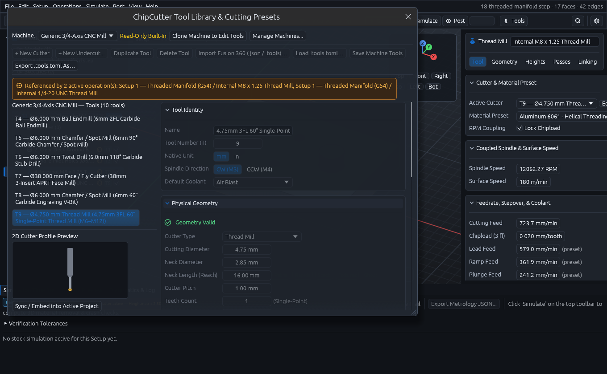
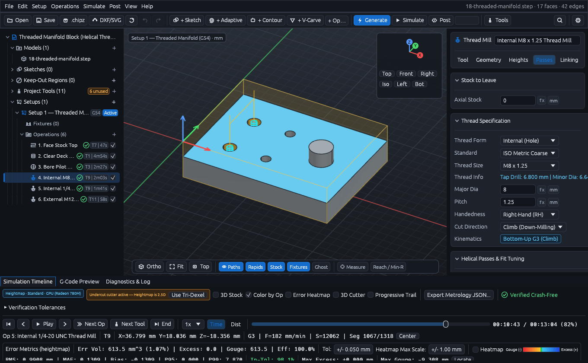
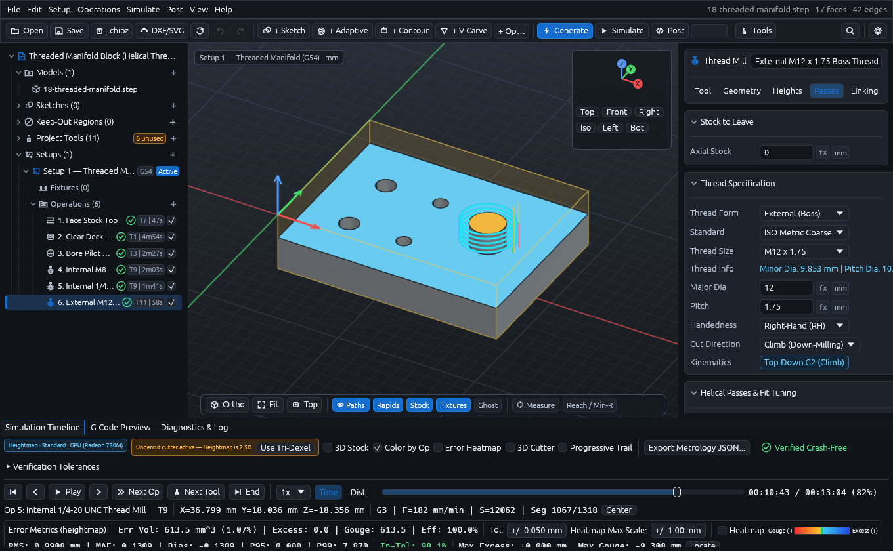
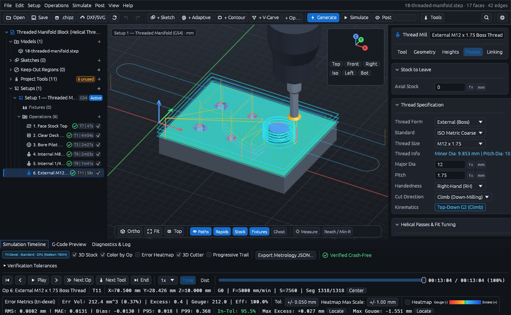
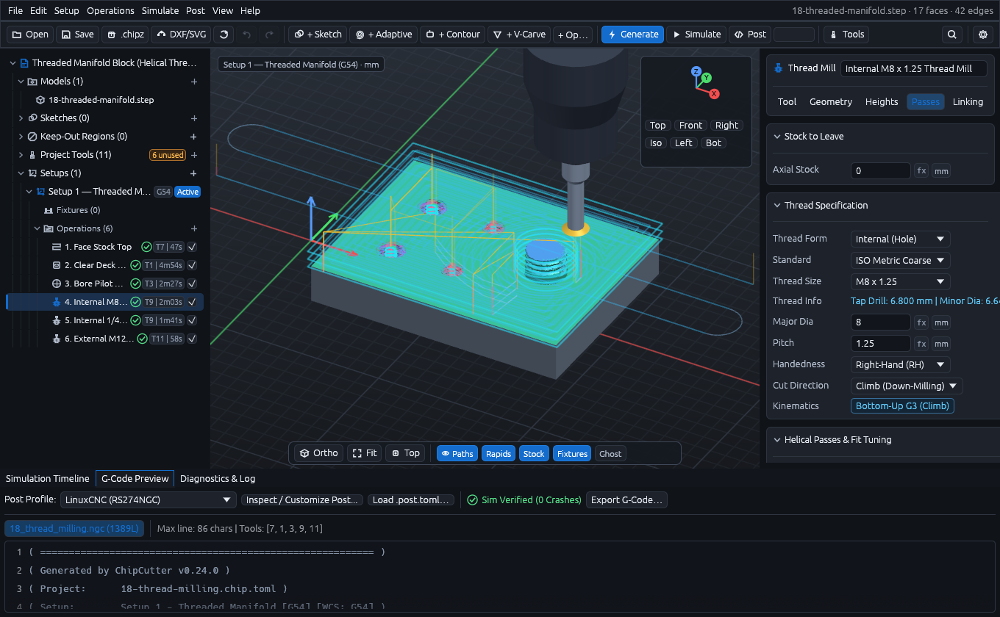

# Tutorial 18: Helical Thread Milling (Internal Holes & External Bosses)

## 1. Goal & What You'll Learn

Rigid tapping requires synchronized spindle-encoder feedback and risks snapping small taps inside deep blind holes or tough alloys. **Helical Thread Milling (`OperationKind::ThreadMill`)** cuts precision internal and external `60°` threads on any standard 3-axis CNC mill or router using synchronized helical **`G2` / `G3`** interpolation—producing clean chips, allowing one single-point cutter to cut multiple metric and imperial thread pitches, and letting you dial in exact GO/NO-GO thread-gauge fit without changing tools.

In this tutorial you will work on the aluminum **Threaded Manifold Block** ([`assets/18-threaded-manifold.step`](assets/18-threaded-manifold.step), `80 × 60 × 20 mm`) and learn how to:

1. Define and inspect a **Single-Point** (or **Multi-Form**) relieved-neck `60°` **`Thread Mill`** cutter in the **Tool Library Manager**.
2. Pick built-in **ISO Metric Coarse/Fine** (`M8 × 1.25`, `M12 × 1.75`) and **Unified UNC/UNF** (`1/4-20 UNC`) thread presets while verifying the recommended **Tap Drill** pilot diameter.
3. Understand **Bottom-Up Climb (`G3`)** for internal right-hand holes vs. **Top-Down Climb (`G2`)** for external right-hand bosses, plus **Radial Passes**, **Spring Passes**, **Pitch Dia Offset** gauge tuning, and **Centerline Feed Compensation**.
4. Simulate true 3D helical undercut thread grooves in **Tri-Dexel (Volumetric 3D)** mode with ChipCutter's relieved-neck 5-rule crash & gouge verifier.
5. Post safety-verified helical `G2`/`G3` G-code for both **GRBL** (quadrant-split arcs, `<= 80`-char lines) and **LinuxCNC**, and run headless **`chipcutter`** CLI equivalents.

---

## 2. Prerequisites & Starter Project

Launch the built-in **Threaded Manifold Block** sample directly in `chip-gui` (or pick it from **`File → Sample Projects Gallery…`**), or generate a fresh starter project from the terminal:

```bash
# Option A: Launch the ready-to-simulate built-in Thread Milling sample
chip-gui --sample thread-mill

# Option B: Open the bare 80 x 60 x 20 mm starter STEP model in an empty workspace
chip-gui docs/tutorials/assets/18-threaded-manifold.step

# Option C: Generate the starter STEP solid + seeded 6-operation .chip.toml project via CLI
chipcutter generate-sample-step /tmp/18-threaded-manifold.step \
  --tutorial 18-thread-milling --project-out /tmp/18-thread-milling.chip.toml
chip-gui /tmp/18-thread-milling.chip.toml
```

The starter manifold solid (`80 × 60 × 20 mm`) contains:
- A `12 mm` thick manifold base (`Z = 0..12 mm`) with **2× `Ø6.80 mm` through pilot holes** (`M8 × 1.25` tap drill) and **2× `Ø5.11 mm` through pilot holes** (`1/4-20 UNC` `#7` tap drill).
- One proud **`Ø12.0 mm` circular boss** (`Z = 12..20 mm`, `8 mm` proud) on the right side for external **`M12 × 1.75`** thread milling.

---

## 3. Step-by-Step GUI Walkthrough

### Step 1 — Inspect & Define `Thread Mill` Cutters in Tool Library Manager

1. Open **`Tools → Tool Library Manager…`** (or press **`Ctrl+K`** and type `Tool Library`).
2. Select **`T9 — 4.75mm 3FL 60° Single-Point Thread Mill (M6–M12)`** in the tool list to view its relieved-neck `60°` V-tooth profile schematic and geometry fields:
   - **`Diameter` (`4.75 mm`):** Cutting tooth tip outer diameter—must be strictly smaller than the internal thread's minor diameter (`Ø6.65 mm` for `M8 × 1.25`, `Ø4.98 mm` for `1/4-20 UNC`).
   - **`Neck Dia` (`2.85 mm`) & `Neck Length` (`16.0 mm`):** Relieved undercut neck that lets the tooth sweep outward into the thread walls while keeping the neck clear of the pilot hole bore up to `16 mm` deep.
   - **`Teeth Count` (`1` = Single-Point, `> 1` = Multi-Form):** A single-point (`1`-tooth) cutter can mill **any** pitch whose radial thread depth `(D_major - D_minor) / 2` fits inside the cutter's tooth radial height `(D_tool - D_neck) / 2`. A multi-form cutter (`teeth_count > 1`) cuts the full thread depth in one revolution, so ChipCutter enforces that its `Pitch` matches the operation pitch within `±0.02 mm`.
   - For the coarse external **`M12 × 1.75`** boss (radial thread depth `1.07 mm`), the sample project also embeds **`T11 — 8.0mm 3FL 60° Single-Point Thread Mill (M10–M24 / Ext)`** (`Neck Dia = 4.80 mm`, `1.60 mm` tooth height) so the relieved neck stays `> 0.50 mm` clear of the boss OD.



### Step 2 — Prep Stock, Boss Deck, & Pilot Bores (`Ops 1–3`)

Before any thread mill enters the part, the stock top, proud boss deck, and pilot bores must be machined cleanly:

1. **`Op 1 — Face Stock Top` (`Facing`, `T7` Ø38 mm APKT Face Mill):** Decks the raw `80 × 60 × 21 mm` billet down `1.0 mm` to `ModelTop` (`Z = 20.0 mm`).
2. **`Op 2 — Clear Deck Around Boss` (`2D Pocket`, `T1` Ø6 mm Flat Endmill):** Selects the open `Z = 12.0 mm` manifold deck face to clear `Z = 20 -> 12 mm` around the proud `Ø12.0 mm` circular boss with `0 mm` radial/axial stock-to-leave.
3. **`Op 3 — Bore Pilot Holes (Ø6.8 & Ø5.1 mm)` (`Drill / Bore`, `T3` 1/8" Flat Endmill, `Helical Bore` mode):** Helically interpolates both `Ø6.80 mm` (`M8`) and `Ø5.11 mm` (`1/4-20 UNC`) through-holes cleanly in one setup with zero center pin left behind.

> [!IMPORTANT]
> Always pre-drill or helically bore internal pilot holes **before** running an internal `Thread Mill` operation. ChipCutter's 5-rule simulator verifies relieved-neck clearance inside the pilot bore and flags any un-drilled material blocking the cutter neck.

### Step 3 — Internal `M8 × 1.25` & `1/4-20 UNC` Thread Milling (`Ops 4 & 5`)

1. Click **`+ Op… → Helical Thread Mill`** under `Setup 1` in the left **CAM Browser** (or **`Operations → + Helical Thread Mill`** in the top menu bar).
2. On the **`Tool`** tab, choose **`T9 — 4.75mm 3FL 60° Single-Point Thread Mill (M6–M12)`**.
3. On the **`Geometry`** tab, click **`Pick Holes…`** and select the two `Ø6.80 mm` cylindrical pilot holes (click one and use **`+ Same Ø`**).
4. On the **`Heights`** tab, leave **`Top`** at `From Selection` (`+0.0 mm`, `Z = 12.0 mm`) and set **`Bottom`** to `From Selection` `+2.0 mm` (`Z = 2.0 mm`, giving `10.0 mm` = 8 full thread pitches comfortably within `T9`'s `16.0 mm` neck reach).
5. Switch to the **`Passes`** tab and configure the two aligned cards:
   - **`Thread Specification`:**
     - **`Thread Form`:** `Internal Hole`
     - **`Standard`:** `ISO Metric Coarse` → **`Thread Size`:** **`M8 x 1.25`** (auto-populates `Major Dia = 8.000 mm`, `Pitch = 1.250 mm`, and displays `Tap Drill: 6.800 mm | Minor Dia: 6.647 mm` in **`Thread Info`**).
     - **`Handedness`:** `Right-Hand` · **`Cut Direction`:** `Climb` → verify the live **`Kinematics`** badge reads **`Bottom-Up G3 (Climb)`**.
   - **`Helical Passes & Fit Tuning`:**
     - **`Radial Passes`:** `2` (uses equal-area `sqrt(k / N)` radial progression so each pass removes an even V-groove chip cross-section).
     - **`Spring Passes`:** `1` (repeats one zero-offset full-depth pass to eliminate carbide deflection).
     - **`Pitch Dia Offset`:** `0.000 mm` initially (dial `+0.02` to `+0.05 mm` if a test bolt feels tight; dial negative to tighten fit).
     - **`Feed Comp`:** Checked (**`Compensate Centerline Feed`**) — automatically slows the programmed centerline feedrate by `(D_major - D_tool) / D_major` (`~41%`) so the outer cutting edge never overloads on tight internal arcs!
6. Duplicate Op 4 (`Ctrl+D`) to create **`Op 5 — Internal 1/4-20 UNC Thread Mill`**, swap the selected holes to the two `Ø5.11 mm` pilot bores, and set **`Standard`** = **`Unified Coarse (UNC)`** → **`Thread Size`** = **`1/4-20 UNC`** (`Major Dia = 6.350 mm`, `Pitch = 1.270 mm`, `Tap Drill: 5.105 mm`).
7. Press **`Ctrl+G`** and inspect Op 4's isolated bottom-up `G3` helical toolpaths with smooth `180°` centerline tangent arc-in/arc-out leads:



### Step 4 — External `M12 × 1.75` Boss Thread Milling (`Op 6`)

1. Add a third **`Helical Thread Mill`** operation named **`External M12 x 1.75 Boss Thread`**.
2. On the **`Tool`** tab, select **`T11 — 8.0mm 3FL 60° Single-Point Thread Mill (M10–M24 / Ext)`**.
3. On the **`Geometry`** tab, pick the circular planar top face of the proud `Ø12.0 mm` boss (`Z = 20.0 mm`). ChipCutter extracts the boss center, diameter (`12.0 mm`), top (`Z = 20.0 mm`), and adjacent deck floor (`Z = 12.0 mm`) automatically.
4. On the **`Heights`** tab, set **`Bottom`** to `From Selection` `+1.0 mm` (`Z = 13.0 mm`) so the cutter tip stops `1.0 mm` clear of the `Z = 12.0 mm` manifold deck (`7.0 mm` = 4 full `1.75 mm` pitches).
5. On the **`Passes`** tab:
   - Set **`Thread Form`** = **`External Boss`**, **`Standard`** = **`ISO Metric Coarse`**, **`Thread Size`** = **`M12 x 1.75`** (`Major Dia = 12.000 mm`, `Pitch = 1.750 mm`, `Minor Dia = 9.853 mm`).
   - Keep **`Handedness`** = `Right-Hand` and **`Cut Direction`** = `Climb` — notice the **`Kinematics`** badge automatically flips to **`Top-Down G2 (Climb)`**!
   - Set **`Radial Passes`** = `2`, **`Spring Passes`** = `1`, **`Lead-In Clearance`** = `0.500 mm`, and keep **`Compensate Centerline Feed`** checked (notice external arc compensation speeds centerline feed *up* by `(D_minor + D_tool) / D_minor` to maintain target cutting-edge chipload!).
6. Press **`Ctrl+G`** to view the external top-down `G2` helix and `90°` external tangent arc-in/arc-out transitions:



---

## 4. Key Parameters Reference

All parameters below live in **`Right Inspector → Passes`** (`Thread Specification` and `Helical Passes & Fit Tuning`):

| Parameter | Safe Starting Value | Purpose & Shop Guidance |
|---|---|---|
| **`Thread Form`** | `Internal Hole` / `External Boss` | Sets internal vs. external arc radius (`(D - d)/2` vs. `(D + d)/2`) and lead-in geometry |
| **`Standard` & `Thread Size`** | `ISO Metric Coarse/Fine`, `UNC`, `UNF`, or `Custom` | Auto-fills `Major Dia`, `Pitch`, and displays recommended **`Tap Drill`** & **`Minor Dia`** |
| **`Handedness` & `Cut Direction`** | `Right-Hand` + `Climb` | Automatically resolves CW (`M3`) spindle helix: **Internal RH Climb = `Bottom-Up G3`**, **External RH Climb = `Top-Down G2`** |
| **`Radial Passes`** | `2` (aluminum) / `3–4` (steel) | Equal-area (`sqrt(k/N)`) radial depth passes to keep chip load uniform across the `60°` V-tooth |
| **`Spring Passes`** | `1` (aluminum) / `1–2` (steel) | Repeats the final pass at full depth with zero radial offset to clean up tool deflection |
| **`Pitch Dia Offset`** | `0.000 mm` (tune `±0.02–0.05 mm`) | Signed gauge-fit trim (`+` increases cut diameter: looser internal / tighter external; `-` decreases diameter) |
| **`Lead-In Clearance`** | `0.500 mm` | Extra radial air clearance outside an external boss OD before tangent arc entry/exit |
| **`Compensate Centerline Feed`** | Checked (`true`) | Scales programmed centerline `F` by `(D_major - D_tool)/D_major` (internal) or `(D_minor + D_tool)/D_minor` (external) |

---

## 5. Generate (`Ctrl+G`) & Tri-Dexel Undercut Simulation

Fast 2.5D heightmap simulation verifies safety and clears the bore/boss footprint, while **Tri-Dexel (Volumetric 3D)** simulation models all three orthogonal ray axes (`X`, `Y`, `Z`)—physically carving the actual **3D helical undercut thread grooves** along both internal bore walls and the external boss cylinder!

1. Press **`Ctrl+G`** to generate all 6 operations cleanly.
2. Open the bottom **`Simulation Timeline`** tab, switch **`Engine`** to **`Tri-Dexel (Volumetric 3D)`**, and click **`Refresh Simulation`** (if not auto-triggered).
3. Scrub to the end (`100%`) and orbit around the manifold block:
   - Inspect the crisp **`M12 × 1.75`** external helical thread grooves carved around the proud circular boss.
   - Inspect the internal **`M8 × 1.25`** and **`1/4-20 UNC`** helical grooves inside the four manifold ports and the revolved 3D relieved-neck `Thread Mill` cutter.
   - Confirm the green **`Verified Crash-Free`** badge (`0 Crashes`, `0 Target Gouges`, and `0` neck/shank collisions).



---

## 6. Post-Processing (`GRBL` & `LinuxCNC`)

Click **`Post`** in the top toolbar (or switch to the bottom **`G-Code Preview`** tab):

- **`LinuxCNC (RS274NGC)` (`linuxcnc`):** Emits a single ATC `.ngc` program (`T7` → `T1` → `T3` → `T9` → `T11`) with `T9 M6 / G43 H9`, `T11 M6 / G43 H11`, and exact helical `G3` (bottom-up internal) and `G2` (top-down external) blocks carrying `I`, `J`, and synchronized `Z` pitch advance.
- **`Grbl 1.1 / FluidNC` (`grbl`):** Automatically splits the job into 5 manual-tool-change `.nc` files (`01_T7` Face, `02_T1` Deck, `03_T3` Pilot Bores, `04_T9` Internal Threads, `05_T11` External Boss Thread) with quadrant-split helical arcs and `<= 80`-character lines compatible with every Grbl/FluidNC controller.



---

## 7. Headless CLI Equivalent (`chipcutter`)

Reproduce the exact starter STEP solid, seeded 6-operation `.chip.toml` project, Heightmap + Tri-Dexel verification, and both `LinuxCNC` and `GRBL` G-code builds from the terminal:

```bash
# 1. Generate the 80 x 60 x 20 mm Threaded Manifold STEP + seeded 6-operation project
chipcutter generate-sample-step /tmp/18-threaded-manifold.step \
  --tutorial 18-thread-milling --project-out /tmp/18-thread-milling.chip.toml

# 2. Validate invariants & generate all 6 toolpaths in parallel
chipcutter validate --generate /tmp/18-thread-milling.chip.toml

# 3. Verify 0 crashes in BOTH fast Heightmap and volumetric Tri-Dexel 3D simulation
chipcutter simulate /tmp/18-thread-milling.chip.toml \
  --engine heightmap --resolution standard
chipcutter simulate /tmp/18-thread-milling.chip.toml \
  --engine tri-dexel --resolution standard --report /tmp/thread_mill_report.json

# 4. Build safety-verified G-code for LinuxCNC (single ATC file) and GRBL (5 split-by-tool files)
chipcutter build /tmp/18-thread-milling.chip.toml \
  -o /tmp/out_thread_linuxcnc --post linuxcnc
chipcutter build /tmp/18-thread-milling.chip.toml \
  -o /tmp/out_thread_grbl --post grbl
```

---

## Navigation

- **Previous:** [Tutorial 17 — Tri-Dexel Volumetric Simulation & Quantitative Error-Volume Analysis](17-tridexel-simulation-error-metrics.md)
- **Next:** [Tutorial 19 — Two-Sided Flip Workholding, 3D Fixtures, & Auto Soft Jaws](19-workholding-flip-jigs-soft-jaws.md)
- **Sample Showcase:** [Threaded Manifold Block (Helical Thread Milling)](../samples/thread-mill.md)
- **Index:** [All Tutorials (`00`–`19`)](README.md)
