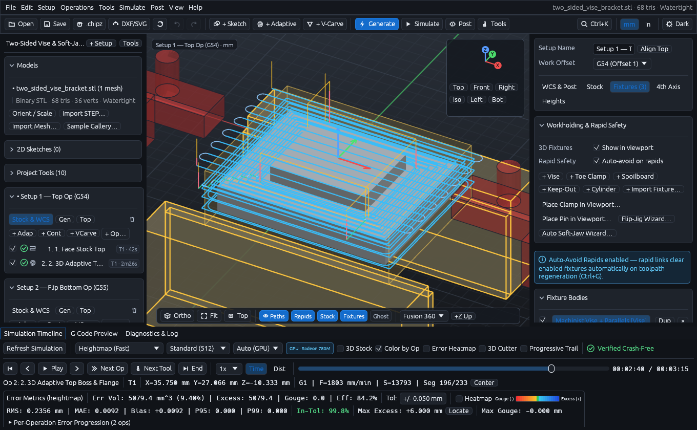
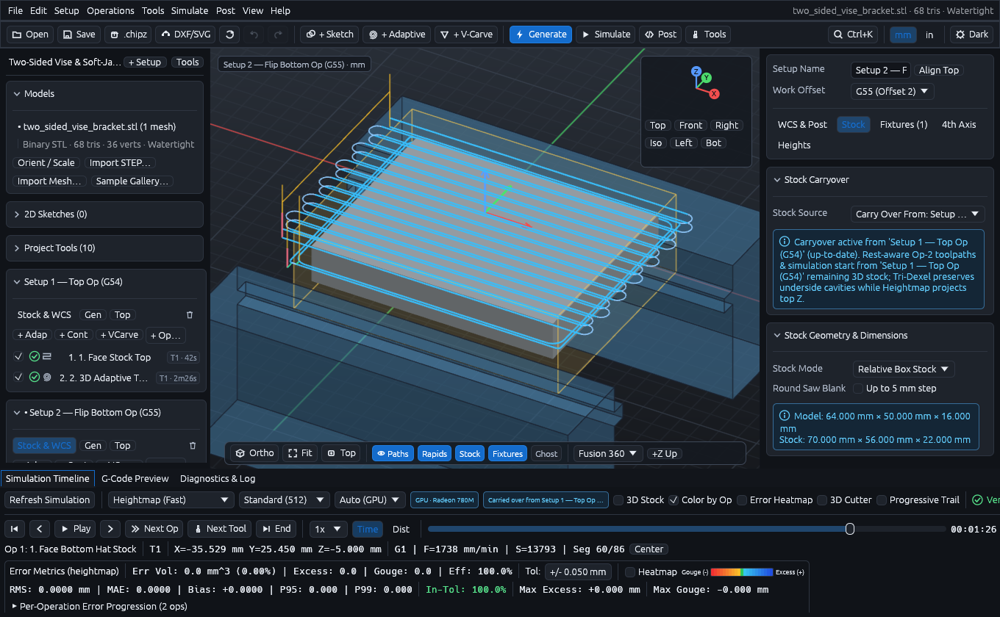
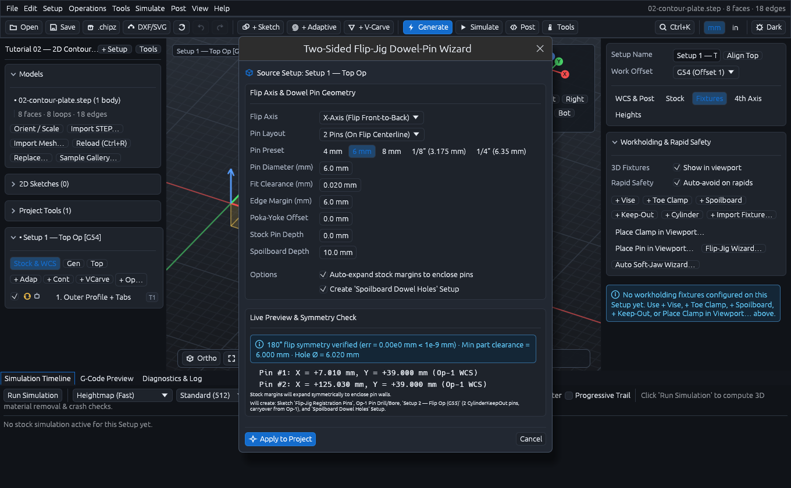
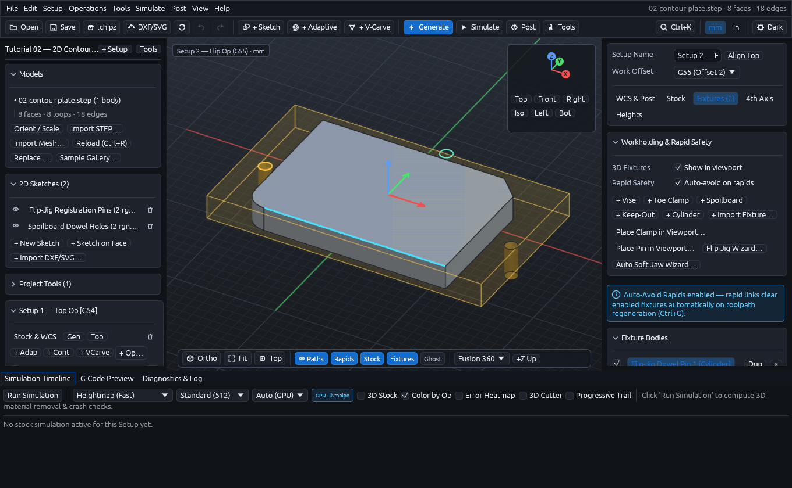
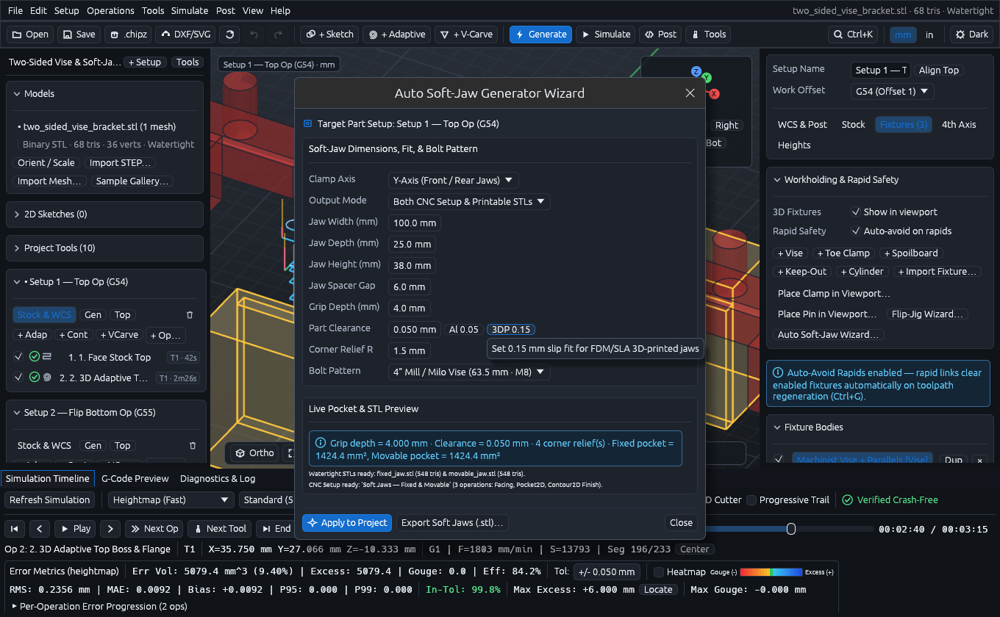
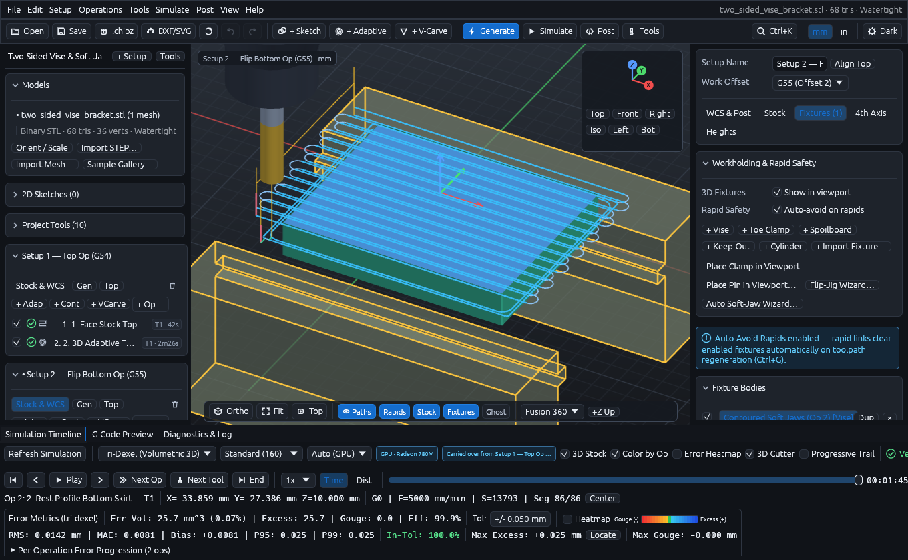

# Tutorial 19: Two-Sided Flip Workholding, 3D Fixtures, & Auto Soft Jaws

## 1. Goal & What You'll Learn

Machining both sides of a part without losing X/Y/Z alignment—or crashing a rapid move into a vise jaw, toe clamp, or registration pin—is one of the biggest hurdles in real-world CNC work. ChipCutter models **3D workholding fixtures**, **automatic safe-rapid fixture avoidance**, **multi-setup volumetric Tri-Dexel stock carryover**, and two dedicated shop-floor automation wizards (**Flip-Jig Dowel-Pin Wizard** and **Auto Soft-Jaw Generator Wizard**) directly inside your project.

Because a finished sample project already has both setups wired together, it is not always obvious *how* to build a two-sided flip job from scratch. In this tutorial you will learn **both** primary two-sided flip workflows step by step:

| Workflow | Best For | How Alignment Works | Key ChipCutter Tools |
|---|---|---|---|
| **A. Vise + Hat Stock + Soft Jaws** | Billet aluminum/plastic parts on a mill vise (like `--sample two-sided-vise`) | Op 1 grips a `5 mm` bottom "hat" in parallels; Op 2 flips `180°` into contoured soft jaws gripping the finished Op-1 boss | **`Setup → Fixtures`**, **`Setup 2 → Stock → Stock Carryover`**, **`Auto Soft-Jaw Wizard…`** |
| **B. Dowel-Pin Flip-Jig on Spoilboard** | Router tables, flat plates, wooden/organic 2-sided parts | Precision dowel pins (`4 mm`–`1/4"`) drilled symmetrically across the flip centerline lock the flipped stock onto the spoilboard | **`Setup → Flip-Jig Wizard…`** (auto-generates pin sketch, Op-1 pin drilling, spoilboard setup, and paired `180°` `G55` Setup 2 with keep-out pins) |

By the end of this guide you will be able to:
1. Build a **Two-Sided Vise & Soft-Jaw** job (`G54` Op 1 → `G55` Op 2) from scratch—explaining every setting behind the built-in `--sample two-sided-vise` project.
2. Add parametric **Vise Jaws + Parallels**, **Toe Clamps**, **Spoilboards**, **Keep-Out Boxes/Cylinders**, or imported 3D fixture models (`STEP`/`STL`/`OBJ`/`3MF`) in **`Setup → Fixtures`**, and verify **Auto-Avoid on Rapids** and **Rule 6 (`FixtureCollision`)** protection.
3. Configure **Multi-Setup Volumetric Stock Carryover** (`Carry Over From: Setup 1`) so Op-2 rest roughing skips material already removed in Op 1 and cuts only the remaining hat stock and flange skirt.
4. Run the 1-click **Two-Sided Flip-Jig Dowel-Pin Wizard** (including optional **Poka-Yoke** error-proofing) and follow the exact physical shop-floor flip sequence.
5. Generate both **CNC-machinable aluminum soft jaws** and **3D-printable `.stl` soft jaws** (with Kurt 6", Milo 4", Carvera Mod Vise, or custom bolt patterns) using the **Auto Soft-Jaw Generator Wizard**.

---

## 2. Prerequisites & Starter Projects

You will use two built-in starter assets—one to inspect and understand the **Vise + Soft-Jaw** workflow, and one bare starter STEP solid to run the **Flip-Jig Dowel-Pin Wizard** from scratch:

```bash
# Starter A: Open the built-in Two-Sided Vise & Soft-Jaw Bracket sample (64 x 50 x 16 mm)
chip-gui --sample two-sided-vise

# Starter B: Open a clean 100 x 70 x 12 mm starter STEP plate for the Dowel-Pin Flip-Jig workflow
chip-gui docs/tutorials/assets/02-contour-plate.step
```

> [!TIP]
> You can also open **Two-Sided Vise & Soft-Jaw Bracket** from inside `chip-gui` via **`File → Sample Projects Gallery…`** (or **`Ctrl+K`** → type `Two-Sided`).

---

## 3. Step-by-Step GUI Walkthrough

### Part A — How the Two-Sided Vise Sample (`Setup 1 — G54`) Is Set Up

When milling a billet part in a vise from both sides, you leave extra sacrificial material on the bottom (**"hat stock"**, typically `4–6 mm` thick) so the vise jaws have clean parallel faces to grip during Op 1 while keeping the endmill safely above the hardened jaws.

1. **Configure Setup 1 WCS & Hat Stock (`G54`):**
   - Select **`Setup 1 — Top Op (G54)`** in the left **CAM Browser**.
   - On the **`WCS`** tab, keep **`Orientation`** upright (`Flip +Z` unchecked) and set **`Origin`** to **`Stock Box Point → Top Center`** (or a fixed vise corner such as `Top Back-Left` against your stationary jaw and workstop).
   - On the **`Stock`** tab, select **`Relative Size Box`** and configure:
     - **`Side Offsets (+X / -X / +Y / -Y)`:** `3.0 mm` (clean perimeter cleanup allowance).
     - **`Top Offset (+Z)`:** `1.0 mm` (facing allowance to deck the top surface flat).
     - **`Bottom Offset (-Z)`:** **`5.0 mm`** — this extra `5 mm` slab beneath the model is the **hat stock** gripped by the vise in Op 1 and faced off after flipping in Op 2.
2. **Add the Machinist Vise, Parallels, & End Toe Clamps (`Fixtures` tab):**
   - Switch to the **`Fixtures`** tab in the right **Setup Inspector**.
   - Check **`3D Fixtures → Show in viewport`** and **`Rapid Safety → Auto-avoid on rapids`**.
   - Click **`+ Vise`** to insert a parametric two-jaw **`Machinist Vise`** aligned along **`Y-Axis (Front/Rear Jaws)`**:
     - Set **`Jaw Width`** = `100.0 mm`, **`Jaw Thickness`** = `18.0 mm`, **`Jaw Height`** = `38.0 mm`, **`Grip Depth`** = **`4.5 mm`** (gripping safely inside the `5.0 mm` bottom hat stock so `0.5 mm` of hat stock stays above the jaw tops), **`Include Parallels`** = checked, and **`Clearance Margin`** = `1.0 mm`.
   - To add strap/toe clamps (e.g., on sacrificial ears or vise shoulders), either click **`+ Toe Clamp`** for numeric placement or click **`Place Clamp in Viewport…`** and click directly on a stock edge in the 3D viewport to auto-orient a clamp with its heel riser and tall T-slot stud tower.
   - Verify the blue status banner reads **`Auto-Avoid Rapids enabled`**; after pressing **`Ctrl+G`**, it reports the exact number of `G0` rapid jumps automatically lifted over your fixtures (and the maximum lifted Z height).
3. **Stop Op-1 Roughing Safely Above the Vise Jaws:**
   - **`Op 1.1 — Face Stock Top` (`Facing`, `T1` Ø6 mm Flat Endmill):** Decks `StockTop` down to `ModelTop` (`1.0 mm`).
   - **`Op 1.2 — 3D Adaptive Top Boss & Flange` (`3D Adaptive Roughing`, `T1` Ø6 mm Flat Endmill):** Sets **`Top`** = `ModelTop` and **`Bottom`** = **`ModelBottom + 2.0 mm`**. Stopping `2 mm` above `ModelBottom` guarantees the cutter finishes the top boss and flange cleanly while leaving a `2 mm` skirt + `5 mm` hat stock well clear of the vise jaws below!



---

### Part B — Setting Up `Setup 2 — Flip Bottom Op (G55)` & Stock Carryover

Now flip the part `180°` upside down so the `5 mm` hat stock faces **up (`+Z`)** and the already-machined Op-1 boss seats **down** into stepped soft jaws:

1. **Create & Orient Setup 2 (`G55`):**
   - Click **`Setup → New Setup`** in the top menu bar (or inspect **`Setup 2 — Flip Bottom Op (G55)`** in `--sample two-sided-vise`).
   - On the **`WCS`** tab:
     - Set **`Work Offset`** to **`G55`** (separate machine zero from Op 1's `G54`).
     - Under **`Orientation`**, check **`Flip +Z`** (`180°` rotation around the WCS X-axis—the underside of the model now faces `+Z` toward the spindle!).
     - Set **`Origin`** to **`Stock Box Point → Top Center`** (or a known finished Op-1 datum face / soft-jaw step reference).
2. **Mirror Stock Offsets & Enable Multi-Setup Stock Carryover (`Stock` tab):**
   - Switch to **`Setup 2 → Stock`**.
   - In the top **`Stock Carryover`** card, change **`Stock Source`** from `Independent Raw Stock` to **`Carry Over From: Setup 1 — Top Op (G54)`**.
     - *What this does:* Instead of treating Setup 2 as a brand-new solid block, ChipCutter transfers the exact 3D **Tri-Dexel** machined volume remaining at the end of Setup 1 into Setup 2's flipped WCS frame!
     - Any rest-aware Op-2 operation (`Facing`, `2D Pocket`, `3D Adaptive`, `3D Waterline`) automatically skips air where Op 1 already cut away the perimeter and boss.
   - Mirror the **`Relative Size Box`** Z offsets to match the flipped billet:
     - **`Top Offset (+Z)`:** **`5.0 mm`** (the `5 mm` hat stock now sits on top!).
     - **`Bottom Offset (-Z)`:** `1.0 mm` (the original Op-1 facing allowance is now on the bottom).
     - **`Side Offsets (±X, ±Y)`:** `3.0 mm`.
3. **Add Stepped / Contoured Soft Jaws (`Fixtures` tab):**
   - On **`Setup 2 → Fixtures`**, click **`+ Vise`**, enable **`Auto-avoid on rapids`**, and configure stepped soft jaws gripping the already-machined Op-1 boss:
     - **`Grip Depth`** = `7.0 mm`, **`Step Shelf Depth`** = `4.0 mm`, **`Step Shelf Height`** = `4.0 mm`, **`Include Parallels`** = unchecked (the machined step shelf supports the part directly!).
4. **Add Op-2 Hat Facing & Rest-Aware Skirt Profiling:**
   - **`Op 2.1 — Face Bottom Hat Stock` (`Facing`):** `Top = StockTop`, `Bottom = ModelTop` (`5.0 mm` total depth with `Multiple Depths` enabled, `Max Stepdown = 2.5 mm`) — removes the entire `5 mm` hat cleanly down to the finished underside of the flange.
   - **`Op 2.2 — Rest Profile Bottom Skirt` (`3D Adaptive Roughing`):** `Top = ModelTop`, `Bottom = ModelTop - 3.5 mm` — because Setup 2 carries over Setup 1's remaining Tri-Dexel stock, Op 2.2 clears **only** the remaining `2 mm` unmachined outer flange skirt (with a slight `1.5 mm` overlap for a seamless wall blend) and never plunges down into the soft jaws!



---

### Part C — Two-Sided Dowel-Pin Flip-Jig Wizard (1-Click Spoilboard Flip)

When machining flat plates, wooden/composite parts, or organic 3D shapes on a CNC router spoilboard (without a machinist vise), **dowel-pin registration** is faster and holds sub-`0.05 mm` alignment across a `180°` flip. ChipCutter automates the entire math and setup generation in one wizard.

1. Open a single-setup part such as [`docs/tutorials/assets/02-contour-plate.step`](assets/02-contour-plate.step) (or your own STEP/STL model with `Setup 1` configured).
2. Launch the wizard from **any** of three places:
   - Top menu: **`Setup → Flip-Jig Wizard…`**
   - Right Inspector: **`Setup 1 → Fixtures → Flip-Jig Wizard…`**
   - Command Palette: **`Ctrl+K`** → type **`Flip-Jig`**
3. Configure **`Flip Axis & Dowel Pin Geometry`**:
   - **`Flip Axis`:** Choose **`X-Axis (Flip Front-to-Back)`** (flips top-to-bottom around the Y centerline) or **`Y-Axis (Flip Left-to-Right)`** (flips left-to-right around the X centerline).
   - **`Pin Layout`:**
     - **`2 Pins (On Flip Centerline)`:** Two pins directly on the flip axis (`Y = y_mid` for X-axis flip) — minimal footprint and mathematically invariant under `180°` flip.
     - **`4 Pins (Mirrored Symmetric Pairs)`:** Two mirrored pairs straddling the flip axis for extra rotational rigidity on wide blanks.
   - **`Pin Preset` & `Fit Clearance (mm)`:** Click a standard dowel preset (**`4 mm`**, **`6 mm`**, **`8 mm`**, **`1/8"`**, **`1/4"`**). Default **`Fit Clearance`** is `0.020 mm` (tight slip fit; bump to `0.04–0.06 mm` for hand-pressed wood/MDF dowels).
   - **`Edge Margin (mm)`:** Minimum radial clearance between the dowel pin outer rim and your part's 2D outer silhouette (`6.0 mm` default).
   - **`Poka-Yoke Offset`:** Optional asymmetric shift along the flip axis (e.g., `4.0 mm`). Moving the pins slightly off-center *along* the flip axis keeps them `100%` `180°`-flip symmetric while making it physically impossible to drop the flipped blank onto the pins backward!
   - **`Stock Pin Depth` & `Spoilboard Depth`:** Leave **`Stock Pin Depth = 0.0 mm`** to drill through the full stock thickness (recommended so pins engage cleanly from both sides), and set **`Spoilboard Depth = 10.0 mm`**.
   - Keep **`Auto-expand stock margins to enclose pins`** and **`Create 'Spoilboard Dowel Holes' Setup`** checked.
4. Inspect the **`Live Preview & Symmetry Check`** card:
   - Confirm the blue banner reads **`180° flip symmetry verified (err = 0.00e0 mm < 1e-9 mm)`**, check the exact Op-1 WCS pin coordinates, and click **`Apply to Project`** (recorded as a single `Ctrl+Z` Undo step!).



5. **Inspect What the Wizard Created Automatically:**
   - **Sketch Layer (`Flip-Jig Registration Pins`):** Exact pin circle centers placed outside the part silhouette.
   - **Setup 1 (`Op 0` inserted first):** A pin drilling or helical-boring operation using a matching drill/endmill from your tool library, plus expanded stock margins if needed so the pins stay safely inside the blank.
   - **Paired `Setup 2 — Flip Op (G55)`:** Automatically rotated `180°` around your chosen flip axis, linked via **`Carry Over From: Setup 1`**, and pre-populated with **`CylinderKeepOut`** fixture bodies at every protruding dowel pin so `Auto-avoid on rapids` and Rule 6 prevent the cutter from ever hitting a steel dowel!
   - **Companion `Spoilboard Dowel Holes` Setup:** Drills the matching blind registration holes into your MDF/tooling-plate spoilboard using the exact same `G54` XY zero.



> [!IMPORTANT]
> **Physical Shop-Floor Execution Order for Dowel-Pin Flips:**
> 1. Clamp your raw blank onto the spoilboard and set **`G54`** X/Y/Z zero.
> 2. Run **Setup 1** (`Op 0` drills the through-stock registration pin holes, followed by your Op-1 top machining operations).
> 3. Remove the blank (keep **`G54` X/Y zero untouched!**) and run the **`Spoilboard Dowel Holes`** setup (`Z = 0` on spoilboard top) to drill the mating blind dowel holes.
> 4. Tap the dowel pins into the spoilboard holes, flip the part **`180°` around your chosen flip axis**, and seat it snugly down over the pins.
> 5. Re-zero **Z only** (keeping the exact same XY origin for `G55`, or using `G54` XY + flipped Z) and run **Setup 2**!

---

### Part D — Auto Soft-Jaw Generator Wizard (CNC Aluminum & 3D-Printable STLs)

For parts with curved, stepped, or irregular outer profiles that flat vise jaws cannot grip safely during Op 2, the **Auto Soft-Jaw Generator Wizard** projects your part's exact `f64` 2D silhouette into a custom pair of fixed & movable vise jaws.

1. Select the Setup whose part silhouette you want to grip (for example **`Setup 1 — Top Op (G54)`** in `--sample two-sided-vise`), then open **`Setup → Auto Soft-Jaw Wizard…`** (or **`[Fixtures] → Auto Soft-Jaw Wizard…`** or **`Ctrl+K`** → `Soft-Jaw`).
2. Configure **`Soft-Jaw Dimensions, Fit, & Bolt Pattern`**:
   - **`Clamp Axis`:** `Y-Axis (Front/Rear Jaws)` (standard machinist vise) or `X-Axis (Left/Right Jaws)`.
   - **`Output Mode`:** Choose **`Both CNC Setup & Printable STLs`**, **`CNC Machining Setup (Aluminum Jaws)`**, or **`3D-Printable STL Files Only`**.
   - **`Jaw Width` / `Jaw Depth` / `Jaw Height`:** Match your physical jaw blanks (e.g., `100 × 25 × 38 mm` for a 4" Milo vise, or `152.4 × 25.4 × 50.8 mm` for a 6" Kurt vise).
   - **`Jaw Spacer Gap` (`6.0 mm` default):** The shim/parallel thickness clamped between the fixed and movable jaws while machining the pockets—removing the spacer afterward gives the movable jaw `6 mm` of closing travel to clamp your part tightly!
   - **`Grip Depth (mm)` (`4.0 mm` default):** Pocket step depth cut into the top of the soft jaws.
   - **`Part Clearance`:** Use the 1-click **`Al 0.05`** button (`0.050 mm` precision slip fit for CNC-machined 6061 aluminum jaws) or **`3DP 0.15`** (`0.150 mm` slip fit for FDM/SLA 3D-printed jaws).
   - **`Corner Relief R` (`1.5 mm` default):** Adds automatic dogbone reliefs at sharp convex part corners so square corners seat flush against the jaw walls without binding on the endmill radius.
   - **`Bolt Pattern`:** Select **`Kurt 6" Vise`**, **`Milo 4" Vise`**, **`Carvera Mod Vise`**, **`None (Blank)`**, or **`Custom Bolt Pattern`** to cut recessed socket-head mounting bolt counterbores directly into exported STL jaws.
3. Review the **`Live Pocket & STL Preview`** banner (fixed & movable pocket areas, dogbone corner relief count, and watertight STL triangle counts):
   - Click **`Apply to Project`** to append a ready-to-generate **`Soft Jaws — Fixed & Movable`** CNC Setup (with `Facing`, `2D Pocket`, and `2D Contour` wall finishing operations) in one Undo step.
   - Click **`Export Soft Jaws (.stl)…`** to save watertight **`fixed_jaw.stl`** and **`movable_jaw.stl`** files ready for your slicer.



---

## 4. Key Parameters Reference

### 3D Fixtures & Rapid Safety (`Setup → Fixtures`)

| Parameter | Recommended Starting Value | Purpose & Shop Guidance |
|---|---|---|
| **`Auto-avoid on rapids`** | Checked (`true`) | Automatically lifts `G0` traverse links cleanly above enabled fixtures + `Clearance Margin` on `Ctrl+G` |
| **`Clearance Margin`** | `1.0 mm` (metal vise/clamps) / `0.5 mm` (spoilboard) | Extra 3D safety halo added around every fixture solid during safe-rapid routing and Rule 6 verification |
| **`Allowed Overcut`** | `0.0 mm` (vise/clamps) / `0.5 mm` (MDF spoilboard) | Permits shallow sacrificial through-cuts into a spoilboard top without triggering a Rule 6 collision |
| **`Grip Depth` (`ViseJaws`)** | `4.5 mm` (inside `5 mm` hat stock) | Vertical jaw engagement from stock bottom upward; keep `< Bottom Offset` on Op 1 so jaw tops stay clear of Op-1 cuts |
| **`Step Shelf Depth / Height`** | `0 mm` (flat jaws + parallels) or `4 × 4 mm` (stepped soft jaws) | Built-in jaw ledge supporting the workpiece directly without separate parallels |

### Flip-Jig & Auto Soft-Jaw Wizards

| Wizard Field | Safe Starting Value | Purpose & Shop Guidance |
|---|---|---|
| **`Flip Axis`** | `X-Axis` (front-to-back) or `Y-Axis` (left-to-right) | Must match how you physically flip the workpiece on the machine table |
| **`Fit Clearance` (Flip-Jig)** | `0.020 mm` (metal/Delrin) / `0.050 mm` (wood/MDF) | Radial hole clearance over nominal pin diameter for repeatable slip/press registration |
| **`Poka-Yoke Offset`** | `3.0–6.0 mm` (non-zero) | Asymmetric shift along the flip axis that stays `180°`-symmetric while preventing accidental backward loading |
| **`Jaw Spacer Gap`** | `6.0 mm` (or a `1/4"` parallel) | Clamped between jaws while milling aluminum soft jaws; removed during Op 2 so jaws can close tightly on the part |
| **`Part Clearance` (Soft Jaws)** | `0.050 mm` (`Al 0.05`) / `0.150 mm` (`3DP 0.15`) | Radial slip-fit allowance around the projected part silhouette |
| **`Corner Relief R`** | `1.5 mm` (`> 0.5 × finish tool Ø` or `1.5–2.0 mm`) | Dogbone relief radius at sharp convex corners so square parts seat flat without corner interference |

---

## 5. Generate (`Ctrl+G`), Tri-Dexel Carryover, & Rule 6 Verification

1. Press **`Operations → Generate All Setups`** (or select each Setup and press **`Ctrl+G`**) so both `Setup 1` and `Setup 2` are `Clean` (upstream `Setup 1` must be generated so `Setup 2` can carry over its machined Tri-Dexel volume!).
2. Select **`Setup 2 — Flip Bottom Op (G55)`** in the CAM Browser.
3. Open the bottom **`Simulation Timeline`** pane, switch **`Engine`** to **`Tri-Dexel (Volumetric 3D)`**, and click **`Refresh Simulation`**.
4. Scrub from `0%` to `100%`:
   - At `0%`, notice the stock already has **Setup 1's machined top boss and flange carved out on the underside** (resting inside the translucent soft jaws), with only the `5 mm` hat stock and `2 mm` outer skirt remaining on top!
   - At `100%`, inspect the fully machined two-sided bracket, confirm **`Verified Crash-Free`** (`0 Crashes`, `0 Target Gouges`, **`0 Fixture Collisions`**), and toggle **`Error Deviation Heatmap`** to check cumulative two-setup surface accuracy (`In-Tol >= 95%`).
5. **How Rule 6 (`FixtureCollision`) Protects Your Machine:**
   - Every cutting move, plunge, shank, and tool holder sweep is checked against all enabled 3D fixtures (`ViseJaws`, `ToeClamp`, `Spoilboard`, `BoxKeepOut`, `CylinderKeepOut`, and imported fixture meshes) plus their `Clearance Margin`.
   - If a toolpath ever grazes a clamp, jaw, or dowel pin (for example, if you lower `Op 1.2` Bottom too deep into the vise jaws or disable `Auto-avoid on rapids`), ChipCutter highlights the colliding fixture **crimson** in the 3D viewport, logs the exact collision position in **`Diagnostics & Log`**, and blocks unsafe G-code export until resolved.



---

## 6. Post-Processing Multi-Setup (`G54` & `G55`) & Shop-Floor Checklist

Each Setup posts its own independent CNC program carrying its assigned work offset (`G54` for Setup 1, `G55` for Setup 2):

1. Select **`Setup 1 — Top Op (G54)`** → click **`Post`** (or **`File → Export G-Code (.nc / .ngc)…`**) to export your Op-1 program (`G54`).
2. Select **`Setup 2 — Flip Bottom Op (G55)`** → click **`Post`** to export your Op-2 program (`G55`).
   - On **LinuxCNC (`linuxcnc`)** and **grblHAL ATC (`grblhal_atc`)**, each Setup emits a single program with explicit `G54` / `G55` work-offset activation and tool changes.
   - On **Grbl 1.1 / FluidNC (`grbl`)**, multi-tool Setups split cleanly into numbered per-tool files (`01_T1_…nc`, `02_T2_…nc`).
3. **Before Pressing Cycle Start on Setup 2:**
   - Confirm **`G55`** zero on the machine matches **`Setup 2 → WCS → Origin`** (for example, top center of the `5 mm` hat stock or your soft-jaw datum step).
   - For **Dowel-Pin Flip-Jigs**, confirm the part is flipped around the exact **`Flip Axis`** (`X` front-to-back vs. `Y` left-to-right) and seated flush against the spoilboard with no chips trapped under the part.
   - Confirm physical clamp/jaw heights match your modeled `Fixtures` dimensions and `Clearance Margin`.

---

## 7. Headless CLI Equivalent (`chipcutter workholding …`)

Every workholding fixture, Flip-Jig wizard, Auto Soft-Jaw generator, and multi-setup Tri-Dexel carryover simulation can also be scripted headlessly with `chipcutter`:

```bash
# 1. Generate a clean starter project from the 100 x 70 x 12 mm contour plate
chipcutter generate-sample-step /tmp/19-plate.step \
  --tutorial 02-contour --project-out /tmp/19-plate.chip.toml

# 2. Option A — Add a Machinist Vise + Parallels & Toe Clamp to a separate vise copy, then list fixtures
chipcutter workholding add-vise /tmp/19-plate.chip.toml -o /tmp/19-plate-vise.chip.toml \
  --axis y --jaw-width 152.4 --grip-depth 4.5 --parallels
chipcutter workholding add-clamp /tmp/19-plate-vise.chip.toml \
  --x 112 --y 39 --yaw 0 --z-ref stock_top
chipcutter workholding list /tmp/19-plate-vise.chip.toml

# 3. Option B — Add an MDF Spoilboard (0.5 mm allowed overcut) & run the Flip-Jig Wizard (4 mm Poka-Yoke)
chipcutter workholding add-spoilboard /tmp/19-plate.chip.toml -o /tmp/19-plate-flip.chip.toml \
  --thickness 18.0 --allowed-overcut 0.5
chipcutter workholding flip-jig /tmp/19-plate-flip.chip.toml \
  --axis x --pin-dia 6.0 --pin-clearance 0.02 --count 2 --poka-yoke 4.0 --edge-margin 6.0

# 4. Run the Auto Soft-Jaw Wizard (both CNC machining Setup + 3D-printable STLs)
chipcutter workholding soft-jaws /tmp/19-plate.chip.toml \
  -o /tmp/19-plate-softjaws.chip.toml \
  --axis y --jaw-width 152.4 --jaw-depth 45.0 --jaw-height 38.0 \
  --jaw-gap 6.0 --grip-depth 4.0 --clearance 0.05 --corner-relief 1.5 \
  --bolt-pattern kurt6 --add-setup --export-stl-dir /tmp/soft_jaws_stl

# 5. Validate, generate all Setups, & run multi-setup Tri-Dexel carryover + Rule 6 verification
chipcutter validate --generate /tmp/19-plate-flip.chip.toml
chipcutter simulate /tmp/19-plate-flip.chip.toml \
  --engine tri-dexel --all-setups --resolution standard --report /tmp/flip_report.json

# 6. Build verified G-code for Setup 1, the Spoilboard Dowel Holes setup, and the Soft-Jaw setup
#    (Add your underside operations to Setup 2 in chip-gui before building --setup setup_2_flip.)
chipcutter build /tmp/19-plate-flip.chip.toml -o /tmp/out_flip_linuxcnc \
  --setup setup_1 --post linuxcnc
chipcutter build /tmp/19-plate-flip.chip.toml -o /tmp/out_spoilboard_grbl \
  --setup setup_spoilboard_pins --post grbl
chipcutter build /tmp/19-plate-softjaws.chip.toml -o /tmp/out_softjaws_linuxcnc \
  --setup setup_soft_jaws --post linuxcnc
```

---

## Navigation

- **Previous:** [Tutorial 18 — Helical Thread Milling (Internal Holes & External Bosses)](18-thread-milling.md)
- **Index:** [All Tutorials (`00`–`19`)](README.md)
