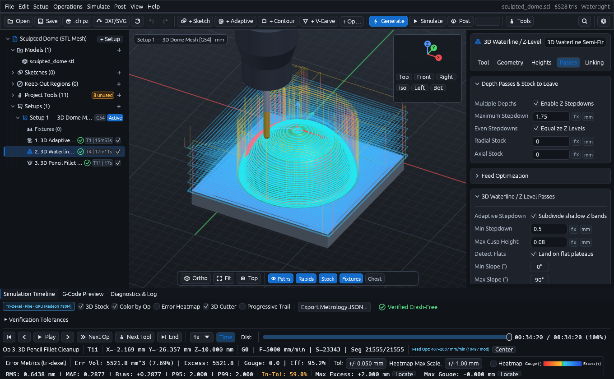
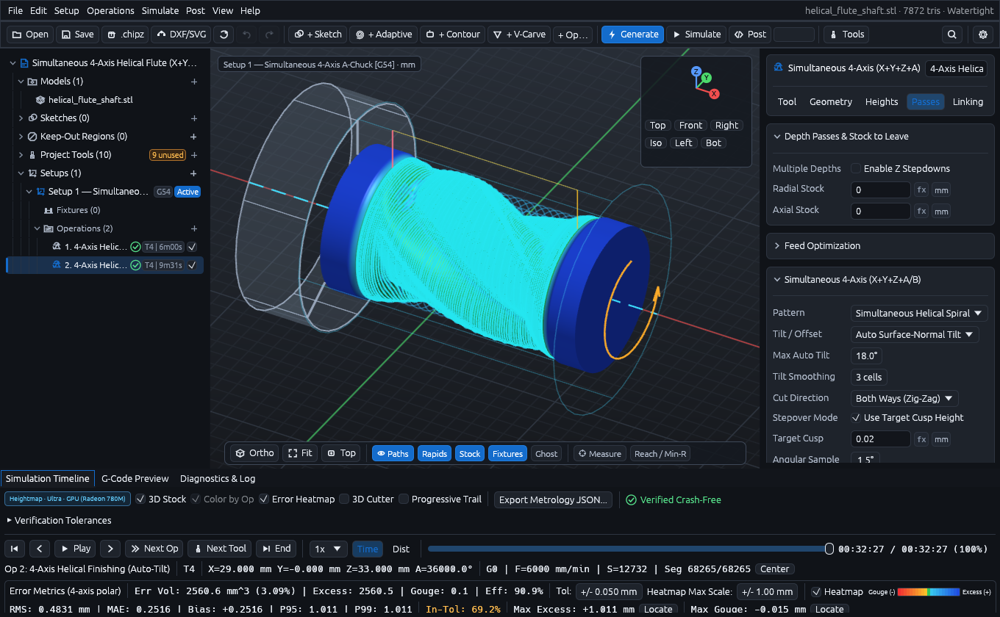
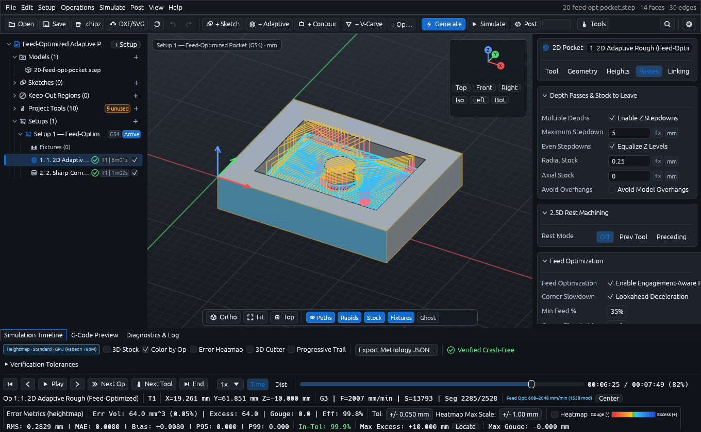
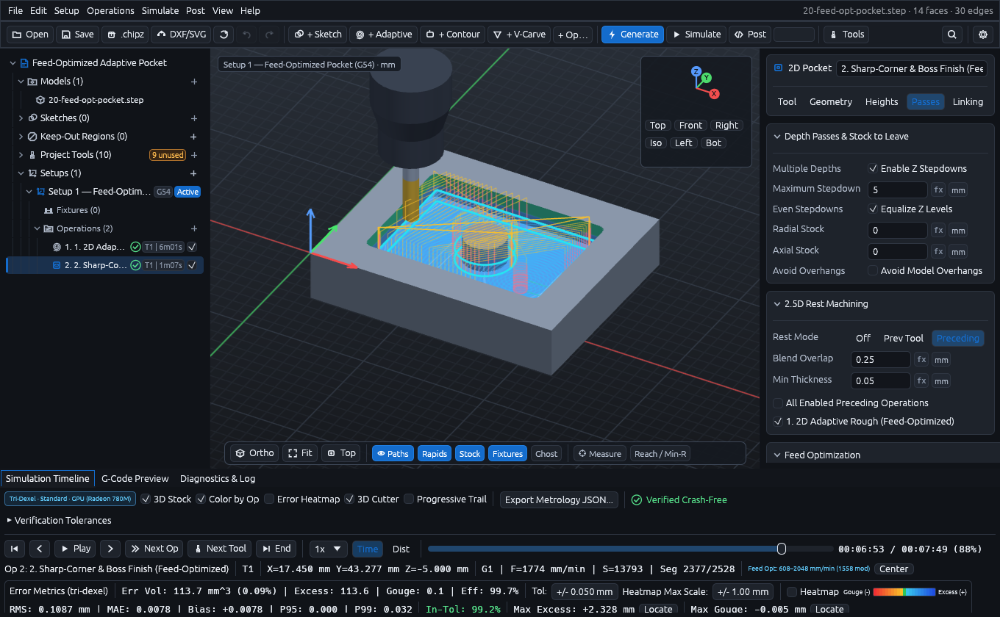
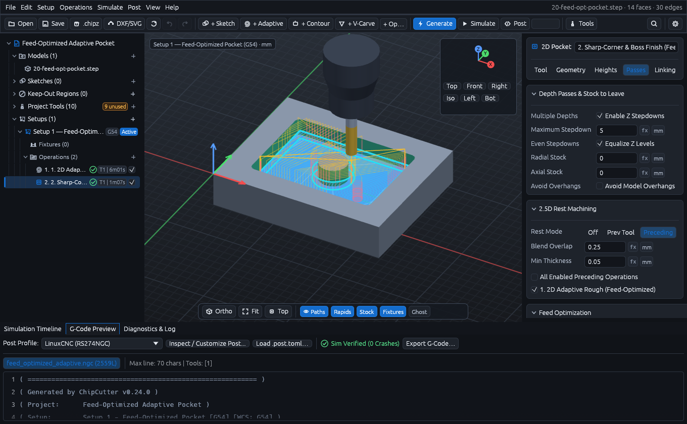

# Tutorial 20: GPU-Accelerated Simulation, Benchmarking, & Feedrate Optimization

## 1. Goal & What You'll Learn

High-resolution 3D volumetric stock verification and smooth, chatter-free corner cutting both come down to physics and throughput. ChipCutter combines two complementary engines to close the loop between fast visual inspection and machine-friendly G-code:

- **`wgpu` Compute Simulation & Direct GPU Stock Rendering:** Runs 2.5D **Heightmap**, 3D volumetric **Tri-Dexel**, and 4th-axis **Cylindrical** material removal, crash/gouge verification, and parallel-reduction error metrology directly on your Vulkan/Metal/DX12 GPU (`Auto (GPU)` / `GPU` / `CPU`), rendering stock buffers straight to the viewport with zero CPU readback and `< 0.1 ms` live **Error Heatmap** updates.
- **Engagement-Aware Feedrate Optimization (`FeedOptimizationConfig`):** Post-processes generated cutting toolpaths across 2.5D, 3-axis, V-carve, and 4th-axis strategies to automatically slow down into sharp corners and tight concave internal arcs—and optionally boost straight light-engagement passes for constant chipload—while preserving exact geometry and never altering rapids, plunges, or ramps.

By the end of this tutorial you will be able to:

1. Switch between **`Auto (GPU)`**, **`GPU (Compute)`**, and **`CPU (Exact)`** in the **Simulation Timeline** toolbar, read the live adapter pill (**`GPU · <Adapter>`** vs. **`CPU (Exact)`** / **`CPU Fallback`**), and inspect per-stage timing breakdowns (`setup`, `sweep`, `metrics`, and `seg/s`).
2. Use **Direct GPU Stock Rendering** on **Tri-Dexel (`Fine (288)`)** and 4th-axis **Cylindrical (`Ultra (2048)`)** simulations while tuning the **Error Heatmap** `Tol: +/-` band live in `< 0.1 ms` with zero CPU re-meshing.
3. Configure the **`Feed Optimization`** card in **`Operation Inspector → Passes`** (**Corner Slowdown**, **Min Feed %**, **Corner Threshold**, **Slowdown Distance**, **Internal Arcs**, and **Chip-Thinning Boost**).
4. Inspect live modulated feedrate telemetry (**`Feed Opt: <min>–<max> mm/min (<N> mod)`** and per-segment `F=...` HUD readouts) while scrubbing through sharp concave corners and internal arcs.
5. Tune 3D and 4th-axis surface finish quality using **Target Cusp Height** / **Max Cusp Height** alongside **In-Tol %**, **RMS**, and **Max Gouge** metrology.
6. Benchmark GPU vs. CPU throughput and numerical parity headlessly with **`chipcutter simulate --backend gpu --benchmark --json`**.

---

## 2. Prerequisites & Starter Projects

This tutorial uses three built-in starter projects shipped with ChipCutter (zero external downloads required):

```bash
# Starter A: Primary sharp-corner island pocket with Engagement-Aware Feed Optimization enabled
chip-gui --sample feed-opt-pocket

# Or open the bare starter STEP solid (100 x 80 x 20 mm pocket + Ø16 mm central boss) to configure from scratch
chip-gui docs/tutorials/assets/20-feed-opt-pocket.step

# Starter B: 3-axis Sculpted Dome STL for Tri-Dexel Fine (288) GPU compute & cusp tuning
chip-gui --sample mesh-dome

# Starter C: Simultaneous 4-Axis Helical Flute Shaft (87k segments) for Ultra (2048) GPU & Error Heatmap benchmarking
chip-gui --sample rotary-4axis
```

> [!TIP]
> You can open any of these directly inside `chip-gui` via **`File → Sample Projects Gallery…`** (or press **`Ctrl+K`** and type `Feed-Opt`, `Dome`, or `Rotary`).

---

## 3. Step-by-Step GUI Walkthrough

### Step 1 — Selecting the GPU Compute Backend & Reading Stage Timings

1. Open **`Sculpted Dome (STL Mesh)`** (`--sample mesh-dome`) and press **`Ctrl+G`** to generate all three operations (`3D Adaptive Roughing`, `3D Waterline Semi-Finish`, and `3D Pencil Fillet Cleanup`).
2. Open the bottom **`Simulation Timeline`** tab and configure the toolbar controls from left to right:
   - **Engine:** Switch to **`Tri-Dexel (Volumetric 3D)`**.
   - **Resolution:** Select **`Fine (288)`** (`288³` isotropic 3D dexel lattice).
   - **Backend:** Choose **`Auto (GPU)`** (recommended default—uses `wgpu` Compute automatically and falls back transparently to exact CPU + Rayon if no compute adapter is available) or explicitly pin **`GPU (Compute)`** / **`CPU (Exact)`**. Your choice is persisted automatically in `~/.config/chipcutter/prefs.toml`.
3. Look at the compact status pill immediately to the right of the Backend dropdown:
   - **`GPU · <Adapter>`** (blue badge, e.g., **`GPU · Radeon 780M`**): GPU compute and zero-readback direct stock rendering are active.
   - **`CPU (Exact)`** (neutral badge): Explicit exact CPU + Rayon verification mode (ideal for bit-level cross-checking).
   - **`CPU Fallback`** (amber badge): No compute GPU adapter was detected, so ChipCutter ran exact CPU simulation automatically.
4. **Hover your mouse over the `GPU · <Adapter>` pill** to read the live per-stage benchmark tooltip:
   - `Last run: <total> ms (setup <target_setup> ms · sweep <sweep> ms · metrics <metrics> ms) · <N> segs (<R> seg/s)`
   - Notice that background simulation runs on an isolated worker thread and `wgpu` queue, keeping the viewport camera and window resize completely responsive even during dense `Fine` / `Ultra` sweeps.



---

### Step 2 — Direct GPU Stock Rendering & Live `< 0.1 ms` Error Heatmap Tuning

When running on the GPU backend, ChipCutter renders machined stock directly from VRAM storage buffers (`Heightfield`, `Cylindrical`, and indirect-draw `Tri-Dexel`) without copying megabytes of mesh data back to the CPU. Toggling **`Error Heatmap`** or dragging **`Tol: +/-`** updates only a single 336-byte visual uniform buffer on the GPU (`< 0.1 ms`, zero re-sweep and zero CPU re-meshing).

1. Launch **`Simultaneous 4-Axis Helical Flute`** (`--sample rotary-4axis`) and press **`Ctrl+G`**.
2. In the **`Simulation Timeline`** toolbar:
   - Set **Resolution** to **`Ultra (2048)`** and **Backend** to **`GPU`**.
   - Click **`Refresh Simulation`** and notice how quickly the GPU sweeps tens of thousands of simultaneous `X+Y+Z+A` segments compared to CPU Ultra mode.
3. Check **`Error Heatmap`** in the toolbar (and optionally uncheck **`3D Cutter`** for a clear view of the machined flutes).
4. Drag the **`Tol: +/- 0.050 mm`** field tighter (for example `+/- 0.025 mm`) or looser (`+/- 0.100 mm`):
   - The diverging heatmap band (**Red/Yellow** = Gouge `-`, **Green** = Within `±Tol`, **Cyan/Blue** = Uncut Excess `+`) updates instantaneously in real time.
   - Notice how the finished helical flutes show tight conformance (`Max Gouge: -0.015 mm`, **`Verified Crash-Free`**), while the unmachined dark-blue collars on both ends accurately mark the chuck/tailstock excess (`+1.011 mm`).



---

### Step 3 — Enabling Engagement-Aware Feedrate Optimization

Sharp `90°` concave pocket corners and small-radius internal arcs cause instantaneous radial engagement (`ae`) and cutting-edge chip load to spike sharply—often leading to tool chatter, deflection marks, or broken small endmills.

1. Open **`Feed-Optimized Adaptive Pocket`** (`--sample feed-opt-pocket`)—or open [`docs/tutorials/assets/20-feed-opt-pocket.step`](assets/20-feed-opt-pocket.step) and create a `2D Adaptive Clearing` + `2D Pocket` finish pair on the `Z = 10 mm` pocket floor with a `Ø6 mm` Flat Endmill.
2. Select **`1. 2D Adaptive Rough (Feed-Optimized)`** in the left **CAM Browser** and open the **`Passes`** tab in the right **Operation Inspector**.
3. Expand the **`Feed Optimization`** card and review each control:
   - **`Feed Optimization` → `Enable Engagement-Aware Feed`:** Master opt-in switch (off by default on legacy projects so existing `.chip.toml` files stay 100% unchanged).
   - **`Corner Slowdown` → `Lookahead Deceleration`:** Splits linear cutting segments within **`Slowdown Distance`** of sharp turns (`deflection >= Corner Threshold`), decelerating monotonically into the corner apex and ramping back up smoothly after exit—preserving exact path geometry.
   - **`Min Feed %` (`35%`):** Floor percentage of nominal cutting feed (`15%–100%`) so the cutter slows safely without stalling or rubbing/melting the workpiece.
   - **`Corner Threshold` (`25°`):** Minimum turn angle (`5°–120°`) that triggers lookahead deceleration.
   - **`Slowdown Distance` (`3.0 mm` / `tool_d * 0.5`):** Deceleration approach distance before a sharp corner (recovery ramps back over `0.5 × Slowdown Distance`). Accepts parametric expressions like `tool_d * 0.5`.
   - **`Internal Arcs` → `Perimeter-to-Center Scaling`:** Applies exact centerline feed scaling on concave `G17` cutting arcs (`R_tool < R_arc < 4 × R_tool`):
     ```text
     F_center = F_nom * clamp((R_arc - R_tool) / R_arc, min_feed_fraction, 1.0)
     ```
     This keeps true cutting-edge chip load constant around tight internal corners and pockets.
   - **`Chip-Thinning Boost` → `Boost Straight Passes`** + **`Max Multiplier` (`1.5x`):** Gently accelerates straight/low-curvature light-engagement passes up to `Max Multiplier` (`1.0x–2.5x`) to maintain constant chipload while still throttling back down inside corners and internal arcs. Never accelerates plunges, ramps, leads, or rapids.
4. Inspect **`2. Sharp-Corner & Boss Finish (Feed-Optimized)`** (`2D Pocket` with `2.5D Rest Machining → Preceding`) to confirm the same **`Feed Optimization`** card protects the `90°` outer pocket corners and circular `Ø16 mm` central boss finish passes.



---

### Step 4 — Inspecting Modulated Feedrate Telemetry in Simulation Timeline

1. Press **`Ctrl+G`** to regenerate both operations in `feed-opt-pocket`.
2. Switch to the bottom **`Simulation Timeline`** tab, select **`Tri-Dexel (Volumetric 3D)`** (`Standard (160)` or `Fine (288)`), **`GPU`**, and check **`3D Stock`** + **`3D Cutter`**.
3. Scrub the timeline into **`Op 2: 2. Sharp-Corner & Boss Finish (Feed-Optimized)`** (around `00:06:53 / 00:07:49`, ~`88%` progress) and read the live controller HUD row:
   - Active motion readout: **`G1 | F=1774 mm/min | S=13793 | Seg 2377/2528`** — use the **Left/Right Arrow** keys (or `<` / `>` step buttons) around a `90°` pocket corner to watch `F` step smoothly down approaching the apex and recover cleanly on the next straight wall.
   - Modulated feed telemetry pill: **`Feed Opt: 608–2048 mm/min (1558 mod)`** — confirms the exact minimum-to-maximum modulated cutting feedrate span and the count of modulated cutting segments across the Setup.
4. Hover over the `G1 | F=...` readout or `Feed Opt:` pill for the full Setup feed-range summary, and verify the metrology row reads **`In-Tol: 99.2%`**, **`Eff: 99.7%`**, and **`Max Gouge: -0.005 mm`**.



---

### Step 5 — Tuning Surface Finish Quality with Cusp Height & Ultra Error Heatmap

Pair **GPU Ultra Error Heatmap** with cusp-height controls to dial in curved 3D and 4th-axis finishes quantitatively instead of guessing stepover values:

1. On **3D Waterline / Z-Level** (`--sample mesh-dome`, Op 2 shown in Step 1) or **3D Constant-Scallop**, enable **`Adaptive Stepdown`** and tighten **`Max Cusp Height`** (e.g., `0.08 mm` semi-finish → `0.015–0.025 mm` fine finish).
2. On **Simultaneous 4-Axis** (`--sample rotary-4axis`, Op 2 shown in Step 2), check **`Stepover Mode → Use Target Cusp Height`** and lower **`Target Cusp`** (e.g., `0.05 mm` → `0.02 mm`).
3. Press **`Ctrl+G`** → **`Refresh Simulation`** on **`GPU`**:
   - Watch **RMS (`mm`)**, **P95/P99 (`mm`)**, and **In-Tol %** improve immediately across the machined region, and click **`Locate`** next to **`Max Excess`** or **`Max Gouge`** to zoom straight onto any remaining scallop ridge.

---

## 4. Key Parameters Reference

### Simulation Backend & Resolution Controls (`Simulation Timeline` Toolbar)

| Control / Preset | Grid / Behavior | Recommended Usage & Notes |
|---|---|---|
| **`Backend: Auto (GPU)`** | Uses `wgpu` Compute (Vulkan/Metal/DX12) when available; transparent CPU + Rayon fallback | Best everyday default; zero-readback direct stock rendering & `< 0.1 ms` Error Heatmap slider |
| **`Backend: GPU (Compute)`** | Explicitly prefers GPU compute & VRAM checkpoints | Best for `Fine` / `Ultra` 3D & 4th-axis inspection and GPU throughput benchmarking |
| **`Backend: CPU (Exact)`** | Forces exact CPU + Rayon volumetric kernel & CPU-tessellated stock | Ideal for numerical parity verification against GPU runs or headless machines without a GPU |
| **`Standard`** | `Heightmap: 512` · `Tri-Dexel: 160³` | Instant interactive iteration during initial toolpath drafting |
| **`Fine`** | `Heightmap: 1024` · `Tri-Dexel: 288³` | High-precision 3D wall/fillet inspection & quantitative metrology |
| **`Ultra`** | `Heightmap: 2048` · `Tri-Dexel: 448³` | Final fine-scallop & 4th-axis rotary surface inspection (GPU strongly recommended — up to `5.6×` faster!) |
| **VRAM Checkpoints** | Periodic GPU stock snapshots cached in VRAM (evicted safely on memory pressure) | Enables fast timeline scrubbing without re-sweeping from `t = 0` |

### Engagement-Aware Feed Optimization (`Operation Inspector → Passes → Feed Optimization`)

| UI Label | Config Field | Default | Safe Starting Range (Al / Wood / Plastic) | Purpose |
|---|---|---|---|---|
| **`Feed Optimization`** | `enabled` | Off (`false`) | On for pockets, contours, adaptive, & 3D finishing | Master opt-in switch; skipped automatically on `DrillBore` & `ThreadMill` |
| **`Corner Slowdown`** | `corner_slowdown` | Checked (`true`) | Checked (`true`) | Inserts monotonic lookahead deceleration & exit recovery ramps around sharp linear corners |
| **`Min Feed %`** | `min_feed_fraction` | `35%` (`0.35`) | `30–40%` (Al) · `40–50%` (Wood/Plastic) | Hard lower floor (`15%–100%`) preventing tool rubbing, heat buildup, or chip welding |
| **`Corner Threshold`** | `corner_angle_threshold_deg` | `25°` | `20°–30°` (Al) · `30°–45°` (Wood/Plastic) | Minimum deflection angle (`5°–120°`) that triggers corner deceleration |
| **`Slowdown Distance`** | `slowdown_distance` | `tool_d * 0.5` | `0.5 × tool_d` (`3.0 mm` for Ø6 mm cutter) | Approach distance before corner apex (recovery ramps over `0.5 ×` distance) |
| **`Internal Arcs`** | `internal_arc_scaling` | Checked (`true`) | Checked (`true`) | Scales concave `G17` arc centerline feed by `(R_arc − R_tool) / R_arc` when `R_tool < R_arc < 4·R_tool` |
| **`Chip-Thinning Boost`** | `chip_thinning_boost` | Unchecked (`false`) | Checked for light-`ae` Adaptive / finish passes | Boosts straight/low-curvature light-engagement passes to preserve constant chipload |
| **`Max Multiplier`** | `max_thinning_multiplier` | `1.5x` | `1.3x–1.5x` (Al) · `1.5x–1.8x` (Wood/Plastic) | Upper cap (`1.0x–2.5x`) on boosted straightaway cutting feed relative to nominal feed |

---

## 5. Generate (`Ctrl+G`) & Verification Gate

Before exporting G-code for a feed-optimized job:

1. Press **`Ctrl+G`** and verify both operations show green **`Clean`** badges in the CAM Browser (`142` adaptive passes + `8` rest-finish passes on `feed-opt-pocket`).
2. Confirm **`Verified Crash-Free`** (`0` critical crashes, `0` target gouges, `0` fixture collisions) in the **Simulation Timeline** toolbar.
3. Verify the metrology bar reports **`Max Gouge <= 0.020 mm`** (`-0.005 mm` in Tri-Dexel / `-0.000 mm` in Heightmap on `feed-opt-pocket`) and **`In-Tol >= 99%`** at `+/- 0.050 mm`.
4. **Geometry Invariance Guarantee:** Enabling **`Feed Optimization`** splits deceleration ramp segments strictly along existing cutting vectors and preserves exact endpoints—meaning finished stock geometry is identical to an unoptimized run while peak corner spindle load drops dramatically.

---

## 6. Post-Processing (`GRBL` & `LinuxCNC`)

1. Switch to the bottom **`G-Code Preview`** tab (or click **`Post`** in the top toolbar).
2. Confirm the green **`Sim Verified (0 Crashes)`** badge appears beside **`Post Profile`**.
3. Choose **`LinuxCNC (RS274NGC)`** (single `.ngc` program) or **`Grbl 1.1 / FluidNC`** (auto-split per tool `.nc`, max `<= 70` chars/line) and click **`Export G-Code…`**.



Inspecting the emitted `G1`/`G2`/`G3` blocks confirms smooth lookahead deceleration approaching corners, exact perimeter-scaled internal arc feeds, and full feed recovery on straightaways (while plunges and helical ramps remain untouched):

```gcode
( Helical entry ramp unchanged at ramp feed, then concave internal arcs scale smoothly with radius )
G3 X70.6997 Y33.3243 I-4.0200 J0.0000 F702.4    ; tight concave arc -> scaled down to protect chip load
G3 X70.6997 Y34.8243 I-5.5200 J0.0000 F916.2    ; wider internal arc -> higher safe centerline feed
G3 X70.6997 Y37.8243 I-8.5200 J0.0000 F1300.2   ; expanding engagement arc
G1 Y34.6979 F2048.2                             ; straight light-engagement pass (chip-thinning boost)
( Lookahead corner deceleration ramp approaching a sharp turn )
G1 Y35.6968 F1965.5
Y36.6958 F1882.8
Y37.6948 F1800.1
```

---

## 7. Headless CLI Equivalent (`chipcutter`)

Use **`chipcutter simulate`** with **`--backend gpu|cpu`**, **`--resolution standard|fine|ultra`**, **`--benchmark`**, and **`--json`** to reproduce validation, GPU vs. CPU benchmarking, parity verification, and verified G-code export from the terminal or CI:

```bash
# 1. Generate the starter STEP solid + 2-operation feed-optimized project
chipcutter generate-sample-step /tmp/20-feed-opt-pocket.step \
  --tutorial 20-feed-opt \
  --project-out /tmp/20-feed-opt.chip.toml

# 2. Validate setup, tools, and generate all feed-optimized toolpaths
chipcutter validate --generate /tmp/20-feed-opt.chip.toml

# 3. Benchmark GPU Compute vs. exact CPU at Heightmap Ultra (2048) resolution
chipcutter simulate /tmp/20-feed-opt.chip.toml \
  --engine heightmap --backend gpu --resolution ultra --benchmark
chipcutter simulate /tmp/20-feed-opt.chip.toml \
  --engine heightmap --backend cpu --resolution ultra --benchmark

# 4. Run 3D Tri-Dexel GPU simulation and save structured benchmark + metrology JSON
chipcutter simulate /tmp/20-feed-opt.chip.toml \
  --engine tri-dexel --backend gpu --resolution standard --benchmark --json \
  > /tmp/20-tridexel-gpu-bench.json

# 5. Cross-check exact CPU Tri-Dexel parity against GPU
chipcutter simulate /tmp/20-feed-opt.chip.toml \
  --engine tri-dexel --backend cpu --resolution standard --benchmark

# 6. Build safety-verified G-code with modulated F words for GRBL and LinuxCNC
chipcutter build /tmp/20-feed-opt.chip.toml -o /tmp/out_feed_opt_grbl --post grbl
chipcutter build /tmp/20-feed-opt.chip.toml -o /tmp/out_feed_opt_linuxcnc --post linuxcnc
```

### Example Verified GPU vs. CPU Benchmark Results (`AMD Radeon 780M` Vulkan)

| Workload | Resolution & Segments | CPU Exact (Rayon) | GPU Compute (`wgpu` Vulkan) | Speedup | RMS / In-Tol Parity |
|---|---|---|---|---|---|
| **`feed-opt-pocket`** (Heightmap) | `Fine (1024)` · `2,528 segs` | `1,232.9 ms` (`2,051 seg/s`) | **`690.3 ms`** (`3,662 seg/s`, metrics `0.75 ms`) | **`1.8×`** | Identical (`0.3269 mm` / `99.9%`) |
| **`feed-opt-pocket`** (Heightmap) | `Ultra (2048)` · `2,528 segs` | `4,324.8 ms` (`585 seg/s`) | **`1,918.7 ms`** (`1,318 seg/s`, metrics `2.18 ms`) | **`2.3×`** | Identical (`0.3034 mm` / `99.9%`) |
| **`rotary-4axis`** (Cylindrical) | `Fine (1024)` · `87,003 segs` | `46,243.3 ms` (`1,881 seg/s`) | **`10,111.3 ms`** (`8,605 seg/s`, metrics `0.32 ms`) | **`4.6×`** | Identical (`0.4827 mm` / `70.9%`) |
| **`rotary-4axis`** (Cylindrical) | `Ultra (2048)` · `87,003 segs` | `90,277.5 ms` (`964 seg/s`) | **`15,983.8 ms`** (`5,443 seg/s`, metrics `0.45 ms`) | **`5.6×`** | Identical (`0.4827 mm` / `70.8%`) |

> [!NOTE]
> Even on an integrated laptop GPU (`Radeon 780M`), parallel GPU reduction drops `metrics_ms` by **`20–28×`** (`< 2.2 ms` even at `Ultra (2048)`!) while delivering identical 4-decimal RMS and In-Tol % parity with the exact CPU reference kernel.

---

## Navigation

- **Previous:** [Tutorial 19 — Two-Sided Flip Workholding, 3D Fixtures, & Auto Soft Jaws](19-workholding-flip-jigs-soft-jaws.md)
- **Next:** [Tutorial 21 — 3D Edge Deburring & Non-Planar Chamfering (`Deburr3D`)](21-3d-edge-deburring-nonplanar-chamfering.md)
- **Related:** [Tutorial 17 — Tri-Dexel Volumetric Simulation & Quantitative Error-Volume Analysis](17-tridexel-simulation-error-metrics.md)
- **Index:** [All Tutorials (`00`–`22`)](README.md)
