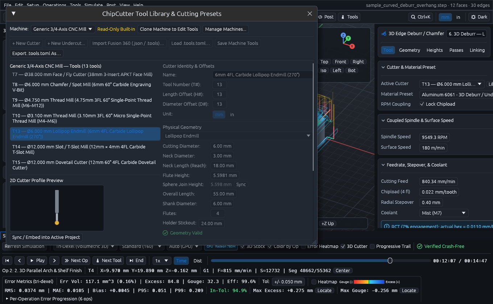
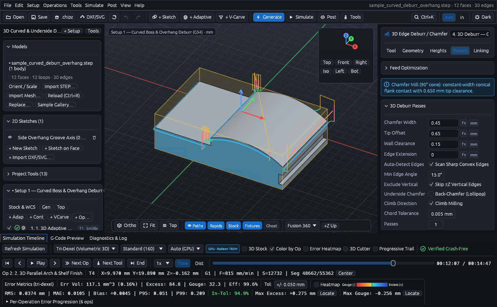
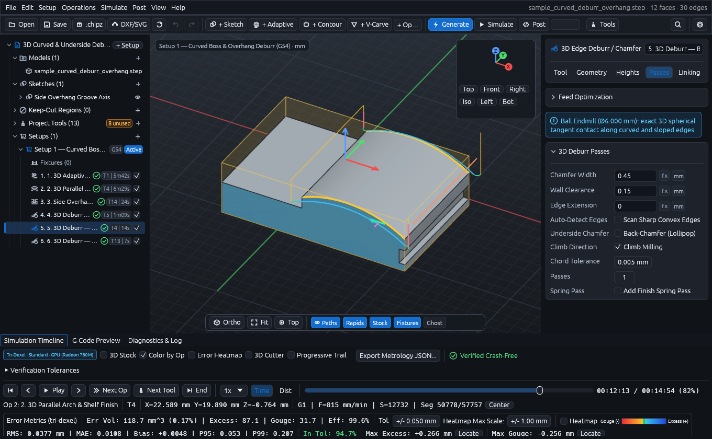
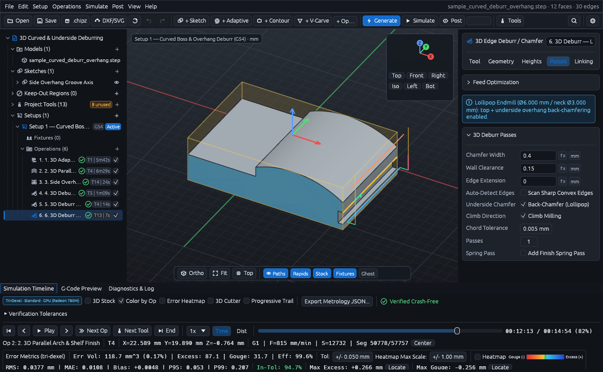
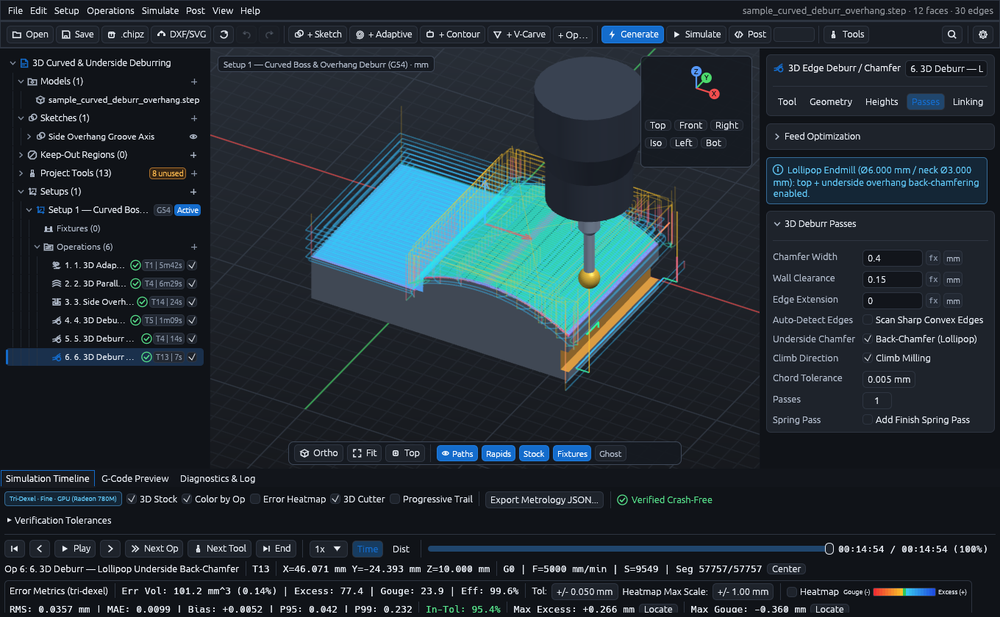
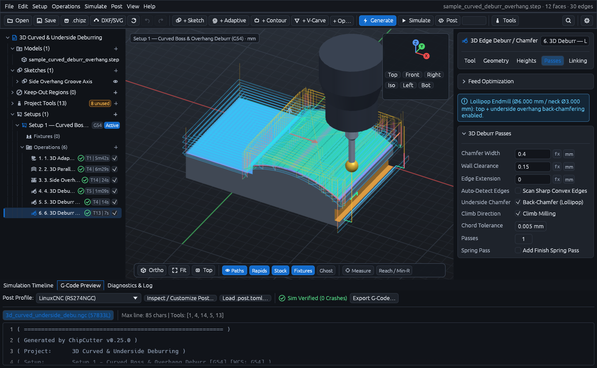

# Tutorial 21: 3D Edge Deburring & Non-Planar Chamfering (`Deburr3D`)

## 1. Goal & What You'll Learn

Real-world machined parts rarely have only flat, horizontal edges. Arched tops, sloped intersections, stepped bosses, and overhanging flanges all leave sharp burrs that conventional 2D edge chamfering cannot follow without gouging neighboring walls or requiring a second vise setup.

ChipCutter's **`3D Edge Deburr / Chamfer`** (`OperationKind::Deburr3D`) strategy traces true 3D B-Rep curves in `X + Y + Z` simultaneously using exact analytic cutter-contact math for three cutter families:

- **Chamfer Mill (`ChamferMill`):** Constant-width conical flank contact with configurable **`Tip Offset`** so the cutter engages on its strong conical flute rather than its fragile dead-center tip.
- **Ball Endmill (`BallEndmill`):** Exact 3D spherical tangent contact along variable-slope curved rims and arched intersections where a fixed-angle cone would produce an uneven bevel width.
- **Lollipop Endmill (`LollipopEndmill`):** Relieved-neck spherical cutter capable of deburring **both top-accessible 3D edges and downward-facing underside overhang lips** (`Back-Chamfer (Lollipop)`) in a single setup—no part flip required.

By the end of this tutorial you will be able to:

1. Create and inspect a relieved-neck **`Lollipop Endmill`** in the **Tool Library** (`Cutting Diameter`, `Neck Diameter`, `Neck Length (Reach)`, `Flute Height`, and analytic **`Sphere Join Height`**).
2. Configure **`3D Edge Deburr / Chamfer`** with **`Auto-Detect Edges`** (`Min Edge Angle`, `Exclude Vertical`), constrain auto-detected edges spatially via the **`Geometry → Cutting Area / Machining Boundary`** card (`Stock Bounds`, `Model Silhouette`, or `Selected Regions` + `Tool Containment` + signed `Boundary Offset` with live 3D boundary preview), or pick explicit 3D B-Rep edge chains.
3. Rely on automatic **`FlatBvh` inside-corner wall collision trimming** (`Wall Clearance`), circular corner rolls, and tangent lead-in/out arcs to stop cleanly before adjacent vertical walls and stepped bosses.
4. Compare **Chamfer Mill** vs. **Ball Endmill** contact across non-planar circular-arc arches.
5. Enable **`Underside Chamfer` → `Back-Chamfer (Lollipop)`** to chamfer downward-facing overhang rims from underneath while keeping the relieved neck safely clear of vertical walls.
6. Verify intentional edge breaks crash-free in **GPU Tri-Dexel (`Fine (288)`)** simulation and export verified **LinuxCNC** and **GRBL** G-code.

---

## 2. Prerequisites & Starter Projects

This tutorial uses one built-in multi-tool sample project and two minimal starter STEP solids shipped with ChipCutter:

```bash
# Starter A: Complete 6-op 3D Curved & Underside Deburring sample (80 x 50 x 23 mm)
# Combines curved arch, stepped boss wall (X = 35), and +X overhang relief groove (Z = 9.5)
chip-gui --sample curved-deburr-3d

# Starter B: Bare sloped curved-arch + stepped boss STEP solid to practice from scratch
chip-gui docs/tutorials/assets/21-sloped-boss-deburr.step

# Starter C: Bare T-shaped overhang flange STEP solid (80 x 50 x 18 mm, 12 mm underside lips)
chip-gui docs/tutorials/assets/21-overhang-flange.step
```

> [!TIP]
> You can also launch **`3D Curved & Underside Deburring`** directly inside `chip-gui` via **`File → Sample Projects Gallery…`** (or press **`Ctrl+K`** and type `Curved Deburr`).

---

## 3. Step-by-Step GUI Walkthrough

### Step 1 — Creating & Inspecting a Lollipop Endmill in the Tool Library

1. Launch `chip-gui --sample curved-deburr-3d` and click **`Tools`** in the top toolbar (or press **`Ctrl+K`** → `Open Tool Library`).
2. To add a starter undercut cutter to a custom machine library, click **`+ New Undercut…` → `Lollipop Endmill (Ø6 mm)`** (built-in machines are read-only; click **`Clone Machine to Edit Tools`** first if you want to save custom tools to your machine).
3. Select **`T13 — Ø6.000 mm Lollipop Endmill (6mm 4FL Carbide Lollipop Endmill (270°))`** and inspect the **Physical Geometry** fields alongside the live **2D Cutter Profile Preview** schematic:
   - **`Cutting Diameter:`** `6.00 mm` — full spherical ball diameter ($D = 2R$).
   - **`Neck Diameter:`** `3.00 mm` — relieved cylindrical neck behind the sphere (must be strictly `< Cutting Diameter`; radial overhang reach is $(D - D_{\text{neck}})/2 = 1.50\text{ mm}$).
   - **`Neck Length (Reach):`** `18.00 mm` — usable relieved reach from the tip up to the shank taper.
   - **`Flute Height:`** `5.598 mm` — axial height of the spherical cutting head up to the neck join.
   - **`Sphere Join Height:`** `5.598 mm` + **`Sync`** button — analytic height $R + \sqrt{R^2 - r_{\text{neck}}^2}$ where the sphere meets the relieved neck cylinder. Click **`Sync`** anytime you change Cutting Diameter or Neck Diameter to keep the cutting envelope mathematically exact.
   - Confirm the green **`Geometry Valid`** indicator appears below `Holder Stickout`.



---

### Step 2 — Adding `3D Edge Deburr / Chamfer` (`ChamferMill`) & Automatic Wall Trimming

In `--sample curved-deburr-3d`, Operations 1–3 rough and finish the stepped shelf (`Z = 14.0 mm`), the curved circular-arc arch (`Z = 15.0..23.0 mm`), and the `+X` side overhang relief groove (`Z = 3.0..9.5 mm`). Now inspect Operation 4:

1. In the left **CAM Browser**, select **`4. 3D Deburr — Chamfer Mill (Wall-Trimmed)`** (or confirm **`Setup 1`** is the **Active Setup** and add a new operation via **`+ Op… → 3D Edge Deburr / Chamfer`** in the **top toolbar**, or **`Operations → + 3D Edge Deburr / Chamfer`** in the **top menu bar**).
2. Open **`Operation Inspector → Geometry`** to inspect the **`Cutting Area / Machining Boundary`** card at the top:
   - Whenever **`Auto-Detect Edges`** is active (no explicit 3D edge chains picked below), this card spatially constrains which auto-detected sharp edges are machined: choose **`Boundary Source`** (**`Stock Bounds`**, **`Model Silhouette`**, or **`Selected Regions`** using 2D contours, planar faces, or sketch regions), **`Tool Containment`** (**`Tool Inside Boundary`**, **`Tool Center on Boundary`**, or **`Tool Outside Boundary`**), and a signed **`Boundary Offset`** (`+` expands outward, `-` insets inward).
   - A live summary displays the resolved `XY` span and `Tool-Center Shift`, while the **3D CAD Viewport** renders a live **3D boundary preview** (solid cyan nominal boundary loop + dashed amber effective tool-center boundary loop). Picking explicit 3D edge loops or open chains below overrides Auto-Detect mode.
3. Now switch to **`Operation Inspector → Passes`** and notice the live blue compatibility banner at the top of the card:
   - **`Chamfer Mill (90° cone): constant-width conical flank contact with 0.650 mm tip clearance.`**
   - ChipCutter validates immediately that `chamfer_width + tip_offset * tan(included_angle / 2)` fits inside the Chamfer Mill's flute radius and warns you before generation if the requested bevel exceeds flute capacity.
4. Review the **`3D Deburr Passes`** card parameters:
   - **`Chamfer Width:`** `0.45 mm` — constant edge-break leg width measured along the adjacent B-Rep faces.
   - **`Tip Offset:`** `0.65 mm` — axial distance above the pointed tip so cutting occurs on the stronger conical flank rather than the zero-SFM tip.
   - **`Wall Clearance:`** `0.15 mm` — minimum safety margin enforced against adjacent vertical walls, stepped bosses, and inside corners.
   - **`Edge Extension:`** `0 mm` — optional tangent extension past open edge ends prior to collision trimming.
   - **`Auto-Detect Edges` → `Scan Sharp Convex Edges`:** Checked. Automatically discovers every sharp convex 3D edge on the solid (within the **`Geometry → Cutting Area / Machining Boundary`** XY region) whose dihedral normal-change angle exceeds **`Min Edge Angle` (`15.0°`)** while **`Exclude Vertical` → `Skip ±Z Vertical Edges`** ignores vertical side-wall corners.
   - **`Chord Tolerance:`** `0.005 mm` — maximum 3D chord-sagitta deviation when subdividing curved non-planar B-Rep edges.
5. Press **`Ctrl+G`** and inspect the isolated viewport toolpath:
   - Watch how the toolpath traces both the flat `Z = 14.0 mm` shelf perimeter and the curved `X = 35..80 mm` arch seamlessly in `X + Y + Z`.
   - Look closely at the stepped boss junction at **`X = 35.0 mm`**: ChipCutter's **`FlatBvh` wall-collision trimmer** automatically trims the shelf deburr pass short of the vertical `Z = 14..19 mm` boss wall by `R_tool_at_wall + Wall Clearance`, adding smooth tangent lead-out/lead-in arcs and circular corner rolls so the Chamfer Mill never nicks the vertical wall!



---

### Step 3 — Non-Planar Curved Arch Deburring with a Ball Endmill

When a 3D edge sweeps across steep and shallow slopes—such as the two circular-arc arch rims along `Y = 0` and `Y = 50`—a **Ball Endmill** maintains uniform bevel width through exact 3D spherical tangent contact regardless of local face tilt.

1. Select **`5. 3D Deburr — Ball Endmill (Curved Arch)`** in the **CAM Browser** and open **`Operation Inspector → Passes`**.
2. Notice two automatic UI adaptations compared to Op 4:
   - The info banner updates to **`Ball Endmill (Ø6.000 mm): exact 3D spherical tangent contact along curved and sloped edges.`**
   - **`Tip Offset`** hides automatically (spherical cutters offset analytically along the edge's exact bisector normal rather than an axial cone tip offset).
3. On the **`Geometry`** tab, **`Auto-Detect Edges`** is unchecked and the two non-planar `CircleArc` B-Rep arch edges are selected explicitly.
4. Set **`Chamfer Width = 0.45 mm`**, **`Wall Clearance = 0.15 mm`**, **`Chord Tolerance = 0.005 mm`**, and **`Climb Direction`** checked.
5. Inspect the smooth 3D circular-arc ribbons arching cleanly across both sides of the curved boss (`Z = 19.0 → 23.0 → 15.0 mm`) with automatic tangent lead-in/lead-out transitions at both ends.



---

### Step 4 — Underside Back-Chamfering with a Lollipop Endmill

Traditional 3-axis chamfering cannot reach downward-facing overhang lips without flipping the part into a second fixture. With a relieved-neck **`Lollipop Endmill`**, ChipCutter offsets the **upper hemisphere** of the spherical head against the underside edge while checking the thin relieved neck against the vertical wall.

1. Select **`6. 3D Deburr — Lollipop Underside Back-Chamfer`** in the **CAM Browser** (or open [`docs/tutorials/assets/21-overhang-flange.step`](assets/21-overhang-flange.step) and pick the `Z = 12.0 mm` underside flange lips at `X = 8` and `X = 72`).
2. Assign **`T13 — Ø6.000 mm Lollipop Endmill`** in the **`Tool`** tab.
3. Open **`Operation Inspector → Passes`** and check **`Underside Chamfer` → `Back-Chamfer (Lollipop)`**:
   - The compatibility banner confirms: **`Lollipop Endmill (Ø6.000 mm / neck Ø3.000 mm): top + underside overhang back-chamfering enabled.`**
   - *(Safety Guard: If you check `Underside Chamfer` while a Chamfer Mill or Ball Endmill is assigned, ChipCutter immediately raises an inline error banner blocking generation until you switch to a relieved-neck Lollipop Endmill.)*
4. Set **`Chamfer Width = 0.4 mm`**, **`Wall Clearance = 0.15 mm`**, and confirm **`Heights`** bracket the overhang groove (`Top = Model Bottom + 11.0 mm`, `Bottom = Model Bottom + 2.5 mm`).
5. Inspect the viewport: the Lollipop enters horizontally from clear air past the `+X` end, engages the `Z = 9.5 mm` underside overhang lip with its upper spherical quadrant while its `Ø3.0 mm` neck stays safely clear of the upper vertical lip, and pulls away horizontally into open air before any `+Z` retract!



---

### Step 5 — GPU Tri-Dexel Verification (`intentional_edge_break_mm`)

Because a sharp CAD edge is mathematically unmodeled (`0 mm` bevel in the STEP file), breaking that edge intentionally removes a small controlled triangle of material along the sharp corner. ChipCutter's volumetric verifier automatically passes each `Deburr3D` operation's **`intentional_edge_break_mm`** (`chamfer_width`) to the gouge checker—allowing the exact intentional edge break while still catching any real wall collision, neck rub, or shank crash with full strictness.

1. Open **`Edit → Settings… → Simulation`** (`Ctrl+,`, the toolbar gear icon, or click the compact Simulation status chip on the **`Simulation Timeline`** top bar).
2. Set **`Simulation Engine`** = **`Tri-Dexel (Volumetric 3D)`**, **`Detail Level`** = **`Fine (288)`**, and **`Compute Backend`** = **`GPU (Compute)`** (or **`Auto (GPU with CPU fallback)`**)—you can also toggle **`Smooth Skinned Surfaces (Mesh Skinning)`** for visually smoother curved arches.
3. Click **`Simulate`** in the **top toolbar** (tracking progress in the toolbar bar with `Esc` cancel and logging wall-clock execution time in **`Diagnostics & Log`**), then in **`Simulation Timeline`** check **`3D Stock`**, **`Color by Op`**, and **`3D Cutter`**, scrub to `100%` (`00:14:47 / 00:14:47`), and verify:
   - Status badge reads green **`Verified Crash-Free`** (`0` critical errors, `0` wall collisions, `0` shank/neck crashes).
   - The gold revolved **`T13 Lollipop Endmill`** sphere and slender relieved neck sit cleanly above the finished `+X` undercut groove and beveled 3D arch rims.
   - Quantitative Tri-Dexel metrology reads **`Eff: 99.7%`**, **`RMS: 0.0359 mm`**, and **`In-Tol: 95.6%`** at `Tol: +/- 0.050 mm`.



---

### Step 6 — Reviewing & Exporting Verified G-Code

1. Click the bottom **`G-Code Preview`** tab (or **`Post`** in the top toolbar).
2. Confirm the green **`Sim Verified (0 Crashes)`** gate badge appears beside **`Post Profile`**.
3. Select **`LinuxCNC (RS274NGC)`** (single multi-tool `.ngc` program containing `Tools: [1, 4, 14, 5, 13]`) or **`Grbl 1.1 / FluidNC`** (automatically split into one `.nc` file per tool with safe `<= 70`-char line formatting) and click **`Export G-Code…`**.



---

## 4. Key Parameters Reference

### `Cutting Area / Machining Boundary` (`Operation Inspector → Geometry`, Auto-Detect Mode)

| UI Label | Options / Default | Purpose |
|---|---|---|
| **`Boundary Source`** | `Stock Bounds` · `Model Silhouette` · `Selected Regions` | Constrains **`Auto-Detect Edges`** spatially to a 2D XY region (pick 2D contours/planar faces/sketch regions when using `Selected Regions`; explicit 3D edge selections override Auto-Detect) |
| **`Tool Containment`** | `Tool Inside Boundary` · `Tool Center on Boundary` · `Tool Outside Boundary` | Controls cutter placement relative to the nominal boundary with live `Tool-Center Shift` readout & 3D boundary preview |
| **`Boundary Offset`** | Signed length (`0.0 mm` default; `+` expands, `-` insets) | Fine-tunes the XY inclusion region around the nominal boundary |

### `3D Deburr Passes` (`Operation Inspector → Passes`)

| UI Label | Config Field | Default | Recommended Range | Purpose |
|---|---|---|---|---|
| **`Chamfer Width`** | `chamfer_width` | `0.5 mm` | `0.2–0.8 mm` (deburr) · `1.0–2.0 mm` (cosmetic bevel) | Constant edge-break leg width measured along the adjacent B-Rep faces |
| **`Tip Offset`** *(Chamfer Mill only)* | `tip_offset` | `0.75 mm` | `0.5–1.5 mm` | Axial clearance above the pointed tip so cutting occurs on the stronger conical flank |
| **`Wall Clearance`** | `wall_clearance` | `0.15 mm` | `0.10–0.50 mm` | Minimum safety clearance from adjacent vertical walls/bosses during automatic `FlatBvh` trimming |
| **`Edge Extension`** | `edge_extension` | `0.0 mm` | `0.0–2.0 mm` | Optional tangent extension beyond open edge ends prior to neighbor-wall collision trimming |
| **`Auto-Detect Edges`** | `auto_detect_edges` | Off (`false`) | On for full-part deburr; Off for targeted edges | Scans all sharp convex 3D edges across the B-Rep solid (also auto-active if Geometry is empty) |
| **`Min Edge Angle`** | `min_dihedral_angle_deg` | `15.0°` | `15°–30°` | Minimum face-normal change to treat an edge as sharp (ignores smooth tangent fillet seams) |
| **`Exclude Vertical`** | `exclude_vertical_edges` | Checked (`true`) | Checked (`true`) | Skips pure `±Z` vertical side-wall edges during auto-detection |
| **`Underside Chamfer`** | `allow_underside_back_chamfer` | Unchecked (`false`) | Checked only with **`LollipopEndmill`** | Enables upper-hemisphere back-chamfering on downward-facing overhang lips |
| **`Climb Direction`** | `climb_direction` | Checked (`true`) | Checked (`true`) | Climb milling (cleaner burr-free edge in aluminum/steel) vs. Conventional milling |
| **`Chord Tolerance`** | `chord_tolerance_mm` | `0.005 mm` | `0.002–0.010 mm` | Maximum 3D chord-sagitta deviation along curved non-planar B-Rep edges |
| **`Passes`** | `multiple_passes` | `1` | `1` (`<= 0.6 mm` bevel) · `2–3` (`> 1.0 mm` bevel) | Progressive step-in passes up to full `Chamfer Width` |
| **`Spring Pass`** | `spring_pass` | Unchecked (`false`) | Checked for thin-neck Lollipops or steel | Appends an extra zero-offset pass at full width to remove tool deflection |

### Choosing the Right Cutter for `Deburr3D`

| Cutter Type | Best Applications | Underside Overhangs? | Notes |
|---|---|---|---|
| **Chamfer Mill (`90°`)** | Flat-to-sloped intersections, prismatic rims, crisp `45°` visual bevels | No | Fastest edge break; always keep `Tip Offset >= 0.5 mm` to avoid zero-SFM tip rubbing |
| **Ball Endmill** | Curved 3D arches, contoured bosses, variable-dihedral intersections | No | Uniform bevel width across continuously changing slopes via spherical tangent contact |
| **Lollipop Endmill (`270°`)** | Top + downward-facing overhang lips, cross-hole exit burrs, single-setup back-chamfering | **Yes** | Always verify in **Tri-Dexel**; keep horizontal reach `(D − D_neck)/2` greater than `chamfer_width + wall_clearance` |

---

## 5. Generate (`Ctrl+G`) & Tri-Dexel Verification Gate

Before posting G-code for any 3D deburring or back-chamfering job:

1. Press **`Ctrl+G`** and verify every `Deburr3D` operation displays a green **`Clean`** badge with `0` warnings.
2. Confirm **`Settings → Simulation`** (click the Simulation status chip on **`Simulation Timeline`**, or `Ctrl+,`) is set to **`Tri-Dexel (Volumetric 3D)`** (`Fine (288)` recommended whenever Lollipop underside back-chamfering is active—2.5D Heightmap cannot see underside roofs, and **`Simulation Timeline`** displays an amber **`Undercut cutter active — Heightmap is 2.5D`** pill with a 1-click **`Use Tri-Dexel`** button if Heightmap is active!), then click **`Simulate`** in the **top toolbar**.
3. Confirm **`Verified Crash-Free`** (`0` critical errors) and inspect the trimmed ends near vertical bosses to confirm smooth lead-in/lead-out arcs with zero wall nicks.
4. For Lollipop underside passes, scrub slowly through entry and exit to verify the cutter drops to cutting depth in open air, engages horizontally, and pulls completely clear of the overhang lip before retracting `+Z`.

---

## 6. Post-Processing (`GRBL` & `LinuxCNC`)

- **`LinuxCNC (RS274NGC)`:** Emits a single multi-tool `.ngc` program with `T# M6 G43 H#` tool changes across all roughing, finishing, and `Deburr3D` tools (`Tools: [1, 4, 14, 5, 13]` on `curved-deburr-3d`).
- **`Grbl 1.1 / FluidNC`:** Automatically splits the job into numbered single-tool `.nc` files (`01_T1_...nc`, `02_T4_...nc`, …, `05_T13_...nc`) with every line formatted safely for GRBL's serial buffer.
- **Auto Tri-Dexel Safety Gate:** Whenever a project contains a `LollipopEndmill` or undercut/back-chamfer operation, `chipcutter build` automatically selects the volumetric **`Tri-Dexel`** verification engine before writing G-code.

---

## 7. Headless CLI Equivalent (`chipcutter`)

Reproduce starter STEP generation, validation, GPU Tri-Dexel simulation, and safety-verified G-code builds from the terminal or CI:

```bash
# 1. Generate the Tutorial 21 bare starter STEP solids + pre-configured tool libraries
chipcutter generate-sample-step /tmp/21-sloped-boss-deburr.step \
  --tutorial 21-deburr-boss \
  --project-out /tmp/21-sloped-boss.chip.toml
chipcutter generate-sample-step /tmp/21-overhang-flange.step \
  --tutorial 21-deburr-flange \
  --project-out /tmp/21-overhang-flange.chip.toml

# 2. Validate both starter project setups and embedded undercut/deburr tools
chipcutter validate /tmp/21-sloped-boss.chip.toml
chipcutter validate /tmp/21-overhang-flange.chip.toml

# 3. Generate, simulate in GPU Tri-Dexel Fine mode, and build the full Phase 18
#    Undercut & 3D Edge Deburr / Lollipop Back-Chamfer benchmark project
chipcutter generate-sample-step /tmp/21-deburr-verify.step \
  --undercut-block \
  --project-out /tmp/21-deburr-verify.chip.toml
chipcutter validate --generate /tmp/21-deburr-verify.chip.toml
chipcutter simulate /tmp/21-deburr-verify.chip.toml \
  --engine tri-dexel --backend gpu --resolution fine --benchmark
chipcutter build /tmp/21-deburr-verify.chip.toml -o /tmp/out_21_grbl --post grbl
chipcutter build /tmp/21-deburr-verify.chip.toml -o /tmp/out_21_linuxcnc --post linuxcnc
```

---

## Navigation

- **Previous:** [Tutorial 20 — GPU-Accelerated Simulation, Benchmarking, & Feedrate Optimization](20-gpu-simulation-feed-optimization.md)
- **Next:** [Tutorial 22 — Undercut Milling: Keyways, T-Slots, Dovetails, & Lollipop 3D Undercuts](22-undercut-tslot-dovetail-lollipop.md)
- **Index:** [All Tutorials (`00`–`22`)](README.md)
