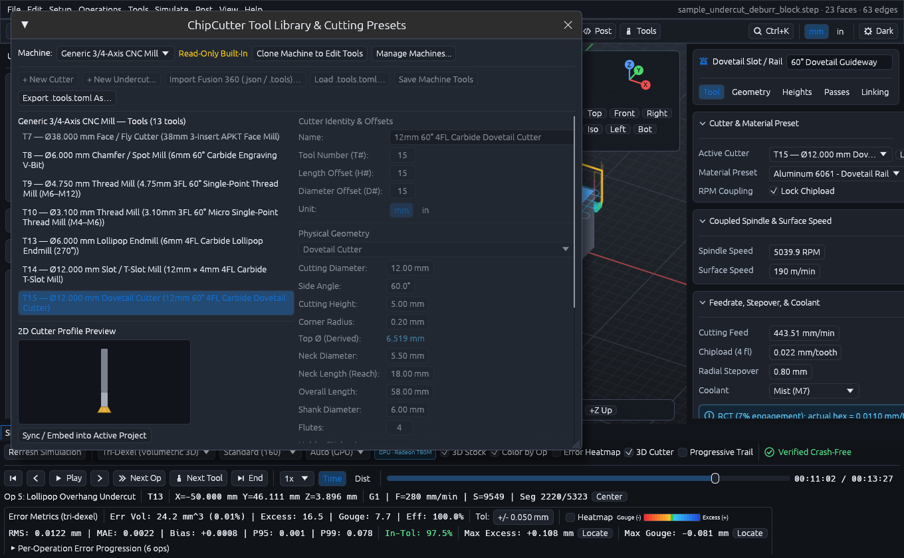
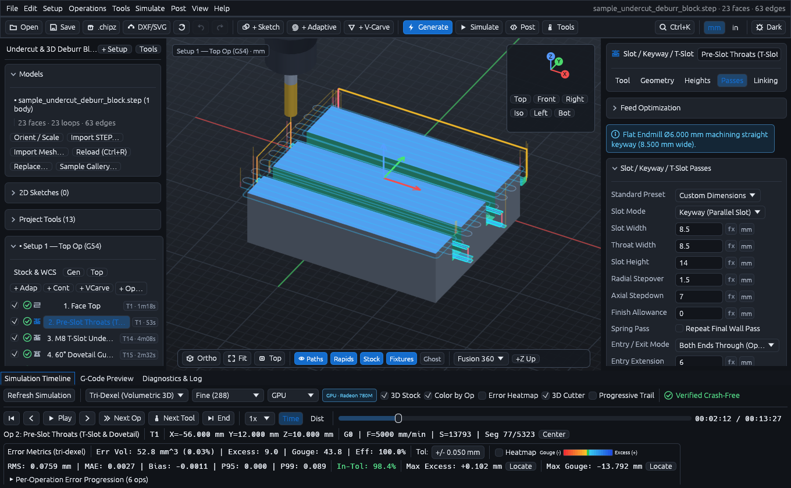
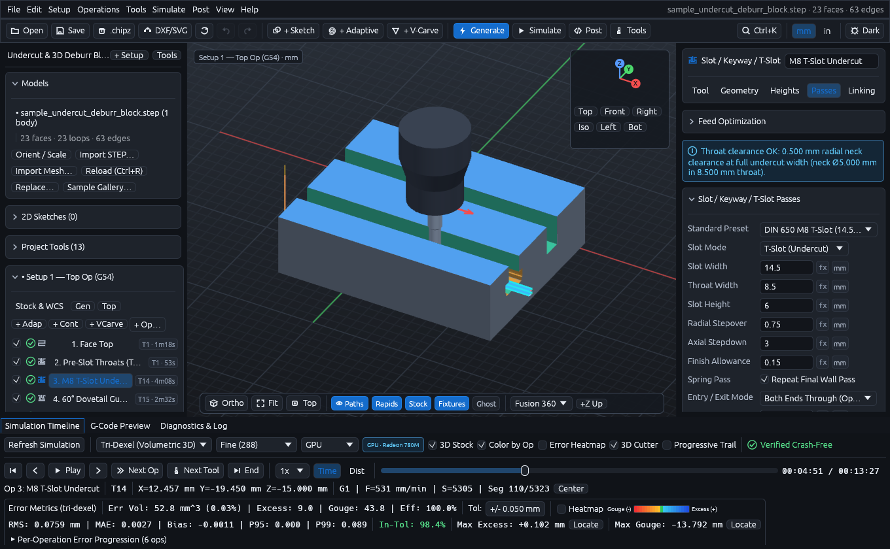
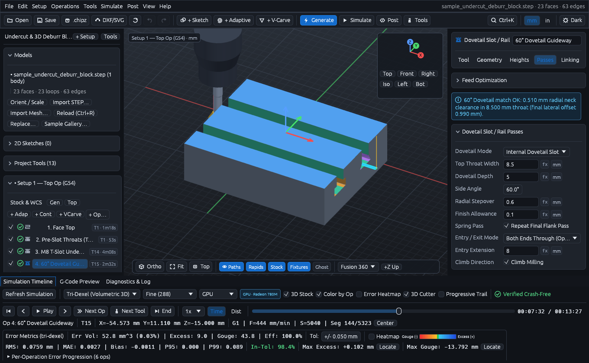
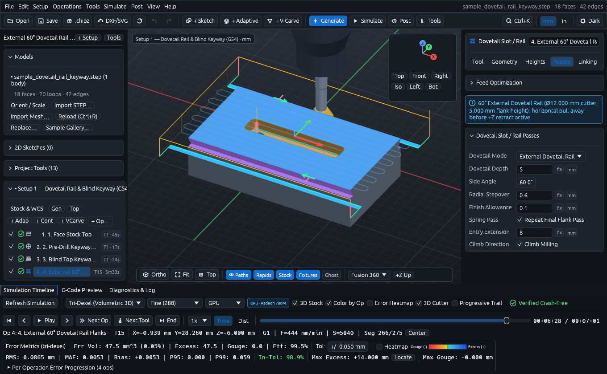
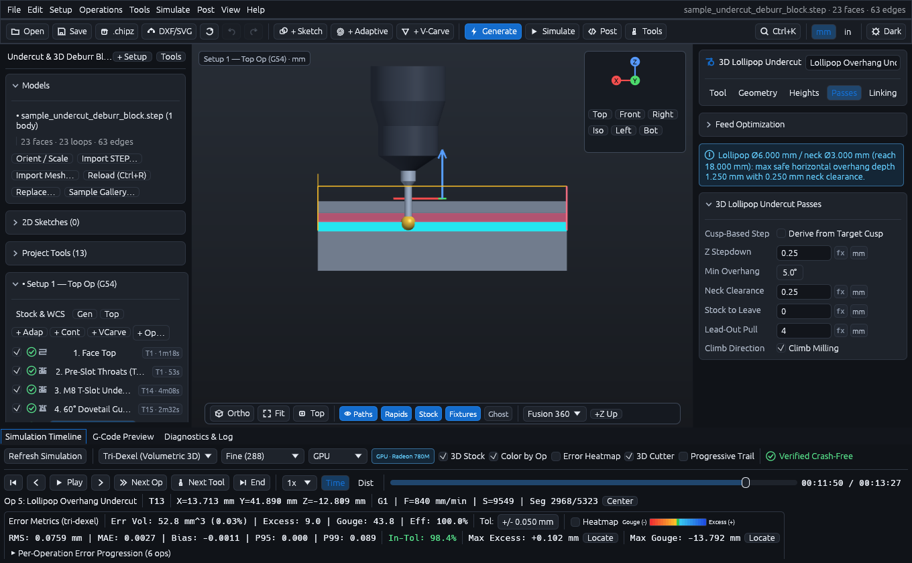
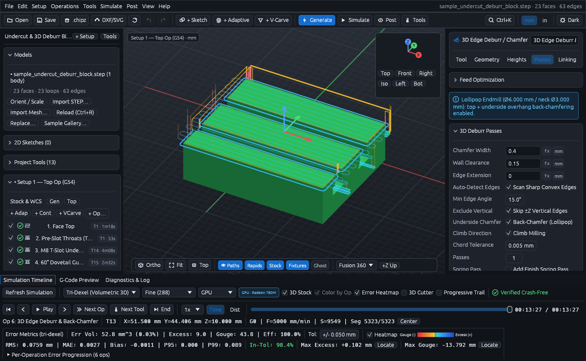

# Tutorial 22: Undercut Milling — Keyways, T-Slots, Dovetails, & Lollipop 3D Undercuts

## 1. Goal & What You'll Learn

Undercuts—features wider beneath an overhanging roof than at their top opening—are indispensable in fixture plates, modular tooling, optical rails, and sliding mechanisms. Unlike standard 2.5D/3D milling, undercut cutters (**`SlotMill`**, **`DovetailCutter`**, and **`LollipopEndmill`**) have a cutting head wider than their relieved neck, so **a single vertical plunge or `+Z` retract inside the slot will snap the cutter and ruin the workpiece**.

ChipCutter automates both the geometric clearance math and the non-negotiable horizontal entry/exit choreography across three dedicated undercut strategies:

- **Slot / Keyway / T-Slot (`OperationKind::SlotUndercut`):** DIN 650 metric & ASME imperial T-slots, DIN 6885 straight keyways (including blind keyways entered via a pre-drilled entry bore), and open-sided O-ring / retaining-ring side grooves.
- **Dovetail Slot / Rail (`OperationKind::Dovetail`):** Internal female dovetail guideways and external male dovetail rails with automatic cutter-angle matching (`±0.5°`), progressive lateral flank stepovers, spring passes, and horizontal exit before retract.
- **3D Lollipop Undercut (`OperationKind::Undercut3D`):** Constant-Z or cusp-height 3D finishing of concave overhanging walls with automatic relieved-neck ceiling-collision clipping and open-air horizontal lead-out pulls.

By the end of this tutorial you will be able to:

1. Configure and validate **`SlotMill`**, **`DovetailCutter`** (with live **`Top Ø (Derived)`** validation), and **`LollipopEndmill`** cutters in the **Tool Library**.
2. Sequence mandatory **throat pre-clearing** with a Flat Endmill before any undercut cutter enters—and understand how **Tri-Dexel** catches missing pre-slots.
3. Machine a **DIN 650 M8 T-Slot** (`Both Ends Through`) and a **Blind Keyway** (`Pre-Cleared Entry Bore`) with `SlotUndercut`.
4. Machine both an **Internal `60°` Dovetail Guideway** and an **External `60°` Dovetail Rail** with `Dovetail`.
5. Finish a concave overhanging 3D wall with **`3D Lollipop Undercut`** (`Undercut3D`), controlling `Min Overhang`, `Neck Clearance`, and `Lead-Out Pull`.
6. Verify undercut roofs, mid-cut revolved cutters, and signed **Error Heatmap** metrology (`98–99%` In-Tol, `0` critical crashes) in **GPU Tri-Dexel (`Fine (288)`)** and export verified **GRBL** and **LinuxCNC** G-code.

---

## 2. Prerequisites & Starter Projects

This tutorial uses two built-in undercut sample projects and one bare starter STEP solid shipped with ChipCutter:

```bash
# Starter A: Complete 6-op Undercut & 3D Deburr Block (100 x 80 x 28 mm)
# Combines M8 T-Slot, 60° Dovetail guideway, +Y Lollipop overhang groove, & 3D Deburr
chip-gui --sample undercut-deburr

# Starter B: External 60° Dovetail Rail & Blind Entry-Bore Keyway (90 x 50 x 22 mm)
chip-gui --sample dovetail-rail-keyway

# Starter C: Bare 100 x 80 x 28 mm Undercut Block STEP solid to program from scratch
chip-gui docs/tutorials/assets/22-undercut-deburr-block.step
```

> [!TIP]
> You can also open either built-in project inside `chip-gui` via **`File → Sample Projects Gallery…`** (or press **`Ctrl+K`** and type `Undercut` or `Dovetail Rail`).

---

## 3. Step-by-Step GUI Walkthrough

### Step 1 — Undercut Cutters in the Tool Library

1. Launch `chip-gui --sample undercut-deburr` and open the **Tool Library** (`Tools` in the top toolbar).
2. Inspect the three relieved-neck undercut cutters shipped in ChipCutter's starter undercut catalog (`+ New Undercut…`):
   - **`T14 — 12mm × 4mm 4FL Carbide T-Slot Mill` (`SlotMill`):** `Cutting Diameter = 12.00 mm`, `Cutting Thickness = 4.00 mm`, `Corner Radius = 0.20 mm`, `Neck Diameter = 5.00 mm`, `Neck Length (Reach) = 18.00 mm`, `Shank Diameter = 6.00 mm`.
   - **`T15 — 12mm 60° 4FL Carbide Dovetail Cutter` (`DovetailCutter`):** `Cutting Diameter = 12.00 mm` (major bottom diameter), `Side Angle = 60.0°` (measured from the horizontal floor), `Cutting Height = 5.00 mm`, `Corner Radius = 0.20 mm`, **`Top Ø (Derived): 6.519 mm`** (live analytic minor top diameter accounting for flank angle and corner radius), `Neck Diameter = 5.50 mm` (validated `<= Top Ø`), and `Neck Length (Reach) = 18.00 mm`.
   - **`T13 — 6mm 4FL Carbide Lollipop Endmill (270°)` (`LollipopEndmill`):** `Cutting Diameter = 6.00 mm`, `Neck Diameter = 3.00 mm`, `Neck Length (Reach) = 18.00 mm`, `Sphere Join Height = 5.598 mm`.
3. Observe the live **2D Cutter Profile Preview** in the bottom-left corner of the modal—it draws the exact inverted dovetail cone, horizontal slot disc, or spherical lollipop head alongside the relieved neck and shank so geometry mistakes stand out immediately.



---

### Step 2 — Mandatory Throat Pre-Clearing (Why Operation Order Matters)

> [!CAUTION]
> **Never send a T-Slot Mill or Dovetail Cutter into solid unslotted stock.** Relieved-neck undercut cutters are designed to cut laterally with their disc/flank while their slender neck rides inside a **pre-cleared vertical throat**. Skipping or mis-ordering the throat pre-slot will snap the neck immediately—and ChipCutter's volumetric **Tri-Dexel** simulator will flag it as a fatal **`ShankCollision` / `RapidCrash`** blocking G-code export.

1. In `undercut-deburr`, verify the first two operations run with **`T1 — Ø6.000 mm Flat Endmill`**:
   - **Op 1 (`Face Top`):** Decks the `1.0 mm` top facing allowance (`StockTop → ModelTop`, `Z = 29.0 → 28.0 mm`).
   - **Op 2 (`Pre-Slot Throats (T-Slot & Dovetail)`):** Uses `SlotUndercut` in **`Keyway (Parallel Slot)`** mode with **`Slot Width = 8.5 mm`**, **`Throat Width = 8.5 mm`**, **`Slot Height = 14 mm`**, **`Radial Stepover = 1.5 mm`**, **`Axial Stepdown = 7 mm`**, and **`Both Ends Through`** (`Entry Extension = 6 mm`) on both slot floor faces (`Y = 20 mm` and `Y = 52 mm`).
2. Press **`Ctrl+G`**, switch to **`Simulation Timeline`** → **`Tri-Dexel (Volumetric 3D)`** (`Fine (288)` / `GPU`), and scrub to the end of **Op 2** (`00:02:12 / 00:13:27`).
3. Confirm both `8.5 mm`-wide vertical throats are completely cleared down to the `Z = 14.0 mm` floor before `T14` or `T15` ever enters the block.



---

### Step 3 — DIN 650 M8 T-Slot (`SlotUndercut` + `BothEndsThrough`)

1. Select **Op 3 (`M8 T-Slot Undercut`)** in the **CAM Browser** (`T14 — Ø12 × 4 mm SlotMill`) and open **`Operation Inspector → Passes`**.
2. Choose **`Standard Preset: DIN 650 M8 T-Slot (14.5 × 6.0 / 8.5 throat)`** — ChipCutter automatically populates **`Slot Mode = T-Slot (Undercut)`**, **`Slot Width = 14.5 mm`**, **`Throat Width = 8.5 mm`**, and **`Slot Height = 6 mm`**.
3. Check the live blue throat-clearance banner at the top of the card:
   - **`Throat clearance OK: 0.500 mm radial neck clearance at full undercut width (neck Ø5.000 mm in 8.500 mm throat).`**
   - Because `14.5 mm` head width minus `12.0 mm` disc diameter leaves `1.25 mm` lateral travel per side, the `Ø5.0 mm` neck (`R = 2.50 mm`) reaches `1.25 + 2.50 = 3.75 mm` from centerline—leaving `4.25 − 3.75 = 0.500 mm` of positive clearance against the `8.5 mm` throat wall!
4. Configure progressive cuts and safe entry/exit:
   - **`Radial Stepover = 0.75 mm`**, **`Axial Stepdown = 3 mm`** (automatically splits the `6.0 mm` head height into 2 overlapping Z passes for the `4.0 mm`-thick disc!).
   - **`Finish Allowance = 0.15 mm`** + **`Spring Pass` (`Repeat Final Wall Pass`)** checked.
   - **`Entry / Exit Mode = Both Ends Through (Open Air)`** with **`Entry Extension = 8 mm`** (every vertical Z move occurs `8.0 mm` past the open block ends in clear air).
5. Scrub the **`Simulation Timeline`** into **Op 3** (`00:04:51 / 00:13:27`) to watch the 3D revolved **`T14` Slot Mill** disc carving the wider inverted-T chamber beneath the overhanging roof while its relieved neck rides cleanly down the center of the pre-slotted throat.



---

### Step 4 — `60°` Internal Dovetail Guideway (`Dovetail` + `InternalSlot`)

1. Select **Op 4 (`60° Dovetail Guideway`)** (`T15 — Ø12 mm 60° DovetailCutter`) and open **`Operation Inspector → Passes`**.
2. Verify the live angle-match & neck-clearance banner:
   - **`60° Dovetail match OK: 0.510 mm radial neck clearance in 8.500 mm throat (final lateral offset 0.990 mm).`**
   - *(Safety Guard: If your target `Side Angle` differs from the assigned Dovetail Cutter by more than `±0.5°`, or if `Dovetail Depth` exceeds the cutter's `Cutting Height`, ChipCutter displays a red inline Error banner and blocks unsafe toolpath generation.)*
3. Review the **`Dovetail Slot / Rail Passes`** parameters:
   - **`Dovetail Mode:`** `Internal Dovetail Slot`
   - **`Top Throat Width:`** `8.5 mm` · **`Dovetail Depth:`** `5 mm` · **`Side Angle:`** `60.0°`
   - **`Radial Stepover:`** `0.6 mm` · **`Finish Allowance:`** `0.1 mm` · **`Spring Pass`:** Checked
   - **`Entry / Exit Mode:`** `Both Ends Through (Open Air)` · **`Entry Extension:`** `8 mm` · **`Climb Direction`:** Checked
4. Scrub the timeline into **Op 4** (around `00:07:32 / 00:13:27`) to inspect the inverted conical **`T15` Dovetail Cutter** stepping progressively outward into both `60°` flanks—always returning laterally to the throat centerline in open air before shifting or retracting!



---

### Step 5 — External `60°` Dovetail Rail & Blind Keyway with Entry Bore

Now explore the two complementary undercut modes in `--sample dovetail-rail-keyway` (`90 × 50 × 22 mm` slide block):

1. Open `chip-gui --sample dovetail-rail-keyway` and press **`Ctrl+G`**.
2. Inspect the 4-operation sequence in the **CAM Browser**:
   - **Op 1 (`1. Face Stock Top`):** Removes the `1.0 mm` top stock allowance (`T1 Ø6 mm Flat Endmill`).
   - **Op 2 (`2. Pre-Drill Keyway Entry Bore (Ø8 mm)`):** Helically bores a **`Ø8.0 mm`** cylindrical entry pocket at `(X = 24, Y = 25)` down to `Z = 14.0 mm` (`bore_dia >= cutter_dia + 0.5 mm`).
   - **Op 3 (`3. Blind Top Keyway (Entry Bore)`):** Uses **`SlotUndercut`** in **`Keyway (Parallel Slot)`** mode with **`Entry / Exit Mode = Pre-Cleared Entry Bore`**. Notice on the **`Geometry`** tab that **both** the blind keyway floor face **and** the cylindrical entry bore are selected—guaranteeing the cutter descends vertically strictly inside the pre-bored hole, mills horizontally to both blind ends, returns to the bore centerline, and retracts `+Z` cleanly.
   - **Op 4 (`4. External 60° Dovetail Rail Flanks`):** Uses **`Dovetail`** in **`External Dovetail Rail`** mode along both `-Y` and `+Y` exterior edges (`Dovetail Depth = 5 mm`, `Side Angle = 60.0°`, `Radial Stepover = 0.6 mm`, `Finish Allowance = 0.1 mm`, `Spring Pass`, `Entry Extension = 8 mm`). Notice the live info banner: **`60° External Dovetail Rail (Ø12.000 mm cutter, 5.000 mm flank height): horizontal pull-away before +Z retract active.`**
3. Simulate in **`Tri-Dexel (Volumetric 3D)`** (`Fine (288)` / `GPU`) and verify **`In-Tol: 98.9%`**, **`Max Gouge: -0.000 mm`**, and **`Verified Crash-Free`**.



---

### Step 6 — Lollipop 3D Overhang Undercut Finishing (`Undercut3D`)

Return to `chip-gui --sample undercut-deburr` to machine the contoured overhanging groove along the `+Y` exterior wall (`Z_model = 19.8..24.5 mm`):

1. Select **Op 5 (`Lollipop Overhang Undercut`)** (`T13 — Ø6 mm LollipopEndmill`) and open **`Operation Inspector → Passes`**.
2. Read the live horizontal overhang-reach banner:
   - **`Lollipop Ø6.000 mm / neck Ø3.000 mm (reach 18.000 mm): max safe horizontal overhang depth 1.250 mm with 0.250 mm neck clearance.`**
   - ChipCutter computes $(D - D_{\text{neck}})/2 - \text{neck\_clearance} = (6.0 - 3.0)/2 - 0.25 = 1.250\text{ mm}$ and automatically clips any deeper ceiling recesses that the relieved neck cannot safely reach!
3. Review the **`3D Lollipop Undercut Passes`** parameters:
   - **`Cusp-Based Step` (`Derive from Target Cusp`):** Unchecked for fixed **`Z Stepdown = 0.25 mm`**, or check it to automatically compute vertical slice spacing from **`Target Cusp`** (e.g., `0.02 mm`) and the Lollipop sphere radius.
   - **`Min Overhang:`** `5.0°` — targets downward-facing overhang triangles where surface normal $n_z \le -\sin(5^\circ)$.
   - **`Neck Clearance:`** `0.25 mm` — radial safety clearance enforced between the relieved neck/shank and overhanging roofs above.
   - **`Stock to Leave:`** `0 mm` — uniform normal finishing allowance.
   - **`Lead-Out Pull:`** `4 mm` — horizontal pull-away distance into open air away from the overhanging roof before every `+Z` retract.
   - Check **`Heights`**: `Top = Model Top - 3.5 mm`, `Bottom = Model Top - 8.2 mm` isolates the `+Y` overhang groove cleanly above the `Z = 14..19 mm` dovetail cavity.
4. Switch the viewport to the **`Back`** view (`+Y` face) and scrub into **Op 5** (`00:11:50 / 00:13:27`) to watch the gold spherical **`T13` Lollipop Endmill** sweeping horizontal Z-slices cleanly underneath the upper flange lip.



---

### Step 7 — GPU Tri-Dexel Fine Error Heatmap & Metrology Verification

1. Still in `undercut-deburr`, switch the viewport back to **`Iso`** and scrub to **`100%`** (`00:13:27 / 00:13:27`, after Op 6 `3D Edge Deburr & Back-Chamfer` finishes).
2. In the **`Simulation Timeline`** toolbar:
   - Confirm **`Tri-Dexel (Volumetric 3D)`**, **`Fine (288)`**, and **`GPU`** (`GPU · Radeon 780M`).
   - Check **`Error Heatmap`** and uncheck **`3D Cutter`** to inspect the entire machined block unobstructed.
3. Read the final volumetric metrology bar:
   - **`Verified Crash-Free`** (`0` critical crashes, `0` neck collisions, `0` roof retracts).
   - **`In-Tol: 98.4%`** · **`Eff: 100.0%`** · **`RMS: 0.0759 mm`** (and **`RMS: 0.0076 mm`** immediately after Op 5 prior to Op 6's intentional `0.4 mm` unmodeled edge break!).
   - Bright uniform green covers the top deck, both vertical throats, the carved M8 T-slot chamber, the `60°` dovetail flanks, and the `+Y` concave undercut groove.



---

## 4. Key Parameters & Non-Negotiable Safety Guards Reference

### `Slot / Keyway / T-Slot Passes` (`OperationKind::SlotUndercut`)

| UI Label | Config Field | Default | Notes / Recommended Values |
|---|---|---|---|
| **`Standard Preset`** | `preset` | `Custom Dimensions` | 1-click DIN 650 (`M6`, `M8`, `M10`), ASME (`1/4"`, `3/8"`), & DIN 6885 (`4`, `6`, `8 mm`) presets |
| **`Slot Mode`** | `mode` | `T-Slot (Undercut)` | `T-Slot (Undercut)`, `Keyway (Parallel Slot)`, or `Side Groove (Open Side)` |
| **`Slot Width`** | `slot_width` | `14.5 mm` | Total wall-to-wall undercut head width (must be `>= cutter diameter`) |
| **`Throat Width`** | `throat_width` | `8.5 mm` | Pre-cleared upper vertical throat width (validated live against `neck_diameter` + max lateral offset) |
| **`Slot Height`** | `slot_height` | `6.0 mm` | Axial undercut head height (auto-split into overlapping Z levels when `> cutting_thickness`) |
| **`Radial Stepover`** | `radial_stepover` | `0.8 mm` | Progressive lateral roughing stepover per side (`0.5–1.0 mm` Al · `0.25–0.5 mm` steel) |
| **`Axial Stepdown`** | `axial_stepdown` | `flute_len * 0.8` | Vertical overlap stepdown across multi-Z slot passes |
| **`Finish Allowance`** | `finish_allowance` | `0.15 mm` | Lateral finishing stock reserved on both walls (`0.10–0.20 mm`) |
| **`Spring Pass`** | `spring_pass` | Off (`false`) | Check to append an extra zero-stock pass eliminating thin-neck deflection |
| **`Entry / Exit Mode`** | `entry_mode` | `Open End` | `Open End (Enter & Exit Same End)`, `Pre-Cleared Entry Bore`, or `Both Ends Through (Open Air)` |
| **`Entry Extension`** | `entry_extension` | `tool_r + 2.0` | Horizontal clearance past open slot ends so all Z moves stay in open air (`>= R_tool + 2 mm`) |

### `Dovetail Slot / Rail Passes` (`OperationKind::Dovetail`)

| UI Label | Config Field | Default | Notes / Recommended Values |
|---|---|---|---|
| **`Dovetail Mode`** | `mode` | `Internal Dovetail Slot` | `Internal Dovetail Slot` (female cavity) or `External Dovetail Rail` (male guideway) |
| **`Top Throat Width`** | `top_throat_width` | `8.5 mm` | Pre-cleared throat width for `InternalSlot` (must clear cutter `Top Ø` and relieved neck) |
| **`Dovetail Depth`** | `dovetail_depth` | `5.0 mm` | Axial height of the angled flank (validated `<= cutter.cutting_height_mm`) |
| **`Side Angle`** | `side_angle_deg` | `60.0°` | Target flank angle from horizontal floor (validated strictly within `±0.5°` of assigned cutter) |
| **`Radial Stepover`** | `radial_stepover` | `0.6 mm` | Progressive lateral roughing stepover into the angled flank (`0.4–0.8 mm` Al) |
| **`Finish Allowance`** | `finish_allowance` | `0.1 mm` | Final angled flank finishing pass stock (`0.05–0.15 mm`) |
| **`Spring Pass`** | `spring_pass` | Off (`false`) | Recommended On for tight-fit sliding dovetail guideways |
| **`Entry / Exit Mode`** | `entry_mode` | `Open End` | `Open End`, `Pre-Cleared Entry Bore`, or `Both Ends Through` (`InternalSlot` only) |
| **`Entry Extension`** | `entry_extension` | `tool_r + 2.0` | Open-air horizontal lead/pull-away distance before every `+Z` retract |

### `3D Lollipop Undercut Passes` (`OperationKind::Undercut3D`)

| UI Label | Config Field | Default | Notes / Recommended Values |
|---|---|---|---|
| **`Cusp-Based Step`** | `use_cusp_height` | Off (`false`) | Check to compute Z-slice spacing automatically from `Target Cusp` and sphere radius |
| **`Z Stepdown` / `Target Cusp`** | `z_stepdown` / `target_cusp` | `0.4 mm` / `0.025 mm` | Fixed Z-slice step (`0.15–0.4 mm`) or spherical scallop height (`0.01–0.03 mm`) |
| **`Min Overhang`** | `min_overhang_angle_deg` | `5.0°` | Minimum downward tilt below horizontal equator (`n_z <= -sin(angle)`) |
| **`Neck Clearance`** | `neck_clearance` | `0.25 mm` | Minimum radial safety margin between relieved neck/shank and overhanging ceilings above |
| **`Stock to Leave`** | `stock_to_leave` | `0.0 mm` | Uniform surface-normal finishing allowance |
| **`Lead-Out Pull`** | `lead_out_distance` | `tool_r + 1.0` | Horizontal open-air pull-away distance before any `+Z` retract (`>= R_tool + 1 mm`) |

### Non-Negotiable Undercut Safety Rules

> [!IMPORTANT]
> ChipCutter enforces four hard safety invariants across all undercut toolpaths and simulation gates:
> 1. **Zero Vertical Plunges or Retracts Under Roofs:** Every `SlotUndercut`, `Dovetail`, and `Undercut3D` pass descends to cutting Z strictly in open air (or a verified `bore_dia >= cutter_dia + 0.5 mm` entry bore), returns laterally to centerline/open air at cutting depth, and only then executes `G0 Z` retract.
> 2. **Mandatory Throat Pre-Clearing:** Always mill vertical throats down to full slot floor depth with a Flat Endmill **before** any `SlotMill` or `DovetailCutter` enters.
> 3. **Strict Tool Geometry Validation:** Cutter angle mismatch (`> ±0.5°`), `cutting_height < dovetail_depth`, `neck_diameter >= throat_width`, or `slot_depth > neck_length` trigger immediate inline errors before generation.
> 4. **Always Verify in Tri-Dexel:** 2.5D Heightmap cannot represent overhang roofs (`chip-gui` displays an amber warning banner whenever an undercut op is inspected in Heightmap mode, and `chipcutter build` auto-switches to volumetric **Tri-Dexel**).

---

## 5. Generate (`Ctrl+G`) & Tri-Dexel Verification Gate

1. Press **`Ctrl+G`** and verify all 6 operations in `undercut-deburr` (or all 4 operations in `dovetail-rail-keyway`) show green **`Clean`** badges (`0` warnings, `0` errors).
2. Confirm **`Simulation Timeline`** is set to **`Tri-Dexel (Volumetric 3D)`** (`Fine (288)` on **`GPU`**) and shows **`Verified Crash-Free`** (`0` critical errors).
3. Verify the **Error Heatmap** shows **`In-Tol >= 98%`** and **`Eff >= 99.5%`**, with zero red gouges on the overhanging slot roofs or vertical throat walls.

---

## 6. Post-Processing (`GRBL` & `LinuxCNC`)

Switch to **`G-Code Preview`** (or run `chipcutter build`) and inspect the emitted `T15` Dovetail G-code before sending it to the mill. Notice how **every single plunge, lateral shift, and final `+Z` retract occurs strictly in open air (`X-58` / `X58` — `8.0 mm` clear of the `[-50, +50]` block) and returns to throat centerline (`Y12`) before retracting**:

```gcode
( 60deg Dovetail Guideway - Dovetail Slot / Rail )
( Tool T15: 12mm 60deg 4FL Carbide Dovetail Cutter [D12.000 mm] )
S5040 M3
M7
G0 X-58 Y12 Z5          ; position 8 mm clear past -X open end on throat centerline
G1 Z-15 F148            ; descend to cutting floor Z strictly in open air
X58 F444                ; centerline through-pass to +X open air (X=+58)
Y12.445 F355            ; step laterally into +Y flank in open air
X-58 F444               ; cut +Y angled flank back to -X open air
Y12 F355                ; return to throat centerline in open air
Y11.555                 ; step laterally into -Y flank in open air
X58 F444                ; cut -Y angled flank to +X open air
...
Y11.01                  ; final spring pass on -Y flank (zero deflection)
X58 F444                ; exit completely into +X open air
Y12 F355                ; return to throat centerline BEFORE any Z retract!
G0 Z5                   ; safe +Z retract strictly in open air
Z10
M9
M5
M30
```

- **`LinuxCNC (RS274NGC)`:** Writes a single multi-tool `.ngc` file (`5,388` lines, `Tools: [1, 14, 15, 13]`).
- **`Grbl 1.1 / FluidNC`:** Splits automatically into four single-tool `.nc` files (`01_T1`, `02_T14`, `03_T15`, `04_T13`) so you can safely swap cutters and re-touch Z between operations.

---

## 7. Headless CLI Equivalent (`chipcutter`)

Generate the undercut block STEP + 6-operation project, validate all toolpaths, run volumetric GPU Tri-Dexel verification, and build safety-gated GRBL & LinuxCNC G-code directly from the terminal:

```bash
# 1. Generate the 100 x 80 x 28 mm Undercut & 3D Deburr Block STEP + 6-op project
chipcutter generate-sample-step /tmp/22-undercut-block.step \
  --undercut-block \
  --project-out /tmp/22-undercut-block.chip.toml

# 2. Validate setup, undercut cutter clearances, and generate all 6 operations
chipcutter validate --generate /tmp/22-undercut-block.chip.toml

# 3. Verify all undercut cavities and overhang roofs in GPU Tri-Dexel Fine mode
chipcutter simulate /tmp/22-undercut-block.chip.toml \
  --engine tri-dexel --backend gpu --resolution fine --benchmark --json \
  > /tmp/22-undercut-tridexel.json

# 4. Build safety-verified G-code (auto-enforces Tri-Dexel gate for undercut jobs!)
chipcutter build /tmp/22-undercut-block.chip.toml -o /tmp/out_22_grbl --post grbl
chipcutter build /tmp/22-undercut-block.chip.toml -o /tmp/out_22_linuxcnc --post linuxcnc
```

---

## Navigation

- **Previous:** [Tutorial 21 — 3D Edge Deburring & Non-Planar Chamfering (`Deburr3D`)](21-3d-edge-deburring-nonplanar-chamfering.md)
- **Related:** [Tutorial 17 — Tri-Dexel Volumetric Simulation & Quantitative Error-Volume Analysis](17-tridexel-simulation-error-metrics.md) · [Tutorial 20 — GPU-Accelerated Simulation, Benchmarking, & Feedrate Optimization](20-gpu-simulation-feed-optimization.md)
- **Index:** [All Tutorials (`00`–`22`)](README.md)
