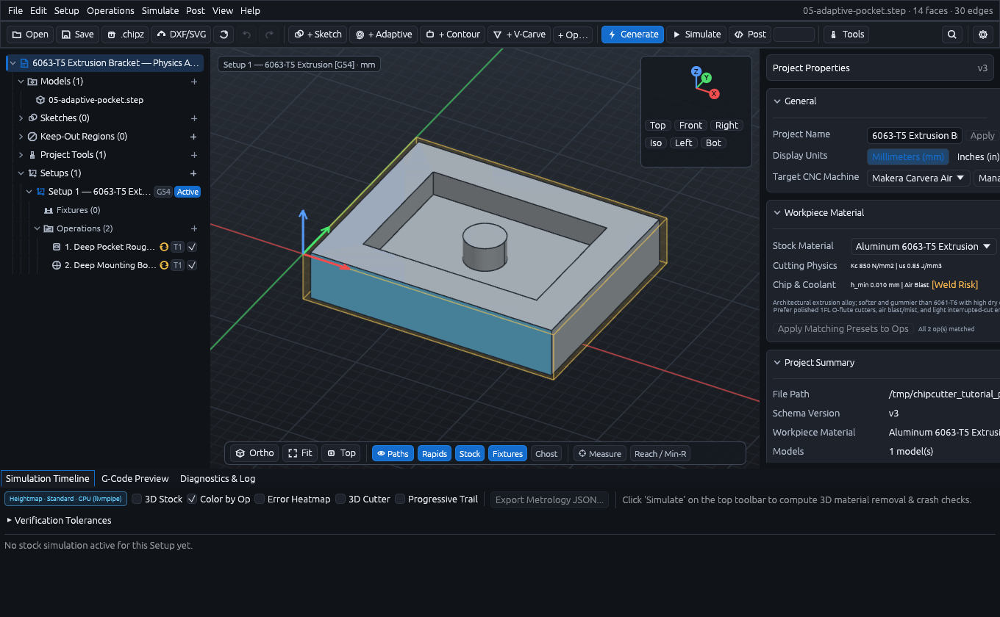
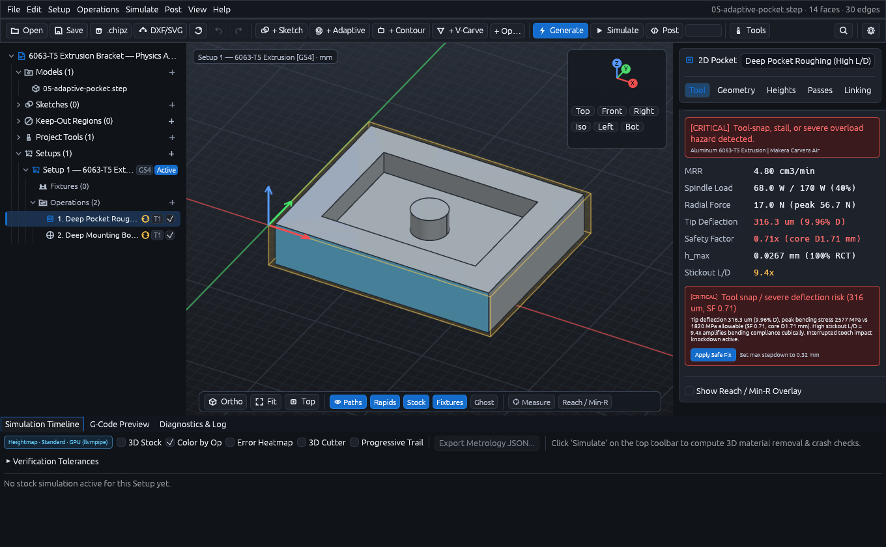
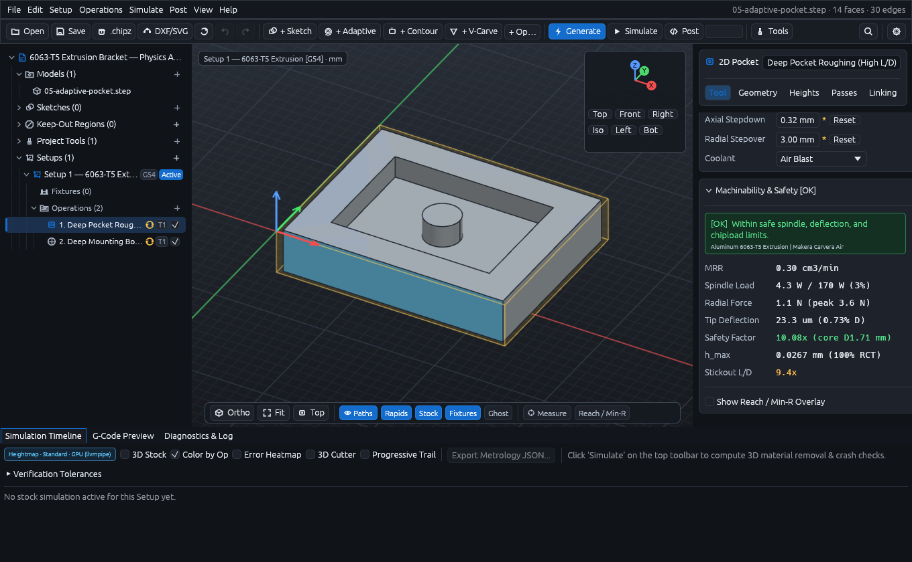
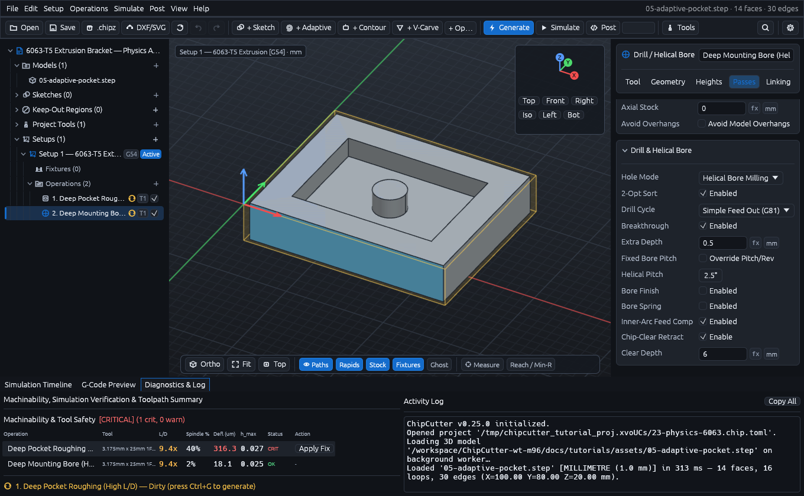
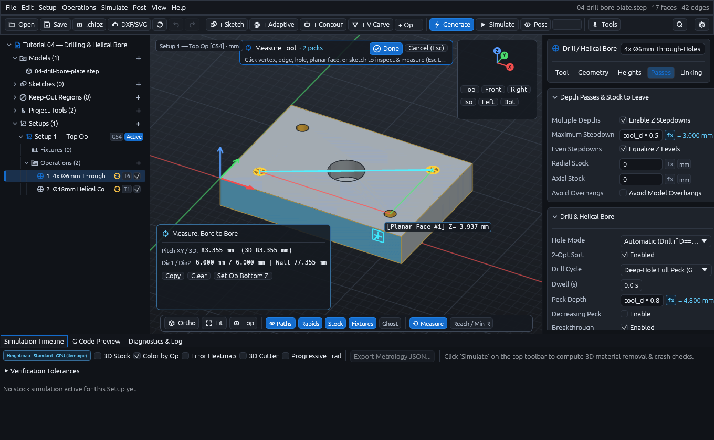
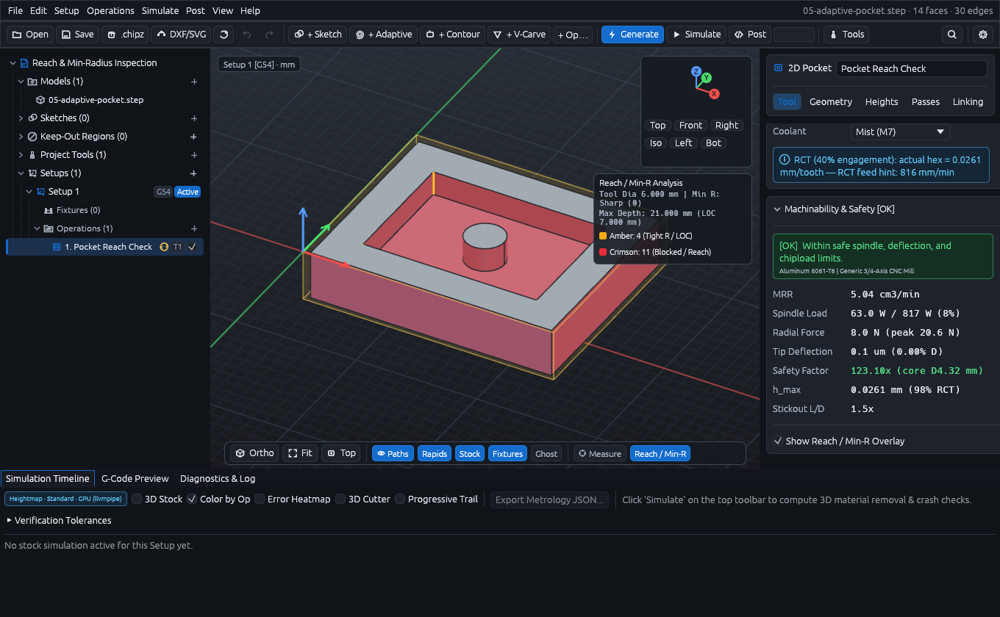

# Tutorial 23: Physics-Backed Machinability Advisor, Click-to-Measure, & Reach Heatmap

## 1. Goal & What You'll Learn

A toolpath can be geometrically collision-free in 3D simulation and still snap an endmill or stall a benchtop spindle on the first cut—especially when pushing a long-reach `1FL` O-flute into gummy **Aluminum 6063-T5 Extrusion**, running an uncompensated helical bore (`R_hole / r_orbit > 2x`), or entering a deep pocket whose corner radius is smaller than your cutter.

ChipCutter's **Phase 26 Physics & Machinability Suite** catches these physical failures *before* you generate G-code:

1. **Project-Level Workpiece Material Library:** Set the stock alloy/polymer/wood **once** in **Project Inspector** / **Project Properties** (`11` built-in materials including **Aluminum 6063-T5 Extrusion**, plus Custom physics constants $K_c$, $u_s$, $h_{\min}$), automatically matching cutter presets across every operation and machine swap.
2. **Live `Machinability & Safety` Advisor & 1-Click Safe Fixes:** Inspect real-time **MRR**, **Spindle Load** (torque-curve derated for your active CNC machine), **Radial Force**, **Tip Deflection (`um`)**, **Bending Safety Factor** (flute-count-aware stepped cantilever stiffness), **Effective `h_max`**, and **Stickout `L/D`**—and resolve hazards in one Undoable click (**`Apply Safe Fix`**).
3. **Helical Bore Safety Controls:** Protect small cutters inside tight bores with **`Inner-Arc Feed Comp`** (`r_orbit / R_hole` scaling) and **`Chip-Clear Retract`** (periodic R-plane chip evacuation).
4. **Setup-Wide `Diagnostics & Log` Table & Project Tree Tooltips:** Audit every active operation in one sortable summary table, click any row to jump straight to its Inspector, and hover operations in the **Project Tree** to see concise warning summaries.
5. **In-Viewport Exact-`f64` `Measure` Tool (`M`) & `Reach / Min-R` Heatmap:** Measure exact CAD distances, hole diameters, center-to-center pitches, and pocket depths with 1-click **`Set Op Bottom Z`**, and visualize tight concave corners (amber) and deep flute/stickout reach violations (amber/crimson) directly on the 3D model.

---

## 2. Prerequisites & Starter Assets

This walkthrough uses two minimal STEP starter assets already bundled in `docs/tutorials/assets/`:

```bash
# Starter A: 100 x 80 x 20 mm deep sharp-corner pocket block (Machinability & Reach Heatmap)
chip-gui docs/tutorials/assets/05-adaptive-pocket.step

# Starter B: 100 x 70 x 16 mm multi-hole plate (Exact-f64 Click-to-Measure)
chip-gui docs/tutorials/assets/04-drill-bore-plate.step
```

---

## 3. Step-by-Step GUI Walkthrough

### Step 1 — Set Project-Level Workpiece Material Once

1. Click the root **Project** node at the top of the left **Project Tree** (or open **`Edit → Project Properties…`**).
2. Under **Workpiece Material**, select **`Aluminum 6063-T5 Extrusion`** (or choose **`Custom Material…`** to specify your own $K_c$, $u_s$, and $h_{\min}$).
3. Review the read-only physics summary displayed below the picker:
   - Specific cutting force $K_c$, specific cutting energy $u_s$, minimum uncut chip thickness $h_{\min}$, gummy chip-welding advisory, and preferred coolant (`Air Blast` / `Mist`).
4. Set the project's target machine to **`Makera Carvera Air`** (200 W spindle) to see how spindle power-curve derating responds to desktop spindles.
5. Whenever you add a new operation or assign a cutter, ChipCutter automatically selects the closest matching material preset and displays a clickable **`Project Material: Aluminum 6063-T5 Extrusion`** pill at the top of Operation Inspector **`[Tool]`**.



---

### Step 2 — Catch High-`L/D` Tool-Snap & Spindle-Load Hazards

1. Select a **`2D Pocket`** operation using a long-reach **`3.175 mm × 25 mm 1FL O-Flute`** (`Stickout = 30.0 mm`, `L/D = 9.5x`) at an aggressive `6.0 mm` axial stepdown and `2.0 mm` stepover.
2. Open Operation Inspector **`[Tool]`** and scroll to **`Machinability & Safety [CRITICAL]`** (which auto-expands whenever a `Warning` or `Critical` hazard is active).
3. Inspect the plain-ASCII live telemetry strip:
   - **`MRR (cm3/min)`** and **`Spindle Load (W / %)`** compared against the Carvera Air's torque-derated spindle power at `12,000 RPM`.
   - **`Radial Force (N)`** (mean & peak instantaneous per-tooth impact), **`Tip Deflection (um / % D)`**, **`Safety Factor`** (accounting for the thin `~0.54 × D` 1-flute carbide core and cubic $(L/D)^3$ compliance), **`h_max`**, and **`Stickout L/D`**.
4. Read the color-coded **`[CRITICAL]`** finding cards explaining *why* the cut risks snapping the endmill or stalling the spindle, and note the compact alert banner that also appears at the top of **`[Passes]`**.



---

### Step 3 — Apply 1-Click Safe Fixes (Atomic Undo)

1. Click **`Apply Safe Fix`** directly inside the **`[CRITICAL]`** finding card (or inside the **`[Passes]`** alert banner).
2. ChipCutter atomically records an Undo snapshot (`Ctrl+Z` reverts immediately), reduces `max_stepdown` (or adjusts feed/compensation depending on the finding), marks the operation and any downstream Rest Machining operations **`Dirty`**, and re-evaluates cutting physics on the next frame.
3. Confirm the badge updates to **`Machinability & Safety [OK]`** with healthy **`Tip Deflection`**, **`Safety Factor`**, and **`Spindle Load %`**.



---

### Step 4 — Helical Bore Safety & Setup-Wide Diagnostics

1. Select a **`Drill / Bore`** operation configured for **`Helical Bore Milling`** and open **`Operation Inspector → [Passes]`**.
2. Review the two dedicated helical bore safety controls at the bottom of the **`Drill & Helical Bore`** card:
   - **`Inner-Arc Feed Comp` (`bore_inner_arc_feed_comp`):** Scales centerline feed by `r_orbit / R_hole` so actual wall chipload stays within material limits instead of spiking inside narrow bores (with a live **`R_hole/r_orbit`** amplification readout when a cylindrical hole is selected).
   - **`Chip-Clear Retract` (`bore_chip_clear_depth`):** Enable and specify an expression-capable **`Clear Depth`** (e.g., `6 mm` or `hole_d * 2`) so deep bores periodically pull to center and retract cleanly to the R-plane to clear packed aluminum chips.
3. Open the bottom **`Diagnostics & Log`** tab and inspect the **`Machinability & Tool Safety`** summary table listing every active operation in the Setup (`Operation`, `Tool`, `L/D`, `Spindle %`, `Defl (um)`, `h_max`, `Status`, `Action`).
   - Click any operation name in the table to focus it in the right Inspector.
   - Click **`Apply Fix`** on any flagged row to apply its primary safe fix in a single atomic Undo step.
   - Hover over operations in the left **Project Tree** to see concise **`Machinability [WARN/CRITICAL]: ...`** summaries without cluttering tree rows.



---

### Step 5 — Exact-`f64` Click-to-Measure (`M`)

1. Open `docs/tutorials/assets/04-drill-bore-plate.step` (or any STEP/Sketch/mesh project).
2. Press **`M`** (or click **`Measure`** in the bottom viewport HUD, **`View → Measure Tool`**, or **`Ctrl+K` → `Toggle Measure Tool`**).
3. Click any B-Rep face, cylindrical hole, arc edge, vertex, or 2D sketch entity for a single-entity readout (`Hole Diameter`, `Depth`, `Z WCS`, `Radius`), then click a second entity to measure exact **`3D Distance`**, **`dX / dY / dZ`**, **`Hole Center Pitch`**, or **`Parallel Plane Depth`**.
4. Use **`Copy`** to copy formatted numbers to the clipboard, or click **`Set Op Bottom Z`** to transfer a measured floor/hole Z height straight into the focused operation's **Bottom Height** (single atomic Undo). Press **`Esc`** or **`M`** to exit Measure mode.



---

### Step 6 — Inspect Tight Corners & Flute/Stickout Reach (`Reach / Min-R`)

1. Open `docs/tutorials/assets/05-adaptive-pocket.step` with a **`6 mm` Stub Flat Endmill** (`7 mm` flute length, `9 mm` stickout) assigned to a pocket operation.
2. Enable **`Show Reach / Min-R Overlay`** directly inside the **`Machinability & Safety`** card (or via the bottom viewport HUD **`Reach`**, **`View → Show Reach / Min-R Heatmap`**, or **`Ctrl+K`**).
3. Inspect the 3D heatmap and top-right legend pill:
   - **Amber edges / faces:** Tight concave internal corners (`r < R_tool`), narrow slots (`width < D_tool`), or walls deeper than `flute_length_mm` (flute rub zone).
   - **Crimson faces:** Deep cavities exceeding `stickout_length_mm` (guaranteed collet/holder collision unless you switch to a longer cutter or add a second Setup).



---

## 4. Key Parameters Reference

| Control / Metric | Location | Meaning & Safe Guideline |
|---|---|---|
| **`Workpiece Material`** | Project Inspector / Project Properties | Project-wide stock alloy/polymer/wood physics (`Kc`, `us`, `h_min`, chip-weld flag, coolant) |
| **`Spindle Load (%)`** | `[Tool] → Machinability & Safety` | Cutting power vs. torque-derated available spindle watts (`>70%` Warning, `>100%` Critical) |
| **`Tip Deflection (um)` & `Safety Factor`** | `[Tool] → Machinability & Safety` | Stepped cantilever deflection & carbide fracture margin (`>25 um`/`SF < 2.5` Warning; `>60 um`/`SF < 1.5` Critical) |
| **`h_max (mm)`** | `[Tool] → Machinability & Safety` | Effective chip thickness after radial chip thinning; keep `h_max >= h_min` to prevent rubbing & aluminum chip-welding |
| **`Inner-Arc Feed Comp`** | `DrillBore → [Passes]` | Scales helical center feed by `(r_orbit / R_hole).clamp(0.20, 1.0)` to prevent internal-wall chipload overload |
| **`Chip-Clear Retract`** | `DrillBore → [Passes]` | Periodic full Z retract to R-plane during deep helical bores (`depth > 2.5 × hole_d` & narrow annulus) |
| **`Measure (M)`** | Viewport HUD / `View` / `Ctrl+K` | Exact-`f64` Setup-WCS snap measurement (`3D`, `dX/dY/dZ`, hole pitch/depth, `Set Op Bottom Z`) |
| **`Reach / Min-R`** | `[Tool]` card / Viewport HUD / `View` | Background-cached B-Rep/mesh overlay for concave corner radius `< R_tool` and flute/stickout reach limits |

---

## 5. Generate (`Ctrl+G`) & 3D Simulation Verification

1. After resolving all **`[CRITICAL]`** findings in **`Machinability & Safety`** and **`Diagnostics & Log`**, press **`Ctrl+G`** to regenerate all dirty operations.
2. Click **`Simulate`** in the top toolbar to run ChipCutter's 6-rule physical crash/gouge/fixture verifier (`Heightmap` or volumetric `Tri-Dexel`).
3. Confirm **`0 crashes, 0 gouges, 0 warnings`** in **`Diagnostics & Log`** alongside green **`OK`** status across every row of the **`Machinability & Tool Safety`** table.

---

## 6. Post-Processing (GRBL & LinuxCNC)

1. Open the bottom **`G-Code Preview`** tab and select your machine's post-processor profile (`grbl`, `grblhal_atc`, or `linuxcnc`).
2. Verify that `bore_inner_arc_feed_comp` emits reduced helical `F` feedrates matching the compensated centerline speed, and that `bore_chip_clear_depth` emits clean center-pull + `R`-plane chip-clearing retracts.
3. Click **`Export G-Code…`** (or **`Export All Setups…`** for multi-setup jobs).

---

## 7. Headless CLI Equivalent (`chipcutter`)

Run the exact same cutting-physics machinability analysis from CI scripts or the terminal using `chipcutter validate --physics`:

```bash
# Run geometric validation + cutting-physics machinability report (human-readable table)
chipcutter validate job.chip.toml --physics

# Machine-readable JSON physics report for automation / shop checklists
chipcutter validate job.chip.toml --physics-json

# Fail CI / pre-flight build with non-zero exit code if any Critical tool-snap or stall hazard exists
chipcutter validate job.chip.toml --physics --fail-on-physics-critical --machine carvera-air
```
