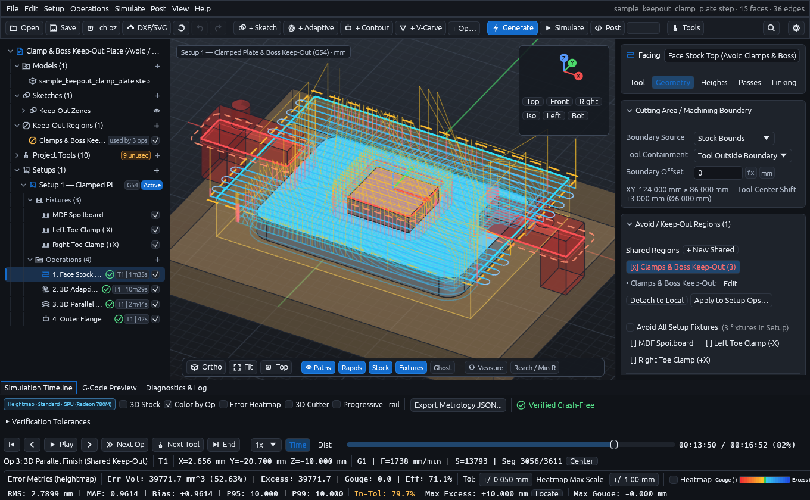
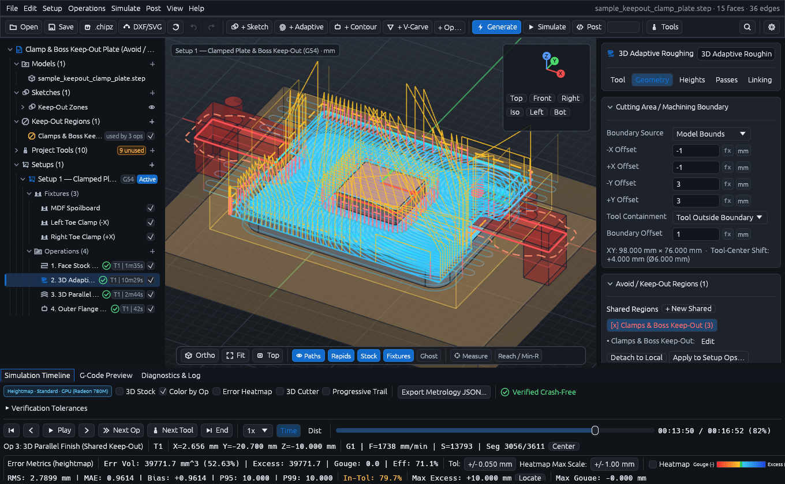
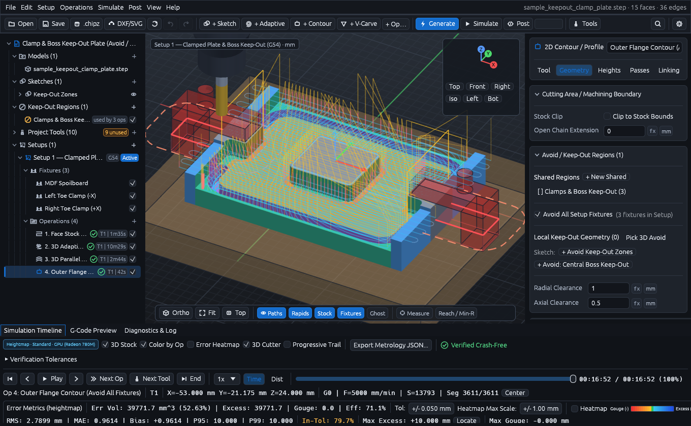
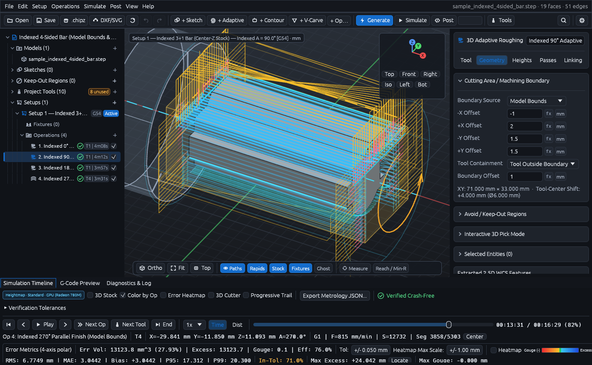
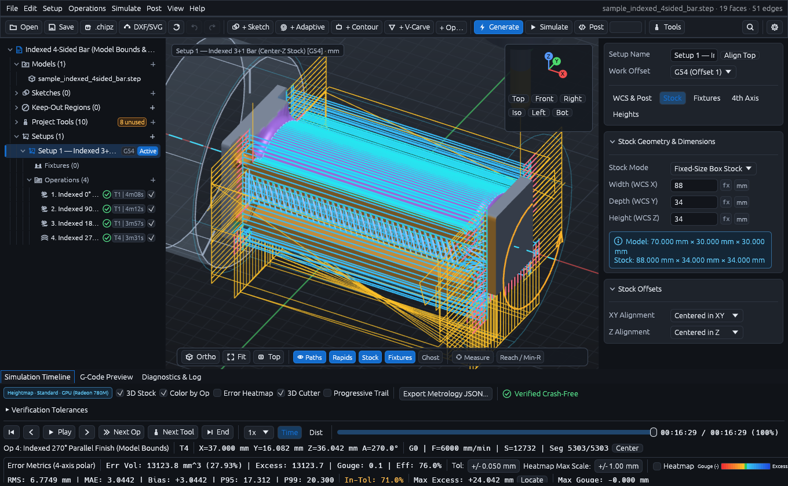

# Tutorial 24: Avoid / Keep-Out Regions, Model Bounds, & Indexed 3+1 Auto-Rotate

## 1. Goal & What You'll Learn

Real workholding rarely leaves the entire stock top wide open: toe clamps overhang the workpiece edges, raised bosses need to stay untouched during facing/roughing, and 4th-axis chucks demand strict axial clearance on the `-X` side.

In this tutorial you will learn how to combine ChipCutter's unified **`Geometry`** cutting-area controls, project-level **Shared Avoid / Keep-Out Regions**, and automatic **Indexed `3+1` Viewport Rotation**:

1. **Project-Level Reusable `Keep-Out Regions (N)`:** Define a single `SharedAvoidRegion` in the **Project Tree** (combining 3D fixtures, 2D sketch contours, or 3D B-Rep faces with radial/axial clearance) and link it across multiple operations so one edit updates every linked pass.
2. **Per-Operation `Avoid All Setup Fixtures` & `Pick Target`:** Switch **`Interactive 3D Pick Mode`** between **`Cutting Area`** and **`Avoid / Keep-Out`** with live translucent **coral/red** 3D keep-out previews.
3. **Explicit `Model Bounds` with Signed `-X / +X / -Y / +Y` Offsets:** Constrain 3D and 2.5D strategies to the exact target-part bounding box while pulling back on clamped/chucked sides (negative offset) and extending out for open-air entry on free sides (positive offset).
4. **Fixed-Size Box Stock `Centered in Z` & `Indexed 3+1` Auto-Rotate:** Center square bar stock symmetrically on the rotary axis and automatically rotate the 3D viewport, stock wireframe, and live boundary previews upright to `0° / 90° / 180° / 270°` as you click each indexed operation.

---

## 2. Prerequisites & Starter Projects

This walkthrough uses two built-in showcase projects from the **Sample Projects Gallery**—no external files required:

```bash
# Part A: Clamp & Boss Keep-Out Plate (Shared Keep-Outs + Model Bounds + Avoid All Fixtures)
chip-gui --sample keepout-clamps

# Part B: Indexed 4-Sided Bar (Fixed-Box Centered in Z + Signed Model Bounds + Auto-Rotate 3+1)
chip-gui --sample indexed-model-bounds
```

You can also open both from inside the GUI via **`File → Sample Projects Gallery…`** (or the Welcome Overlay).

---

## 3. Step-by-Step GUI Walkthrough

### Step 1 — Inspect & Edit a Shared Keep-Out Region (`Keep-Out Regions` Tree Folder)

1. Launch **`--sample keepout-clamps`** (or open **`Clamp & Boss Keep-Out Plate`** from the Sample Gallery).
2. In the left **Project Tree**, expand **`Keep-Out Regions (1)`** and click **`Clamps & Boss Keep-Out`** to open the right-hand **Keep-Out Inspector**.
   - Notice it bundles both overhanging **`ToeClamp`** fixtures (`clamp_neg_x`, `clamp_pos_x`) and a 2D sketch rectangle around the central boss with `Radial Clearance = 1.0 mm`.
   - From the Project Tree you can right-click any region to **Suppress**, **Duplicate**, **Rename (`F2`)**, or **Apply to Active Setup Ops**.
3. Click **`1. Face Stock Top`** under **`Setups → Setup 1 → Operations (4)`** and open **`Operation Inspector → [Geometry]`**.
4. Expand **`Avoid / Keep-Out Regions`**:
   - Toggle chips let you link or unlink any project-level shared region in one click, or click **`Save Local as Shared…`** to promote a local keep-out for reuse.
   - Switch **`Pick Target:`** to **`Avoid / Keep-Out`** whenever you want 3D face or 2D sketch clicks routed directly into keep-out geometry (highlighted by a coral/red HUD badge).
   - Observe the translucent **coral/red** 3D keep-out overlays in the viewport and how the facing toolpath cleanly routes around both clamps and the central boss.



---

### Step 2 — Combine `Model Bounds` Signed `-X / +X / -Y / +Y` Offsets with Shared Keep-Outs

1. Select **`2. 3D Adaptive Roughing`** under **`Operations (4)`** and open **`[Geometry]`**.
2. In the top **`Cutting Area / Machining Boundary`** card:
   - **`Boundary Source`** is set to **`Model Bounds`** (`MachiningBoundaryMode::ModelBoundingBox`).
   - Review the four independent signed side offsets:
     - **`-X Offset = -1.0 mm`** and **`+X Offset = -1.0 mm`** (pulls the roughing boundary inward away from the `-X`/`+X` toe clamps).
     - **`-Y Offset = +3.0 mm`** and **`+Y Offset = +3.0 mm`** (extends past the unclamped `±Y` edges so the endmill enters cleanly from open air).
   - Notice **`Model Silhouette`** (with **`Fill through-holes`** enabled by default) is also available in the same dropdown whenever you want a non-rectangular projected outline instead of a box.
3. Because **`Clamps & Boss Keep-Out`** is linked to Ops 1, 2, and 3 simultaneously, adjusting its clearance once in the **Keep-Out Inspector** automatically marks all three operations **`Dirty`** and updates them together on `Ctrl+G`.



---

### Step 3 — Protect Workholding Automatically with `Avoid All Setup Fixtures`

1. Select **`4. Outer Flange Contour`** and inspect **`[Geometry] → Avoid / Keep-Out Regions`**.
2. Instead of manually picking individual clamps, **`Avoid All Setup Fixtures`** (`avoid_all_fixtures = true`) is checked:
   - ChipCutter computes the exact Z-overlapping footprint of every enabled fixture in the Setup (`ViseJaws`, `ToeClamp`, `BoxKeepOut`, `CylinderKeepOut`, and `ImportedModel`) with tiered shank/holder inflation—automatically skipping the sacrificial `Spoilboard` below the cut Z range.
3. Press **`Ctrl+G`** and click **`Simulate`** (`Tri-Dexel` or `Heightmap`) to verify all four operations finish with **`0` `FixtureCollision`**, **`0` `TargetModelGouge`**, and **`0` `RapidIntoStock`** diagnostics.



---

### Step 4 — `Fixed-Size Box Stock` (`Centered in Z`) & `Indexed 3+1` Auto-Rotate Viewport

1. Switch to **`--sample indexed-model-bounds`** (**`Indexed 4-Sided Bar`** in the Sample Projects Gallery).
2. Click **`Setup 1`** in the Project Tree and open **`[Stock]`**:
   - **`Stock Mode`** is **`Fixed-Size Box Stock`** (`88 × 34 × 34 mm`).
   - Under **`Stock Offsets`**, **`XY Alignment`** (`Centered in XY` vs. `Offset from Front-Left`) and **`Z Alignment`** (`Offset from Top (+Z)`, `Offset from Bottom (-Z)`, **`Centered in Z`**) position the bar squarely on the `A`-axis centerline (`Z = 0`). Rotary-enabled Setups auto-default to **`Centered in Z`**.
3. Click **`2. Indexed 90° Adaptive Rough`** under **`Operations (4)`** and open **`[Geometry]`**:
   - With **`Auto-Rotate Indexed Viewport`** enabled (in `[Passes] → 4th-Axis Indexing / Wrapping` or `Application Settings → Viewport`), the 3D part, square stock wireframe, Z-height planes, and live **`Model Bounds`** preview automatically rotate upright to **`Indexed A = 90.0°`**.
   - Signed offsets (`-X = -1.0 mm` away from the `-X` rotary chuck, `+X = +2.0 mm` & `±Y = +1.5 mm` for open-air tail/shoulder clearing) frame the stepped terrace and `45°` bevel cleanly.



4. Press **`Ctrl+G`** and click **`Simulate`** to run full 4-sided volumetric **`Tri-Dexel`** simulation across `0°`, `90°`, `180°`, and `270°` and verify `0` chuck or gouge collisions.



---

## 4. Key Parameters Reference

| Control | Location | Purpose |
|---|---|---|
| **`Keep-Out Regions (N)`** | Left Project Tree / Keep-Out Inspector | Reusable project-level `SharedAvoidRegion` definitions linked across ops |
| **`Avoid All Setup Fixtures`** | Operation `[Geometry] → Avoid` | Auto-subtracts Z-overlapping enabled fixtures with tiered shank/holder clearance |
| **`Pick Target: Cutting Area \| Avoid`** | Operation `[Geometry]` | Routes 3D B-Rep and 2D Sketch clicks into cutting vs. keep-out geometry |
| **`Boundary Source: Model Bounds`** | Operation `[Geometry] → Cutting Area` | Target-part AABB with independent signed `-X`, `+X`, `-Y`, `+Y` offsets |
| **`Model Silhouette` (`Fill through-holes`)** | Operation `[Geometry] → Cutting Area` | Exact projected 2D silhouette boundary without leaving interior hole pillars |
| **`XY Alignment` / `Z Alignment`** | Setup `[Stock] → Stock Offsets` | Explicit placement for `Fixed-Size Box Stock` (`Centered in Z` for rotary bars) |
| **`Auto-Rotate Indexed Viewport`** | `[Passes] → 4th-Axis` / `Application Settings` | Rotates 3D solid, stock, picking rays, and previews upright to `Indexed A = <deg>` |

---

## 5. Generate (`Ctrl+G`) & 3D Simulation Verification

1. Press **`Ctrl+G`** to regenerate all operations linked to updated keep-out regions or boundary offsets.
2. Run **`Simulate`** (`Tri-Dexel` recommended for overhanging clamps and 4-sided indexed bars) and verify **`Verified Crash-Free`** with `0` Rule 6 `FixtureCollision` warnings.

---

## 6. Post-Processing (GRBL & LinuxCNC)

1. Open **`G-Code Preview`** and pick `grbl` / `grblhal_atc` / `linuxcnc` for 3-axis clamp jobs or `grblhal_4axis` / `linuxcnc_4axis` for indexed `3+1` rotary jobs.
2. Confirm clean safe-retract clearances over clamps and `G0 A90.000` / `A180.000` / `A270.000` index moves before exporting.

---

## 7. Headless CLI Equivalent (`chipcutter`)

```bash
# Validate and run volumetric Tri-Dexel simulation with Rule 6 fixture collision checks
chipcutter validate job.chip.toml --generate
chipcutter simulate job.chip.toml --engine tri-dexel --report

# Build verified G-code for all Setups
chipcutter build job.chip.toml --output-dir ./gcode_out
```
