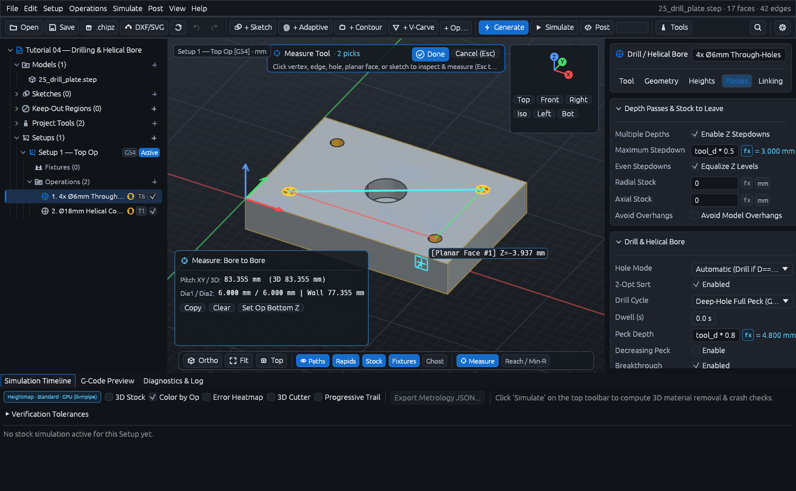
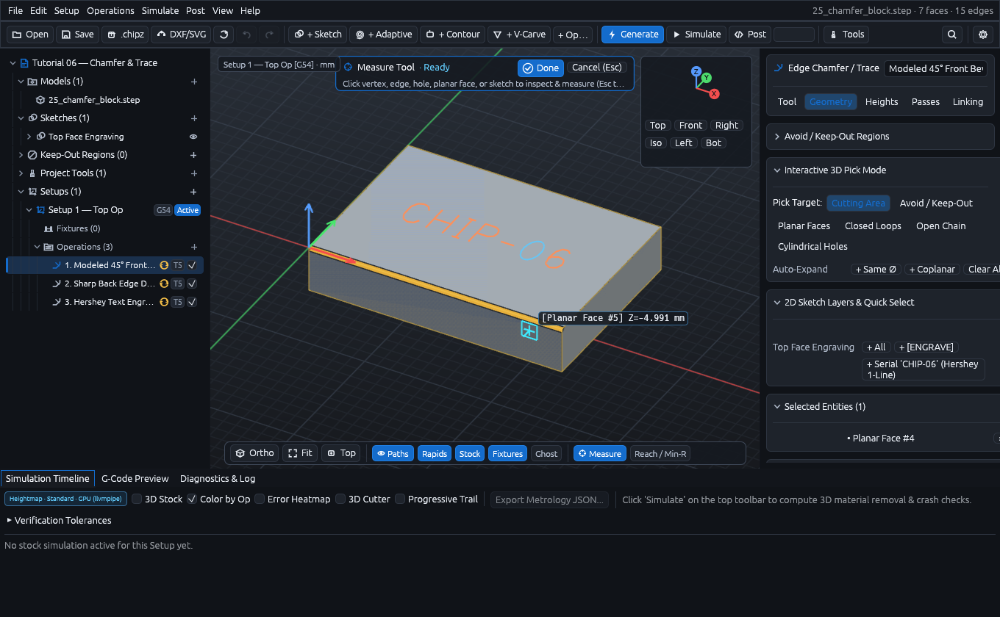
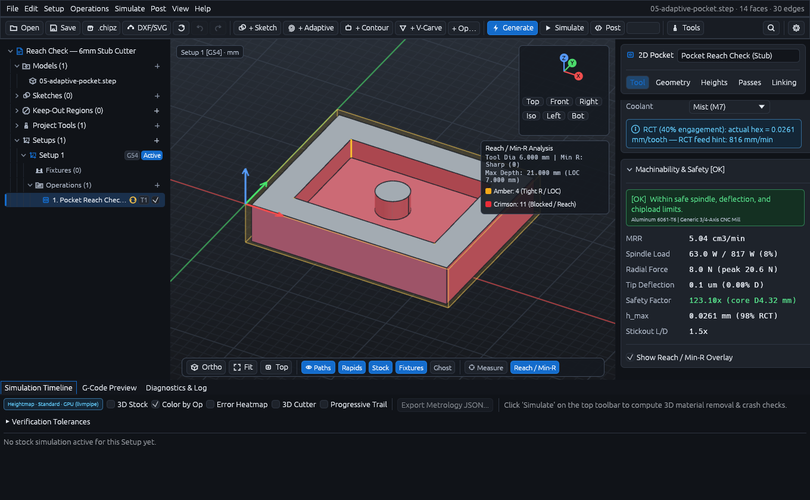
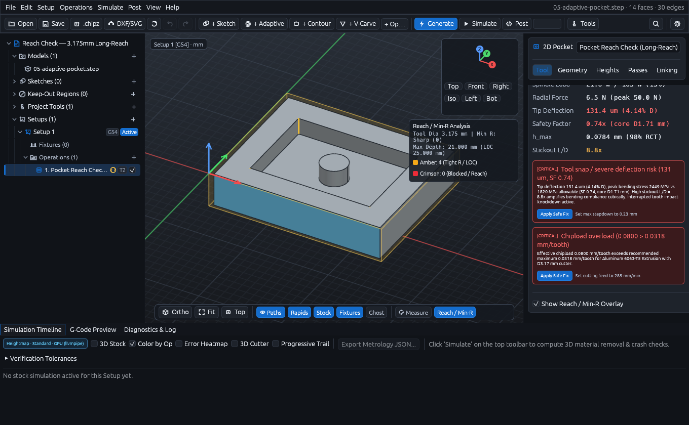

# Tutorial 25: In-Viewport Click-to-Measure (`M`) & Minimum-Radius / Reach Heatmap

## 1. Goal & What You'll Learn

Before choosing an endmill or setting a pocket's **Bottom Height**, machinists constantly need two answers directly from the 3D part: *what are the exact feature dimensions (hole diameter, center pitch, pocket depth, bevel angle)*, and *will my chosen cutter actually fit every internal corner and reach every floor without shank or collet rub?*

In this tutorial you will practice both of ChipCutter's in-viewport geometric inspection tools:

1. **Exact-`f64` Click-to-Measure (`M`):** Snap to exact B-Rep vertices, edges, cylindrical hole axes, planar faces, and 2D sketch entities (never approximated viewport mesh triangles when B-Rep/Sketch geometry exists) to inspect single entities and pair measurements (`3D` distance, `dX/dY/dZ` in Setup WCS, bore-to-bore pitch & wall thickness, parallel plane depth, and bevel dihedral angles).
2. **1-Click `Copy` & `Set Op Bottom Z`:** Copy exact measurement text to the clipboard or transfer a measured floor/hole Z height straight into the active operation's **Bottom Height** in a single atomic Undo step.
3. **Minimum-Radius & Reach Heatmap (`Reach / Min-R`):** Run background-cached geometric clearance analysis against the active cutter (`diameter`, `flute_length`, `stickout_length`, and relieved `neck_diameter` / `neck_length`), highlighting **Amber** tight concave corners / flute-rub zones and **Crimson** blocked slots / stickout-unreachable depths.

---

## 2. Prerequisites & Starter Assets

This walkthrough uses three minimal STEP starter models bundled in `docs/tutorials/assets/`:

```bash
# Starter A: 100 x 70 x 16 mm multi-hole plate (bore-to-bore pitch, hole Ø, & depth)
chip-gui docs/tutorials/assets/04-drill-bore-plate.step

# Starter B: 100 x 70 x 18 mm beveled block (45 deg dihedral face angle & bevel width)
chip-gui docs/tutorials/assets/06-chamfer-engrave-block.step

# Starter C: 100 x 80 x 20 mm deep sharp-corner pocket block (stub vs. long-reach heatmap)
chip-gui docs/tutorials/assets/05-adaptive-pocket.step
```

---

## 3. Step-by-Step GUI Walkthrough

### Step 1 — Measure Bore Diameters, Center-to-Center Pitch, & Wall Thickness

1. Launch **`chip-gui docs/tutorials/assets/04-drill-bore-plate.step`**.
2. Activate **Measure Mode** via any of four ways:
   - Press **`M`** on the keyboard,
   - Click the **`Measure`** pill in the bottom viewport HUD,
   - Choose **`View → Measure Tool (M)`**, or
   - Press **`Ctrl+K`** and run **`Toggle Measure Tool`**.
3. Hover over the 3D part to see live exact snap callouts (vertices, edge midpoints/radii, cylindrical bore axes, and planar face Z heights in Setup WCS).
4. Click one of the `Ø6.000 mm` corner holes:
   - The floating **Measurement Card** immediately reports the exact **`Hole Diameter`**, **`Depth`**, and axis origin in Setup WCS.
5. Click a second `Ø6.000 mm` hole across the plate:
   - ChipCutter draws a crisp 3D cyan dimension leader with `dX` / `dY` projection legs and switches the readout card to **`Measure: Bore to Bore`**, reporting **`Pitch XY / 3D`**, both **`Dia1 / Dia2`** values, and the exact minimum **`Wall`** thickness between the bores.
6. Click **`Copy`** to place the formatted readout on your clipboard, or click **`Set Op Bottom Z`** while an operation is focused to set its Bottom Height directly from the measured Z (undoable with `Ctrl+Z`).



---

### Step 2 — Inspect Parallel Plane Depths & Dihedral Bevel Angles

1. Open **`docs/tutorials/assets/06-chamfer-engrave-block.step`** and press **`M`**.
2. Click the top horizontal face, then click the bottom face (or any stepped shelf):
   - ChipCutter detects **`Parallel Planes`** and reports the exact perpendicular **`Gap (dZ)`** and `3D` distance in Setup WCS.
3. Click **`Clear`** (or click a third entity to start a new pair), then click the top horizontal face and the sloped front bevel face:
   - ChipCutter detects **`Angled Planes`** and displays the exact **`Dihedral Angle`** (`45.00°` / supplementary `135.00°`) so you immediately know whether to assign a `90°` (`45°` per side) chamfer mill.
4. Press **`Esc`** or **`M`** to exit Measure Mode cleanly.



---

### Step 3 — Spot Flute-Rub, Stickout Collisions, & Tight Corners (`Reach / Min-R`)

1. Open **`docs/tutorials/assets/05-adaptive-pocket.step`** and add a **`2D Pocket`** operation using a short stub **`Ø6.0 mm` Flat Endmill** (`Flute Length = 7.0 mm`, `Stickout = 9.0 mm`).
2. Enable the **Minimum-Radius & Reach Heatmap** via:
   - The **`Reach / Min-R`** pill in the bottom viewport HUD,
   - The **`Show Reach / Min-R Overlay`** checkbox inside Operation Inspector **`[Tool] → Machinability & Safety`**, or
   - **`View → Show Reach / Min-R Heatmap`** / **`Ctrl+K`**.
3. Analysis runs asynchronously on a background `rayon` thread (cached by CAD revision + Setup + Tool so idle frames cost zero CPU). Read the viewport overlay and top-right **`Reach / Min-R Analysis`** legend pill:
   - **`Min R: Sharp (0)`** + **Amber edges**: the `90°` sharp interior pocket corners are smaller than `R_tool = 3.0 mm`, telling you the `Ø6 mm` cutter will leave `R3.0` corner fillets unless followed by a smaller Rest Machining cutter.
   - **`Max Depth: 21.000 mm (LOC 7.000 mm)`** + **Crimson faces**: walls deeper than the `9.0 mm` stickout are physically unreachable without collet collision!



---

### Step 4 — Verify a Long-Reach or Relieved-Neck Cutter Clears All Crimson Blocks

1. Switch the operation's tool to a long-reach **`Ø3.175 mm × 25 mm LOC` Flat Endmill** (`Stickout = 28.0 mm`)—or a relieved-neck cutter whose `neck_diameter_mm < cutting_diameter_mm` covers the pocket depth within `neck_length_mm`.
2. Notice the **`Reach / Min-R`** overlay refreshes automatically in the background:
   - Every **Crimson** stickout/collision face disappears (`Crimson: 0`), confirming safe physical reach to the `20 mm` depth while keeping **Amber** corner indicators visible where sharp `90°` corners still exceed `R_tool = 1.588 mm`.
   - Combine this check with the **`Machinability & Safety`** card (Tutorial 23 & Tutorial 26) to verify that the longer `28 mm` stickout still stays within safe bending-deflection limits!



---

## 4. Key Controls & Color Legend Reference

| Control / Visual Indicator | Meaning |
|---|---|
| **`M` / HUD `Measure`** | Toggles exact-`f64` Setup-WCS click-to-measure mode (`Esc` exits) |
| **`Single Entity` readout** | Exact hole `Dia` & `Depth`, arc `R`, edge `Length`, or planar `Z` & `Area` |
| **`Pair` readout** | `Point-to-Point` (`3D`, `dX/dY/dZ`), `Parallel Planes` (`Gap`), `Angled Planes` (`deg`), `Bore-to-Bore` (`Pitch` & `Wall`), `Point-to-Plane` |
| **`Copy` / `Set Op Bottom Z`** | Copies formatted measurements or sets focused op's Bottom Height (atomic Undo) |
| **Amber (`Reach / Min-R`)** | Concave internal corner `r < R_tool - 0.02 mm` (rest stock left) or depth `> flute_length_mm` without neck relief (shank rub risk) |
| **Crimson (`Reach / Min-R`)** | Narrow slot / hole `< tool_d + 0.02 mm` (cutter cannot enter) or depth `> stickout_length_mm` (collet collision — unreachable) |

---

## 5. Generate (`Ctrl+G`) & 3D Simulation Verification

1. After confirming `Crimson: 0` in **`Reach / Min-R`** and transferring any critical floor Z heights via **`Set Op Bottom Z`**, press **`Ctrl+G`** to generate toolpaths.
2. Run **`Simulate`** (`Tri-Dexel` + **Error Heatmap**) to verify leftover corner radii and confirm `0` shank/holder collisions.

---

## 6. Post-Processing (GRBL & LinuxCNC)

Once geometry reach and simulation both pass, open **`G-Code Preview`**, confirm minimum Z depths match your measured values, and export verified G-code for your controller.

---

## 7. Headless CLI Equivalent (`chipcutter`)

Inspect exact STEP bounding boxes, face/hole counts, and verify physics + tool clearance from the terminal:

```bash
# Inspect exact f64 B-Rep dimensions, faces, loops, and edges
chipcutter inspect docs/tutorials/assets/04-drill-bore-plate.step

# Validate project geometry, machine limits, and cutting physics
chipcutter validate job.chip.toml --generate --physics
```
