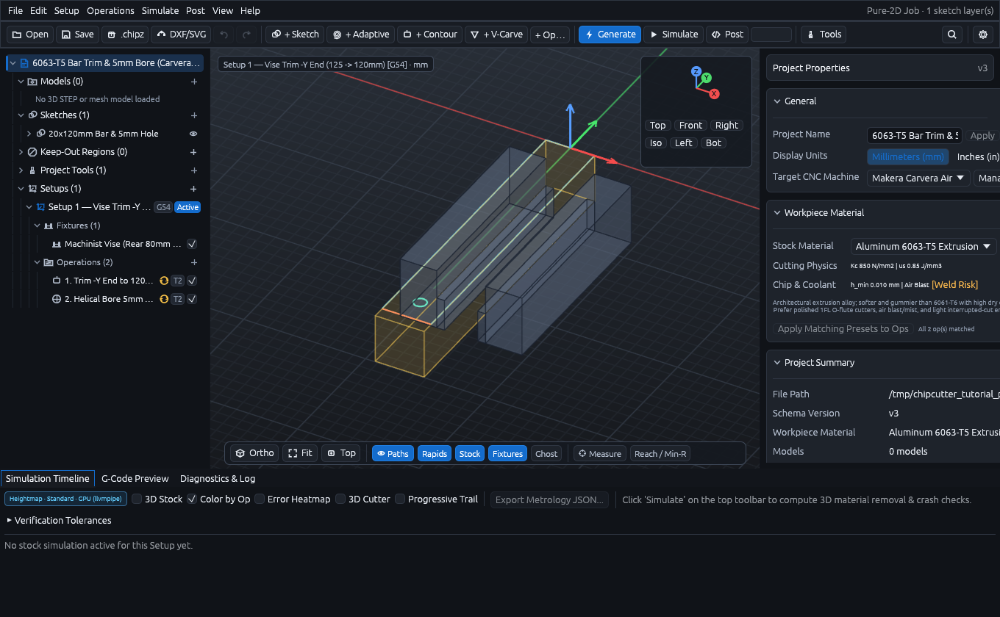
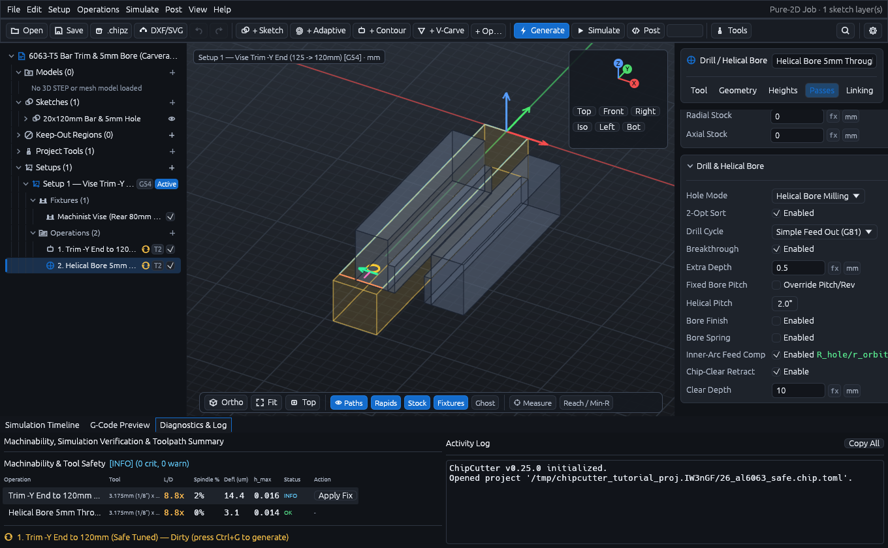
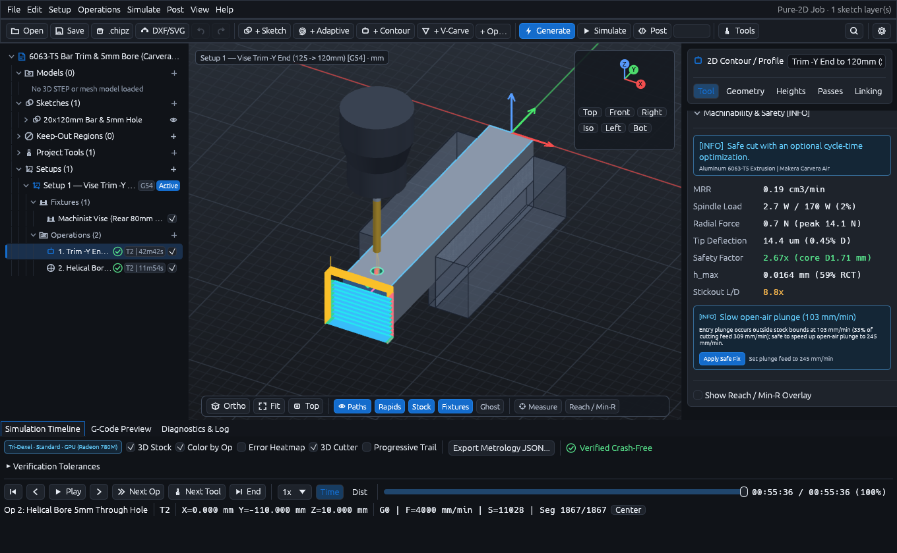

# Tutorial 26: Aluminum 6063-T5 Extrusions, Deep Helical Bore Safety, & Custom Post Profiles

## 1. Goal & What You'll Learn

Extruded **Aluminum 6063-T5** (such as `2020` T-slot rail or `20 × 20 mm` architectural bar stock) behaves very differently from `6061-T6` on benchtop CNCs like the **Makera Carvera Air** (`200 W` spindle): it is softer and gummier, welds aggressively onto dry flutes if chips get too thin, and snaps long-reach **`Ø3.175 mm (1/8") × 25 mm LOC` 1-flute O-flute** cutters (`~1.7 mm` core, `28 mm` stickout, `L/D = 8.8x`) when axial/radial loads or internal bore wall speeds are underestimated.

In this hands-on shop-floor tutorial you will build and audit a complete **Pure-2D** `20 × 20 × 125 mm` 6063 bar-trimming + `Ø5.0 mm × 20 mm` through-hole job from start to finish:

1. **Project-Level `Aluminum 6063-T5 Extrusion` Material:** Set the alloy once in **Project Inspector** (`u_s = 0.85 J/mm^3`, `K_c = 850 N/mm^2`, `h_min = 0.010 mm`, `[Weld Risk]`, `Air Blast`) and use **`Apply Matching Presets to Ops`** so Carvera 1FL O-flutes automatically pick their 6063-T5 cutting presets.
2. **Catching & Fixing High-`L/D` End-Trim Breakage:** See how an aggressive `ap = 4.04 mm × ae = 0.50 mm` cut triggers a **`[CRITICAL]`** stepped-cantilever snap hazard in **`Machinability & Safety`**, and fix it in one Undoable click (**`Apply Safe Fix`**).
3. **Eliminating All Three Deep Helical Bore Traps:** Fix `2.74×–2.95×` internal-arc wall feed amplification (`R_hole / r_orbit`), disable hazardous full-depth (`20 mm`) single-lap radial finish passes, and enable **`Chip-Clear Retract`** (`10 mm`) to clear chips out of a `4 × D` deep `Ø5 mm` bore.
4. **Custom `.post.toml` Profiles, Batch Multi-Setup Export, & CI Validation:** Inspect or clone a custom post profile in the **Post Profile Inspector**, export G-code, and gate jobs headlessly with `chipcutter validate --strict-physics --json`.

---

## 2. Prerequisites & New Workspace

This is a **Pure-2D** workflow (no external CAD file needed—just a built-in `2D Sketch` and `Fixed-Size Box Stock`):

```bash
chip-gui
```

1. Select **`New Pure-2D Parametric Sketch`** from the Welcome Overlay (or click **`+ Sketch`** in the top toolbar) to open a fresh Pure-2D workspace with `Setup 1` and `Sketch 1`.

---

## 3. Step-by-Step GUI Walkthrough

### Step 1 — Configure Project Material, Machine, Stock, Vise, & 2D Sketch

1. Click the root **Project** node in the left **Project Tree** (or open **`Edit → Project Properties…`**):
   - Set **`Target CNC Machine`** to **`Makera Carvera Air`** (`200 W` spindle, `1,000–13,000 RPM`).
   - Under **`Workpiece Material`**, choose **`Aluminum 6063-T5 Extrusion`** and review the live physics summary (`Kc = 850 N/mm^2 | us = 0.85 J/mm^3 | h_min = 0.010 mm | Air Blast [Weld Risk]`).
   - *(Tip: whenever you later switch materials on an existing project that already has operations, click **`Apply Matching Presets to Ops`** here to update each operation's `preset_id` cleanly without clobbering any custom `feed_overrides`.)*
2. Select **`Setup 1`** in the **Project Tree** and configure the workpiece & holding:
   - **`[WCS & Post]`:** Set WCS Origin to **`Stock Box Point → Center-X, Max-Y, Max-Z`** so `(0, 0, 0)` sits at the top-center of the rear bar face and the bar extends forward along `-Y`.
   - **`[Stock]`:** Choose **`Fixed-Size Box Stock`** (`Width X = 20 mm`, `Depth Y = 125 mm`, `Height Z = 20 mm`). In Pure-2D `Fixed-Size Box Stock` mode, the stock stays anchored to Setup WCS while you edit geometry, and sketch `(0, 0)` maps `1:1` to Setup WCS `(0, 0)`.
   - **`[Fixtures]`:** Add a rear **`Machinist Vise`** (`80 mm` jaw width) gripping the rear `80 mm` of the bar so the `-Y` trim end (`Y = -120 mm`) and `Ø5.0 mm` hole (`X = 0 mm, Y = -110 mm`) cantilever safely clear of the jaws.
3. Select **`Sketch 1`** under **`Sketches`** and draw the two 2D job features in Setup WCS coordinates:
   - A horizontal **Line** across the bar end from `(+10, -120)` to `(-10, -120)` (our end-trim cut line).
   - A **Circle** centered at `(0, -110)` with **`Diameter = 5.0 mm`** (our through-hole).



---

### Step 2 — Create Op 1 (`2D Contour`), Confirm Inherited Material, & Fix the High-`L/D` Snap Hazard

1. Click **`+ Contour`** (or **`+ Op… → 2D Contour`**) under **`Setup 1`** to create **Op 1** and name it **`Trim -Y End to 120mm`**.
2. Open **`Operation Inspector → [Tool]`**:
   - Confirm the read-only clickable **`Project Material: Aluminum 6063-T5 Extrusion`** pill appears automatically at the top—inherited from Step 1 with no per-operation material picker required.
   - Assign **`T2 — 3.175mm (1/8") x 25mm 1FL O-Flute Flat`** (`Stickout = 28.0 mm`, `L/D = 8.8x`, core diameter `~1.71 mm`) and verify its matching `Aluminum 6063-T5` cutting preset is selected automatically.
3. Open **`[Geometry]`** and select the `(+10, -120) → (-10, -120)` trim line from **`Sketch 1`**, setting **`Open-Chain Extension = 3.0 mm`** so the cutter plunges cleanly in open air off the side of the bar. In **`[Heights]`**, set `Top = Stock Top + 0.0 mm` and `Bottom = Stock Bottom - 0.2 mm` (`-20.2 mm`).
4. In **`[Passes]`**, first test an aggressive roughing setup (`max_stepdown = 4.1 mm`, `roughing_stepover = 0.50 mm`), then switch back to **`[Tool] → Machinability & Safety`**:
   - The advisor immediately flags **`[CRITICAL]` Tool snap / severe deflection risk**, showing how the thin `1FL` core (`I ∝ d_core^4`, `~4×` less rigid than a 3-flute) plus cubic `L^3` stickout compliance drives tip deflection and carbide bending stress past safe limits in interrupted 6063 cuts.
   - Notice the **`[INFO]`** open-air plunge advisory as well: because Op 1 plunges outside the stock on its `3.0 mm` open-chain extension, raising `plunge_feed_mm_min` to `600 mm/min` on Op 1 **only** saves air-cut time without affecting Op 2's in-material bore!
5. Click **`Apply Safe Fix`** (or dial in `max_stepdown = 2.2 mm` → `2.02 mm × 10` passes and `roughing_stepover = 0.30 mm`, `finish_stepover = 0.10 mm`, `finish_feed = 280 mm/min`, `repeat_finish_pass = true`) and verify Op 1 transitions cleanly to **`Machinability & Safety [OK]`**.


---

### Step 3 — Create Op 2 (`Drill / Bore`) & Protect the Deep `Ø5.0 mm × 20 mm` Helical Bore

1. Click **`+ Op… → Drill / Bore`** under **`Setup 1`** to create **Op 2** and name it **`Helical Bore 5mm Through Hole`**.
2. In **`Operation Inspector → [Tool]`**, assign the same **`T2`** `3.175 × 25 mm` 1FL O-flute (confirming it also displays the inherited **`Project Material: Aluminum 6063-T5 Extrusion`** pill and matching 6063-T5 preset).
3. In **`[Geometry]`**, select the `Ø5.0 mm` circle at `(0, -110)` from **`Sketch 1`**. In **`[Heights]`**, set `Feed = Stock Top + 1.0 mm` (`R-plane`) and `Bottom = Stock Bottom - 0.5 mm` (`-20.5 mm`) for clean breakthrough across `20 mm ± 0.2` extrusion tolerance.
4. Open **`[Passes]`** and set Mode to **`Helical Bore Milling`**. Notice why a naive helical bore breaks small cutters in a `Ø5.0 mm` hole with a `Ø3.175 mm` tool (`r_orbit = 0.9125 mm`):
   - **Inner-Arc Feed Amplification (`2.74×–2.95×`):** Without compensation, `309 mm/min` at tool center drives the cutting edge at **`846–912 mm/min`** (`0.077–0.083 mm/tooth` — nearly `3×` preset chipload!).
   - **Full-Depth Finish Trap:** Leaving `bore_finish_pass = true` on a `20.5 mm` (`6.5 × D`) hole steps out radially at the bottom and takes the *entire* `20.5 mm` wall in a single concave lap.
   - **Deep-Hole Chip Packing (`4 × D`):** Only `0.91 mm/side` annulus clearance exists around the cutter—dry 6063 chips can pack and weld without periodic evacuation.
5. Configure all three protections right inside **`[Passes]`** (or click **`Apply Fix`** in the bottom **`Diagnostics & Log → Machinability & Tool Safety`** table):
   - Uncheck **`Finish Pass`** (`bore_finish_pass = false`, `bore_spring_pass = false`) so the helix cuts directly to `Ø5.00 mm` at a gentle `0.20 mm/rev` pitch.
   - Enable **`Inner-Arc Feed Comp`** (`bore_inner_arc_feed_comp = true`) — notice the live **`R_hole/r_orbit`** amplification readout and automatic wall-safe centerline feed scaling.
   - Enable **`Chip-Clear Retract`** (`bore_chip_clear_depth = 10.0 mm`) so halfway down the `20.5 mm` bore the cutter pulls smoothly to hole center, retracts to `R-plane` (`+1.0 mm`) to clear 6063 chips with air blast, and resumes safely.
6. Now open the bottom **`Diagnostics & Log → Machinability & Tool Safety`** tab to confirm **both** Op 1 and Op 2 report green **`OK`** status.



---

### Step 4 — Simulate in Tri-Dexel, Customize Post Profiles, & Batch-Export

1. Press **`Ctrl+G`** and run volumetric **`Tri-Dexel`** simulation (`Edit → Application Settings… → Simulation → Tri-Dexel`) to verify:
   - Op 1 trims the `-Y` end cleanly to `120.0 mm` with zero vise jaw contact.
   - Op 2 bores cleanly through `Z = -20.5 mm` with `0` crashes, `0` gouges, and `0` fixture collisions.
2. Need custom coolant/air-blast (`M7`/`M8`), spindle warm-up, or ATC headers for your Carvera Air or LinuxCNC mill?
   - Open **`Post → Post Profile Inspector / Customizer…`** (or click **`Inspect Post…`** in **`G-Code Preview`**).
   - Built-in profiles (`grblhal_atc`, `grbl`, `linuxcnc`) are strictly read-only so upgrades never overwrite your tweaks—click **`Clone to Custom .post.toml`** to save an editable copy in your OS config folder (`~/.config/chipcutter/posts/`) and select it directly in **`Setup → [WCS & Post]`**.
   - For multi-setup jobs, use **`Post → Export All Setups…`** to write sanitized per-Setup `.nc`/`.ngc` files into one output folder.



---

## 4. Key Parameters Reference (6063-T5 on Carvera Air, `Ø3.175 × 25 mm` 1FL O-Flute)

| Operation / Setting | Unsafe (Snap Risk) | Safe (Tuned) | Why |
|---|---|---|---|
| **Project Material** | Unset (`6061` defaults) | **`Aluminum 6063-T5 Extrusion`** | Models `K_c = 850`, `h_min = 0.010 mm`, and `[Weld Risk]` |
| **Op 1 `max_stepdown` × `stepover`** | `4.04 mm × 0.50 mm` | **`2.02 mm × 0.30 mm`** | Cuts bending deflection & snap stress by `~70%` at `L/D = 8.8x` |
| **Op 1 `plunge_feed` override** | `103 mm/min` | **`600 mm/min`** *(Op 1 open-air only!)* | Safe because Op 1 plunges in open air; **never** copy onto Op 2 |
| **Op 2 `bore_finish_pass`** | `true` (`20.2 mm` full-depth lap) | **`false`** | Eliminates `6.4 × D` full-flute concave chatter/snap pass |
| **Op 2 `bore_inner_arc_feed_comp`** | `false` (`846–912 mm/min` wall!) | **`true`** (`r_orbit / R_hole` scaling) | Keeps actual wall chipload at safe `~0.024 mm/tooth` |
| **Op 2 `bore_chip_clear_depth`** | `None` (`20.5 mm` blind continuous) | **`10.0 mm`** | Retracts halfway to clear gummy 6063 chips from `Ø5 mm` bore |
| **Op 2 `bottom` offset** | `-0.2 mm` (`-20.2 mm`) | **`-0.5 mm`** (`-20.5 mm`) | Clean breakthrough on `20 mm ± 0.2` extruded bar stock |

---

## 5. Generate (`Ctrl+G`) & 3D Simulation Verification

1. Press **`Ctrl+G`** and verify green status checks on every operation under **`Setups → Setup 1 → Operations (2)`**.
2. Run **`Simulate`** (`Tri-Dexel`) and confirm **`Verified Crash-Free`** with `0` collisions and green **`OK`** rows in **`Diagnostics & Log → Machinability & Tool Safety`**.

---

## 6. Post-Processing (GRBL / grblHAL ATC & LinuxCNC)

1. Open **`G-Code Preview`**, confirm the reduced compensated `F` feedrates on `G3` helical moves and the mid-depth `G0 Z1.000` chip-clearing retract inside Op 2, and export via **`Export G-Code…`** or **`Export All Setups…`**.
2. Keep continuous air blast (or light cutting oil / alcohol mist) aimed directly at the `Ø5 mm` bore while machining dry 6063 aluminum.

---

## 7. Headless CLI Equivalent (`chipcutter`)

```bash
# Run geometric + cutting-physics validation against Carvera Air and fail on any Critical snap/stall hazard
chipcutter validate job.chip.toml --strict-physics --machine carvera-air

# Emit machine-readable JSON physics telemetry (MRR, spindle load %, tip deflection um, safety factor)
chipcutter validate job.chip.toml --physics --json

# Verify volumetric Tri-Dexel simulation and build verified G-code
chipcutter simulate job.chip.toml --engine tri-dexel
chipcutter build job.chip.toml --output-dir ./gcode_out
```
