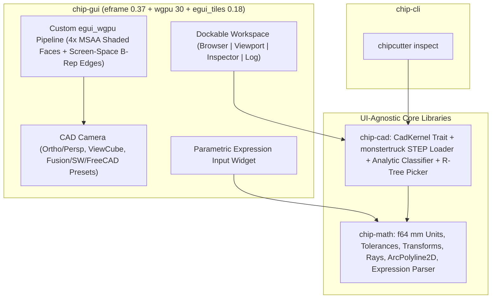

# ChipCutter — Milestone 1 Implementation Plan

## Goal Description
Implement **Milestone 1 (Foundation, STEP Import, & `wgpu` CAD Viewport)** from [10-roadmap.md](file:///workspace/ChipCutter/specs/10-roadmap.md). This establishes the multi-crate Rust 2024 workspace, enforces permissive dependency licensing via `cargo-deny`, implements the canonical `f64` millimeter math and mixed-unit expression engine (`chip-math`), builds the `CadKernel` trait and ISO 10303-21 STEP B-Rep loader/tessellator/picker (`chip-cad`), provides an initial headless CLI slice (`chip-cli`), and delivers the dockable `eframe` + `wgpu` + `egui_tiles` desktop application (`chip-gui`) with shaded B-Rep solids, crisp topological edges, CAD camera presets, ViewCube navigation, and interactive 3D face/edge picking.

---

## User Review Required

> [!IMPORTANT]
> **Environment Bootstrap Required:** This Ubuntu 26.04 workspace does not currently have `rustc`/`cargo` or Linux windowing/Vulkan headers installed. Upon plan approval, the first execution step will install the stable Rust toolchain via `rustup`, `cargo-deny`, and standard `apt` system headers (`build-essential`, `pkg-config`, X11/Wayland/xkbcommon headers, `libvulkan-dev`, `mesa-vulkan-drivers` Lavapipe, and `xvfb` for headless GPU test verification).

To align with the latest 2026 Rust CAD ecosystem, `chip-cad` will use the actively maintained **`monstertruck`** crate family (`monstertruck-io`, `monstertruck-meshing`, `monstertruck-modeling` v0.4.x — the direct Apache-2.0 continuation of `truck`) encapsulated strictly behind the `CadKernel` trait. We will update [01-architecture.md](file:///workspace/ChipCutter/specs/01-architecture.md), [02-cad-selection.md](file:///workspace/ChipCutter/specs/02-cad-selection.md), and [AGENTS.md](file:///workspace/ChipCutter/AGENTS.md) accordingly.

> [!NOTE]
> **Focused Workspace Members in M1:** Rather than creating empty stub crates for later milestones, `Cargo.toml` will include the four crates exercised in Milestone 1 (`chip-math`, `chip-cad`, `chip-cli`, and `chip-gui`). `chip-tools`, `chip-cam`, `chip-sim`, `chip-post`, and `chip-project` will be added cleanly as Milestones 2–4 land.

---

## Architecture Overview



---

## Proposed Changes

### 1. Environment Bootstrap, Spec Sync, & Workspace Configuration
Install Rust stable (`1.85+` / Rust 2024 edition), Linux `winit`/`wgpu` native build dependencies, and `cargo-deny`, then initialize workspace-level manifests.

#### [MODIFY] [01-architecture.md](file:///workspace/ChipCutter/specs/01-architecture.md), [02-cad-selection.md](file:///workspace/ChipCutter/specs/02-cad-selection.md), & [AGENTS.md](file:///workspace/ChipCutter/AGENTS.md)
- Update crate table references from legacy `truck-*` crate names to `monstertruck-io` (`step` feature), `monstertruck-modeling`, and `monstertruck-meshing` (`0.4.x`, Apache-2.0) behind `CadKernel`.

#### [NEW] [Cargo.toml](file:///workspace/ChipCutter/Cargo.toml)
```toml
[workspace]
resolver = "2"
members = [
    "crates/chip-math",
    "crates/chip-cad",
    "crates/chip-cli",
    "crates/chip-gui",
]

[workspace.package]
version = "0.1.0"
edition = "2024"
license = "MIT OR Apache-2.0"

[workspace.lints.rust]
unsafe_code = "deny" # Allowed selectively only in GPU Pod structs via bytemuck derive

[workspace.lints.clippy]
unwrap_used = "deny"
expect_used = "deny"

[workspace.dependencies]
glam = { version = "0.29", features = ["serde", "bytemuck"] }
bytemuck = { version = "1.21", features = ["derive"] }
serde = { version = "1.0", features = ["derive"] }
thiserror = "2.0"
rstar = "0.12"
rayon = "1.10"
crossbeam-channel = "0.5"
clap = { version = "4.5", features = ["derive"] }
tracing = "0.1"
tracing-subscriber = { version = "0.3", features = ["env-filter"] }
monstertruck-io = { version = "0.4", features = ["step"] }
monstertruck-meshing = "0.4"
monstertruck-modeling = "0.4"
eframe = { version = "0.37", default-features = false, features = ["wgpu", "default_fonts", "wayland", "x11"] }
egui = "0.37"
egui-wgpu = "0.37"
egui_tiles = "0.18"
wgpu = "30"
rfd = "0.15"
```
*(Exact minor versions will be resolved against crates.io during `cargo update` while preserving the synchronized `egui 0.37` / `egui_tiles 0.18` / `monstertruck 0.4` lock.)*

#### [NEW] [deny.toml](file:///workspace/ChipCutter/deny.toml) & [.gitignore](file:///workspace/ChipCutter/.gitignore)
- Configure `cargo-deny` `[licenses]` allowlist (`MIT`, `Apache-2.0`, `BSD-2-Clause`, `BSD-3-Clause`, `MPL-2.0`, `ISC`, `Zlib`, `Unicode-3.0`, `Unicode-DFS-2016`, `CC0-1.0`, `BSL-1.0`) and deny all `GPL`/`LGPL`/`AGPL` crates.

---

### 2. Canonical Math, Geometry, & Expression Crate (`crates/chip-math`)
Pure `f64` millimeter math foundation with zero UI/GPU dependencies.

#### [NEW] [lib.rs](file:///workspace/ChipCutter/crates/chip-math/src/lib.rs) & [units.rs](file:///workspace/ChipCutter/crates/chip-math/src/units.rs)
- Tolerance constants:
  - `COINCIDENCE_TOL_MM: f64 = 1e-4`
  - `ANALYTIC_CLASSIFY_TOL_MM: f64 = 1e-5`
  - `DEFAULT_ARC_FIT_TOL_MM: f64 = 0.01`
  - `DEFAULT_TESS_CHORD_TOL_MM: f64 = 0.02`
- `DisplayUnit` (`Millimeter`, `Inch`) formatting & conversion helpers (`1.0 in == 25.4 mm`, `thou`/`mil == 0.0254 mm`, `ipm`, `sfm`, `deg`).

#### [NEW] [expr.rs](file:///workspace/ChipCutter/crates/chip-math/src/expr.rs)
- Recursive-descent expression tokenizer & parser supporting `+`, `-`, `*`, `/`, parentheses, unary `+/-`, functions (`min`, `max`, `sqrt`, `sin`, `cos`, `tan`, `abs`), unit suffixes (`1/4 in`, `6mm + 10 thou`), and scoped `EvalContext` variables (`tool_d`, `tool_r`, `flute_len`, `stock_x`, `stock_y`, `stock_z`, etc.).
- `ParamLength` struct storing `{ expr: Option<String>, value_mm: f64 }` so user formulas persist cleanly.

#### [NEW] [geom2d.rs](file:///workspace/ChipCutter/crates/chip-math/src/geom2d.rs) & [geom3d.rs](file:///workspace/ChipCutter/crates/chip-math/src/geom3d.rs)
- `ArcSegment2D` (`Line { start, end }` | `Arc { start, end, center, radius, ccw }`) and `ArcPolyline2D` (`segments`, `closed`, perimeter, AABB).
- `Aabb3`, `Ray3` (`DVec3` origin + normalized direction), Möller–Trumbore `f64` ray-triangle intersection, and ray-to-3D-line-segment closest distance + depth calculation for crisp edge picking.

---

### 3. CAD Kernel, STEP Pipeline, & Spatial Picking (`crates/chip-cad`)
Isolates `monstertruck` behind `CadKernel` and produces exact `f64` B-Rep metadata alongside `FaceId`/`EdgeId`-tagged tessellations.

#### [NEW] [model.rs](file:///workspace/ChipCutter/crates/chip-cad/src/model.rs) & [kernel.rs](file:///workspace/ChipCutter/crates/chip-cad/src/kernel.rs)
```rust
#[derive(Debug, Clone, Copy, PartialEq, Eq, PartialOrd, Ord, Hash)]
pub struct BodyId(pub u32);
#[derive(Debug, Clone, Copy, PartialEq, Eq, PartialOrd, Ord, Hash)]
pub struct FaceId(pub u32);
#[derive(Debug, Clone, Copy, PartialEq, Eq, PartialOrd, Ord, Hash)]
pub struct LoopId(pub u32);
#[derive(Debug, Clone, Copy, PartialEq, Eq, PartialOrd, Ord, Hash)]
pub struct EdgeId(pub u32);

pub enum SurfaceKind {
    Plane { origin_mm: DVec3, normal: DVec3 },
    Cylinder { axis_origin_mm: DVec3, axis_dir: DVec3, radius_mm: f64, is_internal: bool },
    Cone { apex_mm: DVec3, axis_dir: DVec3, half_angle_rad: f64 },
    Torus { center_mm: DVec3, axis_dir: DVec3, major_radius_mm: f64, minor_radius_mm: f64 },
    OtherNurbs,
}

pub enum CurveKind {
    Line { start_mm: DVec3, end_mm: DVec3 },
    CircleArc { center_mm: DVec3, normal: DVec3, radius_mm: f64, start_mm: DVec3, end_mm: DVec3 },
    EllipseArc,
    OtherNurbs,
}

pub trait CadKernel: Send + Sync {
    fn load_step_bytes(
        &self,
        source_name: &str,
        step_bytes: &[u8],
        chord_tol_mm: f64,
    ) -> Result<CadDocument, CadError>;
}
```

#### [NEW] [monstertruck_kernel.rs](file:///workspace/ChipCutter/crates/chip-cad/src/monstertruck_kernel.rs)
- Parses STEP header/data units (`INCH` -> `25.4`, `METRE` -> `1000.0`, `MILLIMETRE` -> `1.0`) and normalizes all `f64` geometry into canonical millimeters.
- Extracts `SolidBody` shells, assigns deterministic `FaceId`, `LoopId`, and `EdgeId` indices, runs analytic geometry classification (detecting planar faces, internal vs. external cylindrical holes/bosses via face orientation + curvature sign, straight lines, and circular arcs within `ANALYTIC_CLASSIFY_TOL_MM`), and computes `GeometricSignature` for every face/edge/loop.
- Tessellates each face via `monstertruck-meshing` into `RenderMesh` (positions, smooth/analytic normals, and per-triangle `FaceId`) and discretizes each topological `BRepEdge` into polyline segments tagged with `EdgeId`.

#### [NEW] [picking.rs](file:///workspace/ChipCutter/crates/chip-cad/src/picking.rs)
- Builds two `rstar::RTree` spatial indices over face triangles and edge segments.
- `pick_ray(ray: &Ray3, world_units_per_pixel: f64, filter: PickFilter) -> Option<PickHit>`:
  - Evaluates closest front-facing/two-sided face triangle hit (`t_face`) AND closest unoccluded edge segment within a `6.0 px` screen-space pick radius (`t_edge <= t_face + depth_bias`), giving priority to topological edges and supporting **Loop Chain** expansion (`expand_closed_loop(edge_id)`).

#### [NEW] [fixtures.rs](file:///workspace/ChipCutter/crates/chip-cad/src/fixtures.rs)
- Programmatically models a machined test bracket/block via `monstertruck-modeling` (prismatic base with a stepped pocket face, cylindrical through-hole, and angled chamfer face) and exports ISO 10303-21 STEP bytes in-memory for deterministic unit tests and GUI "Load Sample Bracket" quick-testing.

---

### 4. Headless CLI Inspector (`crates/chip-cli`)
Proves `AGENTS.md` Invariant #1 (UI-agnostic core) from Milestone 1.

#### [NEW] [main.rs](file:///workspace/ChipCutter/crates/chip-cli/src/main.rs)
- Implements `chipcutter inspect <path.step>` (plus `chipcutter generate-sample-step <out.step>`): prints detected STEP file unit, normalized `f64` millimeter bounding box, body/face/loop/edge counts, and breakdown of classified analytic surfaces (Planes, Internal Cylinders / Holes, Cones, NURBS).

---

### 5. Desktop GUI & `wgpu` 3D CAD Viewport (`crates/chip-gui`)
Responsive `eframe` + `egui_tiles` workspace with custom 4x MSAA CAD rendering.

#### [NEW] [camera.rs](file:///workspace/ChipCutter/crates/chip-gui/src/camera.rs)
- `ProjectionMode`: `Orthographic { height_mm }` *(default)* | `Perspective { fov_y_rad }`, seamless toggle (`P`) preserving apparent scale at target focal point.
- `MousePreset`: `Fusion360` | `SolidWorks` | `FreeCadBlender`, plus `OrbitMode`: `TurntableZUp` *(default)* | `Trackball`.
- Standard views (`Top`, `Bottom`, `Front`, `Back`, `Left`, `Right`, `Iso`, `Fit All`) + unproject screen cursor into canonical `f64` `Ray3` for zoom-to-cursor and B-Rep ray-picking.

#### [NEW] [viewport/pipeline.rs](file:///workspace/ChipCutter/crates/chip-gui/src/viewport/pipeline.rs) & [viewport/shaders.wgsl](file:///workspace/ChipCutter/crates/chip-gui/src/viewport/shaders.wgsl)
- `egui_wgpu::CallbackTrait` pipeline with `4x MSAA` color + `Depth32Float` attachment:
  1. **Grid Pass:** Anti-aliased WCS XY plane grid (`1 mm` / `10 mm` or `0.1 in` / `1.0 in` adaptive lines) + RGB XYZ origin triad.
  2. **Shaded B-Rep Pass:** Studio camera-space key + fill + rim lighting; per-vertex `face_id: u32` attribute matched against uniform `{ hovered_face, selected_face }` for instant zero-reupload hover/selection highlighting!
  3. **Screen-Space Topological Edge Pass:** Quad-expanded mitered screen-space line shader (`1.5 px` base, `3.0 px` hovered/selected loop) with view-space Z-bias so crisp CAD edges never Z-fight against coplanar shaded faces.
  4. **Corner ViewCube Overlay:** Interactive 2D/3D `egui::Painter` orientation cube in the top-right viewport corner with clickable face/corner snap animations.
- Includes a headless `render_offscreen_png(...)` helper using `wgpu` directly (backed by Mesa Lavapipe in CI/containers) so automated tests can verify actual rendered frames without a physical monitor.

#### [NEW] [layout.rs](file:///workspace/ChipCutter/crates/chip-gui/src/layout.rs), [widgets/expr_input.rs](file:///workspace/ChipCutter/crates/chip-gui/src/widgets/expr_input.rs), & [app.rs](file:///workspace/ChipCutter/crates/chip-gui/src/app.rs)
- `egui_tiles` 4-pane default layout (`CAM Browser` left, `3D Viewport` center, `Selection & Expression Inspector` right, `Diagnostics & Log` bottom) + `View -> Reset Default Layout`.
- Top toolbar: `Open STEP…`, `Load Sample Part`, Pick Filter (`Any` | `Faces` | `Edges` | `Edge Loops` | `Cylindrical Holes`), `Ortho/Persp`, `Fit View`, `Mouse Preset`, and Display Units (`mm` / `in`).
- Background `rayon` STEP import job with `egui` spinner so loading multi-megabyte STEP solids never stalls `60 FPS` rendering.
- Inspector displays exact `f64` properties of picked entities (e.g., Planar Face normal/Z-height/area, Cylindrical Hole exact diameter & axis depth, CircleArc radius) formatted in active display units, alongside the live mixed-unit `ExpressionInput` widget.

---

## Verification Plan

### Automated Tests
All library crates enforce `#![deny(clippy::unwrap_used, clippy::expect_used)]`. After implementation, we will execute:

1. **Formatting, Strict Lints, & License Audit:**
   ```bash
   cargo fmt --all -- --check
   cargo clippy --workspace --all-targets -- -D warnings
   cargo deny check licenses
   ```
2. **Unit & Integration Test Suite:**
   ```bash
   cargo test --workspace
   ```
   Covering:
   - `chip-math`: Mixed-unit expressions (`"1/4 in" == 6.35`, `"tool_d * 0.4 + 10 thou"`), precedence, trig functions, division-by-zero & unknown-variable error reporting, ray-triangle and ray-segment accuracy.
   - `chip-cad`: Round-trip STEP loading of the programmatic fixture (both `MILLIMETRE` and scaled `INCH` STEP headers), verifying body/face/loop/edge topology counts, analytic `Plane` / `Cylinder` / `CircleArc` recognition within `1e-5 mm`, `GeometricSignature` determinism, and `RTree` ray-picking priority between overlapping edges and faces.
   - `chip-gui`: Headless `wgpu` offscreen viewport render test generating a `800x600` frame of the sample STEP solid and asserting non-empty shaded geometry + edge pixels.
3. **Headless CLI End-to-End Check & GUI Launch Capture:**
   ```bash
   cargo run -p chip-cli -- generate-sample-step /tmp/sample_bracket.step
   cargo run -p chip-cli -- inspect /tmp/sample_bracket.step
   xvfb-run -a cargo run -p chip-gui -- --self-test-screenshot /tmp/m1_gui_preview.png
   ```

### Manual Verification
Once built, you can run:
```bash
cargo run -p chip-gui
```
- Click **Load Sample Part** (or **Open STEP…** with one of your own `.step`/`.stp` CAD files).
- Test **Fusion 360 / SolidWorks / FreeCAD** mouse orbit/pan/zoom presets, toggle **Orthographic / Perspective (`P`)**, and click faces on the **ViewCube**.
- Hover and click planar pocket floors, circular edges (with **Edge Loops** chaining), and cylindrical holes, verifying exact `mm` / `in` dimensions in the right-hand **Inspector** and testing inline formulas (`1/4 in`, `12mm / 3`) in the expression field.
