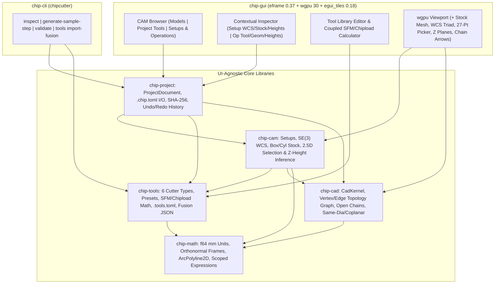

# ChipCutter — Milestone 2 Implementation Plan

## Goal Description
Implement **Milestone 2 (Setups, WCS, Selection Engine, & Tool Library)** from [10-roadmap.md](file:///workspace/ChipCutter/specs/10-roadmap.md). Building on Milestone 1's STEP B-Rep kernel and `wgpu` CAD viewport, Milestone 2 transforms ChipCutter from a single-part STEP viewer into a full parametric CAM job preparation environment:

1. **Multi-Setup & Work Coordinate Systems (`chip-cam`):** Right-handed `SE(3)` WCS orientation from B-Rep faces/edges, 27-point Stock/Model origin picker + CAD feature origin anchoring, Box & Cylindrical stock definitions, controller work offsets (`G54`..`G59.3`), and strictly validated Z-height hierarchies (`Clearance >= Retract >= Feed >= Top >= Bottom`).
2. **Interactive 3D Selection & Feature Extraction (`chip-cad` + `chip-cam`):** Planar faces (with inner island loops), closed edge loops, tangent-preferring open edge chains (with reversible travel direction and side-flip indicators), internal cylindrical holes (with blind vs. through-hole recognition), assistive **Select Same Diameter** and **Select Coplanar Faces** expanders, and automatic `Top` / `Bottom` Z-height inference in active Setup WCS coordinates.
3. **Tool Library & Cutting Presets (`chip-tools`):** All 6 v1 cutter types, machine/offset metadata, material cutting presets, bidirectional coupled **SFM ↔ RPM** and **Chipload ↔ Feedrate** calculator (with Radial Chip Thinning hint), `.tools.toml` global & project-embedded persistence, and **Fusion 360 `.json` / `.tools`** importer.
4. **Project Persistence & Instant Undo/Redo (`chip-project`):** Deterministic, Git-diff-friendly `.chip.toml` (`schema_version = 1`) serialization with relative STEP paths + SHA-256 integrity hashes, headless CLI validation (`chipcutter validate` & `chipcutter tools import-fusion`), and `< 1 ms` out-of-band snapshot Undo/Redo (`Ctrl+Z` / `Ctrl+Y`).
5. **Viewport & Inspector UX (`chip-gui`):** Translucent 3D Stock & Z-height plane render passes, active Setup WCS RGB triad + interactive 27-point origin anchor overlay, multi-face/multi-edge highlight buffers with 3D chain direction cones, **Align View to Active Setup Top**, Setup & Operation Inspector tabs, and a modal/dockable **Tool Library Manager**.

---

## Key Architectural Decisions & Scope Alignment

> [!IMPORTANT]
> **New UI-Agnostic Core Crates in M2 (`chip-tools`, `chip-cam`, `chip-project`):**
> Per [AGENTS.md](file:///workspace/ChipCutter/AGENTS.md) Invariant #1 and [01-architecture.md](file:///workspace/ChipCutter/specs/01-architecture.md), Milestone 2 introduces three pure-Rust library crates with **zero** `egui`/`eframe`/`wgpu` dependencies:
> - `crates/chip-tools` — Cutter geometry, material presets, SFM/chipload math, `.tools.toml`, and Fusion 360 import.
> - `crates/chip-cam` — Setups, WCS transforms, Stock, 2.5D B-Rep feature extraction (`ArcPolyline2D` / `HoleFeature`), Z-height hierarchy resolution, and parametric Operation specs.
> - `crates/chip-project` — `ProjectDocument`, deterministic `.chip.toml` I/O, SHA-256 CAD tracking, project validation, and `HistoryStack` Undo/Redo.
>
> `chip-sim` and `chip-post` remain cleanly deferred until Milestone 4.

> [!NOTE]
> **Parametric Operation Shells Included in M2 for End-to-End Selection & Persistence:**
> To exercise interactive 3D selection modes, automatic Z-height inference, tool/preset binding, `.chip.toml` round-tripping, and Undo/Redo together in Milestone 2 (without premature toolpath math), `chip-cam` will define the common `Operation` container (`Facing`, `Contour2D`, `Pocket2D`, `DrillBore`, `ChamferTrace`) holding its `[Tool]`, `[Geometry]`, and `[Heights]` specifications in `Dirty` (`⟳`) state. Milestone 3 will then plug background `rayon` `Ctrl+G` generation and the 5 toolpath strategies directly into these exact structs without breaking `.chip.toml` or reworking the UI.

> [!TIP]
> **Permissive Pure-Rust Dependency Additions:**
> Milestone 2 adds `toml` (`MIT OR Apache-2.0`), `serde_json` (`MIT OR Apache-2.0`), `zip` (`MIT`, `default-features = false, features = ["deflate"]` — pure Rust, no C bzip2/lzma), `sha2` (`MIT OR Apache-2.0`), and `dirs` (`MIT OR Apache-2.0`). All pass `cargo deny check licenses` under [deny.toml](file:///workspace/ChipCutter/deny.toml).

---

## Architecture Overview



---

## Proposed Changes

### 1. Workspace Manifest & Permissive Dependencies

#### [MODIFY] [Cargo.toml](file:///workspace/ChipCutter/Cargo.toml)
- Add workspace members `"crates/chip-tools"`, `"crates/chip-cam"`, and `"crates/chip-project"`.
- Add shared `[workspace.dependencies]`:
  - `chip-tools = { path = "crates/chip-tools" }`
  - `chip-cam = { path = "crates/chip-cam" }`
  - `chip-project = { path = "crates/chip-project" }`
  - `toml = "0.8"`
  - `serde_json = "1.0"`
  - `zip = { version = "2.2", default-features = false, features = ["deflate"] }`
  - `sha2 = "0.10"`
  - `dirs = "6.0"`

---

### 2. Math, Orthonormal Frames, & Scoped Expression Variables (`crates/chip-math`)

#### [NEW] [frame.rs](file:///workspace/ChipCutter/crates/chip-math/src/frame.rs)
- `RigidFrame3` (`f64` right-handed `SE(3)` transform):
  - Stores unit axes `x_axis: DVec3`, `y_axis: DVec3`, `z_axis: DVec3` (`x × y = z`, orthonormal within `1e-9`) and `origin_mm: DVec3`.
  - Builders with explicit degeneracy guards (`Result<RigidFrame3, FrameError>`, zero `NaN`s):
    - `RigidFrame3::identity()`
    - `RigidFrame3::from_z_and_x_hint(z_dir: DVec3, x_hint: Option<DVec3>, flip_z: bool, flip_x: bool, clock_90_steps: u8)` — projects `x_hint` onto plane `⊥ Z`, rejects collinear `Z` and `X` (`|z × x_hint| < 1e-6`), or selects a deterministic canonical perpendicular axis when `x_hint` is `None`.
  - Exact bidirectional point/vector/direction transforms: `world_to_local_point`, `local_to_world_point`, `world_to_local_dir`, `local_to_world_dir`, `to_dmat4_local_to_world`, `to_dmat4_world_to_local`.

#### [MODIFY] [geom2d.rs](file:///workspace/ChipCutter/crates/chip-math/src/geom2d.rs), [units.rs](file:///workspace/ChipCutter/crates/chip-math/src/units.rs), & [expr.rs](file:///workspace/ChipCutter/crates/chip-math/src/expr.rs)
- Extend `ArcPolyline2D`:
  - `exact_aabb(&self) -> Aabb2` accounting for circular arc cardinal quadrant extrema (`0°, 90°, 180°, 270°` swept angles), not just segment endpoints!
  - `signed_area(&self) -> f64` & `reverse(&self) -> Self` (flipping segment order, `start`/`end`, and `ccw` flags for open/closed contour direction reversal).
- Extend `units.rs` & `expr.rs`:
  - Add feedrate/surface-speed/angle display helpers (`mm/min` ↔ `ipm`, `m/min` ↔ `sfm`, `mm/tooth` ↔ `ipt`, `rad` ↔ `deg`).
  - Support full `EvalContext` variable scopes from [01-architecture.md](file:///workspace/ChipCutter/specs/01-architecture.md#L63-L66):
    - Tool scope: `tool_d`, `tool_r`, `flute_len`, `flutes`, `tip_angle`
    - Setup scope: `stock_x`, `stock_y`, `stock_z`, `model_top_z`, `model_bottom_z`
    - Feature scope: `feature_top_z`, `feature_bottom_z`, `hole_d`
  - Add `ParamScalar` (for unitless/RPM/degree/feed expressions alongside `ParamLength`) if needed for parametric Inspector fields.

---

### 3. B-Rep Topology Graph, Open Chains, & Assistive Queries (`crates/chip-cad`)

#### [NEW] [topology.rs](file:///workspace/ChipCutter/crates/chip-cad/src/topology.rs)
Built once on `CadDocument` load (or lazily cached) by welding edge endpoints within `COINCIDENCE_TOL_MM` (`1e-4 mm`):
- `VertexId(pub u32)` and `TopologyGraph`:
  - Maps each `EdgeId` -> `(start_vertex: VertexId, end_vertex: VertexId)` + start/end unit tangent vectors.
  - Maps each `VertexId` -> `position_mm: DVec3` and incident `Vec<EdgeId>`.
- **Open Edge Chain Pathfinding (`find_open_edge_chain`):**
  - Given `(body_id, start_edge: EdgeId, end_edge: EdgeId)`, runs Dijkstra over the body's edge-incidence graph minimizing `edge_length_mm + kink_angle_rad * TANGENT_PENALTY_MM` so tangent-continuous chains win naturally over sharp branches while still connecting sharp corners when needed.
  - Returns ordered `Vec<OrientedEdgeUse>` (open or closed).
- **Assistive Selection Expanders ([02-cad-selection.md](file:///workspace/ChipCutter/specs/02-cad-selection.md#L50)):**
  - `find_same_diameter_holes(doc, body_id, axis_wcs_world: DVec3, radius_mm: f64, tol_mm: f64) -> Vec<FaceId>`: finds all internal `SurfaceKind::Cylinder` faces on `body_id` coaxial/parallel with `±axis` whose `|r - radius_mm| <= tol_mm`.
  - `find_coplanar_faces(doc, body_id, plane_normal_world: DVec3, plane_d_mm: f64, tol_mm: f64) -> Vec<FaceId>`: finds all `SurfaceKind::Plane` faces on `body_id` with matching outward normal (`dot > 0.9999`) and signed plane offset within `tol_mm`.
- **Adjacent Wall & Hole Rim Queries:**
  - `adjacent_faces_of_face(doc, face_id) -> Vec<FaceId>` (via shared `BRepEdge::adjacent_faces`) for Pocket Top Z inference.
  - `cylinder_hole_axial_span(doc, cyl_face_id, axis_world: DVec3) -> CylinderSpanInfo`: computes exact upper/lower rim projections along `axis_world` and checks whether the lower rim edges border an interior floor face (`is_through_hole = false`) or exterior bottom face (`is_through_hole = true`).

#### [MODIFY] [model.rs](file:///workspace/ChipCutter/crates/chip-cad/src/model.rs) & [picking.rs](file:///workspace/ChipCutter/crates/chip-cad/src/picking.rs)
- Attach `TopologyGraph` (or build in `MonstertruckKernel`) on `CadDocument`, and store `SelectionBinding { body_id, target_kind, last_index, signature: GeometricSignature }` ready for `.chip.toml` persistence and M5 reload re-matching.
- Extend `PickFilter` / `CadPicker` with WCS-pick helpers:
  - `WcsAxisCandidate` (Planar faces, Linear edges, Cylindrical faces) for interactive WCS Z/X axis picking.
  - `WcsOriginPointCandidate` (B-Rep vertices within `7 px` screen radius, circular edge centers, cylindrical hole top/bottom centers) for interactive WCS feature-origin picking.

#### [MODIFY] [fixtures.rs](file:///workspace/ChipCutter/crates/chip-cad/src/fixtures.rs)
- Enhance / add synthetic STEP fixtures for M2 verification:
  1. `sample_machined_plate_step()` (existing M1 fixture, preserved for existing tests).
  2. `sample_multi_feature_bracket_step(tilted: bool)`: prismatic part containing **multiple equal-diameter mounting holes** (`4x Ø6.0 mm` through-holes + `1x Ø10.0 mm` blind bore), **coplanar pocket floors**, a **raised island**, and an option to export the STEP body **tilted/rotated (`+Y` up or `30°` oblique)** to rigorously test WCS alignment, tight WCS stock bounding boxes, Same-Diameter/Coplanar expanders, and blind vs. through-hole Z inference!

---

### 4. Tool Library, SFM/Chipload Calculator, & Fusion 360 Import (`crates/chip-tools`)

#### [NEW] [Cargo.toml](file:///workspace/ChipCutter/crates/chip-tools/Cargo.toml) & [src/lib.rs](file:///workspace/ChipCutter/crates/chip-tools/src/lib.rs)
Pure-Rust crate (`chip-math`, `serde`, `toml`, `serde_json`, `zip`, `dirs`, `thiserror`).

#### [NEW] [src/model.rs](file:///workspace/ChipCutter/crates/chip-tools/src/model.rs)
- `ToolId(pub String)` (stable deterministic slug/UUID, e.g. `"tool_t1_6mm_flat"`).
- `CutterGeometry` enum covering all 6 v1 types from [04-tool-library.md](file:///workspace/ChipCutter/specs/04-tool-library.md#L12-L23) in canonical `f64` mm:
  - `FlatEndmill { diameter_mm, flute_length_mm, overall_length_mm, shank_diameter_mm, flutes: u32 }`
  - `BullNoseEndmill { diameter_mm, corner_radius_mm, flute_length_mm, overall_length_mm, shank_diameter_mm, flutes: u32 }`
  - `BallEndmill { diameter_mm, flute_length_mm, overall_length_mm, shank_diameter_mm, flutes: u32 }`
  - `ChamferMill { diameter_mm, tip_diameter_mm, included_angle_deg: f64, flute_length_mm, overall_length_mm, shank_diameter_mm, flutes: u32 }`
  - `TwistDrill { diameter_mm, point_angle_deg: f64, flute_length_mm, overall_length_mm, shank_diameter_mm, flutes: u32 }`
  - `FaceMill { cutting_diameter_mm, outside_diameter_mm, corner_radius_mm, flute_length_mm, overall_length_mm, shank_diameter_mm, flutes: u32 }`
- `Tool` struct:
  - `id: ToolId`, `name: String`, `vendor: Option<String>`, `product_id: Option<String>`, `native_unit: DisplayUnit` (preserves `in` vs `mm` display fidelity!), `tool_number: u32`, `length_offset_number: u32`, `diameter_offset_number: u32`, `spindle_direction: SpindleDirection`, `default_coolant: CoolantMode`, `stickout_length_mm: f64`, `geometry: CutterGeometry`, `presets: Vec<CuttingPreset>`.
  - `Tool::validate(&self) -> Result<(), ToolValidationError>` (verifies finite positive dimensions, `0 < corner_radius < diameter / 2` on bull-nose, `tip_diameter < diameter` & `0° < included_angle < 180°` on chamfer mills, `stickout_length >= flute_length`, `flutes >= 1`, etc.).
  - `Tool::supports_operation(op_kind) -> bool` compatibility matrix per [04-tool-library.md](file:///workspace/ChipCutter/specs/04-tool-library.md#L15-L22).

#### [NEW] [src/feeds_speeds.rs](file:///workspace/ChipCutter/crates/chip-tools/src/feeds_speeds.rs)
- `CuttingPreset` (`id`, `name`, `material`, `spindle_rpm`, `surface_speed_m_min`, `cutting_feed_mm_min`, `chipload_mm_tooth`, `lead_feed_mm_min`, `ramp_feed_mm_min`, `plunge_feed_mm_min`, `default_stepdown_mm`, `default_stepover_mm`, `coolant_override`).
- Coupled bidirectional update methods (zero drift, guarded against `D == 0` or `flutes == 0`):
  - `set_surface_speed_m_min(vc, diameter_mm, flutes, lock_chipload: bool)` -> updates `spindle_rpm = (vc * 1000.0) / (PI * diameter_mm)`, and either scales `cutting_feed_mm_min` (+ proportional default `lead`/`ramp`/`plunge` if uncustomized) when `lock_chipload == true` or recalculates `chipload_mm_tooth` when `false`.
  - `set_spindle_rpm(rpm, diameter_mm, flutes, lock_chipload: bool)` -> updates `surface_speed_m_min` + coupled feed/chipload.
  - `set_chipload_mm_tooth(fz, flutes)` <-> `set_cutting_feed_mm_min(vf, flutes)`.
  - `radial_chip_thinning_factor(diameter_mm, stepover_mm) -> Option<ChipThinningHint>`: when `0 < ae < 0.5 * D`, computes effective chip thickness ratio `2 * sqrt((ae / D) * (1 - ae / D))` and compensated feedrate hint.

#### [NEW] [src/builtin.rs](file:///workspace/ChipCutter/crates/chip-tools/src/builtin.rs) & [src/storage.rs](file:///workspace/ChipCutter/crates/chip-tools/src/storage.rs)
- Curated starter library (`default_starter_library()`) with practical metric & imperial shop cutters (`6 mm 3FL Carbide Flat`, `3.175 mm / 1/8" 2FL Flat`, `1/4" 3FL Bull-Nose R0.020"`, `6 mm Ball`, `90° 6 mm Chamfer/Spot`, `5.0 mm 118° Stub Drill`, `38 mm 3-Insert Face Mill`) each populated with presets for **Aluminum 6061**, **Baltic Birch Plywood**, **Acetal / Delrin**, and **Mild Steel 1018**.
- Deterministic `.tools.toml` load/save + OS global config path discovery (`~/.config/chipcutter/default.tools.toml` on Linux).

#### [NEW] [src/fusion_import.rs](file:///workspace/ChipCutter/crates/chip-tools/src/fusion_import.rs)
- Parses both raw Fusion 360 `.json` (`{ "data": [ ... ] }`) and `.tools` ZIP archives (reading `tools.json` inside the archive via `zip`).
- Maps `"flat end mill"`, `"bull nose end mill"`, `"ball end mill"`, `"chamfer mill"`, `"spot drill"`, `"drill"`, and `"face mill"`; converts `"inches"` / `"millimeters"` cleanly to `f64` mm while setting `native_unit`; imports `"post-process"` numbers (`number`, `length-offset`, `diameter-offset`, `clockwise`, `coolant`) and `"start-values"` cutting presets (`v_c`, `n`, `v_f`, `f_z`, `v_f_leadIn`, `v_f_ramp`, `v_f_plunge`, `stepdown`, `stepover`).
- Skips unsupported exotic types (e.g., `"lollipop mill"`, `"dovetail mill"`, `"form mill"`) with structured non-fatal warnings in `FusionImportReport`.

---

### 5. Setups, WCS, Stock, 2.5D Selection, & Z-Height Engine (`crates/chip-cam`)

#### [NEW] [Cargo.toml](file:///workspace/ChipCutter/crates/chip-cam/Cargo.toml) & [src/lib.rs](file:///workspace/ChipCutter/crates/chip-cam/src/lib.rs)
Pure-Rust crate (`chip-math`, `chip-cad`, `chip-tools`, `serde`, `thiserror`).

#### [NEW] [src/wcs.rs](file:///workspace/ChipCutter/crates/chip-cam/src/wcs.rs) & [src/stock.rs](file:///workspace/ChipCutter/crates/chip-cam/src/stock.rs)
- `WorkOffsetSlot`: `Default` (`0`), `G54`..`G59` (`1..=6`), `G59_1`..`G59_3` (`7..=9`).
- `WcsOrientationMode`:
  - `ModelOrientation { flip_z: bool, flip_x: bool, clock_90: u8 }`
  - `SelectZAndX { z_ref: WcsAxisBinding, flip_z: bool, x_ref: Option<WcsAxisBinding>, flip_x: bool, clock_90: u8 }`
  - `SelectXYPlane { face_ref: SelectionBinding, flip_z: bool, x_edge_ref: Option<SelectionBinding>, clock_90: u8 }`
- `BoxAnchor27 { x: AxisAnchor, y: AxisAnchor, z: AxisAnchor }` (`Min | Center | Max` along X, Y, Z — all 27 stock/model anchor points, with human-readable labels like `"Top Center"`, `"Top Front-Left"`, `"Bottom Front-Left"`).
- `WcsOriginMode`:
  - `StockBoxPoint(BoxAnchor27)` *(default: Top Center or Top Front-Left)*
  - `ModelBoxPoint(BoxAnchor27)`
  - `SelectedCadFeature(WcsPointBinding)` (Vertex, CircleArc center, or Cylinder hole top/bottom center)
  - Plus `additional_offset_wcs: [ParamLength; 3]` (`ΔX, ΔY, ΔZ`).
- `StockConfig`:
  - `BoxRelative { offset_pos_x: ParamLength, offset_neg_x: ParamLength, offset_pos_y: ParamLength, offset_neg_y: ParamLength, symmetric_xy: bool, offset_top_z: ParamLength, offset_bottom_z: ParamLength, round_increment_mm: Option<f64> }`
  - `BoxFixed { width_x: ParamLength, depth_y: ParamLength, height_z: ParamLength, xy_align: FixedStockXyAlign, z_align: FixedStockZAlign, align_offset: ParamLength }`
  - `CylinderRelative { axis: StockAxis, radial_offset: ParamLength, top_offset: ParamLength, bottom_offset: ParamLength }`
  - `CylinderFixed { axis: StockAxis, diameter: ParamLength, length: ParamLength, axial_offset: ParamLength }`
- `resolve_setup_frame(&Setup, &CadDocument, DisplayUnit) -> Result<ResolvedSetup, CamValidationError>`:
  1. Resolves orthonormal rotation `(X_wcs, Y_wcs, Z_wcs)` from `WcsOrientationMode`.
  2. Computes exact tight `model_aabb_oriented` of target `BodyId`(s) along `(X_wcs, Y_wcs, Z_wcs)` (combining exact analytic circle/cylinder extrema in oriented axes + B-Rep vertices).
  3. Computes `stock_aabb_oriented` (or cylinder bounds) around `model_aabb_oriented`.
  4. Anchors `origin_world` from `WcsOriginMode` + `additional_offset_wcs` and returns `ResolvedSetup` containing `frame: RigidFrame3`, `model_aabb_wcs: Aabb3`, `stock_bounds_wcs: ResolvedStockBounds`, and scopedSetup `EvalContext` variables (`stock_x`, `stock_y`, `stock_z`, `model_top_z`, `model_bottom_z`).

#### [NEW] [src/selection.rs](file:///workspace/ChipCutter/crates/chip-cam/src/selection.rs)
Transforms B-Rep selections into exact `f64` WCS 2.5D CAM features (preserving analytic `ArcSegment2D::Arc` segments per `AGENTS.md` Invariant #3 & #4):
- `GeometrySelectionItem`:
  - `PlanarFace { binding: SelectionBinding }` -> extracts outer `ArcPolyline2D` + inner island `Vec<ArcPolyline2D>`, exact `face_z_wcs`, and adjacent wall top `Z`.
  - `ClosedLoop { binding: SelectionBinding, reverse: bool, side_flip: bool }` -> projects loop onto WCS XY as closed `ArcPolyline2D` (splitting full `360°` circles into two exact `180°` arcs) + `loop_z_wcs`.
  - `OpenChain { body_id: BodyId, start_edge: SelectionBinding, end_edge: SelectionBinding, resolved_edges: Vec<OrientedEdgeUse>, reverse: bool, side_flip: bool }` -> extracts open `ArcPolyline2D` + tangent direction sample point/vector in WCS for 3D viewport arrow gizmos.
  - `CylindricalHole { binding: SelectionBinding }` -> validates `axis ∥ ±Z_wcs`, extracts exact `(center_x_wcs, center_y_wcs)`, `diameter_mm`, `top_z_wcs`, `bottom_z_wcs`, and `is_through_hole: bool`.

#### [NEW] [src/heights.rs](file:///workspace/ChipCutter/crates/chip-cam/src/heights.rs) & [src/operation.rs](file:///workspace/ChipCutter/crates/chip-cam/src/operation.rs)
- `HeightReference`: `FromSelection`, `StockTop`, `StockBottom`, `ModelTop`, `ModelBottom`, `WcsOrigin`, `SetupClearance`, `SetupRetract`, `TopHeight`.
- `HeightSpec { reference: HeightReference, offset: ParamLength }`.
- Automatic Z-height inference rules from [02-cad-selection.md](file:///workspace/ChipCutter/specs/02-cad-selection.md#L52-L57):
  - Planar pocket floor -> `Bottom = face_z_wcs`, `Top = highest_adjacent_wall_top_z` (fallback `StockTop`).
  - Edge loop / chain -> `Bottom = loop_min_z_wcs`, `Top = ModelTop` (or `StockTop`).
  - Cylindrical hole -> `Top = hole_top_z_wcs`, `Bottom = hole_bottom_z_wcs`.
- Strict validation `validate_heights(ResolvedHeights) -> Result<(), HeightValidationError>`:
  - Enforces `Clearance >= Retract >= Feed >= Top >= Bottom` (within `-1e-6 mm` epsilon); produces structured, actionable diagnostics (e.g., *"Retract Height (12.0 mm) must be >= Feed Height (15.0 mm)"*).
- `Operation` struct (`id`, `name`, `kind: OperationKind`, `suppressed: bool`, `status: OperationStatus`, `tool_id: Option<ToolId>`, `preset_id: Option<String>`, `feed_overrides: OperationFeedOverrides`, `selections: Vec<GeometrySelectionItem>`, `heights: OperationHeights`) ready for `.chip.toml` persistence in M2 and toolpath generation in M3.

---

### 6. Project Document, `.chip.toml` Persistence, & Undo/Redo (`crates/chip-project`)

#### [NEW] [Cargo.toml](file:///workspace/ChipCutter/crates/chip-project/Cargo.toml) & [src/lib.rs](file:///workspace/ChipCutter/crates/chip-project/src/lib.rs)
Pure-Rust crate (`chip-math`, `chip-cad`, `chip-tools`, `chip-cam`, `serde`, `toml`, `sha2`, `thiserror`).

#### [NEW] [src/document.rs](file:///workspace/ChipCutter/crates/chip-project/src/document.rs) & [src/toml_io.rs](file:///workspace/ChipCutter/crates/chip-project/src/toml_io.rs)
- `ProjectDocument`:
  - `schema_version: u32` (`1`)
  - `project_name: String`
  - `display_units: DisplayUnit`
  - `models: Vec<ModelReference>` (`id`, `relative_or_abs_path`, `sha256_hex`, `detected_unit`)
  - `tools: Vec<Tool>` (sorted deterministically by `(tool_number, id)` — **project-embedded snapshots** copied automatically whenever a global tool is assigned to an operation, plus `sync_tool_from_global(&mut self, &Tool)` helper per [04-tool-library.md](file:///workspace/ChipCutter/specs/04-tool-library.md#L8)!)
  - `setups: Vec<Setup>` (each containing `id`, `name`, `target_bodies`, `wcs`, `wcs_slot`, `post_profile`, `stock`, `default_heights`, and `operations: Vec<Operation>`).
- Deterministic `.chip.toml` serialization:
  - Converts imported STEP paths to relative POSIX-style paths (`cad/part.step`) whenever located under or alongside the `.chip.toml` parent directory.
  - Computes and verifies SHA-256 hashes (`sha2::Sha256`) on load, surfacing a structured `ModelHashMismatch` notice when the external STEP file was revised on disk.
  - Zero binary/mesh blobs in `.chip.toml`.

#### [NEW] [src/history.rs](file:///workspace/ChipCutter/crates/chip-project/src/history.rs) & [src/validation.rs](file:///workspace/ChipCutter/crates/chip-project/src/validation.rs)
- `UndoHistory`:
  - Ring-bounded (`max_entries = 100`) undo/redo stack storing `(action_label: String, snapshot: ProjectDocument)` (plus optional transaction-key coalescing so dragging or typing doesn't spam per-character snapshots).
  - Out-of-band `LoadedCadStore` (mapping `ModelId -> Arc<(CadDocument, CadPicker)>`) stays untouched across `undo()` / `redo()`, guaranteeing `< 1 ms` `Ctrl+Z` / `Ctrl+Y` latency!
- `validate_project(&ProjectDocument, &LoadedCadStore) -> ProjectValidationReport`:
  - Validates STEP model availability & SHA-256 status, tool definitions, Setup WCS frames, Stock dimensions, B-Rep selection bindings against active Setup WCS, and Z-height hierarchy invariants across every Setup and Operation.

---

### 7. Headless CLI Subcommands (`crates/chip-cli`)

#### [MODIFY] [main.rs](file:///workspace/ChipCutter/crates/chip-cli/src/main.rs)
Extend `chipcutter` with two Milestone 2 subcommands from [09-persistence-cli.md](file:///workspace/ChipCutter/specs/09-persistence-cli.md#L55-L64):
1. `chipcutter validate <project.chip.toml>`:
   - Loads `.chip.toml`, loads referenced STEP file(s) via `MonstertruckKernel`, checks SHA-256 hashes, resolves every Setup WCS + Stock + Operation selection + Z-height hierarchy, prints a clear diagnostic summary, and exits non-zero if any error invariant fails.
2. `chipcutter tools import-fusion <input.json|.tools> -o <output.tools.toml>`:
   - Imports a Fusion 360 JSON or `.tools` zip library, prints imported cutter counts, preset counts, and any skipped-tool warnings, and writes deterministic `.tools.toml`.

---

### 8. Desktop GUI — Multi-Setup Workflow, Viewport Gizmos, & Tool Manager (`crates/chip-gui`)

#### [MODIFY] [viewport/pipeline.rs](file:///workspace/ChipCutter/crates/chip-gui/src/viewport/pipeline.rs) & [viewport/shaders.wgsl](file:///workspace/ChipCutter/crates/chip-gui/src/viewport/shaders.wgsl)
Upgrade the 4x MSAA `wgpu` viewport to render full Milestone 2 CAM context:
1. **Multi-Entity Selection Highlighting:**
   - Replace single `selected_face: u32` uniform with a GPU face-state buffer (`0 = Default`, `1 = Hovered`, `2 = Selected`, `3 = Ghosted/Translucent`) so selecting 8 coplanar faces or 4 same-diameter holes highlights every selected face simultaneously, plus optional **Ghost Part** translucency toggle for inspecting internal blind holes and WCS origins!
2. **Active Setup WCS Grid, RGB Triad, & 27-Point Interactive Origin Overlay:**
   - Transform the reference XY grid and crisp 3D RGB XYZ axis arrows (`X`=Red, `Y`=Green, `Z`=Blue cones/lines) by the active Setup's `T_wcs_to_world` frame.
   - When the user is editing **WCS Origin** in `StockBoxPoint` or `ModelBoxPoint` mode, render the **27 interactive anchor dots** directly on the 3D Stock/Model bounding box in `egui` screen-space overlay so clicking any corner, midpoint, or face center snaps `X0 Y0 Z0` immediately!
3. **Stock & Z-Height Planes Pass:**
   - Render translucent wireframe + soft alpha-blended faces (`depth_write_enabled: false`) for **Box Stock** or **Cylindrical Stock**.
   - Render translucent color-coded **Z-Height Planes** (`Clearance`, `Retract`, `Feed`, `Top`, `Bottom`) across the stock XY footprint whenever the Setup Heights or Operation Heights tab is active in the Inspector.
4. **3D Chain Direction & Side-Flip Arrows:**
   - Render 3D directional tangent cones/chevrons along selected `ClosedLoop` and `OpenChain` polylines (plus perpendicular side-indicator tick) so clicking **Reverse Chain** or **Flip Side** gives unmistakable visual feedback in the viewport.

#### [MODIFY] [camera.rs](file:///workspace/ChipCutter/crates/chip-gui/src/camera.rs)
- Add `align_to_setup_top(&mut self, wcs_frame: &RigidFrame3, bounds_wcs: &Aabb3)` (`Align View to Active Setup Top` toolbar button + hotkey): positions camera looking straight down `-Z_wcs` with `+X_wcs` right and `+Y_wcs` up, and locks Turntable orbit horizon to `+Z_wcs`.

#### [NEW] Modular GUI Panels under `crates/chip-gui/src/panels/`
Split `app.rs` cleanly into focused UI modules:
- [NEW] [panels/browser.rs](file:///workspace/ChipCutter/crates/chip-gui/src/panels/browser.rs):
  - Hierarchical **CAM Browser** tree:
    - `Models` (with unit badge, SHA-256 status, and `Import STEP…`)
    - `Project Tools` (showing `T1`, `T2`, … embedded cutters + button to open **Tool Library**)
    - Ordered `Setups` (`Setup 1 — Op 1 (G54)`, `Setup 2 — Flip Op (G55)`, … with active-setup radio/click activation, duplicate/delete, and `New Setup`)
    - Under each Setup: `Stock & WCS` node + reorderable `Operations` list (`⟳ Dirty`, `⚠ Invalid`, `⊘ Suppressed` badges, context menu to suppress/duplicate/delete/move up/down).
- [NEW] [panels/setup_inspector.rs](file:///workspace/ChipCutter/crates/chip-gui/src/panels/setup_inspector.rs):
  - Tabbed Setup editor:
    - **[WCS]:** Orientation mode (`Model Orientation`, `Select Z & X`, `Select XY Plane`), interactive viewport pick buttons (`Pick Z Face/Axis`, `Pick X Edge/Face`), `Flip Z` / `Flip X` / `Clock 90°` buttons, Origin mode (`Stock Box 27-Point`, `Model Box 27-Point`, `Selected CAD Point`), 3-layer `[Top | Middle | Bottom]` × `3×3` visual grid widget synced with the 3D viewport dots, `ΔX / ΔY / ΔZ` `ExpressionInput` offsets, and `Work Offset` (`G54`..`G59.3`).
    - **[Stock]:** `Relative Box`, `Fixed Box`, `Relative Cylinder`, `Fixed Cylinder` with parametric `ExpressionInput` margins/dimensions, `Round up to increment`, and live computed stock dimensions readout (`X × Y × Z` in `mm` or `in`).
    - **[Heights]:** Setup default `Clearance` and `Retract` `HeightSpec` editors with live Z-plane preview and validation banner.
- [NEW] [panels/operation_inspector.rs](file:///workspace/ChipCutter/crates/chip-gui/src/panels/operation_inspector.rs):
  - Standardized Operation editor tabs:
    - **[Tool]:** Select from Project/Global Tool Library, pick Material `CuttingPreset`, edit coupled **Spindle RPM ↔ Surface Speed** and **Cutting Feedrate ↔ Chipload** with `Lock Chipload` toggle, view Radial Chip Thinning hint, and reset any overridden field back to preset with 1 click.
    - **[Geometry]:** Interactive viewport selection mode (`Planar Faces`, `Closed Loops`, `Open Edge Chain` two-click start->end picker, `Cylindrical Holes`), one-click **Select Same Diameter** & **Select Coplanar Faces** buttons, selection list with per-chain **Reverse** / **Flip Side** / **Remove** controls, and live extracted feature summary (area, perimeter, exact hole diameter, blind vs. through).
    - **[Heights]:** `Clearance`, `Retract`, `Feed`, `Top`, and `Bottom` `HeightSpec` rows (`From Selection`, `Stock Top`, etc. + `ExpressionInput` offset), showing live resolved `Z` values in WCS and immediate red banner if `Clearance >= Retract >= Feed >= Top >= Bottom` is violated.
- [NEW] [panels/tool_library.rs](file:///workspace/ChipCutter/crates/chip-gui/src/panels/tool_library.rs):
  - **Tool Library Manager** window/dialog: browse Global Starter/User `.tools.toml` and Project-Embedded tools, create/edit any of the 6 cutter types with live 2D profile schematic preview (`egui::Painter`), add/edit material `CuttingPreset`s with coupled SFM/chipload calculator, **Import Fusion 360 JSON / `.tools`…**, **Save / Load `.tools.toml`…**, and **Sync Project Tool from Global Library**.

#### [MODIFY] [app.rs](file:///workspace/ChipCutter/crates/chip-gui/src/app.rs)
- Integrate `ProjectDocument` + `UndoHistory` as single source of truth.
- Menu bar & keyboard shortcuts:
  - `File`: `New Project`, `Open Project (.chip.toml)…` (`Ctrl+O`), `Save Project` (`Ctrl+S`), `Save Project As…`, `Import STEP Model…`, `Load Sample Multi-Feature Part`.
  - `Edit`: `Undo <action>` (`Ctrl+Z`), `Redo <action>` (`Ctrl+Y`).
  - `Setup`: `New Setup`, `Align View to Active Setup Top`.
  - `Operations`: Add `Facing`, `2D Contour`, `2D Pocket`, `Drill / Bore`, `Chamfer / Trace` operation shells under active Setup.
  - `Tools`: `Tool Library Manager…`, `Import Fusion 360 Library…`.
  - `View`: `Show/Hide Stock`, `Show/Hide WCS Grid & Triad`, `Ghost Part Translucency`, `Reset Default Layout`.

---

## Suggested Implementation Sequence

1. **Step 1 — Workspace & `chip-math` Extensions:** Add workspace deps, implement `RigidFrame3`, exact arc AABB/reversal on `ArcPolyline2D`, feed/speed unit conversions, and expanded `EvalContext` variables + unit tests.
2. **Step 2 — `chip-cad` Topology & Multi-Feature Fixtures:** Build `TopologyGraph`, Dijkstra open-chain pathfinder, `find_same_diameter_holes`, `find_coplanar_faces`, blind/through hole span analyzer, and the tilted/multi-hole synthetic STEP fixture + tests.
3. **Step 3 — `chip-tools` Crate:** Implement all 6 cutter geometries, validation, coupled SFM/chipload + radial chip thinning math, starter `.tools.toml` library, and Fusion 360 `.json` / `.tools` zip importer + comprehensive unit tests.
4. **Step 4 — `chip-cam` Crate:** Implement `Setup`, `WcsConfig`, 27-point `StockConfig`, `ResolvedSetup`, exact `f64` WCS 2.5D feature projection (`PlanarFace`, `ClosedLoop`, `OpenChain`, `CylindricalHole`), automatic Z-height inference, strict height hierarchy validation, and `Operation` specs + unit/integration tests against tilted STEP fixtures.
5. **Step 5 — `chip-project` & `chip-cli`:** Implement `ProjectDocument`, deterministic `.chip.toml` reader/writer with relative paths & SHA-256 verification, `< 1 ms` `UndoHistory`, `chipcutter validate`, and `chipcutter tools import-fusion`.
6. **Step 6 — `chip-gui` Viewport & Panels:** Upgrade `wgpu` shaders/pipelines (multi-face highlight buffer, ghosting, Stock box/cylinder, WCS RGB triad, 27-point origin overlay, Z-height planes, 3D chain arrows), add `Align View to Active Setup Top`, and wire `CAM Browser`, `Setup Inspector`, `Operation Inspector`, `Tool Library Manager`, `.chip.toml` File I/O, and `Ctrl+Z`/`Ctrl+Y`.
7. **Step 7 — Spec Sync & Full Verification Pass:** Verify all `specs/*.md` stay 100% synchronized with exact `.chip.toml` / `.tools.toml` field names and execute the full test, clippy, license, CLI, and headless GUI screenshot suite.

---

## Verification Plan

### Automated Tests
All library crates enforce `#![deny(clippy::unwrap_used, clippy::expect_used)]` and `#![deny(unsafe_code)]`.

1. **Formatting, Strict Clippy Lints, & License Audit:**
   ```bash
   cargo fmt --all -- --check
   cargo clippy --workspace --all-targets -- -D warnings
   cargo deny check licenses
   ```
2. **Workspace Unit & Integration Suite:**
   ```bash
   cargo test --workspace
   ```
   Covering:
   - **`chip-math`:** Orthonormal right-handed `RigidFrame3` construction (`X × Y = Z`), collinear axis rejection, `90°` clocking, round-trip world↔WCS transforms, exact `ArcPolyline2D` AABB on swept arcs, and new `EvalContext` variables.
   - **`chip-cad`:** Open edge chain pathfinding (preferring tangent-continuous fillets over sharp side branches), `find_same_diameter_holes` (`4x Ø6.0 mm` vs `1x Ø10.0 mm`), `find_coplanar_faces`, and blind vs. through cylindrical hole detection.
   - **`chip-tools`:** Cutter geometry validation edge cases, bidirectional SFM↔RPM and Chipload↔Feedrate coupling (both `lock_chipload = true` and `false`), radial chip thinning math, `.tools.toml` round-trip determinism, and Fusion 360 `.json` + `.tools` zip import (verifying metric/imperial preservation, `"start-values"` presets, and graceful warnings on unsupported lollipop/form mills).
   - **`chip-cam`:** WCS alignment on a **tilted (`30°`) STEP solid**, verifying tight oriented WCS model AABB, all 27 Stock/Model origin anchor points, cylindrical & box stock bounds, `PlanarFace` outer+island `ArcPolyline2D` extraction, `ClosedLoop` `360°` circle splitting into two exact `180°` arcs, automatic Pocket/Contour/Hole `Top` & `Bottom` Z inference, and rejection of invalid `Clearance < Retract` / `Top < Bottom` height hierarchies.
   - **`chip-project`:** Deterministic byte-for-byte identical `.chip.toml` re-serialization (`git diff` stability), relative STEP path + SHA-256 mismatch detection, project-embedded tool snapshotting, and 100-step `UndoHistory` (`undo` / `redo` / branch truncation).
   - **`chip-gui`:** Headless `wgpu` offscreen viewport render test verifying Stock wireframe/translucent pass, WCS triad, multi-face selection highlight, and Z-height plane rendering without panics or validation errors.
3. **Headless CLI & Xvfb GUI Self-Test:**
   ```bash
   cargo run -p chip-cli -- tools import-fusion crates/chip-tools/tests/fixtures/fusion_sample.json -o /tmp/imported.tools.toml
   cargo run -p chip-cli -- validate crates/chip-project/tests/fixtures/sample_job.chip.toml
   WGPU_BACKEND=vulkan xvfb-run -a cargo run -p chip-gui -- --self-test-screenshot /tmp/m2_gui_preview.png
   ```

### Interactive Manual Walkthrough
Once implemented, launch `cargo run -p chip-gui`:
1. Load the sample multi-feature bracket (or any STEP model) and create **Setup 1 (Op 1 — G54)** and **Setup 2 (Flip Op — G55)**.
2. Use **Select Z & X** in the viewport to align WCS to any face/edge, click points on the **27-point Stock Box origin picker**, click **Align View to Active Setup Top**, and inspect the live 3D Stock box/cylinder and Z-height planes.
3. Open the **Tool Library Manager**, test coupled SFM/RPM & Chipload/Feedrate edits, or import a Fusion 360 `.json`/`.tools` file.
4. Add a `2D Pocket`, `2D Contour`, and `Drill / Bore` operation under Setup 1: test **Planar Face**, **Closed Loop**, **Open Edge Chain** (reversing chain direction & flipping side), **Cylindrical Hole** + **Select Same Diameter**, verify automatic `Top`/`Bottom` Z inference, press **`Ctrl+Z` / `Ctrl+Y`**, and save/reopen a `.chip.toml` project.
