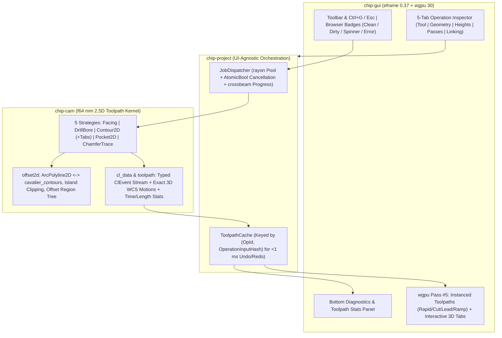

# ChipCutter — Milestone 3 Implementation Plan

## Goal Description
Implement **Milestone 3 (Core 2.5D Operations & Explicit Generation Engine)** from [10-roadmap.md](file:///workspace/ChipCutter/specs/10-roadmap.md) and [05-operations.md](file:///workspace/ChipCutter/specs/05-operations.md). Building on Milestone 1's STEP B-Rep kernel and Milestone 2's Setups, WCS, interactive 2.5D selection, Tool Library, and `.chip.toml` persistence, Milestone 3 turns ChipCutter's parametric `Operation` shells into a real, multithreaded 2.5D CAM toolpath engine:

1. **Typed CL-Data IR & Toolpath Model (`chip-cam`):** Strongly typed `ClEvent` stream (`RapidMove`, `LinearMove`, planar & helical `ArcMove`, `DrillCycle`, `ToolChange`, `SpindleStart`, `Coolant`, `CutterComp`) in canonical `f64` WCS millimeters—preserving true `G2`/`G3` circular and helical arcs end-to-end without emitting G-code strings inside `chip-cam`.
2. **Arc-Preserving 2D Offset & Region Kernel (`chip-cam`):** Lossless `ArcPolyline2D` ↔ `cavalier_contours` bulge-polyline bridge for parallel inward/outward offsetting, boolean island clipping, **Offset Region Trees** (handling pocket neck-downs cleanly), and largest-inscribed-circle poles for automatic helical entry placement.
3. **All 5 v1 2.5D Toolpath Strategies (`chip-cam`):**
   - **Facing:** Stock/face XY surfacing with smooth `G2`/`G3` U-turn zig-zag arcs or one-way climb/conventional passes.
   - **Drilling & Helical Bore Milling:** Nearest-neighbor + 2-opt TSP hole ordering, spot/simple (`G81`/`G82`), chip-break (`G73`), and deep-peck (`G83`) cycles with drill-tip breakthrough math, plus single- and multi-radial-pass helical bore interpolation (`tool_d < hole_d`) with smooth center arc-off retract.
   - **2D Contour / Profile:** Left/Right/Center compensation, multi-depth & continuous spiral ramps, side roughing + finishing + spring passes, horizontal/vertical lead-in & lead-out arcs with seam overlap, and automatic + interactive click-on-contour **Rectangular** and **3D Ramped Triangular** holding tabs.
   - **2D Pocket:** Extensible `PocketStrategy` trait with **Contour-Parallel** (inside-out / outside-in over an Offset Region Tree with smooth tangent stepovers) and **Zig-Zag / Raster** clearing, open-edge air entry from outside stock, and automatic helical-to-linear ramp fallback.
   - **Edge Chamfering & 2D Curve Trace:** Sharp unmodeled CAD edge and modeled angled chamfer face kinematics (`chamfer_width`, `tip_offset`, adjacent boss/floor clearance check) plus on-center/offset curve tracing.
4. **Explicit `Ctrl+G` Background Dispatcher & Out-of-Band Cache (`chip-project`):** Non-blocking `rayon` job runner with per-operation `Arc<AtomicBool>` cancellation tokens, parallel intra-Setup generation, `Dirty` → `Generating` → `Clean` / `Error` lifecycle transitions, and content-hashed out-of-band `ToolpathCache` so `Ctrl+Z` / `Ctrl+Y` restores previously generated `Clean` toolpaths in `< 1 ms`.
5. **5-Tab Operation Inspector, Interactive Tabs, & Instanced 3D Toolpaths (`chip-gui`):** Complete `[Passes]` and `[Linking]` Inspector tabs, `Generate Dirty (Ctrl+G)` toolbar/shortcut workflow, live `◐` generation spinners & `[Diagnostics]` panel, interactive 3D contour holding-tab placement/dragging, and GPU-instanced toolpath rendering (`500,000+` segments at `60 FPS`).

---

## Key Architectural Decisions & Scope Alignment

> [!IMPORTANT]
> **Strict Typed CL-Data Boundary & True Arc Preservation ([AGENTS.md](file:///workspace/ChipCutter/AGENTS.md) Invariants #1, #3, #4, #7):**
> - All 5 strategies compute strictly from exact `f64` B-Rep `ExtractedFeature25D` geometry in Setup WCS coordinates—never from `f32` viewport triangle meshes.
> - Circular arcs (`ArcSegment2D::Arc`), U-turn links, lead-in/out sweeps, and helical ramps/bores emit analytic `ClEvent::ArcMove` records (`XY`, `XZ`, or `YZ` plane + `turns`). Discretization into chord segments happens **only** when building GPU line-instance buffers in `chip-gui` (and later heightmap sweeps in M4 `chip-sim`).
> - Zero G-code formatting lives in `chip-cam`; dialect modal tracking and `.post.toml` output remain deferred to `chip-post` in Milestone 4.

> [!NOTE]
> **UI-Agnostic `JobDispatcher` & Hash-Indexed `ToolpathCache` in `chip-project`:**
> Placing the `rayon` generation dispatcher and `ToolpathCache` inside `crates/chip-project` (with zero `egui`/`wgpu` dependencies) satisfies [01-architecture.md](file:///workspace/ChipCutter/specs/01-architecture.md#L70-L77) and [08-ui-viewport.md](file:///workspace/ChipCutter/specs/08-ui-viewport.md#L73-L75):
> - Both `chip-gui` (`Ctrl+G`) and `chip-cli` (`chipcutter validate --check-toolpaths`, and M4/M5 `chipcutter build`) share the exact same parallel generation pipeline.
> - Because `ProjectDocument` stays free of toolpath blobs, `.chip.toml` remains compact and Git-diff-friendly while `UndoHistory` (`Ctrl+Z` / `Ctrl+Y`) stays `< 1 ms` and instantaneously reconnects any operation whose `OperationInputHash` is still resident in `ToolpathCache`.

> [!TIP]
> **Permissive Pure-Rust Dependency Addition:**
> Milestone 3 adds a single third-party crate from [01-architecture.md](file:///workspace/ChipCutter/specs/01-architecture.md#L86): `cavalier_contours = "0.9"` (`MIT OR Apache-2.0`, default safe Rust features only—`unsafe_optimizations` left **off** to uphold `#![deny(unsafe_code)]`). `rayon` and `crossbeam-channel` are already configured in [Cargo.toml](file:///workspace/ChipCutter/Cargo.toml).

---

## Architecture Overview



---

## Proposed Changes

### 1. Workspace Manifest & Geometry Helpers

#### [MODIFY] [Cargo.toml](file:///workspace/ChipCutter/Cargo.toml)
- Add `cavalier_contours = "0.9"` under `[workspace.dependencies]` and link `cavalier_contours`, `rayon`, and `crossbeam-channel` in `crates/chip-cam` / `crates/chip-project` as needed.

#### [MODIFY] [geom2d.rs](file:///workspace/ChipCutter/crates/chip-math/src/geom2d.rs)
Extend `ArcSegment2D` and `ArcPolyline2D` with exact parametric utilities needed across offsetting, seam shifting, and holding-tab slicing:
- `ArcSegment2D::split_at(&self, u: f64) -> (Option<ArcSegment2D>, Option<ArcSegment2D>)` — splits a line or circular arc at normalized arc-length `u ∈ (0, 1)` while preserving exact `center`, `radius`, and `ccw`.
- `ArcSegment2D::closest_point(&self, query: DVec2) -> (DVec2, f64, f64)` — returns `(closest_pt, local_u, dist_mm)` accounting for angular sweep intervals on circular arcs (used for interactive click-on-contour tab placement and start/seam snapping).
- `ArcPolyline2D::project_point(&self, query: DVec2) -> Option<PolylineProjection>` (`s_mm`, `s_norm ∈ [0, 1]`, `point`, `tangent`, `distance_mm`).
- `ArcPolyline2D::slice_interval(&self, s_start_mm: f64, s_end_mm: f64) -> ArcPolyline2D` & `rotate_closed_seam(&self, new_start_s_mm: f64) -> ArcPolyline2D` (for seam overlap and tab interval partitioning).
- `ArcPolyline2D::ensure_orientation(&self, ccw: bool) -> ArcPolyline2D` (normalizing CCW outer loops vs. CW island loops via `signed_area()`).

---

### 2. CAD Test Fixtures & Open-Edge / Chamfer Queries (`crates/chip-cad`)

#### [MODIFY] [topology.rs](file:///workspace/ChipCutter/crates/chip-cad/src/topology.rs)
Add two B-Rep topological helpers consumed by `Pocket2D` and `ChamferTrace`:
- `classify_face_loop_open_edges(doc: &CadDocument, floor_face: FaceId, up_axis_world: DVec3) -> HashSet<EdgeId>`:
  - Inspects each edge of `floor_face`'s outer loop and checks its adjacent face across that edge:
    - If the adjacent face rises *above* `floor_face` along `+up_axis_world` (vertical or sloped wall/boss), the edge is a **closed wall**.
    - If the adjacent face goes *downward* or away (e.g., an exterior side wall dropping below an open step/ledge), the edge is tagged **open to air**, enabling `Pocket2D` to extend past the open edge and enter horizontally!
- `extract_modeled_chamfer_strip(doc: &CadDocument, chamfer_face: FaceId, up_axis_world: DVec3) -> Option<ModeledChamferGeometry>`:
  - Recognizes planar or conical angled chamfer faces (`0.05 < |n · up_axis| < 0.999`), extracting exact upper/lower edge loops, radial chamfer width `w_mm`, axial drop `h_mm`, and bevel angle `θ` for Modeled Chamfer selection mode ([05-operations.md](file:///workspace/ChipCutter/specs/05-operations.md#L102)).
- `min_distance_to_adjacent_floor_or_boss(...)` helper for `ChamferTrace` `tip_offset` clearance checks ([05-operations.md](file:///workspace/ChipCutter/specs/05-operations.md#L107)).

#### [MODIFY] [fixtures.rs](file:///workspace/ChipCutter/crates/chip-cad/src/fixtures.rs)
Add `sample_cam_torture_block_step()` (preserving existing M1 & M2 fixtures intact) featuring:
- A **closed pocket containing a circular/rounded-rect central island** (testing `Pocket2D` island offsetting + Offset Region Tree).
- An **open-edge step/shoulder pocket** open on two exterior stock faces (testing horizontal air entry without helical plunging).
- A **wide counterbore (`Ø18.0 mm`)** alongside `4x Ø6.0 mm` through-holes and a `Ø10.0 mm` blind hole (testing multi-radial-step `HelicalBore` core clearing + `Drill` breakthrough).
- Both **sharp `90°` top edges** and a **modeled `45° × 1.5 mm` angled bevel face** plus an adjacent floor step (testing `ChamferTrace` kinematics and `tip_offset` gouge prevention).

---

### 3. Typed CL-Data IR & Toolpath Representation (`crates/chip-cam`)

#### [NEW] [cl_data.rs](file:///workspace/ChipCutter/crates/chip-cam/src/cl_data.rs) & [toolpath.rs](file:///workspace/ChipCutter/crates/chip-cam/src/toolpath.rs)
Implements the exact typed Cutter Location stream specified in [07-post-processor.md](file:///workspace/ChipCutter/specs/07-post-processor.md#L17-L36):
- `MotionRole`: `Plunge`, `Ramp`, `LeadIn`, `Cut`, `FinishCut`, `LeadOut`, `TabRamp`, `LinkTransition`.
- `ArcPlane`: `XY`, `XZ`, `YZ`.
- `ArcDir`: `CW`, `CCW`.
- `CutterCompMode`: `Off`, `WearLeft`, `WearRight` (carries optional `G41`/`G42` wear-compensation metadata for LinuxCNC).
- `DrillCycleKind`: `Spot`, `Simple`, `ChipBreak`, `DeepPeck`.
- `ClEvent`:
  - `SetupStart { setup_name: String, wcs_slot: WorkOffsetSlot }`
  - `OperationStart { op_id: String, op_name: String, strategy_name: String, est_time_sec: f64 }`
  - `ToolChange { tool_number: u32, length_offset: u32, diameter_offset: u32, tool_desc: String, is_first_tool: bool }`
  - `SpindleStart { rpm: f64, direction: SpindleDirection }`
  - `SpindleStop`
  - `Coolant { mode: CoolantMode }`
  - `CutterComp { mode: CutterCompMode }`
  - `RapidMove { end_wcs: DVec3 }`
  - `LinearMove { end_wcs: DVec3, feed_mm_min: f64, role: MotionRole }`
  - `ArcMove { plane: ArcPlane, dir: ArcDir, end_wcs: DVec3, center_offset_ijk: DVec3, radius_mm: f64, turns: u32, feed_mm_min: f64, role: MotionRole }`
  - `DrillCycle { kind: DrillCycleKind, bottom_wcs: DVec3, r_plane_z_wcs: f64, clear_z_wcs: f64, peck_q_mm: f64, decreasing_factor: Option<f64>, min_peck_mm: f64, chip_break_retract_mm: f64, dwell_sec: f64, feed_mm_min: f64 }`
  - `Dwell { seconds: f64 }`
  - `Comment(String)`
  - `OperationEnd`
  - `ProgramEnd`
- `ToolpathSegment3D`: exact geometric motion span (`start_wcs`, `end_wcs`, `motion: SegmentMotion3D` [`Rapid` | `Linear { role, feed }` | `Arc { plane, dir, center_wcs, radius_mm, sweep_rad, feed, role }`])—including explicit expansion of `DrillCycle` events so viewport rendering, cycle-time estimation, and safety verifiers trace every physical peck and retract accurately!
- `GeneratedToolpath`:
  - `op_id: String`
  - `events: Vec<ClEvent>`
  - `segments_wcs: Vec<ToolpathSegment3D>`
  - `stats: ToolpathStats` (`cutting_distance_mm`, `rapid_distance_mm`, `est_cutting_time_sec`, `est_rapid_time_sec`, `total_est_time_sec`, `pass_count`, `linear_count`, `arc_count`, `bounds_wcs: Aabb3`)
  - `tab_markers_wcs: Vec<TabMarker3D>` (visual 3D tab footprints for viewport display)
  - `warnings: Vec<String>`

---

### 4. Operation Parameters: Passes, Linking, & Strategy Configs (`crates/chip-cam`)

#### [NEW] [params.rs](file:///workspace/ChipCutter/crates/chip-cam/src/params.rs) & [MODIFY] [operation.rs](file:///workspace/ChipCutter/crates/chip-cam/src/operation.rs)
Extend `Operation` with `[Passes]`, `[Linking]`, and typed `StrategyParams` (all defaulting cleanly via `#[serde(default)]` so existing Milestone 2 `.chip.toml` projects load without migration friction):
- **`PassesParams`:**
  - `multiple_depths: bool`, `max_stepdown: ParamLength` (default `"tool_d * 0.5"`), `even_stepdowns: bool` (default `true`).
  - `stock_to_leave_radial: ParamLength` (`0 mm`), `stock_to_leave_axial: ParamLength` (`0 mm`).
  - `tolerance_mm: f64` (`0.01 mm` per [01-architecture.md](file:///workspace/ChipCutter/specs/01-architecture.md#L58)).
- **`LinkingParams`:**
  - `retract_policy: RetractPolicy` (`MinimumRetract` | `FullClearance`).
  - `safe_stay_down_distance: ParamLength` (`"tool_d * 2.0"`).
  - `lead_in: LeadConfig` (`enabled: bool`, `horizontal_radius: ParamLength`, `horizontal_sweep_deg: f64`, `linear_length: ParamLength`, `vertical_radius: ParamLength`).
  - `lead_out_same_as_in: bool`, `lead_out: LeadConfig`, `seam_overlap: ParamLength` (`0.5 mm`).
  - `entry_mode: EntryStrategy` (`HelicalRamp` | `LinearRamp` | `Plunge` | `PreDrilled { point_wcs: DVec2 }`), `ramp_angle_deg: f64` (`2.5°`), `min_ramp_diameter: ParamLength` (`"tool_d * 0.5"` helix path / `"tool_d * 1.35"` hole clearance).
- **`StrategyParams` (tagged enum aligned with `OperationKind`):**
  1. **`FacingParams`:** `pass_direction_deg: f64`, `auto_longest_axis: bool`, `stepover: ParamLength` (`"tool_d * 0.7"`), `pass_extension: ParamLength` (`"tool_d * 0.55"`), `cut_mode: FacingCutMode` (`BothWaysZigZag` | `OneWayClimb` | `OneWayConventional`), `finishing_stepdown: Option<ParamLength>`.
  2. **`Contour2DParams`:** `compensation: ContourCompensation` (`LeftClimb` | `RightConventional` | `CenterOff`), `emit_wear_comp: bool`, `continuous_spiral_ramp: bool`, `roughing_passes: u32`, `roughing_stepover: ParamLength`, `finish_passes: u32`, `finish_stepover: ParamLength`, `finish_feed_mm_min: Option<f64>`, `repeat_finish_pass: bool`, `tabs: HoldingTabsConfig` (`enabled: bool`, `placement: TabPlacementMode` [`Automatic { count: u32, use_spacing: bool, target_spacing: ParamLength }` | `Manual`], `manual_tabs: Vec<ManualTabAnchor>`, `profile: TabProfileKind` [`Rectangular` | `Triangular { ramp_angle_deg: f64 }`], `width: ParamLength`, `height: ParamLength`).
  3. **`Pocket2DParams`:** `strategy: PocketStrategyKind` (`ContourParallel` | `ZigZag { pass_angle_deg: f64 }`), `stepover: ParamLength` (`"tool_d * 0.4"`), `order: PocketPassOrder` (`Auto` | `InsideOut` | `OutsideIn`), `open_edge_overhang: ParamLength` (`"tool_r + 0.5mm"`), `finish_wall_pass: bool`, `finish_wall_stepover: ParamLength` (`"0.2 mm"`).
  4. **`DrillBoreParams`:** `machining_mode: HoleMachiningMode` (`AutoByTool` | `Drill` | `HelicalBore`), `cycle_kind: DrillCycleKind` (`Spot` | `Simple` | `ChipBreak` | `DeepPeck`), `peck_depth: ParamLength` (`"tool_d * 1.0"`), `decreasing_peck_factor: Option<f64>`, `min_peck_depth: ParamLength` (`"0.5 mm"`), `chip_break_retract: ParamLength` (`"0.5 mm"`), `dwell_seconds: f64`, `tip_breakthrough: bool`, `breakthrough_extra: ParamLength` (`"0.5 mm"`), `bore_pitch_per_rev: Option<ParamLength>`, `bore_ramp_angle_deg: f64` (`2.5°`), `bore_finish_pass: bool`, `bore_finish_stepover: ParamLength` (`"0.15 mm"`), `bore_spring_pass: bool`, `sort_nearest_neighbor: bool` (`true`).
  5. **`ChamferTraceParams`:** `mode: ChamferTraceMode` (`EdgeChamfer` | `CurveTrace`), `chamfer_source: ChamferSourceMode` (`SharpEdge { width: ParamLength }` | `ModeledFace`), `tip_offset: ParamLength` (`"0.8 mm"`), `check_adjacent_walls: bool` (`true`), `trace_compensation: ContourCompensation` (`CenterOff`), `trace_axial_offset: ParamLength` (`"0.0 mm"`).

---

### 5. 2D Arc-Preserving Offset & Region Kernel (`crates/chip-cam/src/offset2d.rs`)

#### [NEW] [offset2d.rs](file:///workspace/ChipCutter/crates/chip-cam/src/offset2d.rs)
Wraps `cavalier_contours` (`Polyline<f64>` with vertex bulge `b = tan(Δθ / 4)`) behind safe, NaN/degeneracy-guarded `f64` APIs:
1. **Exact Conversion (`to_cavalier` / `from_cavalier`):**
   - Splits any `ArcSegment2D::Arc` with `|sweep| > π - 1e-6` into two exact half-arcs before computing `bulge = (sweep / 4.0).tan()` so bulge values remain bounded (`|b| <= 1.0`).
   - Reconstructs exact `ArcSegment2D::Arc { start, end, center, radius, ccw }` from bulge vertices (`|b| > 1e-7`), filtering micro-segments `< 1e-5 mm` and rejecting degenerate zero-radius arcs.
2. **Closed & Open Contour Offsetting:**
   - `offset_closed_loop(loop_2d: &ArcPolyline2D, signed_delta_mm: f64) -> Vec<ArcPolyline2D>`.
   - `offset_open_chain(chain_2d: &ArcPolyline2D, signed_delta_mm: f64) -> Vec<ArcPolyline2D>` (computing exact parallel offset curves on the selected left/right side with tangent arc joins on convex corners and self-intersection trimming on concave corners via `cavalier_contours`).
3. **Pocket Region Clipping, Open-Edge Extension, & Offset Region Tree:**
   - `PocketRegion2D { outer_ccw: ArcPolyline2D, islands_cw: Vec<ArcPolyline2D>, open_segments: Vec<usize> }`:
     - Extends `open_segments` outward by `tool_r + open_edge_overhang` prior to inward wall offsetting so the cutter enters from air along open steps ([05-operations.md](file:///workspace/ChipCutter/specs/05-operations.md#L74-L75)).
     - Computes eroded safe tool-center regions `erode_region(&PocketRegion2D, offset_dist_mm) -> Vec<PocketRegion2D>` by offsetting `outer` inward, offsetting each `island` outward, and running `cavalier_contours` boolean `Not` (`PlineBooleanOptions`).
   - **`OffsetRegionNode` Tree:**
     - Recursively steps inward by `stepover_mm` until the eroded region vanishes. When an inward offset splits into `k >= 2` disconnected child regions, records parent-child topology so depth-first traversal machines each sub-pocket completely without jumping back and forth across islands!
   - **Largest Inscribed Circle Pole (`find_helical_entry_pole`):**
     - Uses the deepest inward-eroded ring / sample pole inside each sub-pocket leaf to locate a guaranteed collision-free `(center_xy, max_clearance_radius_mm)` for helical ramp entry!

---

### 6. The 5 v1 2.5D Toolpath Strategies (`crates/chip-cam/src/strategies/`)

All strategy modules take `(&Operation, &Tool, &ResolvedSetup, &CadDocument, &AtomicBool)` and return `Result<GeneratedToolpath, CamError>`, polling the cancellation token on every pass/loop.

#### [NEW] [strategies/mod.rs](file:///workspace/ChipCutter/crates/chip-cam/src/strategies/mod.rs)
- Unified `generate_operation_toolpath(...)` entry point:
  - Validates tool compatibility (`OperationKind::is_compatible_with_tool`), resolves `ExtractedSelectionSummary`, evaluates `EvalContext`, validates `Clearance >= Retract >= Feed >= Top >= Bottom` (never clamping invalid heights per `AGENTS.md` §4!), computes Z stepdown levels (`compute_z_levels(top_z, bottom_z + stock_to_leave_axial, max_stepdown, even_stepdowns)`), wraps strategy moves in `OperationStart` / `ToolChange` / `SpindleStart` / `Coolant` / safe `Clearance` retract / `OperationEnd`, and computes `ToolpathStats`.

#### [NEW] [strategies/facing.rs](file:///workspace/ChipCutter/crates/chip-cam/src/strategies/facing.rs)
- Uses selected `PlanarFace` XY bounds if provided, otherwise defaults automatically to the active Setup's XY Stock footprint (`05-operations.md` §1).
- Rotates scan frame by `pass_direction_deg` (or auto-aligns with longest XY stock axis).
- Generates parallel passes spaced by `stepover` extending `pass_extension` (`0.55 * tool_d`) beyond stock ends so the cutter enters from air outside stock:
  - `BothWaysZigZag`: links adjacent passes with smooth tangent `180°` `ClEvent::ArcMove` U-turns outside the stock!
  - `OneWayClimb` / `OneWayConventional`: retracts to `MinimumRetract` / `Feed` plane, rapids back to start side, plunges outside stock, and feeds across in consistent milling direction.
- Supports multi-depth roughing stepdowns + optional thin `finishing_stepdown` final pass.

#### [NEW] [strategies/drill_bore.rs](file:///workspace/ChipCutter/crates/chip-cam/src/strategies/drill_bore.rs)
- Orders selected `CylindricalHole` features via **Nearest-Neighbor + 2-Opt TSP** improvement (`sort_nearest_neighbor = true`) to eliminate wasted rapid zig-zags.
- **Mode A — Drilling (`TwistDrill`, spot drill, or `tool_d ≈ hole_d`):**
  - Rejects `tool_d > hole_d + tol` when not spot-drilling (unless explicit spot mode).
  - Applies optional **Drill Tip Breakthrough** on through-holes: `tip_cone = (tool_d / 2.0) / (point_angle_rad / 2.0).tan() + breakthrough_extra`.
  - Emits typed `ClEvent::DrillCycle` (`Spot`, `Simple`, `ChipBreak`, `DeepPeck`) AND populates `segments_wcs` via `expand_drill_cycle_to_segments` (handling decreasing peck factor & minimum peck floor) so viewport preview, cycle time, and crash checks reflect exact physical pecks.
- **Mode B — Helical Bore Milling (endmill with `tool_d < hole_d`):**
  - Computes target roughing bore radius `R_rough = (hole_d - tool_d) / 2.0 - stock_to_leave_radial - finish_allowance`.
  - **Wide Bore Core Clearing (`hole_d > 2 * tool_d - overlap`):** Automatically computes concentric radial passes stepping outward from a central helical core (`R_core <= 0.45 * tool_d`) by `stepover` at each Z level (or multi-depth) so **zero uncut center pin** is left behind!
  - Helically interpolates (`ClEvent::ArcMove` in `XY` plane with simultaneous `end_wcs.z` drop per revolution controlled by `pitch_per_rev` or `ramp_angle_deg`), executes a flat `360°` cleanup circle at `Bottom Z`, runs optional radial `bore_finish_pass` + `bore_spring_pass`, and **arcs smoothly toward bore center** before `G0` retracting so flutes never rub the finished bore wall.

#### [NEW] [strategies/contour2d.rs](file:///workspace/ChipCutter/crates/chip-cam/src/strategies/contour2d.rs)
- Supports closed loops, planar face outer/inner boundaries, and open chains.
- Computes parallel offset path(s) for `LeftClimb`, `RightConventional`, or `CenterOff` (`offset = tool_r + stock_to_leave_radial + side_pass_offset`), ordering outer roughing passes outside-in followed by `finish_passes` and optional `repeat_finish_pass`.
- **Entry, Lead-In/Out, & Ramps:**
  - Tangent **Horizontal Lead-In Arc** (`ClEvent::ArcMove` XY) + linear tangent + optional **Vertical Lead-In Arc** (`XZ`/`YZ` plane rotated into tangent frame, or smooth 3D helical/linear approach), plus `seam_overlap` (`0.5 mm`) before mirrored Lead-Out.
  - Supports **Continuous Spiral Ramp** on closed contours (helically/linearly interpolating Z continuously along contour arc-length down to `Bottom Z` + flat cleanup lap) and **Linear Profile Ramp** (`ramp_angle_deg`) when entering closed slots without side lead room.
- **Automatic & Interactive Holding Tabs (`tabs.rs` sub-helper):**
  - **Automatic Placement:** Distributes `count` (or `perimeter / spacing`) tabs evenly along closed contours while nudging tab centers away from sharp vertices and tight arcs (`radius < 2 * tool_d`).
  - **Manual Placement:** Maps persisted `ManualTabAnchor { s_norm, world_point_mm }` onto the offset contour via `project_point`.
  - **Tab Z-Modulation:** On passes where `pass_z < bottom_z + tab_height`:
    - `Rectangular`: splits contour across `[s_center - half_span, s_center + half_span]` (`half_span = 0.5 * tab_width + tool_r`), retracting vertically to `tab_top_z`, traversing across the bridge, and plunging at `plunge_feed` on the far side.
    - `Triangular`: modulates Z smoothly up a linear ramp at `ramp_angle_deg` to the tab apex `(s_center, tab_top_z)` and smoothly back down to `pass_z` (`MotionRole::TabRamp`)—eliminating dwell marks and plunge shock!

#### [NEW] [strategies/pocket2d.rs](file:///workspace/ChipCutter/crates/chip-cam/src/strategies/pocket2d.rs)
- Defines the clean v1/v2 extension trait ([05-operations.md](file:///workspace/ChipCutter/specs/05-operations.md#L64-L73)):
  ```rust
  pub trait PocketStrategy: Send + Sync {
      fn generate_level_passes(
          &self,
          region: &PocketRegion2D,
          tool_radius_mm: f64,
          params: &PocketEngagementParams,
          cancel: &AtomicBool,
      ) -> Result<Vec<PocketSubpath2D>, CamError>;
  }
  ```
- **Strategy 1 — `ContourParallelStrategy` *(Default)*:**
  - Builds the `OffsetRegionNode` tree from `PocketRegion2D`.
  - **Closed Pockets (`InsideOut`):** Enters each leaf sub-pocket via **Helical Ramp** at its `find_helical_entry_pole` (`helix_r = min(pole_clearance - tool_r, 0.45 * tool_d)`), falling back automatically to a **Linear Profile Ramp** along the innermost offset ring if narrow (with a structured warning), or returning `CamError::PocketTooNarrowForTool` if no valid offset exists. Steps outward ring-by-ring with smooth tangent S-arc / angled transition links instead of harsh `90°` stepover spikes!
  - **Open-Edge Pockets (`OutsideIn`):** Enters horizontally at cutting Z from the extended open air boundary—zero helical plunge required!
  - Finishes with optional dedicated `finish_wall_pass` around the exact outer wall and island perimeters.
- **Strategy 2 — `ZigZagPocketStrategy`:**
  - Generates parallel raster scanlines rotated by `pass_angle_deg`, clips them against the eroded `PocketRegion2D` (outer minus islands, leaving `finish_wall_stepover` allowance), chains adjacent scan segments into continuous bi-directional passes where stay-down links are collision-free, and finishes with an exact arc-preserving contour cleanup pass around outer walls and islands.

#### [NEW] [strategies/chamfer_trace.rs](file:///workspace/ChipCutter/crates/chip-cam/src/strategies/chamfer_trace.rs)
- **Sub-Mode A — `EdgeChamfer`:**
  - Validates chamfer cutter (`ChamferMill` or angled `TwistDrill`/spot mill with `0° < included_angle < 180°`, half-angle `θ = included_angle / 2`).
  - **Sharp Edge Selection:** Uses user `chamfer_width = w` and `tip_offset = d_tip` on selected top edges:
    - `axial_drop = w / θ.tan() + d_tip`
    - `radial_offset = (tip_diameter / 2.0) + d_tip * θ.tan()`
  - **Modeled Chamfer Face Selection:** Extracts `w` and upper/lower edge reference directly from `extract_modeled_chamfer_strip`, positioning the flute cleanly by `d_tip` so cutting happens mid-flute rather than at the zero-surface-speed tip.
  - **Adjacent Wall / Floor Safety Check:** Verifies that `edge_z - axial_drop` does not gouge an adjacent horizontal step floor and that outer cutter flute radius at top of cut clears adjacent vertical bosses; returns a clear `CamError::ChamferTipCollision` diagnostic if `tip_offset` is too deep.
- **Sub-Mode B — `CurveTrace`:**
  - Follows selected closed loops or open chains with `CenterOff`, `LeftClimb`, or `RightConventional` compensation and `trace_axial_offset` below curve Z (supporting multi-stepdown Z passes and lead-in/out for engraving, O-ring grooves, and slots).

---

### 7. Parallel `Ctrl+G` Dispatcher & Out-of-Band Toolpath Cache (`crates/chip-project`)

#### [NEW] [cache.rs](file:///workspace/ChipCutter/crates/chip-project/src/cache.rs) & [dispatcher.rs](file:///workspace/ChipCutter/crates/chip-project/src/dispatcher.rs)
- **`OperationInputHash` (`compute_operation_input_hash`):**
  - Deterministic SHA-256 / 64-bit content digest over `(model_sha256s, setup.wcs, setup.stock, setup.default_heights, embedded_tool, op_serialized_params)`.
  - `ToolpathCache`: thread-safe bounded cache mapping `(op_id: String, input_hash: OperationInputHash) -> Arc<GeneratedToolpath>`.
  - `reconcile_project_statuses(&mut ProjectDocument, &ToolpathCache)`:
    - Automatically marks any operation `Clean` if `(op.id, current_hash)` is in `ToolpathCache`, or `Dirty` if its parameters, tool, or parent Setup WCS/Stock changed—making `Undo`/`Redo` restore `Clean` toolpaths instantaneously (`< 1 ms`)!
- **`JobDispatcher`:**
  - `generate_operations(jobs: Vec<GenerationJobSpec>)` spawns a background coordinator task over `rayon::scope` / `rayon::spawn`, running independent operations in parallel.
  - Maintains `in_flight: HashMap<String, Arc<AtomicBool>>`:
    - Calling `cancel_operation(op_id)` or `cancel_all()` flips the `AtomicBool` immediately.
    - Re-editing an operation while it is `Generating` cancels its in-flight token and resets its status to `Dirty`.
  - Emits `DispatcherEvent` (`Started { op_id }`, `Completed { op_id, input_hash, toolpath }`, `Cancelled { op_id }`, `Failed { op_id, message }`) over `crossbeam_channel::Receiver<DispatcherEvent>` (with an optional wakeup callback so `egui::Context::request_repaint()` wakes the UI frame immediately upon completion).
  - Also exposes synchronous `generate_all_blocking(&ProjectDocument, &LoadedCadStore) -> BatchGenerationReport` for headless CLI commands and integration tests.

#### [MODIFY] [main.rs](file:///workspace/ChipCutter/crates/chip-cli/src/main.rs)
- Enhance `chipcutter validate <project.chip.toml>` with an optional `--generate` flag that runs `generate_all_blocking` across all non-suppressed operations, reporting pass counts, arc/linear move counts, estimated cycle times, warnings, and exiting non-zero if any operation fails generation.

---

### 8. Desktop GUI — `Ctrl+G`, 5-Tab Inspector, Interactive Tabs, & Instanced Toolpaths (`crates/chip-gui`)

#### [MODIFY] [viewport/pipeline.rs](file:///workspace/ChipCutter/crates/chip-gui/src/viewport/pipeline.rs) & [viewport/shaders.wgsl](file:///workspace/ChipCutter/crates/chip-gui/src/viewport/shaders.wgsl)
Implement Render Pass #5 (**Instanced Toolpath & Tab Pass**, [08-ui-viewport.md](file:///workspace/ChipCutter/specs/08-ui-viewport.md#L51-L52)):
1. **GPU-Instanced Toolpath Buffer (`ToolpathGpuBuffer`):**
   - Converts `GeneratedToolpath::segments_wcs` through `setup.frame.local_to_world_point(...)` into screen-space width-stabilized `EdgeInstanceGpu` line segments (tessellating circular & helical `Arc` segments cleanly to `<= 0.02 mm` visual chord error for smooth curves at any zoom while keeping `500,000+` instances at `60 FPS`).
   - Cached on the GPU per `(op_id, OperationInputHash, setup_frame)` so static camera orbits/pans do **zero** CPU re-tessellation or buffer re-uploads!
   - Role color palette:
     - **Rapid (`G0`):** Amber-gold (`#FBBF24`, thin width, toggleable via `Show Rapids`)
     - **Cutting / Finish (`G1`/`G2`/`G3`):** Vivid cyan-blue (`#38BDF8` / `#22D3EE`)
     - **Lead-In / Lead-Out:** Mint green (`#34D399`)
     - **Helical / Linear Ramp & Plunge:** Coral red-orange (`#FB7185`)
     - Non-selected operations in active Setup render subtly dimmed (`35%` alpha) when `Show All Setup Toolpaths` is enabled, keeping focus on the active operation.
2. **3D Holding Tab Markers & Interactive Placement:**
   - Renders 3D rectangular/triangular tab bridge previews (`TabMarker3D`) directly on contour edges in the viewport.
   - Adds `ViewportPickMode::PlaceContourTab { setup_idx, op_idx }`: hovering near a selected contour projects the cursor ray onto the contour's WCS Z plane, snaps to the nearest contour curve point, previews the tab ghost, and **clicks to add / drag / right-click to remove** `ManualTabAnchor`s!

#### [MODIFY] [panels/browser.rs](file:///workspace/ChipCutter/crates/chip-gui/src/panels/browser.rs), [panels/operation_inspector.rs](file:///workspace/ChipCutter/crates/chip-gui/src/panels/operation_inspector.rs), & [NEW] [panels/diagnostics.rs](file:///workspace/ChipCutter/crates/chip-gui/src/panels/diagnostics.rs)
- **CAM Browser (`browser.rs`):**
  - Upgrade operation status badges to match [08-ui-viewport.md](file:///workspace/ChipCutter/specs/08-ui-viewport.md#L30-L35): green `✓` Clean (with compact cycle-time tag, e.g. `1m 14s`), amber `⟳` Dirty, animated `◐` Generating spinner, red `⚠` Error, dimmed `⊘` Suppressed.
  - Support drag-and-drop (plus Move Up / Move Down) reordering of operations within a Setup, and right-click `Generate Operation` / `Cancel` / `Suppress` / `Duplicate` / `Delete`.
- **5-Tab Operation Inspector (`operation_inspector.rs`):**
  - Expand tab bar to **`[Tool]` | `[Geometry]` | `[Heights]` | `[Passes]` | `[Linking]`**:
    - **`[Passes]` Tab:** Common `Multiple Depths` (`Max Stepdown`, `Even Stepdowns`), `Stock to Leave` (`Radial`, `Axial`), `Tolerance`, plus contextual strategy controls (`Facing` stepover/direction/cut-mode; `Contour` compensation, rough/finish/spring passes, and **Holding Tabs** Automatic/Manual + Rectangular/Triangular editor with `"Click Contour to Add Tabs"` toggle; `Pocket` Contour-Parallel vs. Zig-Zag, Inside-Out/Outside-In, overhang, finish pass; `Drill/Bore` Drill vs. Helical Bore, cycle kind, peck/dwell/breakthrough, bore pitch/angle; `Chamfer/Trace` Sharp Edge vs. Modeled Face, `chamfer_width`, `tip_offset`, wall check).
    - **`[Linking]` Tab:** `Retract Policy` (`Minimum Retract` vs. `Full Clearance`), `Safe Stay-Down Distance`, `Entry Strategy` (`Helical Ramp`, `Linear Ramp`, `Plunge`), `Ramp Angle` & `Min Helix Diameter`, and `Lead-In / Lead-Out` horizontal/vertical arc & seam-overlap editors.
- **Bottom Tile `[Diagnostics]` Panel (`diagnostics.rs`, docked in `layout.rs`):**
  - Displays structured generation errors, non-fatal toolpath warnings, and a clean per-operation breakdown (Move counts, `G2`/`G3` Arc count, Cutting/Rapid distances, Z range, and Estimated Cycle Time).

#### [MODIFY] [app.rs](file:///workspace/ChipCutter/crates/chip-gui/src/app.rs)
- Wire `JobDispatcher` + `ToolpathCache` into the main `eframe::App::update` loop:
  - Poll `DispatcherEvent` channel non-blockingly every frame; request repaint while any job is `Generating`.
  - Bind **`Ctrl+G`** (`Generate Dirty Operations in Active Setup` / `Generate All Dirty`) and **`Esc`** (`Cancel Active Pick Mode or In-Flight Generation`).
  - Add toolbar actions (`[Generate Dirty (Ctrl+G)]`, `[Cancel]` when busy, `[Show Rapids]`, `[Setup Toolpaths | Selected Only]`) and `File -> Load Sample CAM Torture Block`.

---

## Suggested Implementation Sequence

1. **Step 1 — Workspace, `chip-math` Curve Slicing, & `chip-cad` Open-Edge/Chamfer Helpers:** Add `cavalier_contours = "0.9"`, implement `ArcPolyline2D` projection/splitting/seam-rotation helpers, add `classify_face_loop_open_edges` + `extract_modeled_chamfer_strip` + `sample_cam_torture_block_step()` in `chip-cad`, and write unit tests.
2. **Step 2 — Typed CL-Data IR, `Toolpath` Model, & Full Operation Params (`chip-cam`):** Implement `ClEvent`, `GeneratedToolpath`, `ToolpathStats`, `PassesParams`, `LinkingParams`, and all 5 `StrategyParams` structs with deterministic `.chip.toml` serde defaults.
3. **Step 3 — 2D Arc-Preserving Offset & Region Engine (`chip-cam/src/offset2d.rs`):** Build `ArcPolyline2D` ↔ `cavalier_contours` conversion, closed/open parallel offsetting, island boolean clipping, open-edge air extensions, the `OffsetRegionNode` tree, and `find_helical_entry_pole` + thorough geometric unit tests.
4. **Step 4 — Vertical Slice Strategies (`Facing` + `DrillBore`) & `JobDispatcher` (`chip-cam` + `chip-project`):** Implement `Facing` and `Drill / Helical Bore`, wire up `OperationInputHash`, `ToolpathCache`, and `rayon` `JobDispatcher` with cancellation tokens, and add `chipcutter validate --generate`.
5. **Step 5 — Advanced Profile, Pocket, & Chamfer Strategies (`Contour2D` + `Pocket2D` + `ChamferTrace`):** Implement `Contour2D` (with ramps, leads, rough/finish, and Auto/Manual Rectangular & Triangular holding tabs), `Pocket2D` (`ContourParallel` + `ZigZag`, islands, open-edge entry, helical/linear entry), and `ChamferTrace` (sharp & modeled chamfers + wall check + curve trace).
6. **Step 6 — `chip-gui` 5-Tab Inspector, `Ctrl+G`, Interactive Tabs, & Instanced Toolpath Pass:** Upgrade `wgpu` pipeline with cached `ToolpathGpuBuffer` + 3D tab markers, add `[Passes]` & `[Linking]` Inspector tabs, `[Diagnostics]` bottom tile, `Ctrl+G` spinner workflow, and interactive click-on-contour tab placement.
7. **Step 7 — Spec Sync & Full Verification Suite:** Synchronize `specs/*.md` if any parameter names were refined, and run `cargo fmt`, strict `clippy`, `cargo deny`, physical toolpath safety invariant tests, CLI checks, and headless Xvfb GUI screenshot tests.

---

## Verification Plan

### Automated Tests
All library crates continue to enforce `#![deny(unsafe_code)]` and `#![deny(clippy::unwrap_used, clippy::expect_used)]`.

1. **Formatting, Strict Clippy Lints, & Permissive License Audit:**
   ```bash
   cargo fmt --all -- --check
   cargo clippy --workspace --all-targets -- -D warnings
   cargo deny check
   ```
2. **Workspace Unit, Strategy, & Geometric Safety Invariant Suite:**
   ```bash
   cargo test --workspace
   ```
   Covering:
   - **`chip-math` & `offset2d`:** `ArcPolyline2D` splitting/projection/seam rotation, lossless `cavalier_contours` round-tripping of `ArcSegment2D::Arc` (`G2`/`G3` preservation, zero micro-segment explosion on fillets/circles), inward/outward offsetting of pockets with circular islands, Offset Region Tree splitting on dumbbell-shaped pockets, and largest-inscribed-circle helical pole accuracy.
   - **Physical Safety & Accuracy Invariants across all 5 Strategies (`chip-cam`):**
     - **Zero Plunge Rapids:** Every `ClEvent::RapidMove` across all generated toolpaths maintains `Z >= Retract` (or safe previously cleared bore retract plane) and never plunges downward into uncut stock Z levels.
     - **Zero Boundary Gouges:** Sampled tool-center points across `Contour2D`, `Pocket2D` (outer boundary + islands), and `HelicalBore` maintain exact signed clearance `>= tool_r + stock_to_leave_radial - 0.005 mm` from target B-Rep walls.
     - **Complete Clearing Coverage:** Sampled interior grid points inside `Facing`, `Pocket2D` (both `ContourParallel` and `ZigZag`, closed with islands and open-edge step), and wide `HelicalBore` (`Ø18 mm` bore with `Ø6 mm` endmill) verify every reachable cell is swept within `tool_r` with **zero uncut islands/pins**.
     - **True Arc Emission:** Verify `Facing` U-turns, `HelicalBore` spirals, `Contour2D` fillets & horizontal/vertical lead-ins, and `Pocket2D` offset arcs emit `ClEvent::ArcMove` records.
     - **Holding Tabs & Chamfer Math:** Verify `Rectangular` vs. `Triangular` ramped tab Z profiles (`max_z == bottom_z + tab_height` at tab center), drill breakthrough depth `(D/2)/tan(point_angle/2) + extra`, sharp vs. modeled `45°` chamfer `axial_drop` / `radial_offset` trigonometry, and `CamError::ChamferTipCollision` when `tip_offset` exceeds floor clearance.
   - **`chip-project` Dispatcher & Undo Cache:** Parallel multi-operation `rayon` generation, mid-run `AtomicBool` cancellation (`Cancelled` -> `Dirty`), deterministic `.chip.toml` round-trip of all 5 `StrategyParams`, and `< 1 ms` `Undo` -> `Clean` cache hit restoration.
   - **`chip-gui` Offscreen Render Test:** Headless `wgpu` render verifying GPU-instanced toolpath segments (rapids, cuts, leads, helical ramps) and 3D holding-tab markers render cleanly without validation errors.
3. **Headless CLI & Xvfb GUI Self-Test:**
   ```bash
   cargo run -p chip-cli -- validate --generate crates/chip-project/tests/fixtures/sample_m3_job.chip.toml
   WGPU_BACKEND=vulkan xvfb-run -a cargo run -p chip-gui -- --self-test-screenshot /tmp/m3_gui_preview.png
   ```

### Interactive Manual Walkthrough
Once implemented, launch `cargo run -p chip-gui`:
1. Click **`File -> Load Sample CAM Torture Block`** and review `Setup 1 (G54)`.
2. Add and configure all 5 operations (`Facing`, `2D Pocket` on the island cavity and open step, `Drill / Helical Bore` on the `4x Ø6 mm` holes + `Ø18 mm` counterbore, `2D Contour` with **Triangular Holding Tabs** around the outer profile, and `Edge Chamfer` on the top edges).
3. Press **`Ctrl+G`** to watch parallel `◐` background spinners transition to green **`✓`** badges, inspect the color-coded 3D toolpaths + cycle-time summary in **`[Diagnostics]`**, click on the outer contour in **Manual Tab** mode to add/drag holding tabs, edit a stepdown (observing instant `⟳ Dirty` invalidation), and press **`Ctrl+Z`** to verify instant `< 1 ms` restoration of the cached `Clean` toolpath.
