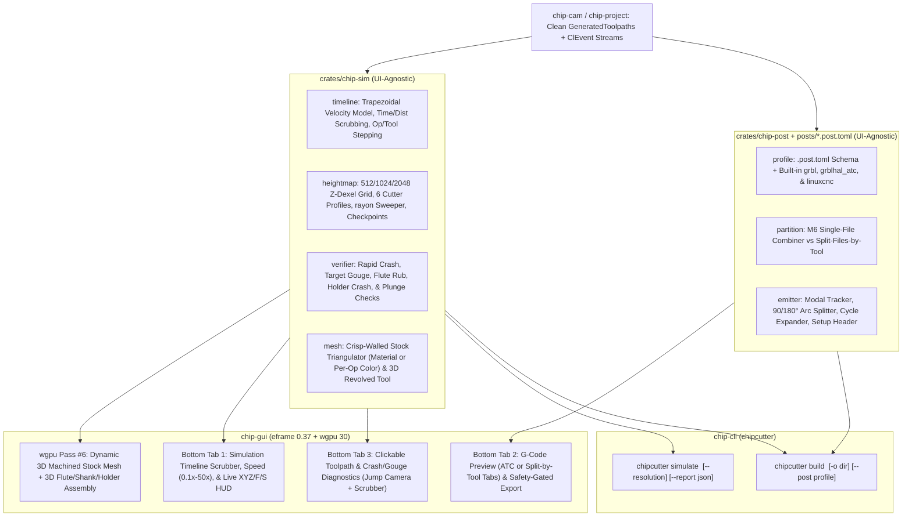

# ChipCutter — Milestone 4 Implementation Plan

## Goal Description
Implement **Milestone 4 (Heightmap Simulation, Crash Checks, & TOML Post-Processors)** from [10-roadmap.md](file:///workspace/ChipCutter/specs/10-roadmap.md), [06-simulation.md](file:///workspace/ChipCutter/specs/06-simulation.md), and [07-post-processor.md](file:///workspace/ChipCutter/specs/07-post-processor.md). Building on Milestone 3's 2.5D toolpath strategies and typed `ClEvent` stream, Milestone 4 completes the end-to-end CAM loop from STEP model to verified, controller-ready G-code:

1. **Motion Timeline & Trapezoidal Cycle-Time Engine (`chip-sim`):** Unified setup-wide playback timeline parameterized by both cumulative machining time and path distance, incorporating rapid rates, corner acceleration limits, dwells, and ATC tool-change durations, with `O(log N)` scrub queries and segment/operation/tool-change stepping.
2. **2.5D Z-Dexel Heightmap Stock Removal & Crash/Gouge Verifier (`chip-sim`):** Multi-resolution (`512²` Standard, `1024²` Fine, `2048²` Ultra) `rayon`-parallelized Z-heightmap (`HeightfieldStock`) supporting all 6 v1 cutter profiles (`Flat`, `BullNose`, `Ball`, `Chamfer`, `TwistDrill`, `FaceMill`), analytic B-Rep target upper-envelope rasterization, crisp-walled 3D stock mesh triangulation (with **Color by Operation / Tool**), and automated detection of **Rapid-into-Stock Crashes**, **Target Model Gouges**, **Flute-Length Shank Rubs**, **Holder/Collet Collisions**, and **Unsafe Plunges**.
3. **TOML Post-Processor Engine & Built-In Controller Profiles (`chip-post` + `posts/`):** Strongly typed `ClEvent` consumer with user-editable `.post.toml` dialect profiles, modal `G`/`X`/`Y`/`Z`/`F` state tracking, automatic `90°`/`180°` circular & helical arc splitting, canned-cycle (`G81`/`G82`/`G83`/`G73`) vs. explicit `G0`/`G1` peck expansion, ATC (`M6`) vs. **Split-Files-by-Tool** partitioning, structured operator setup-sheet G-code header comments, and built-in **GRBL 1.1 / FluidNC** (`grbl.post.toml`), **grblHAL ATC** (`grblhal_atc.post.toml`), and **LinuxCNC RS274NGC** (`linuxcnc.post.toml`) profiles.
4. **Headless CLI Simulation & Build Commands (`chip-cli`):** Add `chipcutter simulate` (headless heightmap verification + JSON report) and `chipcutter build` (parallel toolpath generation + mandatory crash/gouge gate + `.nc`/`.ngc` emission).
5. **Interactive 3D Simulation Playback, Cutter Assembly, & G-Code Preview (`chip-gui`):** Viewport Pass #6 rendering the shaded 3D machined stock mesh and 3D revolved **Flute + Shank + Collet/Holder** cutter assembly, paired with the 3-tab bottom workspace (`[Simulation Timeline] | [G-Code Preview] | [Diagnostics]`), clickable jump-to-crash diagnostics, and safety-gated G-code export.

---

## Key Architectural Decisions & Scope Alignment

> [!IMPORTANT]
> **Two New UI-Agnostic Core Crates (`chip-sim` & `chip-post`, Zero New External Dependencies):**
> Per [AGENTS.md](file:///workspace/ChipCutter/AGENTS.md) Invariants #1 and #7 and [01-architecture.md](file:///workspace/ChipCutter/specs/01-architecture.md#L12-L29), Milestone 4 completes the final two library crates in the v1 architecture:
> - `crates/chip-sim` — Pure-Rust timeline, trapezoidal velocity estimator, 2.5D Z-dexel heightmap kernel, 5-rule crash/gouge verifier, and CPU-side stock/cutter mesh builders (`f32` vertex/index buffers ready for direct GPU upload without `wgpu` types in `chip-sim`).
> - `crates/chip-post` — Pure-Rust `.post.toml` loader, ATC / split-by-tool partitioner, modal G-code state machine, arc quadrant splitter, and built-in GRBL & LinuxCNC dialects.
>
> Neither crate adds any new third-party dependencies beyond existing workspace crates (`serde`, `toml`, `rayon`, `dirs`, `thiserror`, `glam`), keeping `cargo deny check` 100% clean.

> [!NOTE]
> **Exact Analytic B-Rep Surface Z on Target Gouge Grid:**
> To prevent chordal tessellation sag on planar floors or angled chamfers from causing false-positive `0.02 mm` gouge alarms, `chip-sim`'s target solid rasterizer maps each `FaceTriangle` back to its exact `BRepFace` in `CadDocument`: whenever the underlying surface is an analytic `Plane` (or `Cone`), `z_target(x, y)` is evaluated from the **exact `f64` surface equation** in Setup WCS rather than linearly interpolating `f32` triangle Z vertices.

> [!CAUTION]
> **Mandatory Crash & Gouge Gate Before G-Code Export ([06-simulation.md](file:///workspace/ChipCutter/specs/06-simulation.md#L57)):**
> Both `chipcutter build` (unless `--allow-warnings` / explicit override) and the GUI **`Export G-Code…`** workflow run `chip-sim` verification and block G-code file export if any **Critical Error** (`RapidIntoStock`, `TargetModelGouge`, or `HolderCollision`) is present unless the operator explicitly acknowledges an override prompt.

---

## Architecture Overview



---

## Proposed Changes

### 1. Workspace Manifest & Built-In Post Profiles

#### [MODIFY] [Cargo.toml](file:///workspace/ChipCutter/Cargo.toml)
- Add workspace members `"crates/chip-sim"` and `"crates/chip-post"`.
- Add shared `[workspace.dependencies]`:
  - `chip-sim = { version = "0.1.0", path = "crates/chip-sim" }`
  - `chip-post = { version = "0.1.0", path = "crates/chip-post" }`

#### [NEW] Built-in user-editable TOML post profiles under `posts/`:
- [NEW] [posts/grbl.post.toml](file:///workspace/ChipCutter/posts/grbl.post.toml) — GRBL 1.1 / FluidNC default (`extension = "nc"`, `max_line_length = 80`, `expand_drill_cycles = true`, `max_arc_sweep_deg = 90.0`, `allow_helical_arcs = true`, `tool_change_mode = "split_files_by_tool"`, clean `G90 G94 G17 G21` startup).
- [NEW] [posts/grblhal_atc.post.toml](file:///workspace/ChipCutter/posts/grblhal_atc.post.toml) — grblHAL / FluidNC with `M6` tool-setter macro (`tool_change_mode = "m6"`).
- [NEW] [posts/linuxcnc.post.toml](file:///workspace/ChipCutter/posts/linuxcnc.post.toml) — LinuxCNC RS274NGC (`extension = "ngc"`, `G17 G21 G40 G49 G54 G80 G90 G94 G64 P0.025`, native `G81`/`G82`/`G83`/`G73` + `G98`/`G99` + `G80`, `T{tool_num} M6` + `G43 H{len_offset}`, `G54`..`G59.3`, `G41`/`G42` wear compensation).

---

### 2. Simulation, Heightmap Stock Removal, & Crash Verifier (`crates/chip-sim`)

#### [NEW] [Cargo.toml](file:///workspace/ChipCutter/crates/chip-sim/Cargo.toml) & [src/lib.rs](file:///workspace/ChipCutter/crates/chip-sim/src/lib.rs)
Pure-Rust crate depending only on `chip-math`, `chip-cad`, `chip-tools`, `chip-cam`, `glam`, `rayon`, `serde`, and `thiserror`.

#### [NEW] [src/cutter_profile.rs](file:///workspace/ChipCutter/crates/chip-sim/src/cutter_profile.rs)
- `RadialCutterProfile`: exact `f64` radial height function `tip_to_envelope_dz(r_mm: f64) -> Option<f64>` for `0 <= r <= cutting_radius`:
  - `FlatEndmill` (`0.0`), `BullNoseEndmill` (flat core + toroidal corner fillet `R_c`), `BallEndmill` (`R - sqrt(R² - r²)`), `ChamferMill` (flat `tip_diameter` + cone `(r - r_tip) / tan(θ)`), `TwistDrill` (`r / tan(point_angle / 2)`), `FaceMill` (flat core + insert corner radius).
  - Also stores `flute_length_mm`, `stickout_length_mm`, `shank_radius_mm`, `holder_radius_mm` (`max(shank_r * 2.2, 12.0)`), and `is_center_cutting: bool` (`false` for `FaceMill` when `cutting_diameter > 2 * insert_width`, `true` for standard endmills/drills).
- `build_cutter_assembly_mesh(tool: &Tool, radial_slices: u32) -> SimToolMesh`:
  - Generates a clean 3D revolved triangle mesh around `+Z_local` (`tip = (0, 0, 0)`) partitioned by material zone (`0 = CuttingFlutes`, `1 = Shank`, `2 = ColletHolder`) for 3D viewport playback.

#### [NEW] [src/timeline.rs](file:///workspace/ChipCutter/crates/chip-sim/src/timeline.rs)
- `MachineKinematicsConfig`:
  - `rapid_rate_mm_min: f64` (default `5000.0`)
  - `accel_mm_s2: f64` (default `500.0`)
  - `tool_change_time_sec: f64` (default `15.0` when `tool_number` changes, `0.0` for first tool or manual mode)
- `TimelineSpan`: links each `ToolpathSegment3D` (plus dwell/tool-change pauses) to cumulative `(t_start_sec, t_end_sec, dist_start_mm, dist_end_mm, op_idx, tool_id, global_seg_idx, commanded_feed_mm_min, rpm)`.
  - Computes trapezoidal segment duration accounting for corner angle `cos θ = t_prev · t_next` junction speed `v_j` and `accel_mm_s2`!
- `SimulationTimeline`:
  - `from_setup_operations(...) -> Self`
  - `sample_at_time(t_sec: f64) -> ScrubSnapshot` & `sample_at_distance(dist_mm: f64) -> ScrubSnapshot`
  - `step_segment(cur_seg: usize, delta: isize) -> f64`
  - `next_operation_time(t_sec: f64) -> f64` & `prev_operation_time(t_sec: f64) -> f64`
  - `next_tool_change_time(t_sec: f64) -> f64`

#### [NEW] [src/heightmap.rs](file:///workspace/ChipCutter/crates/chip-sim/src/heightmap.rs) & [src/verifier.rs](file:///workspace/ChipCutter/crates/chip-sim/src/verifier.rs)
- `SimResolution`: `Standard` (`512`), `Fine` (`1024`), `Ultra` (`2048`).
- `HeightfieldStock`:
  - Grid dimensions `(nx, ny)` covering `stock.aabb_wcs()` XY with square cells `cell_size_mm`.
  - Per-cell arrays: `z_stock: Vec<f32>`, `z_bottom: Vec<f32>`, `z_target: Vec<f32>`, `last_op_idx: Vec<u16>` (`u16::MAX` = uncut top stock).
  - Initializes Box Stock and Cylindrical Stock (`Z`, `X`, or `Y` cylinder axis!) accurately.
  - `rasterize_target_brep(&mut self, doc: &CadDocument, setup: &ResolvedSetup)`: projects target B-Rep triangles into WCS XY and evaluates exact analytic plane/cone Z where applicable (or exact barycentric Z on curved faces) to populate the upper target envelope `z_target`.
- **Swept Toolpath Execution & Checkpoint Snapshots (`run_setup_simulation`):**
  - Sweeps each `TimelineSpan` across `HeightfieldStock` using `rayon` row parallelism for wide footprints and fast tight-bbox inner loops for small moves, polling an `&AtomicBool` cancellation token.
  - Evaluates all 5 safety checks from [06-simulation.md](file:///workspace/ChipCutter/specs/06-simulation.md#L55-L61) **before** mutating `z_stock[cell]` on each segment:
    1. `SimIssueKind::RapidIntoStock` (`SimSeverity::CriticalError`)
    2. `SimIssueKind::TargetModelGouge` (`SimSeverity::CriticalError`, default `gouge_tol = 0.02 mm`)
    3. `SimIssueKind::FluteLengthExceeded` (`SimSeverity::Warning`)
    4. `SimIssueKind::HolderCollision` (`SimSeverity::CriticalError`)
    5. `SimIssueKind::UnsafeVerticalPlunge` (`SimSeverity::Warning`)
  - Saves periodic `StockCheckpoint { global_seg_idx, z_stock: Vec<f32>, last_op_idx: Vec<u16> }` snapshots (at `seg = 0`, at the end of each operation, and every `N` segments) so interactive timeline scrubbing to *any* arbitrary `t_sec` replays at most a tiny tail delta from the nearest preceding checkpoint (`< 4 ms` frame time!).
- `tessellate_stock_mesh(stock: &HeightfieldStock, color_by_op: bool) -> SimStockMesh`:
  - Generates crisp top-cell quads + vertical step risers between neighboring `(i, j)` cells of differing Z + outer perimeter side walls down to `z_bottom`, computing per-face normals so machined pockets, islands, counterbores, chamfers, and holding tabs render with sharp CNC edges!

---

### 3. TOML Post-Processor Engine & Built-In Profiles (`crates/chip-post`)

#### [NEW] [Cargo.toml](file:///workspace/ChipCutter/crates/chip-post/Cargo.toml) & [src/lib.rs](file:///workspace/ChipCutter/crates/chip-post/src/lib.rs)
Pure-Rust crate depending on `chip-math`, `chip-tools`, `chip-cam`, `serde`, `toml`, `dirs`, and `thiserror`.

#### [NEW] [src/profile.rs](file:///workspace/ChipCutter/crates/chip-post/src/profile.rs)
- `PostProfile` (`Deserialize` / `Serialize` matching `.post.toml`):
  - Output units (`PostUnits::Millimeter` -> `G21`, `PostUnits::Inch` -> `G20` scaling coordinates/IJK by `1 / 25.4` and feedrates `mm/min` -> `ipm`!).
  - Number formatting (`coord_decimals`, `feed_decimals`, `spindle_decimals`, `suppress_trailing_zeros`, `line_numbers: Option<LineNumberConfig>`, `max_line_length: Option<usize>`).
  - Comment formatting (`CommentStyle::Parentheses` vs `CommentStyle::Semicolon`, automatically stripping nested `(` `)` and newlines, and wrapping/truncating header comments cleanly within `max_line_length`).
  - Motion & Arc rules (`arc_center_mode: ArcCenterMode` [`IncrementalIjk` | `AbsoluteIjk` | `Radius`], `max_arc_sweep_deg: f64`, `allow_helical_arcs: bool`, `helical_linearize_tol_mm: f64`).
  - Cycle & Tool rules (`expand_drill_cycles: bool`, `use_g43_length_offset: bool`, `use_cutter_comp_g41_g42: bool`, `tool_change_mode: ToolChangeMode` [`M6` | `SplitFilesByTool` | `IgnoreIfSingleTool`]).
  - Customizable `{placeholder}` template blocks (`program_header`, `operation_header`, `tool_change_block`, `spindle_start_block`, `operation_footer`, `program_footer`).
- `builtin_post_profiles() -> Vec<PostProfile>` & `load_available_post_profiles()` (merging built-in `grbl`, `grblhal_atc`, and `linuxcnc` with any user `.post.toml` files in `posts/` or `~/.config/chipcutter/posts/`).

#### [NEW] [src/partition.rs](file:///workspace/ChipCutter/crates/chip-post/src/partition.rs) & [src/emitter.rs](file:///workspace/ChipCutter/crates/chip-post/src/emitter.rs)
- `SetupPostInput`: bundles project name, Setup metadata (`name`, `wcs_slot`, human-readable WCS origin summary, resolved stock dimensions, clearance/retract Z), ordered `(Operation, Tool, Arc<GeneratedToolpath>)` slices, and total cycle time.
- `PostOutputFile { pub filename: String, pub content: String, pub line_count: usize, pub tool_numbers: Vec<u32>, pub operation_names: Vec<String> }`.
- `post_process_setup(input: &SetupPostInput, profile: &PostProfile, stem: &str) -> Result<Vec<PostOutputFile>, PostError>`:
  1. **Partitions** operations into either `1` combined program (`M6` / single-tool) or `K` sequential tool-grouped programs (`<stem>_01_T6_38mm_face.nc`, `<stem>_02_T1_6mm_flat.nc`, …) when `SplitFilesByTool` is active.
  2. **Emits** the structured operator setup-sheet comment header ([07-post-processor.md](file:///workspace/ChipCutter/specs/07-post-processor.md#L68-L81)).
  3. **Tracks Modal State** (`ModalState`: motion code, `G17`/`G18`/`G19`, `X`, `Y`, `Z`, `F`, `G40`/`G41`/`G42`, `G98`/`G99`), forcing full coordinate output after tool changes and operation headers.
  4. **Splits Circular & Helical Arcs** (`split_arc_move_by_max_sweep`): subdivides any `ClEvent::ArcMove` (including `360°` circles and multi-turn `turns >= 1` helices!) into exact `<= max_arc_sweep_deg` (`90°` or `180°`) sub-arcs with exact recomputed `IJK` center offsets and proportional helical `Z` interpolation—or linearizes 3D helices to `G1` within `helical_linearize_tol_mm` when `allow_helical_arcs == false`.
  5. **Formats Drill Cycles:** emits native RS274NGC `G81`/`G82`/`G83`/`G73` + `G80` when `expand_drill_cycles == false`, or delegates to `expand_drill_cycle_segments` to emit explicit `G0`/`G1`/`G4` peck motions for vanilla GRBL when `expand_drill_cycles == true`.
  6. **Validates Line Lengths:** ensures every emitted line in GRBL profiles satisfies `line.len() <= 80`!

---

### 4. Project Orchestration & Headless CLI (`crates/chip-project` & `crates/chip-cli`)

#### [MODIFY] [Cargo.toml](file:///workspace/ChipCutter/crates/chip-project/Cargo.toml) & [Cargo.toml](file:///workspace/ChipCutter/crates/chip-cli/Cargo.toml)
- Link `chip-sim` and `chip-post` into `chip-cli` (and `chip-gui`).

#### [MODIFY] [main.rs](file:///workspace/ChipCutter/crates/chip-cli/src/main.rs)
Add the two Milestone 4/5 CLI subcommands from [09-persistence-cli.md](file:///workspace/ChipCutter/specs/09-persistence-cli.md#L58-L63):
1. `chipcutter simulate <project.chip.toml> [--resolution standard|fine|ultra] [--report <report.json>]`:
   - Generates all enabled operations, runs `HeightfieldStock` simulation & 5-rule crash/gouge verification across every Setup, prints per-setup cycle times, remaining stock volume, and any crash/gouge/warning diagnostics, optionally writes a structured JSON report, and exits non-zero if any `CriticalError` crash or gouge is detected.
2. `chipcutter build <project.chip.toml> [-o <out_dir>] [--setup <name>] [--post <profile_id_or_path>] [--allow-warnings]`:
   - Generates all enabled operations in parallel, runs `chip-sim` crash/gouge verification (aborting with non-zero exit if any critical crash/gouge occurs!), runs `chip-post` with the Setup's `post_profile` (or `--post` override), and writes `.nc` / `.ngc` G-code file(s) + `build_summary.json` into `<out_dir>`.

---

### 5. Desktop GUI — 3D Stock/Cutter Playback, G-Code Preview, & Crash Jump (`crates/chip-gui`)

#### [MODIFY] [viewport/pipeline.rs](file:///workspace/ChipCutter/crates/chip-gui/src/viewport/pipeline.rs) & [viewport/shaders.wgsl](file:///workspace/ChipCutter/crates/chip-gui/src/viewport/shaders.wgsl)
Implement Render Pass #6 (**Simulation Stock & 3D Cutter Assembly Pass**, [08-ui-viewport.md](file:///workspace/ChipCutter/specs/08-ui-viewport.md#L53-L54)):
1. **Shaded 3D Machined Stock Mesh (`UploadedSimStockGpu`):**
   - Uploads `SimStockMesh` (`pos_mm`, `normal`, `rgba` color) into a dedicated `wgpu` vertex/index buffer transformed by the active Setup's `wcs_local_to_world` matrix, lit with the same studio headlight+rim Phong shader so machined pockets, circular islands, chamfers, bores, and holding tabs look crisp from every angle!
   - When Simulation Stock view is active, optionally dims/hides the raw CAD B-Rep solid (or shows translucent ghost target inside the stock) so material removal is unmistakable.
2. **Animated 3D Cutter + Shank + Holder Mesh (`UploadedSimToolGpu`):**
   - Renders `SimToolMesh` positioned at live `ScrubSnapshot::tip_pos_wcs` along Setup `+Z` (`Flutes` in bright carbide gold/cyan, `Shank` in polished steel gray, `Collet/Holder` in dark anodized charcoal—flashing crimson if the current segment has a crash/gouge diagnostic!).
3. **Progressive Toolpath Trail Option:**
   - Allows filtering Pass #5 toolpath instances up to `active_scrub_segment` during playback (or showing full toolpath dimmed ahead of the cutter).

#### [MODIFY] [layout.rs](file:///workspace/ChipCutter/crates/chip-gui/src/layout.rs), [NEW] [panels/simulation.rs](file:///workspace/ChipCutter/crates/chip-gui/src/panels/simulation.rs), [NEW] [panels/gcode_preview.rs](file:///workspace/ChipCutter/crates/chip-gui/src/panels/gcode_preview.rs), & [MODIFY] [panels/diagnostics.rs](file:///workspace/ChipCutter/crates/chip-gui/src/panels/diagnostics.rs)
Upgrade the bottom workspace container to a tabbed `egui_tiles::Tabs` container matching [08-ui-viewport.md](file:///workspace/ChipCutter/specs/08-ui-viewport.md#L26):
1. **`[Simulation Timeline]` (`panels/simulation.rs`):**
   - `[Run / Refresh Simulation]` button (dispatched asynchronously on `rayon` so UI never freezes!) + Resolution selector (`Standard 512`, `Fine 1024`, `Ultra 2048`) + `Show Machined 3D Stock` & `Color Stock by Operation` toggles.
   - Transport controls: `Play / Pause (Space)`, `|< Start`, `< Step Seg (Left)`, `Step Seg > (Right)`, `Next Op >>`, `Next Tool`, `>| End`, Speed multiplier (`0.1x`, `0.5x`, `1x`, `5x`, `10x`, `25x`, `50x`), and `Scrub by: [Time | Distance]` slider.
   - Live controller HUD strip: `Op`, `T#`, `WCS X / Y / Z`, `Motion (G0/G1/G2/G3)`, `Feed`, `RPM`, and `Elapsed / Total Cycle Time`.
2. **`[G-Code Preview]` (`panels/gcode_preview.rs`):**
   - Post-Processor Profile selector (`grbl`, `grblhal_atc`, `linuxcnc`, or `Load Custom .post.toml…`), synced with `Setup.post_profile`.
   - File tabs when `split_files_by_tool` produces multiple `.nc` files (`01_T7_face.nc` | `02_T1_flat.nc` | …), displaying syntax-tinted monospace G-code preview, line count, max line length, and **`Export G-Code Files…`** button (with safety confirmation modal if simulation is unverified or has errors).
3. **`[Diagnostics]` (`panels/diagnostics.rs`):**
   - Displays both Toolpath Generation summaries AND clickable **Simulation Crash / Gouge / Flute / Holder Diagnostics**: clicking `[Jump to Move]` focuses the `[Simulation Timeline]` scrubber on `diag.timeline_time_sec`, positions the 3D cutter right on the offending move, and centers the 3D camera on `diag.location_wcs`!

---

## Suggested Implementation Sequence

1. **Step 1 — Workspace & `chip-sim` Core (`cutter_profile.rs` + `timeline.rs`):** Scaffold `crates/chip-sim`, implement exact radial profiles `P(r)` + 3D revolved cutter/shank/holder mesh builder for all 6 cutter types, and implement `SimulationTimeline` with trapezoidal corner-limited cycle time estimation + unit tests.
2. **Step 2 — `chip-sim` Heightmap Stock & 5-Rule Crash/Gouge Verifier (`heightmap.rs` + `verifier.rs`):** Implement `HeightfieldStock` (Box & Cylinder stock), analytic-aware B-Rep target Z rasterizer, `rayon`-parallel linear/arc/helical segment sweeper, checkpoint snapshots, crisp-walled 3D stock mesh triangulator, and all 5 crash/gouge/flute/holder/plunge checks + unit & oracle tests.
3. **Step 3 — Upgrade `chip-cam` Strategy Tests to Full `chip-sim` Oracle (`AGENTS.md` §4):** Run all 5 Milestone 3 strategies on the CAM Torture Block directly through `chip-sim` asserting **0 `RapidIntoStock` crashes**, **0 `TargetModelGouge`s** (`<= 0.02 mm`), **0 `HolderCollision`s**, and verified pocket floor Z accuracy, plus negative tests proving `chip-sim` catches intentional rapid crashes, floor gouges, flute rubs, and holder collisions!
4. **Step 4 — `chip-post` & Built-In `posts/*.post.toml` (`grbl`, `grblhal_atc`, `linuxcnc`):** Scaffold `crates/chip-post`, create the 3 built-in `.post.toml` files, implement ATC vs. split-by-tool partitioning, structured operator header comments, modal state tracking, `90°`/`180°` arc/helix splitting, drill cycle expansion vs. native `G81`–`G83`/`G73`, and GRBL `<= 80`-char line-length enforcement + comprehensive unit tests.
5. **Step 5 — Headless CLI (`chipcutter simulate` & `chipcutter build`):** Wire `simulate` and `build` subcommands into `crates/chip-cli` with JSON summary/report output and mandatory critical-crash exit gating.
6. **Step 6 — `chip-gui` Pass #6, Playback Scrubber, G-Code Preview, & Jump-to-Crash UX:** Upgrade `viewport/pipeline.rs` + `shaders.wgsl` for dynamic 3D machined stock + 3D revolved cutter/shank/holder rendering, convert the bottom tile into `[Simulation Timeline] | [G-Code Preview] | [Diagnostics]`, wire `Space` / `←` / `→` playback shortcuts, clickable crash jump, and safety-gated G-code export.
7. **Step 7 — Spec Sync & Full Verification Pass:** Verify all `specs/*.md` stay synchronized, and run `cargo fmt`, strict `clippy`, `cargo deny check`, workspace tests, CLI `simulate` & `build` end-to-end tests, and headless Xvfb GUI screenshot verification.

---

## Verification Plan

### Automated Tests
All library crates continue to enforce `#![deny(unsafe_code)]` and `#![deny(clippy::unwrap_used, clippy::expect_used)]`.

1. **Formatting, Strict Clippy Lints, & Permissive License/Advisory Audit:**
   ```bash
   cargo fmt --all -- --check
   cargo clippy --workspace --all-targets -- -D warnings
   cargo deny check
   ```
2. **Workspace Unit, Oracle, & Post-Processor Suite:**
   ```bash
   WGPU_BACKEND=vulkan cargo test --workspace
   ```
   Covering:
   - **`chip-sim` Unit & Fault-Injection Tests:**
     - Exact radial cutter envelopes `P(r)` for Flat, Bull-Nose, Ball, `90°` Chamfer, `118°` Twist Drill, and Face Mill.
     - Trapezoidal cycle-time accuracy (verifying acceleration ramps on short segments vs. cruise velocity on long moves, plus `G4` dwell and `M6` tool-change penalties) and `O(log N)` scrub interpolation.
     - **Fault-Injection Crash Detection:** Synthesize deliberate bad CL streams verifying `chip-sim` deterministically catches (a) a `G0` rapid cutting through unmachined stock (`RapidIntoStock`), (b) a pocket pass `0.15 mm` deeper than the B-Rep floor (`TargetModelGouge`), (c) a `20 mm` deep cut with a `12 mm` flute endmill (`FluteLengthExceeded`), and (d) a `28 mm` deep cut with `24 mm` stickout (`HolderCollision`).
   - **End-to-End `chip-cam` -> `chip-sim` Physical Oracle Tests (`AGENTS.md` §4):**
     - Sweep the entire 7-operation CAM Torture Block job (`Facing`, `Island Pocket`, `Open Step Pocket`, `Ø18mm Helical Bore`, `4x Shelf Drills`, `Outer Contour + Triangular Tabs`, `Step Chamfer`) through `chip-sim` at `Fine` resolution asserting **zero `CriticalError` diagnostics** (`0` rapid crashes, `0` target gouges, `0` holder collisions) and verifying heightmap cells on the island pocket floor reach `Z = 12.00 ± 0.02 mm` while the central `Ø10 mm` boss remains untouched at `Z = 20.00 mm`!
   - **`chip-post` Dialect & Safety Tests:**
     - **`grbl.post.toml`:** Asserts `split_files_by_tool` emits separate numbered `.nc` files per tool group, expands `DrillCycle` into explicit `G0`/`G1` pecks (zero `G81`/`G83` codes), splits `360°` circles/helices into `<= 90°` quadrants with exact incremental `I J`, omits unsupported `G40`/`G43`/`G49`, and guarantees **every emitted line is `<= 80` characters**!
     - **`linuxcnc.post.toml`:** Asserts single `.ngc` output with `T# M6` + `G43 H#`, `G64 P0.025` path blending, native `G83`/`G81`/`G73` + `G80` cycles, `G54`..`G59.3` offsets, `G20` inch scaling (`1 / 25.4` coords & IPM feedrates when configured), and structured operator header comment accuracy.
   - **`chip-gui` Offscreen Render Test:**
     - Headless `wgpu` test verifying Pass #6 renders both the 3D `HeightfieldStock` machined mesh (including per-operation coloring) and the 3D revolved cutter/shank/holder assembly cleanly without validation errors.
3. **Headless CLI & Xvfb GUI Self-Test:**
   ```bash
   cargo run -p chip-cli -- simulate /tmp/m4_torture_job.chip.toml --resolution fine --report /tmp/sim_report.json
   cargo run -p chip-cli -- build /tmp/m4_torture_job.chip.toml -o /tmp/nc_grbl --post grbl
   cargo run -p chip-cli -- build /tmp/m4_torture_job.chip.toml -o /tmp/nc_linuxcnc --post linuxcnc
   WGPU_BACKEND=vulkan xvfb-run -a cargo run -p chip-gui -- --self-test-screenshot /tmp/m4_gui_preview.png
   ```

### Interactive Manual Walkthrough
Once implemented, launch `cargo run -p chip-gui`:
1. With the default CAM Torture Block loaded and generated, open the bottom **`[Simulation Timeline]`** tab and click **`Run Simulation`**: inspect the crisp 3D machined stock mesh (toggling **Color Stock by Operation**), press **`Space`** to watch the 3D cutter/shank/holder machine the part, scrub the timeline slider, and step segment-by-segment with **`←` / `→`**.
2. Switch to the **`[G-Code Preview]`** tab: toggle between **`GRBL 1.1 (Split by Tool)`**, **`grblHAL (ATC M6)`**, and **`LinuxCNC (RS274NGC)`** to inspect the structured setup-sheet header comments, split `.nc` file tabs, quadrant-split helical `G2`/`G3` arcs, and export G-code to disk.
3. Deliberately edit an operation's Bottom Height `-2 mm` into the pocket floor, regenerate (`Ctrl+G`), re-run Simulation, verify the red **`Target Model Gouge`** diagnostic appears in **`[Diagnostics]`** (and blocks G-code export), click **`Jump to Move`** to snap the 3D cutter and camera straight to the gouge, then press **`Ctrl+Z`** to restore the clean setup.
