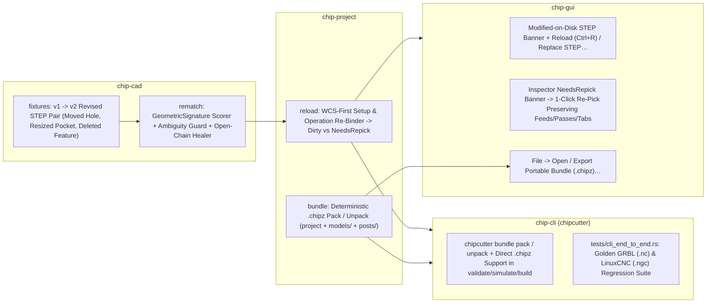

# ChipCutter — Milestone 5 Implementation Plan

## Goal Description
Implement **Milestone 5 (Associative CAD Reload Re-Matching, `.chipz` Portable Bundles, Headless CLI Golden Suite, & v1 Release Hardening)** from [10-roadmap.md](file:///workspace/ChipCutter/specs/10-roadmap.md#L38-L43), [02-cad-selection.md](file:///workspace/ChipCutter/specs/02-cad-selection.md#L61-L78), [08-ui-viewport.md](file:///workspace/ChipCutter/specs/08-ui-viewport.md), and [09-persistence-cli.md](file:///workspace/ChipCutter/specs/09-persistence-cli.md). Milestone 5 is the final v1 milestone and completes the full production workflow when CAD parts evolve across revisions or jobs move across shop machines:

1. **Associative STEP Reload & `GeometricSignature` Re-Matching (`chip-cad` & `chip-project`):** Fuzzy topological re-binding when an imported `.step` model is edited and re-exported (`v1 -> v2`), re-binding Setup WCS references first, scoring candidate B-Rep faces/loops/edges/holes by orientation + characteristic measure + spatial proximity, re-healing multi-edge open chains, marking matched operations `Dirty`, and flagging deleted/ambiguous features as `NeedsRepick` without losing any tool, feed/speed, height, pass, or tab settings.
2. **Portable `.chipz` Archive Bundles (`chip-project`, `chip-cli`, & `chip-gui`):** Deterministic, zip-slip-safe `.chipz` archive export and import packaging `project.chip.toml`, `models/*.step`, and custom `posts/*.post.toml` into a single self-contained file for shop-floor transfer, archiving, and bug reports.
3. **Synthetic Revision Fixtures & Golden G-Code Regression Suite (`chip-cad` & `chip-cli`):** Programmatic `"v1 -> v2 revised STEP"` fixture pair (testing moved holes, resized pockets, permuted entity IDs, and deleted features), checked-in golden `.nc` (GRBL) and `.ngc` (LinuxCNC) G-code snapshot tests, and end-to-end headless CLI integration tests (`validate`, `simulate`, `build`, `bundle`, and `.chipz` direct builds).
4. **Desktop GUI Reload Workflow & v1 UX Polish (`chip-gui` & docs):** `Reload STEP Model (Ctrl+R)` & `Replace STEP Model…` actions, live external STEP file modification banner, `NeedsRepick` 1-click re-binding banner in the Inspector, `.chipz` Open/Export dialogs, complete top menu bar (`Simulate` & `Post` menus per [08-ui-viewport.md](file:///workspace/ChipCutter/specs/08-ui-viewport.md#L9)), and updated `README.md` / `DEVELOPMENT.md` documentation.

---

## Key Architectural Decisions & Scope Alignment

> [!IMPORTANT]
> **Zero New External Dependencies (UI-Agnostic Core Invariant Preserved):**
> All Milestone 5 capabilities build on existing workspace crates (`zip = "9"`, `sha2`, `toml`, `serde`, `serde_json`), keeping `chip-cad`, `chip-cam`, `chip-sim`, `chip-post`, and `chip-project` 100% free of UI/GPU dependencies and keeping `cargo deny check` clean.

> [!NOTE]
> **Two-Stage WCS-First Associative Re-Binding ([02-cad-selection.md](file:///workspace/ChipCutter/specs/02-cad-selection.md#L73-L78)):**
> When a STEP file is reloaded, `chip-project` always re-binds each Setup's **WCS alignment & origin feature references** first (`SelectZAndX`, `SelectXYPlane`, `SelectedCadFeature`), resolves the updated Setup WCS frame and parametric stock variables (`stock_x`, `model_top_z`, etc.), and then re-binds every operation's selections (`PlanarFace`, `ClosedLoop`, `OpenChain` via `TopologyGraph::shortest_edge_chain`, and `CylindricalHole`).
> - **Ambiguity Guard:** If a feature splits into two nearly identical equidistant candidates (`Δscore < ambiguity_margin`), the matcher refuses to guess silently and marks the operation `OperationStatus::NeedsRepick` with an actionable message.

> [!CAUTION]
> **Safe `.chipz` Archive Extraction:**
> Opening or unpacking `.chipz` bundles validates every archive entry path (rejecting `..` parent traversal, absolute paths, and symlinks) and verifies extracted `models/*.step` SHA-256 digests against `ModelEntry::sha256` in `project.chip.toml`.

---

## Architecture Overview



---

## Proposed Changes

### 1. B-Rep Signature Matcher & `"v1 -> v2"` Revision Fixtures (`crates/chip-cad`)

#### [MODIFY] [fixtures.rs](file:///workspace/ChipCutter/crates/chip-cad/src/fixtures.rs) & [lib.rs](file:///workspace/ChipCutter/crates/chip-cad/src/lib.rs)
- Add `sample_revised_part_pair_step() -> Result<(String, String), SampleStepError>`:
  - **v1 STEP:** Prismatic block (`90 × 70 × 20 mm`) with a blind pocket (`[14..46] × [16..54]`, `Z = 12.0 mm`), a `Ø14.0 mm` bore at `(68, 24)`, and `2x Ø6.0 mm` mounting through-holes at `(68, 48)` and `(68, 60)`.
  - **v2 STEP:** Permutes B-Rep face/edge construction order (shifting raw `FaceId`/`LoopId`/`EdgeId` indices!), widens the pocket to `[12..50] × [14..56]` at `Z = 11.0 mm`, moves the `Ø14.0 mm` bore to `(70, 26)`, shifts the `(68, 48)` `Ø6.0 mm` through-hole to `(70, 48)`, and **deletes** the `(68, 60)` `Ø6.0 mm` hole so tests verify both high-confidence re-matching and orphaned-feature `NeedsRepick` flagging!

#### [NEW] [rematch.rs](file:///workspace/ChipCutter/crates/chip-cad/src/rematch.rs)
- `RematchOutcome<Id>`:
  - `Matched { id: Id, updated_binding: SelectionBinding, score: f64, index_changed: bool }`
  - `Ambiguous { candidate_indices: Vec<u32>, message: String }`
  - `Missing { message: String }`
- `rematch_face(doc: &CadDocument, binding: &SelectionBinding) -> RematchOutcome<FaceId>`
- `rematch_loop(doc: &CadDocument, binding: &SelectionBinding) -> RematchOutcome<LoopId>`
- `rematch_edge(doc: &CadDocument, binding: &SelectionBinding) -> RematchOutcome<EdgeId>`
- Weighted geometric distance metric over:
  1. `EntitySignatureKind` compatibility + orientation cosine threshold (`cos θ >= 0.998`, signed for `PlanarFace`, unsigned axial alignment for `Cylinder`/`LineEdge`).
  2. Relative `characteristic_measure` delta (radius for holes/arcs, area for faces, perimeter/length for loops/edges).
  3. Normalized `centroid_mm` shift and `aabb_mm` overlap relative to body diagonal.
  4. Fast-path exact match (`score == 0.0`) when `last_index` still has an identical `GeometricSignature`, plus separation margin check against the runner-up candidate to detect ambiguous splits.

---

### 2. Project Reload Re-Binding & `.chipz` Portable Bundles (`crates/chip-project`)

#### [MODIFY] [Cargo.toml](file:///workspace/ChipCutter/crates/chip-project/Cargo.toml) & [lib.rs](file:///workspace/ChipCutter/crates/chip-project/src/lib.rs)
- Link workspace `chip-post.workspace = true` and `zip.workspace = true` into `chip-project`.

#### [NEW] [reload.rs](file:///workspace/ChipCutter/crates/chip-project/src/reload.rs)
- `OpReloadOutcome`: `ReboundDirty { op_id, op_name, changed_indices: usize }` | `NeedsRepick { op_id, op_name, reason: String }`
- `CadReloadReport`: summarizes updated model SHA-256, Setup WCS re-bind status, count of cleanly re-bound operations (`Dirty`), and any operations marked `NeedsRepick`.
- `rebind_project_to_reloaded_cad(project: &mut ProjectDocument, model_idx: usize, new_doc: &CadDocument, topo: &TopologyGraph, new_sha256: &str) -> CadReloadReport`:
  1. Updates `project.models[model_idx].sha256`.
  2. Re-binds `Setup.wcs` (`WcsOrientationMode::SelectZAndX`, `SelectXYPlane`, `WcsOriginMode::SelectedCadFeature`) and updates `Setup.target_bodies` if body count changed.
  3. Re-binds every `Operation.selections` item (`PlanarFace`, `ClosedLoop`, `OpenChain` re-chained via `topo.shortest_edge_chain`, `CylindricalHole`):
     - If all selections in an operation match unambiguously -> updates `SelectionBinding`s, sets `op.runtime_status = OperationStatus::Dirty`, and re-evaluates inline height/pass formulas (`feature_top_z`, `stock_x`, etc.)!
     - If any selection in an operation is `Missing` or `Ambiguous` -> sets `op.runtime_status = OperationStatus::NeedsRepick { message }` while retaining valid sibling selections and all cutting/linking parameters!

#### [NEW] [bundle.rs](file:///workspace/ChipCutter/crates/chip-project/src/bundle.rs)
- `export_chipz_bundle(...) -> Result<ChipzManifestSummary, BundleError>`:
  - Writes a deterministic Deflate `.chipz` ZIP archive containing:
    - `project.chip.toml` (with normalized bundle-relative model paths `models/<filename>.step`)
    - `models/<filename>.step` (copied from disk or supplied from in-memory STEP bytes for unsaved sample projects)
    - `posts/<id>.post.toml` (for any non-builtin custom post profile referenced by a Setup)
- `unpack_chipz_bundle(chipz_path: &Path, dest_dir: &Path) -> Result<UnpackedChipzBundle, BundleError>`:
  - Rejects path-traversal/absolute ZIP entries, enforces size limits, extracts `project.chip.toml`, `models/*.step`, and `posts/*.post.toml` into `dest_dir`, verifies `ModelEntry::sha256` digests, and loads `ProjectDocument`.

---

### 3. Headless CLI Bundle Support & Golden G-Code Regression Tests (`crates/chip-cli`)

#### [MODIFY] [main.rs](file:///workspace/ChipCutter/crates/chip-cli/src/main.rs)
- Add `chipcutter bundle` subcommand:
  - `chipcutter bundle pack <project.chip.toml> -o <archive.chipz>`
  - `chipcutter bundle unpack <archive.chipz> -o <dest_dir>`
- Allow `chipcutter validate`, `chipcutter simulate`, and `chipcutter build` to accept **either** `<project.chip.toml>` **or** `<archive.chipz>` directly (transparently unpacking `.chipz` into a clean ephemeral workspace directory during execution!).
- Also support `chipcutter reload-step <project.chip.toml> --step <revised.step> [-o <updated.chip.toml>]` so headless users/CI can test associative STEP updates from the command line!

#### [NEW] [tests/cli_end_to_end.rs](file:///workspace/ChipCutter/crates/chip-cli/tests/cli_end_to_end.rs) & `crates/chip-cli/tests/golden/`
- Checked-in golden G-code reference files:
  - `tests/golden/torture_grbl_01_T7.nc`, `torture_grbl_02_T1.nc`, `torture_grbl_03_T6.nc`, `torture_grbl_04_T5.nc`
  - `tests/golden/torture_linuxcnc.ngc`
- Automated CLI integration tests verifying:
  1. **Byte-for-byte deterministic Golden G-code snapshots** for both GRBL (`split_files_by_tool`) and LinuxCNC (`RS274NGC`).
  2. **`.chipz` Bundle Round-Trip:** `bundle pack` -> move `.chipz` to an isolated folder with zero external `.step` files -> `chipcutter build <archive.chipz>` produces identical G-code!
  3. **Associative `v1 -> v2` STEP Reload + Physical Oracle:** Builds a project on `v1.step`, reloads `v2.step`, verifies moved/resized features re-bind automatically, verifies the deleted hole flags `NeedsRepick`, suppresses/updates the deleted hole, regenerates, and passes `chip-sim` with `0` crashes/gouges!

---

### 4. Desktop GUI Reload Workflow, `.chipz` Dialogs, & Release Polish (`crates/chip-gui` & Docs)

#### [MODIFY] [app.rs](file:///workspace/ChipCutter/crates/chip-gui/src/app.rs), [browser.rs](file:///workspace/ChipCutter/crates/chip-gui/src/panels/browser.rs), & [operation_inspector.rs](file:///workspace/ChipCutter/crates/chip-gui/src/panels/operation_inspector.rs)
1. **STEP Reload (`Ctrl+R`) & Replace STEP Workflow:**
   - Add `Reload STEP Model (Ctrl+R)` and `Replace STEP Model (v1 -> v2)…` in `File` menu and directly on model rows in `CAM Browser` (plus a built-in `Test CAD Revision Reload (v1 -> v2)` demo action under `File` so users can experience associative re-matching interactively in 1 click!).
   - Periodically poll the active STEP file's mtime/hash on disk (lightweight check every `~2 s` when `project_file_path` / model source path exists): if modified externally by a CAD package, display a non-blocking banner above the 3D viewport: **`[*] External STEP file updated on disk — [Reload & Re-Match (Ctrl+R)]`**.
   - Push Undo snapshot before re-binding so `Ctrl+Z` cleanly reverts if desired, and display a dismissible reload summary banner (`Re-bound X op(s), Y need re-pick`).
2. **`NeedsRepick` 1-Click Recovery in Inspector (`operation_inspector.rs`):**
   - When the selected operation has `OperationStatus::NeedsRepick { message }`, render a highlighted callout box at the top of the Inspector showing `message` with **`[Re-Pick Geometry in 3D Viewport]`** (clears orphaned selection items and immediately activates the matching 3D pick mode while preserving tool, speeds/feeds, heights, passes, and tabs!).
3. **Portable `.chipz` Open & Export in GUI:**
   - Extend `Open Project… (Ctrl+O)` (and CLI positional path argument `chip-gui <file.chipz>`) to open both `.chip.toml` and `.chipz` archives!
   - Add `File -> Export Portable Bundle (.chipz)…` saving a self-contained `.chipz` archive from any loaded project (including unsaved sample jobs!).
4. **Menu Bar & Documentation Completion:**
   - Add dedicated `Simulate` and `Post` top-level menus in `MenuBar` alongside `File | Edit | Setup | Operations | Tools | Simulate | Post | View` matching [08-ui-viewport.md](file:///workspace/ChipCutter/specs/08-ui-viewport.md#L9), plus dirty indicator `*` in the window title.
   - Update `DEVELOPMENT.md` and `specs/*.md` to reflect completed v1 CLI commands (`bundle`, `simulate`, `build`, `validate`, `tools`).

---

## Suggested Implementation Sequence

1. **Step 1 — `chip-cad` Revision Pair Fixture & `GeometricSignature` Matcher (`fixtures.rs` + `rematch.rs`):** Implement `sample_revised_part_pair_step()` and `rematch_face` / `rematch_loop` / `rematch_edge` with ambiguity detection and unit tests.
2. **Step 2 — `chip-project` WCS-First Reload Re-Binder & `.chipz` Bundles (`reload.rs` + `bundle.rs`):** Implement `rebind_project_to_reloaded_cad` (including `OpenChain` re-healing via `TopologyGraph`) and deterministic zip-slip-safe `.chipz` export/unpack + unit tests.
3. **Step 3 — `chip-cli` Bundle Commands, Direct `.chipz` Input, & Golden G-Code Suite:** Extend `chipcutter` with `bundle pack/unpack`, `reload-step`, and `.chipz` support on `validate`/`simulate`/`build`, then create golden GRBL & LinuxCNC `.nc`/`.ngc` fixtures and `tests/cli_end_to_end.rs`.
4. **Step 4 — `chip-gui` Associative Reload UX, `.chipz` Dialogs, & Release Polish:** Wire `Ctrl+R` reload, `Replace STEP…`, external STEP modification banner, `NeedsRepick` 1-click recovery in `operation_inspector.rs`, `.chipz` Open/Export, and `Simulate`/`Post` menus.
5. **Step 5 — Documentation Sync & Full v1 Verification Pass:** Update `DEVELOPMENT.md` and `specs/`, then run `cargo fmt`, strict `clippy`, `cargo deny check`, full workspace unit/oracle/golden tests, CLI `.chipz` round-trip tests, and Xvfb GUI screenshot verification.

---

## Verification Plan

### Automated Tests
1. **Formatting, Strict Clippy Lints, & Permissive License/Advisory Audit:**
   ```bash
   cargo fmt --all -- --check
   cargo clippy --workspace --all-targets -- -D warnings
   cargo deny check
   ```
2. **Workspace Unit, Associative Reload, Bundle, Oracle, & Golden G-Code Suite:**
   ```bash
   WGPU_BACKEND=vulkan cargo test --workspace
   ```
   Covering:
   - **`chip-cad` & `chip-project` Associative Reload Tests:**
     - Author operations on `v1` of `sample_revised_part_pair_step()` (planar pocket face, outer contour loop, open chamfer chain, `Ø14 mm` bore, and `2x Ø6 mm` holes), reload `v2` (with permuted entity indices, resized pocket, shifted bore/hole, and 1 deleted hole), and verify:
       1. Pocket, contour, chamfer chain, and surviving holes re-bind automatically to their new `FaceId`/`LoopId`/`EdgeId`s and transition to `Dirty`.
       2. The operation referencing the deleted hole transitions to `OperationStatus::NeedsRepick` while preserving its tool, preset, heights, and passes.
       3. Regenerating the re-bound operations on `v2` passes `chip-sim` heightmap verification with **0 crashes and 0 target gouges**!
     - Ambiguity test: verify that if a single hole is replaced by two symmetric twin holes at equal distance, the matcher returns `Ambiguous` -> `NeedsRepick` rather than silently guessing the wrong hole.
   - **`.chipz` Bundle Security & Determinism Tests:**
     - Verify byte-deterministic `.chipz` creation, SHA-256 verification on unpack, custom `.post.toml` preservation, and rejection of malicious `../evil` zip-slip paths.
   - **Golden G-Code Snapshot & End-to-End CLI Tests (`crates/chip-cli/tests/cli_end_to_end.rs`):**
     - Compare `chipcutter build` output for `grbl` and `linuxcnc` byte-for-byte against `crates/chip-cli/tests/golden/*`.
     - Pack `.chipz`, copy to an empty temp directory without external `.step` files, and verify `chipcutter build archive.chipz` succeeds with identical G-code.
3. **Headless Xvfb GUI Self-Test:**
   ```bash
   WGPU_BACKEND=vulkan xvfb-run -a cargo run -p chip-gui -- --self-test-screenshot /tmp/m5_gui_preview.png
   ```
