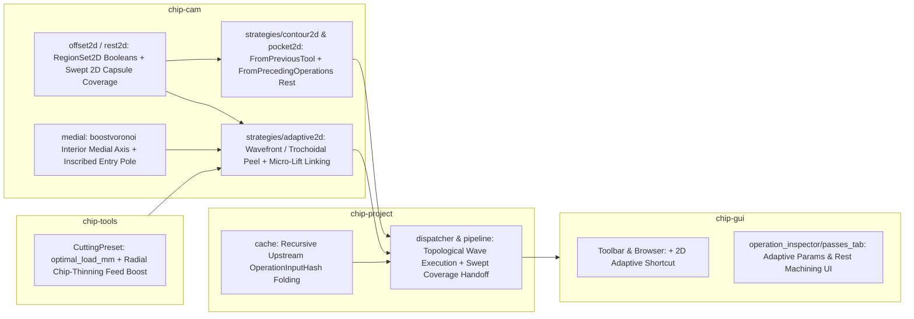

# ChipCutter — Milestone 6 Implementation Plan

## Goal Description
Implement **Milestone 6 (2D Adaptive / Trochoidal Roughing & Exact 2.5D Rest Machining)** from [10-roadmap.md](file:///workspace/ChipCutter/specs/10-roadmap.md#L33-L45), [04-tool-library.md](file:///workspace/ChipCutter/specs/04-tool-library.md#L34-L62), [05-operations.md](file:///workspace/ChipCutter/specs/05-operations.md#L43-L88), and [01-architecture.md](file:///workspace/ChipCutter/specs/01-architecture.md#L82-L91). Milestone 6 is the first v2 milestone and delivers high-efficiency roughing plus zero-air-cut rest cleanup:

1. **Tool Presets & Radial Chip-Thinning Compensation (`chip-tools`):** Add optional `optimal_load_mm` (`ae_adaptive`) to `CuttingPreset` (including Fusion 360 JSON `"optimal-load"` import mapping and starter library roughing presets) and parameterized radial chip-thinning feedrate compensation (`compute_compensated_adaptive_feed` with configurable `max_thinning_feed_multiplier`).
2. **2D Boolean Region Set & Swept Coverage Engine (`chip-cam`):** Build `RegionSet2D` over `cavalier_contours` (`union`, `difference`, `intersect`, `dilate_outward`, `erode_inward`) and exact 2D swept toolpath capsule union (`swept_toolpath_coverage_2d`) preserving true circular arcs.
3. **2D Adaptive / Trochoidal Clearing (`chip-cam`):** Implement `PocketStrategyKind::Adaptive(AdaptiveClearingParams)` + `AdaptivePocketStrategy` (`strategies/adaptive2d.rs`) featuring medial-axis / inscribed-pole helical entry (`boostvoronoi` + `find_helical_entry_pole`), engagement-bounded wavefront & trochoidal crescent peel passes ($\text{radial immersion} \le a_{e,\text{opt}} + \varepsilon$), consistent Climb/Conventional cut direction, island-safe `micro_lift_z` high-feed stay-down linking, and optional automatic radial chip-thinning feed scaling.
4. **Exact 2.5D Rest Machining & Topological DAG Dispatcher (`chip-cam` & `chip-project`):** Implement `RestMachiningConfig` (`Disabled`, `FromPreviousTool`, `FromPrecedingOperations`) on **2D Pocket / Adaptive** and **2D Contour**, fold upstream `OperationInputHash` digests into downstream Rest hashes for automatic `Dirty` invalidation and `< 1 ms` Undo/Redo, and upgrade `JobDispatcher` to topological wave execution.
5. **Desktop GUI & End-to-End Verification (`chip-gui`, `chip-cli`, & `chip-sim`):** Add a 1-click **`Adaptive`** toolbar/browser shortcut, Adaptive & Rest Machining Inspector UI controls, a built-in Adaptive + Rest demo job, `chip-sim` physical invariant tests (verifying zero `G0` crashes, zero model gouges, bounded instantaneous engagement, and complete corner rest cleanup), while keeping all v1 `.chip.toml` files and golden G-code snapshots 100% unchanged.

---

## Key Architectural Decisions & Scope Alignment

> [!IMPORTANT]
> **100% v1 Schema & Golden G-Code Backward Compatibility:**
> - All new fields (`optimal_load_mm`, `rest_machining`, `PocketStrategyKind::Adaptive`) carry `#[serde(default)]` / `skip_serializing_if` defaults so existing `schema_version = 1` `.chip.toml` files and all 5 v1 golden G-code files (`crates/chip-cli/tests/golden/*`) remain **byte-for-byte identical**.
> - Only one permissive dependency is added in Milestone 6: `boostvoronoi = "0.12"` (`BSL-1.0`, already whitelisted in [deny.toml](file:///workspace/ChipCutter/deny.toml#L24)), shared later by Milestone 9's V-Carving medial-axis engine.

> [!NOTE]
> **Exact Gouge-Proof 2.5D Rest Domain Formulation:**
> Given safe tool-center domain $\Omega_{\text{safe}} = \text{erode\_inward}(M_{\text{target}}, R_{\text{curr}} + s_{\text{radial}})$ and conservatively already-cleared material $C_{\text{cleared}}$ (either analytically from `prev_tool_diameter` + `prev_stock_to_leave` or swept from preceding operations at $z \le z_{\text{level}}$), the pure-air tool-center locus is $\Omega_{\text{air}} = \text{erode\_inward}(C_{\text{cleared}}, R_{\text{curr}} + \delta_{\text{overlap}})$.
> - The exact **Rest Tool-Center Domain** is $\Omega_{\text{rest}} = \Omega_{\text{safe}} \setminus \Omega_{\text{air}}$:
>   1. Every point in $\Omega_{\text{rest}}$ lies inside $\Omega_{\text{safe}}$, making target wall/island gouges **impossible by construction**.
>   2. Subtracting $\Omega_{\text{air}}$ eliminates 100% of pure air-cutting passes while keeping `rest_overlap_mm` blend margin.
>   3. Boundary segments of $\Omega_{\text{rest}}$ bordering $\Omega_{\text{air}}$ are tagged as **open cavity-air entry edges**, allowing Adaptive, Pocket, and Contour passes to enter corners horizontally from the already-cleared cavity without tight helical plunges!

> [!CAUTION]
> **Dogleg-Safe High-Feed Micro-Lift Linking:**
> Real CNC controllers (`GRBL`, `LinuxCNC`, `Fanuc`) may execute `G0` rapids as non-linear per-axis doglegs. Low-clearance `micro_lift_z` (`default 0.25 mm`) stay-down return moves inside an Adaptive cavity are therefore emitted strictly as **linear `G1` moves at `no_engagement_feed_mm_min`** (`MotionRole::LeadIn` / `LeadOut`) ONLY when `clip_scanline_to_region` confirms the entire straight return chord lies strictly inside the already-cleared cavity $W_k$; if any island or uncut stock obstructs the chord, the linker retracts vertically to `safe_retract_z` (`Retract` / `Clearance`) via `G0`.

---

## Architecture Overview



---

## Proposed Changes

### 1. Optimal Load Presets & Chip-Thinning Math (`crates/chip-tools`)

#### [MODIFY] [feeds_speeds.rs](file:///workspace/ChipCutter/crates/chip-tools/src/feeds_speeds.rs), [builtin.rs](file:///workspace/ChipCutter/crates/chip-tools/src/builtin.rs), & [fusion_import.rs](file:///workspace/ChipCutter/crates/chip-tools/src/fusion_import.rs)
- Add `#[serde(default, skip_serializing_if = "Option::is_none")] pub optimal_load_mm: Option<f64>` to `CuttingPreset` (and `SurfaceSpeedPresetSpec`).
- Add `pub fn compute_adaptive_thinning_feed(diameter_mm: f64, optimal_load_mm: f64, nominal_feed_mm_min: f64, max_multiplier: f64) -> f64`:
  - Computes $\text{boost} = \text{clamp}\!\bigl(\frac{D}{2\sqrt{a_e(D - a_e)}},\; 1.0,\; \text{max\_multiplier}\bigr)$ when $0 < a_e < 0.5 D$, returning `nominal_feed_mm_min` when $a_e \ge 0.5 D$.
- Map Fusion 360 `"optimal-load"` (`v_ae` / `"stepover"` adaptive presets) in `fusion_import.rs` when present, while keeping existing built-in starter tool serialization unchanged unless `optimal_load_mm` is set.

---

### 2. 2D Region Set Booleans, Medial Axis, Adaptive Roughing, & Rest Machining (`crates/chip-cam`)

#### [MODIFY] [Cargo.toml](file:///workspace/ChipCutter/Cargo.toml) & [crates/chip-cam/Cargo.toml](file:///workspace/ChipCutter/crates/chip-cam/Cargo.toml)
- Add `boostvoronoi = "0.12"` to `[workspace.dependencies]` and `crates/chip-cam/Cargo.toml`.

#### [MODIFY] [offset2d.rs](file:///workspace/ChipCutter/crates/chip-cam/src/offset2d.rs) & [NEW] `crates/chip-cam/src/medial.rs`
- Extend `offset2d.rs` with `RegionSet2D` (`Vec<PocketRegion2D>`) boolean & morphological operators backed by `cavalier_contours`:
  - `RegionSet2D::union(&self, other: &Self) -> Self`
  - `RegionSet2D::difference(&self, clip: &Self) -> Self`
  - `RegionSet2D::intersect(&self, clip: &Self) -> Self`
  - `RegionSet2D::dilate_outward(&self, dist_mm: f64) -> Self` & `erode_inward(&self, dist_mm: f64) -> Self`
- Create `medial.rs` wrapping `boostvoronoi::Builder` over discretized `PocketRegion2D` segments to extract interior medial-axis vertices and exact maximum-clearance entry poles (`find_medial_inscribed_pole`), with automatic fallback to `find_helical_entry_pole` on degenerate inputs.

#### [NEW] `crates/chip-cam/src/rest2d.rs`
- Define `UpstreamSweptInput`:
  ```rust
  #[derive(Debug, Clone)]
  pub struct UpstreamSweptInput {
      pub op_id: String,
      pub tool_diameter_mm: f64,
      pub corner_radius_mm: f64,
      pub toolpath: Arc<GeneratedToolpath>,
  }
  ```
- Implement `swept_toolpath_coverage_2d(inputs: &[UpstreamSweptInput], z_level_wcs: f64) -> RegionSet2D`:
  - Collects cutting/ramp/plunge segments whose effective cutting envelope reaches `z_level_wcs + tol`, constructs exact 2D swept capsules/arc-bands (`offset_polyline` / dilated segment shapes), and unions them into `RegionSet2D`.
- Implement `compute_rest_tool_regions(...) -> Vec<RestPocketRegion2D>` and `clip_contour_to_rest_regions(...)`:
  - Supports both `RestMachiningMode::FromPreviousTool` and `RestMachiningMode::FromPrecedingOperations`.
  - Computes $\Omega_{\text{rest}} = \Omega_{\text{safe}} \setminus \Omega_{\text{air}}$, tags boundary edges touching $\Omega_{\text{air}}$ as open cavity-air entry edges, filters out micro-slivers where maximum radial uncut thickness `< min_rest_thickness_mm`, and orders disconnected corner regions via nearest-neighbor TSP.

#### [MODIFY] [params.rs](file:///workspace/ChipCutter/crates/chip-cam/src/params.rs) & [operation.rs](file:///workspace/ChipCutter/crates/chip-cam/src/operation.rs)
- Add `RestMachiningMode` & `RestMachiningConfig` (`#[serde(default)]` on `PassesParams` or `Pocket2DParams` + `Contour2DParams`; placing `#[serde(default, skip_serializing_if = "RestMachiningConfig::is_disabled")] pub rest_machining: RestMachiningConfig` on `PassesParams` makes it cleanly available to Pocket, Adaptive, Contour, and future M9 V-Carve without duplicating fields, while skipping serialization when disabled so v1 `.chip.toml` snapshots stay clean!):
  - `Disabled` *(default)*
  - `FromPreviousTool { prev_tool_diameter: ParamLength, prev_stock_to_leave: ParamLength, rest_overlap: ParamLength, min_rest_thickness: ParamLength }`
  - `FromPrecedingOperations { source_op_ids: Vec<String>, rest_overlap: ParamLength, min_rest_thickness: ParamLength }` (empty `source_op_ids` = all preceding enabled operations in the same Setup).
- Add `AdaptiveClearingParams` and `PocketStrategyKind::Adaptive(AdaptiveClearingParams)`:
  - `optimal_load: ParamLength` (default `"tool_d * 0.20"`)
  - `cut_direction: AdaptiveCutDirection` (`Climb` *(default)*, `Conventional`, `BothWays`)
  - `micro_lift_z: ParamLength` (default `0.25 mm`)
  - `no_engagement_feed_multiplier: f64` (default `2.5`)
  - `min_trochoid_radius: ParamLength` (default `"tool_d * 0.10"`)
  - `auto_chip_thinning: bool` (default `true`)
  - `max_thinning_feed_multiplier: f64` (default `2.0`)
- Add `Operation::new_adaptive_2d(id, name)` helper constructor that creates an `OperationKind::Pocket2D` pre-configured with `PocketStrategyKind::Adaptive`, `max_stepdown = "tool_d * 1.5"`, and `optimal_load = "tool_d * 0.20"`.

#### [NEW] `crates/chip-cam/src/strategies/adaptive2d.rs`, [MODIFY] [pocket2d.rs](file:///workspace/ChipCutter/crates/chip-cam/src/strategies/pocket2d.rs), [contour2d.rs](file:///workspace/ChipCutter/crates/chip-cam/src/strategies/contour2d.rs), & [strategies/mod.rs](file:///workspace/ChipCutter/crates/chip-cam/src/strategies/mod.rs)
- Pass `upstream_rest: &[UpstreamSweptInput]` inside `StrategyExecContext<'a>` (adding `generate_operation_toolpath_with_rest` while keeping `generate_operation_toolpath` as a 0-slice convenience wrapper so existing callers compile untouched!).
- Implement `adaptive2d.rs`:
  1. **Cavity Initialization ($W_0$):** Enters horizontally from exterior/rest air when open edges exist, or helically ramps at the medial inscribed circle pole (`r_helix`), establishing initial cleared tool-center cavity $W_0$.
  2. **Wavefront Crescent Peel Loop ($W_k \to W_{k+1}$):**
     - Computes $S_{k+1} = \text{dilate\_outward}(W_k, \Delta_k) \cap \Omega_{\text{safe}}$ (scaling $\Delta_k \le a_e$ in narrow slots where channel clearance $< a_e$).
     - Extracts active frontier peel spans along $\partial(S_{k+1} \setminus W_k)$ oriented for `Climb` (or `Conventional` / alternating `BothWays`), prepending/appending smooth tangential lead-in and lead-out arcs of radius `min_trochoid_radius` inside $W_k$.
     - Connects consecutive peel spans via **Dogleg-Safe Micro-Lift Linking**: if the straight return segment stays strictly inside $W_{k+1}$ (`clip_scanline_to_region`) and within stay-down distance, lifts to `z_cut + micro_lift_z` and traverses via linear `G1` at `no_engagement_feed`; otherwise retracts to `safe_retract_z` via `G0`.
  3. Terminates when $\Omega_{\text{safe}} \setminus W_k$ has zero remaining area above tolerance, followed by the optional `finish_wall_pass` around outer + island perimeters.
- Wire `RestMachiningConfig` into both `pocket2d.rs` (filtering/partitioning `eroded_region` into `RestPocketRegion2D`s) and `contour2d.rs` (clipping roughing/finishing offset contours to `RestRegion`s with tangential air lead-in/out arcs).

---

### 3. Recursive Input Hashing & Topological Wave Dispatcher (`crates/chip-project`)

#### [MODIFY] [cache.rs](file:///workspace/ChipCutter/crates/chip-project/src/cache.rs), [dispatcher.rs](file:///workspace/ChipCutter/crates/chip-project/src/dispatcher.rs), [pipeline.rs](file:///workspace/ChipCutter/crates/chip-project/src/pipeline.rs), & [demos.rs](file:///workspace/ChipCutter/crates/chip-project/src/demos.rs)
- **`compute_operation_input_hash` (`cache.rs`):**
  - Keep existing hash bytes **identical** when `op.passes.rest_machining.is_disabled()`.
  - When `RestMachiningMode::FromPrecedingOperations` is active, deterministically hash the ordered list of resolved upstream `(op_id, OperationInputHash)` pairs in `setup.operations[0..op_idx]` (rejecting forward/self references at validation time so cycles are structurally impossible!).
  - Result: editing, reordering, changing tools, or suppressing an upstream roughing operation **automatically** transitions downstream Rest operations to `Dirty` via `reconcile_project_statuses`, and `Ctrl+Z` / `Ctrl+Y` restores `Clean` instantaneously!
- **Topological Wave Execution (`dispatcher.rs`):**
  - Upgrade `dispatch_operations` and `generate_project_blocking`:
    - Operations whose upstream Rest dependencies are already cached `Clean` in `ToolpathCache` receive `Vec<UpstreamSweptInput>` immediately and spawn in parallel on `rayon`.
    - Operations waiting on an in-flight upstream operation remain queued (`OperationStatus::Generating` / pending wave); in `generate_project_blocking` (CLI) waves execute sequentially with intra-wave `rayon` parallelism, and in GUI (`poll_dispatcher_events`) completing an upstream op immediately dispatches newly unblocked downstream Rest ops!
    - If an upstream dependency fails (`OperationStatus::Error`), downstream dependent Rest ops transition cleanly to `OperationStatus::Error` reporting which upstream operation failed.
- **Canonical Adaptive + Rest Demo (`demos.rs`):**
  - Add `build_adaptive_rest_demo_project` showcasing a `Ø10 mm` 2D Adaptive roughing pocket + island cavity followed by a `Ø4 mm` 2D Adaptive/Contour `FromPrecedingOperations` Rest Machining cleanup pass!

---

### 4. Desktop GUI Controls & Shortcuts (`crates/chip-gui`)

#### [MODIFY] [menus_toolbar.rs](file:///workspace/ChipCutter/crates/chip-gui/src/app/menus_toolbar.rs), [browser.rs](file:///workspace/ChipCutter/crates/chip-gui/src/panels/browser.rs), [passes_tab.rs](file:///workspace/ChipCutter/crates/chip-gui/src/panels/operation_inspector/passes_tab.rs), & [tool_library.rs](file:///workspace/ChipCutter/crates/chip-gui/src/panels/tool_library.rs)
1. **1-Click `2D Adaptive` Creation:**
   - Add **`Adaptive`** button in the top toolbar, `Operations -> New 2D Adaptive Clearing`, and `+ Op: Adaptive` quick button in the CAM Browser (creating `Operation::new_adaptive_2d` with `PocketStrategyKind::Adaptive`).
   - Display `[Adaptive]` / `[Rest]` subtle subtitle/tag in the CAM Browser operation label when active, plus a **`Adaptive + Rest`** sample loader button under Demo Models.
2. **Inspector `Passes` Tab (`passes_tab.rs`):**
   - In `2D Pocket`: add `Adaptive / Trochoidal` option to the **Clearing** selector alongside `Contour-Parallel` and `Zig-Zag Raster`, exposing `Optimal Load (ae)`, `Cut Direction (Climb / Conventional / Both Ways)`, `Micro-Lift Height`, `No-Engagement Feed Multiplier`, and `Auto Radial Chip-Thinning` (with live compensated feed preview!).
   - In `2D Pocket` & `2D Contour`: add collapsible **Rest Machining** section (`Disabled`, `From Previous Tool`, `From Preceding Setup Operations`) with expression inputs for `Previous Tool Diameter`, `Previous Stock to Leave`, and `Rest Overlap`, or multi-select checklist of preceding operations in the active Setup.
3. **Tool Library Editor (`tool_library.rs`):**
   - Expose optional `Optimal Load (Adaptive ae)` field on material presets.

---

## Suggested Implementation Sequence

1. **Step 1 — `chip-tools` & `chip-cam` Geometry Foundation:** Add `boostvoronoi` to workspace, extend `CuttingPreset` + `compute_adaptive_thinning_feed`, implement `RegionSet2D` booleans (`offset2d.rs`) + `medial.rs` inscribed pole finder + `rest2d.rs` swept 2D coverage & rest region subtraction with unit tests.
2. **Step 2 — 2D Adaptive Strategy & Rest Strategy Integration (`chip-cam`):** Add `AdaptiveClearingParams` & `RestMachiningConfig` (`params.rs`), implement `strategies/adaptive2d.rs` (wavefront crescent peel + dogleg-safe `micro_lift_z` linking + chip-thinning feed boost), and wire Rest Machining into `pocket2d.rs` and `contour2d.rs`.
3. **Step 3 — Recursive Input Hashing & Topological Wave Dispatcher (`chip-project`):** Update `compute_operation_input_hash`, `JobDispatcher` (`dispatch_operations` + `generate_project_blocking`), and `build_adaptive_rest_demo_project` with DAG invalidation & Undo/Redo unit tests.
4. **Step 4 — GUI Inspector, Toolbar, & End-to-End Oracle Verification (`chip-gui` & `chip-cli`):** Wire `2D Adaptive` creation buttons, Adaptive + Rest Inspector controls, `strategies_invariants.rs` physical engagement & `chip-sim` oracle tests, and headless Xvfb GUI verification.

---

## Verification Plan

### Automated Tests
1. **Formatting, Strict Clippy Lints (`0` `too_many_arguments`), & License Audit:**
   ```bash
   cargo fmt --all -- --check
   cargo clippy --workspace --all-targets -- -D warnings
   cargo deny check
   ```
2. **Workspace Unit, Physical Engagement Oracle, DAG, & Golden Regression Suite:**
   ```bash
   WGPU_BACKEND=vulkan cargo test --workspace
   ```
   Covering:
   - **`chip-tools` Unit Tests:** Verify `compute_adaptive_thinning_feed` accuracy and multiplier clamping across `ae = 0.05 D .. 0.50 D`.
   - **`chip-cam` Boolean & Rest Unit Tests (`offset2d` / `rest2d`):**
     - Verify `FromPreviousTool` (`Ø12 mm` -> `Ø4 mm`) on a rectangular pocket with `R3 mm` filleted corners and a circular island produces 4 isolated corner rest regions + narrow island-gap channel, leaving zero air-cut in the central pocket floor.
     - Verify `swept_toolpath_coverage_2d` + `FromPrecedingOperations` accurately subtracts an upstream roughing toolpath's 2D footprint.
   - **`chip-cam` + `chip-sim` Physical Oracle Tests (`tests/strategies_invariants.rs`):**
     - Run **2D Adaptive Clearing** on closed pockets with islands, open-edge shoulders, and narrow `1.15 * tool_d` slots:
       1. Sweep through `chip-sim` (`Fine` resolution) asserting **0 `G0` rapid-into-stock crashes**, **0 target model gouges**, and complete floor clearing to `Bottom Z ± tol`.
       2. Verify every `micro_lift_z` stay-down move executes above cleared cavity floor without touching islands or walls.
       3. Verify instantaneous radial immersion across cutting steps remains bounded by `optimal_load + tol` (no `180°` corner-burying full-width spikes!).
     - Run **Roughing (`Ø10 mm` Adaptive) -> Rest Pocket + Rest Contour (`Ø4 mm` `FromPrecedingOperations`)**:
       1. Assert `chip-sim` reports **0 crashes and 0 gouges**, and Rest cycle path length is `< 35%` of a full un-rested `Ø4 mm` pocket clear while achieving identical final machined stock volume!
   - **`chip-project` DAG Dirty Propagation & Undo/Redo Test:**
     - Verify editing or suppressing Op 1 (`Ø10 mm` Rough) automatically transitions Op 2 (`Ø4 mm` Rest) from `Clean` -> `Dirty`, `Ctrl+Z` restores both to `Clean` from `ToolpathCache`, and `generate_project_blocking` executes Wave 0 -> Wave 1 deterministically.
   - **v1 Golden G-Code Regression Gate (`cli_end_to_end.rs`):**
     - Confirm all 5 existing v1 golden `.nc`/`.ngc` files continue to match **byte-for-byte**.
3. **Headless Xvfb GUI Self-Test:**
   ```bash
   WGPU_BACKEND=vulkan xvfb-run -a cargo run -p chip-gui -- --self-test-screenshot /tmp/m6_gui_preview.png
   ```
