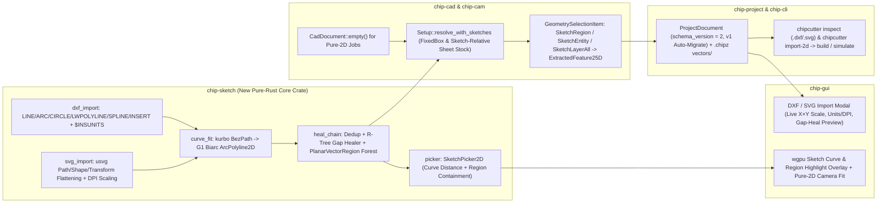

# ChipCutter — Milestone 7 Implementation Plan

## Goal Description
Implement **Milestone 7 (`chip-sketch` Foundation, Pure-2D Projects, & DXF / SVG Importers)** from [10-roadmap.md](file:///workspace/ChipCutter/specs/10-roadmap.md#L47-L59), [11-sketches-vectors.md](file:///workspace/ChipCutter/specs/11-sketches-vectors.md), [02-cad-selection.md](file:///workspace/ChipCutter/specs/02-cad-selection.md#L40-L60), [03-setups-wcs.md](file:///workspace/ChipCutter/specs/03-setups-wcs.md#L3-L51), and [09-persistence-cli.md](file:///workspace/ChipCutter/specs/09-persistence-cli.md). Milestone 7 unlocks pure-2D CNC router/panel/sheet workflows (zero 3D STEP model required) as well as hybrid 3D+2D jobs from imported DXF and SVG vector drawings:

1. **`chip-sketch` Core Crate (`crates/chip-sketch`):** Pure-Rust, UI-agnostic 2D vector & sketch engine featuring `SketchLayer`, `SketchAnchor::SetupXY`, `PlanarVectorRegion` outer-loop + nested-island topology, `kurbo` cubic/quadratic Bézier-to-biarc fitting into exact `ArcPolyline2D`s (`G2`/`G3` arc preservation), R-tree (`rstar`) duplicate removal & endpoint gap-healing (`join_tolerance_mm`), **DXF** (`dxf`) importer, **SVG** (`usvg` `default-features = false`) importer, and 2D ray/point picking (`SketchPicker2D`).
2. **Pure-2D Setups & Unified 2D Sketch Selection (`chip-cad` & `chip-cam`):** `CadDocument::empty()` support for pure-2D (`models = []`) projects, `Setup::resolve_with_sketches` (`FixedBox` & `RelativeBox` over 2D Sketch XY bounds + `sheet_thickness_z`), and `GeometrySelectionItem` variants (`SketchRegion`, `SketchEntity`, `SketchLayerAll`) normalizing into `ExtractedFeature25D` so all existing strategies (`Facing`, `Contour2D`, `Pocket2D`, `2D Adaptive`, `DrillBore`, `ChamferTrace`, and `Rest Machining`) cut 2D vector geometry with zero strategy changes.
3. **`schema_version = 2`, `.chipz` `vectors/` Bundling, & CLI `import-2d` (`chip-project` & `chip-cli`):** Upgrade `.chip.toml` to `schema_version = 2` (with 100% lossless auto-migration of `schema_version = 1` projects), bundle `.dxf`/`.svg` source assets inside `.chipz` archives, and add `chipcutter import-2d` + DXF/SVG support in `chipcutter inspect`, `validate`, `simulate`, and `build`.
4. **Desktop GUI Vector Viewport, Picking, & DXF/SVG Import Modal (`chip-gui`):** Render 2D `SketchLayer` curves, closed-region hover/selection highlights, and open-gap diagnostics in `wgpu`, add a **Sketches** section in the CAM Browser, build an interactive **DXF / SVG Import Modal** (with live `X × Y` scale preview for unitless DXFs & SVG DPIs + live gap-healing region count), and ship a 1-click **`Pure-2D Panel`** demo project.

---

## Key Architectural Decisions & Scope Alignment

> [!IMPORTANT]
> **Permissive & Minimal Dependency Footprint:**
> - `dxf = "0.6"` (`MIT`), `kurbo = "0.13"` (`Apache-2.0 OR MIT`), and `usvg = { version = "0.50", default-features = false }` (`Apache-2.0 OR MIT`).
> - Disabling `usvg` default features omits `fontdb`, `harfrust`, `fontconfig`, and `xmlwriter`, keeping `chip-sketch` fast-compiling, 100% pure-Rust, free of system library dependencies, and compliant with `cargo deny check`.

> [!NOTE]
> **Seamless `v1` Compatibility & Pure-2D (`models = []`) Pipeline:**
> - `ProjectDocument::from_toml_str` accepts both `schema_version = 1` and `schema_version = 2` seamlessly (`sketches` defaults to `[]` and skips serialization when empty). All existing v1 `.chip.toml` files, `.chipz` bundles, and the 5 golden G-code snapshots remain **100% byte-for-byte unchanged**.
> - When `project.models` is empty, `chip-project` and `chip-gui` supply `CadDocument::empty()`: `chip-sim`'s `HeightfieldStock` initializes `z_target` to `-∞` (skipping 3D model-gouge false positives while still enforcing **Rapid-into-Stock Crash**, **Flute Rub**, **Holder Collision**, and **Plunge** checks against the 2D sheet stock!).

> [!TIP]
> **Clean Milestone 7 vs. Milestone 8 Boundary:**
> Milestone 7 establishes `SketchLayer`, `SketchEntity` (`Polyline` & `Circle`), DXF/SVG importing, gap-healing, pure-2D setups, and viewport vector rendering/picking; interactive 2D shape creation tools (`Rectangle`, `Slot`, `RegularPolygon`, `PointPattern`), `PlanarFace` STEP anchoring, and TrueType/Hershey `Text` follow cleanly in Milestone 8.

---

## Architecture Overview



---

## Proposed Changes

### 1. New `chip-sketch` Core Crate (`crates/chip-sketch`)

#### [MODIFY] [Cargo.toml](file:///workspace/ChipCutter/Cargo.toml) & [NEW] `crates/chip-sketch/Cargo.toml`
- Add `"crates/chip-sketch"` to `[workspace.members]` and workspace dependencies:
  - `dxf = "0.6"`
  - `usvg = { version = "0.50", default-features = false }`
  - `kurbo = "0.13"`

#### [NEW] `crates/chip-sketch/src/model.rs`
- Define core serializable 2D sketch domain types (`11-sketches-vectors.md`):
  - `SketchAnchor`:
    - `SetupXy { setup_id: String, plane_ref: SketchPlaneRef, z_offset: ParamLength }` (`SketchPlaneRef`: `StockTop` *(default)*, `StockBottom`, `ModelTop`, `WcsOrigin`).
  - `VectorImportUnits`: `Millimeters`, `Inches`, `Centimeters`, `AutoDetect { fallback: DisplayUnit }`.
  - `VectorSourceAsset`: `{ path: String, sha256: String, format: VectorAssetFormat, units: VectorImportUnits, svg_dpi: f64, join_tolerance_mm: f64 }`.
  - `SketchEntity`:
    - `Polyline { polyline: ArcPolyline2D }` (open or closed, preserving analytic lines & circular arcs)
    - `Circle { center_xy: DVec2, diameter: ParamLength }` (usable both as a closed 2-arc contour/region loop AND as a `CylindricalHole` center+diameter for Drilling / Helical Bore!)
  - `PlanarVectorRegion`: `{ id: String, sub_layer: Option<String>, outer_ccw: ArcPolyline2D, islands_cw: Vec<ArcPolyline2D>, area_mm2: f64 }`.
  - `SketchLayer`: `{ id: String, name: String, visible: bool, anchor: SketchAnchor, source_asset: Option<VectorSourceAsset>, entities: Vec<SketchEntityEntry>, regions: Vec<PlanarVectorRegion>, cut_depth_default: ParamLength }`.

#### [NEW] `crates/chip-sketch/src/curve_fit.rs`
- `fit_bezpath_to_arc_polylines(path: &kurbo::BezPath, arc_tol_mm: f64) -> Vec<ArcPolyline2D>`:
  - Flattens degenerate zero-length spans, preserves exact `PathEl::LineTo` segments as `ArcSegment2D::Line`, and approximates `QuadTo` / `CurveTo` cubic Béziers via adaptive inflection-split **biarc / circular-arc fitting** (`kurbo` arc approximation within `arc_tol_mm`, default `0.01 mm`) so curved SVG/SPLINE artwork compiles into compact, smooth `G2`/`G3` arcs rather than thousands of tiny `G1` chords!

#### [NEW] `crates/chip-sketch/src/heal_chain.rs`
- `heal_and_classify_sketch_geometry(raw_curves: Vec<RawImportedCurve>, join_tolerance_mm: f64) -> HealedSketchGeometry`:
  1. **Exact Segment Deduplication:** Eliminates duplicate/reversed overlapping line and arc segments within `1e-4 mm`.
  2. **R-Tree Endpoint Gap-Healing Chainer (`rstar`):** Chains connected segments and bridges micro-gaps `<= join_tolerance_mm` (`default 0.05 mm`), recording `SketchImportDiagnostic` items (`HealedGap`, `OpenChainRemaining`, `DegenerateDropped`) with 2D coordinates for viewport inspection.
  3. **Even-Odd Nesting & Island Hierarchy (`cavalier_contours`):** Computes containment depth for all closed non-self-intersecting loops—even-depth loops (`0, 2, 4, …`) become `CCW` outer boundaries of `PlanarVectorRegion`s paired with their direct odd-depth (`1, 3, 5, …`) `CW` hole/island loops!

#### [NEW] `crates/chip-sketch/src/dxf_import.rs` & `crates/chip-sketch/src/svg_import.rs`
- **DXF Importer (`dxf_import.rs`):**
  - Supports `LINE`, `ARC`, `CIRCLE` (preserved as `SketchEntity::Circle` so DXF bolt patterns drill/bore natively!), `LWPOLYLINE` (exact bulge `tan(θ/4)` arcs!), `POLYLINE`, `ELLIPSE`, `SPLINE` (evaluated to `kurbo::BezPath` -> biarcs), and recursive `INSERT` block expansion with 2D scale/mirror/rotation matrices.
  - Reads `$INSUNITS` (`Millimeters`, `Inches`, `Centimeters`, `Meters`, `Feet`, or `Unitless` -> `fallback`), filters hidden/frozen/`DEFPOINTS` layers unless requested, and preserves DXF layer names.
  - Includes a deterministic programmatic DXF fixture generator (`sample_router_panel_dxf()`) with outer rounded cutout, `4x Ø6 mm` mounting circles, vented slots, and intentional `0.03 mm` endpoint micro-gaps for unit/CLI/GUI testing!
- **SVG Importer (`svg_import.rs`):**
  - Parses SVG via `usvg::Tree::from_data`, recursively walks `Group` / `Path` nodes applying world `usvg::Transform` matrices, honors physical SVG dimensions (`mm`/`in`/`cm`/`pt`) or `svg_dpi` (`96.0` default), flips `+Y` upward relative to viewBox height, and biarc-fits paths into `ArcPolyline2D`s.
  - Includes a deterministic sample SVG badge/logo fixture (`sample_badge_logo_svg()`) with nested island cutouts!

#### [NEW] `crates/chip-sketch/src/picker.rs` & `crates/chip-sketch/src/lib.rs`
- `SketchPicker2D`: fast 2D hover & click hit-testing in Sketch/WCS XY coordinates prioritizing:
  1. Curve/circle edges within pixel pick radius (`SketchHit::Entity`), and
  2. Smallest-area enclosing `PlanarVectorRegion` (`SketchHit::Region`, excluding interior island holes!).

---

### 2. Pure-2D Setups & Unified 2D Sketch Selection (`crates/chip-cad` & `crates/chip-cam`)

#### [MODIFY] [document.rs](file:///workspace/ChipCutter/crates/chip-cad/src/document.rs)
- Add `CadDocument::empty() -> Self` representing an empty 3D B-Rep scene (`bodies: []`, `faces: []`, `loops: []`, `edges: []`) used whenever `project.models` is empty.

#### [MODIFY] [Cargo.toml](file:///workspace/ChipCutter/crates/chip-cam/Cargo.toml), [stock.rs](file:///workspace/ChipCutter/crates/chip-cam/src/stock.rs), [setup.rs](file:///workspace/ChipCutter/crates/chip-cam/src/setup.rs), [selection.rs](file:///workspace/ChipCutter/crates/chip-cam/src/selection.rs), & [strategies/mod.rs](file:///workspace/ChipCutter/crates/chip-cam/src/strategies/mod.rs)
- Link `chip-sketch.workspace = true` into `chip-cam`.
- **Pure-2D Stock & Setup Resolution (`stock.rs` & `setup.rs`):**
  - Add `#[serde(default = "default_sheet_thickness", skip_serializing_if = "is_default_sheet_thickness")] pub sheet_thickness_z: ParamLength` (`12.0 mm` default) to `StockConfig::RelativeBox`.
  - Add `Setup::resolve_with_sketches(&self, doc: &CadDocument, sketches: &[SketchLayer], display_unit: DisplayUnit) -> Result<ResolvedSetup, CamError>`:
    - When `!doc.bodies.is_empty()`, computes `model_rot_aabb` from 3D B-Rep bodies (100% identical to v1).
    - When `doc.bodies.is_empty()` (`models = []` Pure-2D Project): computes XY bounds from visible `sketches` (or `[0..100] × [0..100]` if no sketch yet) and Z bounds `[-sheet_thickness_z, 0.0]` for `RelativeBox` (or `[0..width_x] × [0..depth_y] × [-height_z..0]` for `FixedBox`), resolving WCS `StockBoxPoint` / `ModelBoxPoint` (Sketch Bounds!) and Z clearance planes cleanly!
- **Unified 2D Sketch Selection (`selection.rs` & `strategies/mod.rs`):**
  - Add three variants to `GeometrySelectionItem`:
    - `SketchRegion { sketch_id: String, region_id: String }`
    - `SketchEntity { sketch_id: String, entity_id: String, #[serde(default)] reverse: bool, #[serde(default)] side_flip: bool }`
    - `SketchLayerAll { sketch_id: String, #[serde(default, skip_serializing_if = "Option::is_none")] sub_layer: Option<String>, #[serde(default = "default_true")] as_regions: bool, #[serde(default)] reverse: bool, #[serde(default)] side_flip: bool }`
  - Add `extract_selection_features_with_sketches(doc, sketches, setup, selections)` (keeping `extract_selection_features` as a `&[]`-sketches wrapper):
    - Resolves each `SketchLayer`'s plane Z in Setup WCS (`StockTop`, `StockBottom`, `ModelTop`, `WCSOrigin` + `z_offset`), sets `inferred_top_z_wcs = sketch_z_wcs` and `inferred_bottom_z_wcs = (sketch_z_wcs - sketch.cut_depth_default.value_mm).max(stock_bottom_z_wcs)`, and emits `ExtractedFeature25D::PlanarFace`, `Contour`, or `CylindricalHole`!
  - Add `sketches: &'a [SketchLayer]` to `OperationGenRequest<'a>` (defaulting to `&[]` in `generate_operation_toolpath`).

---

### 3. `schema_version = 2`, `.chipz` `vectors/` Bundling, & CLI `import-2d` (`crates/chip-project` & `crates/chip-cli`)

#### [MODIFY] [Cargo.toml](file:///workspace/ChipCutter/crates/chip-project/Cargo.toml), [document.rs](file:///workspace/ChipCutter/crates/chip-project/src/document.rs), [toml_io.rs](file:///workspace/ChipCutter/crates/chip-project/src/toml_io.rs), [cache.rs](file:///workspace/ChipCutter/crates/chip-project/src/cache.rs), [bundle.rs](file:///workspace/ChipCutter/crates/chip-project/src/bundle.rs), [dispatcher.rs](file:///workspace/ChipCutter/crates/chip-project/src/dispatcher.rs), [pipeline.rs](file:///workspace/ChipCutter/crates/chip-project/src/pipeline.rs), [validation.rs](file:///workspace/ChipCutter/crates/chip-project/src/validation.rs), & [demos.rs](file:///workspace/ChipCutter/crates/chip-project/src/demos.rs)
- Bump `ProjectDocument::CURRENT_SCHEMA_VERSION = 2` (accepting `1..=2` in `from_toml_str`) and add `#[serde(default, skip_serializing_if = "Vec::is_empty")] pub sketches: Vec<SketchLayer>` to `ProjectDocument`.
- Fold `project.sketches` into `compute_operation_input_hash` ONLY when `!project.sketches.is_empty()` (keeping v1 hashes untouched!).
- Update `pack_chipz_bundle_bytes` / `unpack_chipz_bytes` (`bundle.rs`) to bundle any referenced `sketch.source_asset` `.dxf`/`.svg` files under `vectors/<filename>` with SHA-256 verification and allow `models = []` pure-2D bundles!
- Update `validation.rs`, `dispatcher.rs`, and `pipeline.rs` to pass `&project.sketches` into `resolve_with_sketches` and `OperationGenRequest`, allowing `loaded_cad` to be `&CadDocument::empty()` when `project.models.is_empty()`.
- Add `build_pure2d_router_panel_demo_project(dxf_sketch: SketchLayer, available_tools: &[Tool]) -> ProjectDocument` in `demos.rs` (`4x Ø6mm` drilled holes + `2x` pocketed slots + outer `2D Contour` profile cutout with holding tabs on a `12 mm` Baltic Birch Plywood sheet, zero STEP file!).

#### [MODIFY] `crates/chip-cli/Cargo.toml` & `crates/chip-cli/src/commands/{mod.rs,inspect_sample.rs,validate_sim_build.rs}`
- Upgrade `chipcutter inspect <path>` to auto-detect `.step`/`.stp`, `.dxf`, and `.svg` files (`--units`, `--dpi`, `--join-tol`), reporting detected units, `X × Y` bounds, layers, closed regions (with island counts), circles, and open chains.
- Add `chipcutter import-2d <input.dxf | input.svg> -o <project.chip.toml> [--units mm|in] [--dpi 96] [--join-tol 0.05] [--stock-z 12.0] [--cut-depth 6.0]` creating or appending a healed `SketchLayer` in a pure-2D or hybrid `.chip.toml` project.
- Allow `chipcutter validate`, `simulate`, and `build` to run end-to-end on pure-2D (`models = []`) `.chip.toml` and `.chipz` projects!

---

### 4. Desktop GUI Vector Viewport, Picking, & DXF/SVG Import Modal (`crates/chip-gui`)

#### [NEW] `crates/chip-gui/src/panels/vector_import_modal.rs` & [MODIFY] `crates/chip-gui/src/{app/*,panels/*,viewport/*}`
1. **DXF / SVG Import Modal (`vector_import_modal.rs`):**
   - Triggered via `File -> Import DXF / SVG Vector…` or toolbar **`Import DXF/SVG`**.
   - Re-parses the selected `.dxf`/`.svg` bytes in memory when toggling **Import Units (`Auto / mm / in`)**, **SVG DPI (`96 / 72 / 90`)**, **Gap-Healing Tolerance (`mm`)**, or **Layer Checkboxes**, displaying live **`Artwork Size: X × Y`**, **`Closed Regions (N)`**, **`Circles (M)`**, and **`Open Chains / Healed Gaps`** before committing into `project.sketches` (with Undo snapshot!).
   - Also offers a 1-click **"Create Pure-2D Sheet Setup"** toggle when importing into an empty project.
2. **3D/2D Viewport Rendering & Picking (`viewport/overlays.rs`, `viewport_controller.rs`, `pane_behavior.rs`):**
   - Render visible `SketchLayer` curves (`ArcPolyline2D` lines & smooth sampled arcs) at their anchored WCS Z plane, highlighting hovered/selected `PlanarVectorRegion`s (translucent cyan/gold fill + crisp boundary) and open-gap diagnostic vertices (amber markers).
   - Extend `handle_viewport_pick_click` and hover ray-plane intersection so clicking a 2D Sketch region, curve, or circle in the viewport adds `SketchRegion` / `SketchEntity` directly to the active operation's `selections`!
   - Allow `Generate (Ctrl+G)`, `Simulate`, `Post G-Code`, and `Fit All (F)` to run when `self.model.is_none()` and `!self.project.sketches.is_empty()` (pure-2D mode!).
3. **CAM Browser & Demo Loader (`browser.rs`, `geometry_tab.rs`, `loader.rs`):**
   - Add **Sketches** collapsible section in `CAM Browser` (visibility toggle, delete, `"Select All Regions in Active Op"` 1-click helper) and a **`2D Panel (DXF)`** built-in pure-2D demo button!

---

## Suggested Implementation Sequence

1. **Step 1 — `chip-sketch` Crate & Unit Tests:** Scaffold `crates/chip-sketch` (`model.rs`, `curve_fit.rs`, `heal_chain.rs`, `dxf_import.rs`, `svg_import.rs`, `picker.rs`) with synthetic DXF (bulge arcs, `SPLINE`, `INSERT` blocks, `0.03 mm` micro-gaps) and SVG (nested islands, transforms, DPI scaling) unit tests.
2. **Step 2 — `chip-cad` & `chip-cam` Pure-2D Setups & Sketch Selection:** Add `CadDocument::empty()`, `Setup::resolve_with_sketches` (`sheet_thickness_z`), and `GeometrySelectionItem` sketch variants (`SketchRegion`, `SketchEntity`, `SketchLayerAll`) + unit tests.
3. **Step 3 — `chip-project` (`schema_version = 2` + `.chipz` `vectors/`) & `chip-cli` (`import-2d`):** Wire `project.sketches` persistence, v1 migration, `.chipz` vector bundling, pure-2D `validate`/`simulate`/`build`, and `chipcutter inspect` + `import-2d` CLI subcommands + E2E tests.
4. **Step 4 — `chip-gui` Vector Viewport, Picking, Import Modal, & Pure-2D Demo:** Add `wgpu` sketch curve/region overlays, 2D ray-plane picking, `vector_import_modal.rs`, pure-2D generation/simulation wiring, and headless Xvfb GUI verification.

---

## Verification Plan

### Automated Tests
1. **Formatting, Strict Clippy Lints (`0` `too_many_arguments`), & License Audit:**
   ```bash
   cargo fmt --all -- --check
   cargo clippy --workspace --all-targets -- -D warnings
   cargo deny check
   ```
2. **Workspace Unit, DXF/SVG Import, Pure-2D `chip-sim` Oracle, & CLI E2E Suite:**
   ```bash
   WGPU_BACKEND=vulkan cargo test --workspace
   ```
   Covering:
   - **`chip-sketch` Unit Tests:**
     - Cubic Bézier biarc fitting (`fit_bezpath_to_arc_polylines`) stays within `0.01 mm` radial/chord error of exact circles/ellipses while emitting true `ArcSegment2D::Arc` spans (`G2`/`G3`).
     - DXF importer (`sample_router_panel_dxf`) heals `0.03 mm` endpoint gaps under `join_tolerance_mm = 0.05`, deduplicates double lines, expands `INSERT` blocks, and classifies outer cutout + `4x Ø6 mm` circles + slot islands.
     - SVG importer (`sample_badge_logo_svg`) flattens `<g transform=...>` matrices, converts `96`/`72` DPI & `mm` units accurately, flips `+Y` up, and extracts nested counter islands.
   - **Pure-2D End-to-End CAM + `chip-sim` Oracle Test (`chip-project` & `chip-cli`):**
     - Build `build_pure2d_router_panel_demo_project` (`models = []`, `12 mm` sheet stock, DXF `SketchLayer` driving Drilling + 2D Adaptive Pocket + 2D Contour with holding tabs), run `chip-sim` verifying **0 rapid crashes**, verify drilled through-holes pierce `Z = -12 mm`, pack into `.chipz` (`vectors/panel.dxf`), unpack in an empty temp folder, and run `chipcutter build` producing valid GRBL `.nc` & LinuxCNC `.ngc` G-code with `G2`/`G3` arcs!
   - **v1 Backward Compatibility & Golden G-Code Gate:**
     - Verify `schema_version = 1` `.chip.toml` loads cleanly and all 5 v1 golden G-code files in `crates/chip-cli/tests/golden/*` match **byte-for-byte**.
3. **Headless Xvfb GUI Self-Test:**
   ```bash
   WGPU_BACKEND=vulkan xvfb-run -a cargo run -p chip-gui -- --self-test-screenshot /tmp/m7_gui_preview.png
   ```
