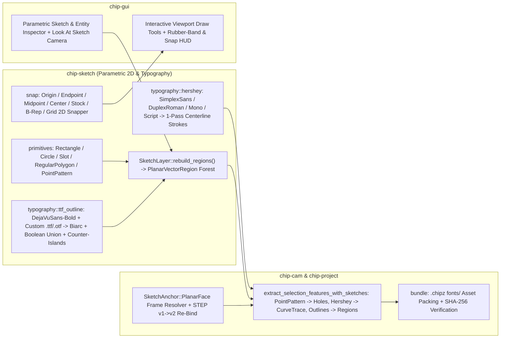

# ChipCutter — Milestone 8 Implementation Plan

## Goal Description
Implement **Milestone 8 (Interactive 2D Sketch Primitives, Associative Planar-Face Sketches, Snapping, & TrueType / Hershey CAM Typography)** from [10-roadmap.md](file:///workspace/ChipCutter/specs/10-roadmap.md#L58-L66), [11-sketches-vectors.md](file:///workspace/ChipCutter/specs/11-sketches-vectors.md), [02-cad-selection.md](file:///workspace/ChipCutter/specs/02-cad-selection.md), and [09-persistence-cli.md](file:///workspace/ChipCutter/specs/09-persistence-cli.md). Milestone 8 transforms `chip-sketch` from an import-only vector layer into a full parametric 2D CAM authoring & typography engine across both Pure-2D jobs (`models = []`) and 3D STEP jobs:

1. **Parametric 2D CAM Primitives & Associative `PlanarFace` Anchoring (`chip-sketch` & `chip-cam`):**
   - Expression-backed `Rectangle` (with exact `90°` corner fillet arcs), `Circle`, `Slot` (`CenterToCenter` / `OverallLength` stadium), `RegularPolygon` (`3..=64` sides, `Inscribed` / `Circumscribed` / `AcrossFlats` + corner fillets), transformable `Polyline`, and `PointPattern` (`Single`, `LinearGrid`, `BoltCircle` feeding directly into **Drilling & Helical Bore**).
   - Associative `SketchAnchor::PlanarFace` attaching 2D sketches onto 3D STEP faces with `GeometricSignature` re-binding on **Reload STEP Model (`v1 -> v2`)**.
2. **Dual-Mode CAM Typography (`ttf-parser` Outline Fonts + Public-Domain Hershey Single-Line Fonts):**
   - **TrueType / OpenType Outline Fonts:** Embed permissively licensed `DejaVuSans-Bold.ttf` (`Bitstream Vera / Public Domain`) for 100% cross-platform deterministic builds + support custom `.ttf`/`.otf` font files (bundled under `fonts/*` in `.chipz` archives), `kern`/`GPOS` pair kerning, alignment (`Left`/`Center`/`Right` × `Baseline`/`Middle`/`Top`), `cap_height` scaling, `mirror_x`, quadratic/cubic Bézier-to-biarc fitting, boolean union of overlapping glyphs, and automatic counter-island classification (`'A'`, `'B'`, `'O'`, `'8'`, `'e'`).
   - **Single-Line Engraving Fonts:** Embed public-domain NBS Hershey stroke tables (`HersheySimplexSans`, `HersheyDuplexRoman`, `HersheyMono`, `HersheyScript`) evaluating directly to 1-pass centerline `ArcPolyline2D` strokes for `ChamferTraceMode::CurveTrace` ("2D Curve Trace / Engraving") and `ContourCompensation::CenterOff`.
3. **2D Snapping Engine & Interactive Viewport Sketch Authoring (`chip-sketch` & `chip-gui`):**
   - Pure-Rust 2D snapping engine (`snap.rs`) snapping to Sketch Origin, Entity Endpoints/Midpoints/Centers, Stock Corners/Center, projected STEP B-Rep vertices/hole centers, and Grid increments.
   - Interactive viewport creation tools (`+ Rect`, `+ Circle`, `+ Slot`, `+ Polygon`, `+ Bolt Circle`, `+ Text`, `+ Sketch on 3D Face`), **Look At Active Sketch** orthographic alignment, live rubber-band + snap HUD badges, and a full parametric **Sketch & Entity Inspector** with Undo/Redo.

---

## Key Architectural Decisions & Scope Alignment

> [!IMPORTANT]
> **Zero-Bloat, Permissive Typography Stack (`ttf-parser = "0.25"`):**
> - `ttf-parser = "0.25"` (`MIT OR Apache-2.0`) has zero external C/system dependencies and parses `.ttf`/`.otf`/`kern`/`GPOS` tables in pure safe Rust.
> - Bundling unmodified `DejaVuSans-Bold.ttf` (with `DejaVuSans-Bold.LICENSE.txt`) ensures headless CLI builds (`chipcutter build`), `.chipz` bundles, and unit tests produce identical glyph geometry on Linux, macOS, and Windows without querying OS fontconfig registries.

> [!NOTE]
> **Keeping `chip-sketch` Decoupled from `monstertruck` (`chip-cad`):**
> - To keep `chip-sketch` ultra-fast to compile and independent of the 3D B-Rep kernel, `SketchAnchor::PlanarFace` stores a lightweight, serializable `SketchFaceBinding` (`body_id`, `last_face_index`, `normal_world`, `centroid_world_mm`, `area_mm2`, `loop_count`, `perimeter_mm`).
> - `chip-cam` resolves `SketchAnchor::PlanarFace` against `CadDocument` (and falls back cleanly to the stored `normal_world` + `centroid_world_mm` plane if cached), while `chip-project::reload` converts `SketchFaceBinding <-> SelectionBinding` to run `rematch_face` during associative STEP `v1 -> v2` reloads!

> [!TIP]
> **100% Backward-Compatible `schema_version = 2` TOML:**
> - Existing Milestone 7 `SketchEntity::Circle { center_xy, diameter }` and `SketchEntity::Polyline { polyline }` `.chip.toml` manifests deserialize losslessly via `#[serde(default)]` / serde compatibility helpers while upgrading `Circle` coordinates (`center_x`, `center_y`) to full `ParamLength` expressions (e.g., `center_x = "stock_x / 2"`).

---

## Architecture Overview

---

## Proposed Changes

### 1. Parametric 2D Primitives, Typography, & Snapping (`crates/chip-sketch`)

#### [MODIFY] [Cargo.toml](file:///workspace/ChipCutter/Cargo.toml) & [crates/chip-sketch/Cargo.toml](file:///workspace/ChipCutter/crates/chip-sketch/Cargo.toml)
- Add `ttf-parser = "0.25"` to `[workspace.dependencies]` and `crates/chip-sketch/Cargo.toml`.
- Embed `crates/chip-sketch/assets/DejaVuSans-Bold.ttf` and `DejaVuSans-Bold.LICENSE.txt`.

#### [MODIFY] [model.rs](file:///workspace/ChipCutter/crates/chip-sketch/src/model.rs) & [NEW] `crates/chip-sketch/src/primitives.rs`
- Extend `SketchAnchor`:
  - `SetupXy { setup_id: String, plane_ref: SketchPlaneRef, z_offset: ParamLength }`
  - `PlanarFace { face_binding: SketchFaceBinding, origin_mode: FaceSketchOriginMode, x_axis_clock_deg: f64, z_offset: ParamLength }` (`FaceSketchOriginMode`: `FaceCentroid` *(default)*, `SetupWcsProjected`).
- Expand `SketchEntity` to all 7 spec variants (`11-sketches-vectors.md`):
  1. `Rectangle { anchor: RectAnchorMode, x: ParamLength, y: ParamLength, width: ParamLength, height: ParamLength, corner_radius: ParamLength, rotation_deg: f64 }`
  2. `Circle { center_x: ParamLength, center_y: ParamLength, diameter: ParamLength }` (accepting legacy `center_xy: [f64; 2]` on deserialize)
  3. `Slot { mode: SlotLengthMode, x: ParamLength, y: ParamLength, length: ParamLength, width: ParamLength, angle_deg: f64 }`
  4. `RegularPolygon { center_x: ParamLength, center_y: ParamLength, sides: u32, sizing: PolygonSizingMode, diameter: ParamLength, corner_radius: ParamLength, rotation_deg: f64 }`
  5. `Polyline { polyline: ArcPolyline2D, translate_x: ParamLength, translate_y: ParamLength, scale: f64, rotation_deg: f64 }`
  6. `PointPattern(PointPatternSpec)` (`Single`, `LinearGrid`, `BoltCircle`) -> `evaluate_hole_points() -> Vec<HolePoint2D>`
  7. `Text(SketchTextSpec)`
- Add `SketchLayer::rebuild_regions(&mut self)` which evaluates all non-construction closed loops (plus TrueType text outline regions) and rebuilds `self.regions: Vec<PlanarVectorRegion>` with deterministic region IDs (`region_1`, `region_2`, …) and Even-Odd island pairing.

#### [NEW] `crates/chip-sketch/src/typography/mod.rs`, `ttf_outline.rs`, & `hershey.rs`
- **Outline Fonts (`ttf_outline.rs`):**
  - `SketchFontSource::BuiltinSansBold` + `SketchFontSource::CustomFile { path: String, sha256: String, face_index: u32 }`.
  - Extracts glyph `BezPath`s via `ttf_parser::OutlineBuilder`, applies `kern` / `GPOS` pair adjustments + `letter_spacing`, scales by `cap_height`, aligns multi-line text (`\n`) per `(TextHAlign, TextVAlign)`, applies `mirror_x` (for reverse/bottom-side acrylic engraving & V-inlays!) and `rotation_deg`, fits curves into `ArcPolyline2D`s via `fit_bezpath_to_arc_polylines`, boolean-unions overlapping script/kerned glyphs via `cavalier_contours`, and outputs `PlanarVectorRegion`s with exact counter-islands (`'A'`, `'B'`, `'O'`, `'8'`, `'e'`, etc.).
- **Single-Line Engraving Fonts (`hershey.rs`):**
  - `HersheyFontKind`: `SimplexSans`, `DuplexRoman`, `Mono`, `Script`.
  - Evaluates single-pass open/closed stroke `ArcPolyline2D`s scaled to `cap_height` with multi-line alignment, `letter_spacing`, `mirror_x`, and `rotation_deg`.

#### [NEW] `crates/chip-sketch/src/snap.rs`
- Pure-Rust 2D snapping engine (`SnapKind`: `Origin`, `Endpoint`, `Midpoint`, `Center`, `StockCorner`, `StockCenter`, `CadFeature`, `Grid`):
  - `snap_sketch_point_2d(query_xy: DVec2, ctx: &SketchSnapContext<'_>) -> SketchSnapResult` prioritizing geometric snaps within `snap_radius_mm` over grid snaps.

---

### 2. `PlanarFace` Sketch Frame Resolution & Feature Extraction (`crates/chip-cam`)

#### [MODIFY] [setup.rs](file:///workspace/ChipCutter/crates/chip-cam/src/setup.rs) & [selection.rs](file:///workspace/ChipCutter/crates/chip-cam/src/selection.rs)
- Update `resolve_sketch_world_frame(doc: &CadDocument, sketch: &SketchLayer, setup: &ResolvedSetup) -> Result<RigidFrame3, CamError>`:
  - For `SketchAnchor::PlanarFace`, resolve the planar B-Rep `FaceId` on `doc` (using `z_axis = face_normal_world`, clocked `x_axis` rotated by `x_axis_clock_deg`, and `origin` at `FaceCentroid` or `SetupWcsProjected` + `z_offset * z_axis`).
  - When extracting CAM features for a Setup, verify `|+Z_sketch · +Z_wcs| >= 0.999` (returning a clear `CamError::SketchNotAlignedWithSetupZ` if a tilted face sketch is selected inside a top-only Setup before orienting a matching Setup WCS!).
- Update `extract_selection_features_with_sketches`:
  - `PointPattern` -> emits ordered `ExtractedFeature25D::CylindricalHole`s (with `hole_d` populated!) + closed circle contours.
  - `Rectangle`, `Slot`, `RegularPolygon` -> emits closed `Contour` (with exact fillet/end arcs) + participates in `PlanarVectorRegion`s.
  - `Text` (**Outline** font) -> emits `PlanarFace` regions (outer glyph contour + `CW` counter-islands as `raised_islands_wcs`!) for **2D Pocket / Adaptive**, **2D Contour**, and upcoming **M9 V-Carving**.
  - `Text` (**Hershey Single-Line** font) -> emits centerline `ExtractedFeature25D::Contour` strokes for 1-pass engraving via **Edge Chamfer / 2D Curve Trace (`ChamferTraceMode::CurveTrace`)** or **2D Contour (`CenterOff`)**!
- Verify `chamfer_trace.rs` (`ChamferTraceMode::CurveTrace`): ensure `CurveTrace` accepts Chamfer Mills, Spot Drills, AND Flat/Ball Endmills when tracing 2D centerline strokes at `axial_offset` / `Bottom Height`!

---

### 3. Expression Re-Evaluation, STEP Reload Re-Binding, `.chipz` `fonts/`, & CLI (`crates/chip-project` & `crates/chip-cli`)

#### [MODIFY] [bundle.rs](file:///workspace/ChipCutter/crates/chip-project/src/bundle.rs), [reload.rs](file:///workspace/ChipCutter/crates/chip-project/src/reload.rs), [validation.rs](file:///workspace/ChipCutter/crates/chip-project/src/validation.rs), & [demos.rs](file:///workspace/ChipCutter/crates/chip-project/src/demos.rs)
- **Setup-Scoped Sketch Expression Evaluation:** Provide `reevaluate_project_sketches(project, cad_doc, custom_fonts)` so parametric entity expressions (`x = "stock_x / 2"`, `width = "stock_x - 10 mm"`) evaluate cleanly against resolved Setup dimensions.
- **Associative STEP Reload (`reload.rs`):** Re-bind `SketchAnchor::PlanarFace` via `rematch_face` when reloading revised STEP models (`v1 -> v2`), updating `last_face_index`, `centroid_world_mm`, and `area_mm2` (or emitting a clear reload warning if the host face was deleted).
- **`.chipz` Font Bundling (`bundle.rs`):** Pack custom `.ttf`/`.otf` files referenced by `SketchFontSource::CustomFile` into `fonts/<filename>` inside `.chipz` archives and verify their SHA-256 digests on unpack.
- **New Demo Job (`demos.rs`):** Add `build_engraved_nameplate_demo_project` featuring:
  - Parametric filleted `Rectangle` plaque + `PointPattern::BoltCircle` mounting holes (**Drilling**),
  - Raised/recessed TrueType Outline `Text` (`"CHIPCUTTER"` — **2D Pocket / Contour** preserving `'P'`/`'R'` counter-islands!),
  - Single-line `HersheySimplexSans` serial tag (`"S/N 2026-08"` — 1-pass **2D Curve Trace** engraving!),
  - Outer perimeter **2D Contour** with holding tabs!

---

### 4. Interactive Viewport Sketching, Snapping HUD, & Sketch Inspector (`crates/chip-gui`)

#### [NEW] `crates/chip-gui/src/panels/sketch_inspector.rs` & [MODIFY] `viewport_controller.rs`, `pane_behavior.rs`, `scene_builders.rs`, `browser.rs`, `menus_toolbar.rs`
- **Sketch Creation & Anchoring Workflow:**
  - In `CAM Browser -> 2D Sketches` & `Setup` menu: add **`+ New 2D Sketch (Setup XY)`**, **`+ Sketch on 3D Face`** (click any planar STEP face to anchor an associative `PlanarFace` sketch!), and **`Nameplate + Text`** demo button.
  - **`Look At Sketch` Button:** Orbits camera perpendicular to the active sketch's `+Z` normal and fits its XY/stock bounds in Orthographic view.
- **Interactive Viewport Authoring & 2D Snapping (`ViewportPickMode::SketchAuthor`):**
  - Tools: `Select`, `Rectangle (2-Click / Center)`, `Circle (Center-Radius)`, `Slot (Start-End-Width)`, `Polygon`, `Bolt Circle`, and `Place Text`.
  - Live rubber-band geometry overlay + cyan/amber **2D Snap Marker** (`[Origin]`, `[End]`, `[Mid]`, `[Center]`, `[Stock]`, `[B-Rep]`, `[Grid]`) and live `(X, Y)` sketch coordinate readout in the viewport HUD!
- **Parametric Entity Inspector (`sketch_inspector.rs`):**
  - Lists all entities on the active `SketchLayer` (`Visibility / Construction` toggle, `Duplicate`, `Delete`, reorder).
  - Expression inputs (`edit_param_length`) for every parametric dimension (`x`, `y`, `width`, `height`, `corner_radius`, `diameter`, `sides`, `bolt_circle_diameter`, `cap_height`, `letter_spacing`), multi-line text box, Font selector (`DejaVu Sans Bold (Built-In)`, `Browse .ttf/.otf…`, `Hershey Simplex Sans`, `Hershey Duplex Roman`, `Hershey Mono`, `Hershey Script`), `H/V Align`, and `Mirror X`, recording instant Undo/Redo snapshots and regenerating `PlanarVectorRegion`s live!

---

## Verification Plan

### Automated Unit & Integration Tests
1. **`chip-sketch` Primitives, Typography, & Snapping Tests (`crates/chip-sketch/src/lib.rs`):**
   - Verify `Rectangle` (filleted exact `90°` arcs), `Slot` (`180°` end arcs), `RegularPolygon` (`AcrossFlats` hex sizing: circumradius $= \frac{\text{AF}}{\sqrt{3}}$), and `PointPattern::BoltCircle` exact hole coordinates + Setup variable expression evaluation (`x = "stock_x / 2"`).
   - Verify TrueType Outline `Text` (`DejaVuSans-Bold`): `"B8O"` produces exact closed `PlanarVectorRegion`s with `2` interior `CW` counter-islands for `'B'`, `2` for `'8'`, and `1` for `'O'`, fitted with true circular arcs (`ArcSegment2D::Arc`), and overlapping kerned glyphs union cleanly without self-intersections!
   - Verify Hershey Single-Line `Text` (`HersheySimplexSans`, `HersheyMono`): produces open centerline stroke `ArcPolyline2D`s with non-zero perimeter and zero double-outline duplication, honoring `cap_height` and `mirror_x`.
   - Verify `snap_sketch_point_2d` snaps accurately to Origin, Endpoints, Midpoints, Arc Centers, Stock Corners, and Grid.
2. **`chip-cam` & `chip-project` Integration Tests:**
   - Verify `SketchAnchor::PlanarFace` resolves accurately on a 3D STEP face (including tilted face Setup alignment!) AND re-binds automatically across STEP `v1 -> v2` reload (`rebind_project_to_reloaded_cad`).
   - Verify `build_engraved_nameplate_demo_project` (`BoltCircle` Drilling + Outline Text Pocketing + Hershey 1-Pass `CurveTrace` Engraving + Filleted Rect Tabbed Profile) generates cleanly and passes `chip-sim` Heightfield Verification with **`0` critical crashes and `0` gouges**!
   - Verify `.chipz` bundles custom `.ttf` font assets under `fonts/*` with SHA-256 verification, and confirm all 5 v1 golden G-code files remain byte-for-byte identical.
3. **Workspace Quality Gates & Headless Vulkan Screenshot:**
   - `cargo fmt --all -- --check`
   - `cargo clippy --workspace --all-targets -- -D warnings` (`0` warnings, `0` `too_many_arguments`)
   - `cargo deny check`
   - `WGPU_BACKEND=vulkan cargo test --workspace`
   - `WGPU_BACKEND=vulkan xvfb-run -a cargo run -p chip-gui -- --demo-nameplate --self-test-screenshot .../m8_gui_preview.png` (visually inspected via `read_file`).
