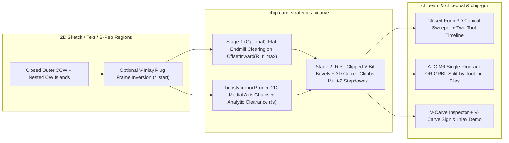

# ChipCutter — Milestone 9 Implementation Plan

## Goal Description
Implement **Milestone 9 (V-Carving, Flat-Bottom Two-Tool Clearance, V-Inlays, & v2 Release Hardening)** from [10-roadmap.md](file:///workspace/ChipCutter/specs/10-roadmap.md#L68-L78), [05-operations.md](file:///workspace/ChipCutter/specs/05-operations.md#L123-L145), [06-simulation.md](file:///workspace/ChipCutter/specs/06-simulation.md#L30-L61), and [07-post-processor.md](file:///workspace/ChipCutter/specs/07-post-processor.md)—completing the **ChipCutter v2** roadmap:

1. **Medial-Axis Variable-Depth V-Carving (`chip-cam` — `OperationKind::VCarve`):**
   - Pruned interior **Segment Voronoi / 2D Medial Axis Graph** (`boostvoronoi`) over closed outer + nested island regions (DXF/SVG logos, TrueType/OpenType text with counter-islands, and 3D STEP planar faces) with sub-micron analytic `ArcPolyline2D` clearance refinement.
   - Simultaneous 3-axis `(X, Y, Z)` V-bit toolpaths with razor-sharp corner-climb bisectors and multi-pass `max_stepdown` Z-layering.
2. **Flat-Bottom Clamping (`flat_depth`), Two-Stage Flat Clearance (`clearing_tool_id`), & V-Inlay Plugs:**
   - Optional `flat_depth` ($d_{\max}$) clamping wide strokes at $z_{\text{flat}} = z_{\text{top}} - d_{\max}$ while preserving crisp 3D corner-sharpening climbs.
   - Optional **Two-Stage Flat Endmill Area Clearance** (`clearing_tool_id`): Stage 1 clears wide flat pocket interiors with a Flat Endmill (`ContourParallel` or `Adaptive`); Stage 2 uses exact 2D Rest Machining (`swept_toolpath_coverage_2d`) so the V-Bit machines only the sloped bevel walls, tight unreached corners, and narrow medial strokes—seamlessly handled by `chip-sim` (3D cutter swap + `Color by Op`) and `chip-post` (ATC `M6` single-file and GRBL `split_files_by_tool` output).
   - **V-Inlay Male Plug Mode** (`start_depth` + `glue_gap_bottom` + `border_margin`) generating mated male inlay plugs that seat tightly into female V-carved cavities.
3. **Analytical Conical 3D Simulation, v2 Golden Snapshots, & Documentation (`chip-sim`, `chip-cli`, `chip-gui`, Docs):**
   - Exact closed-form stationary-point solver in `chip-sim`'s 3D sloped conical sweeper (eliminating discrete sampling ripples on 3D V-carve corner climbs), `Fine`/`Ultra` heightmap verification, new v2 golden G-code snapshots (while preserving 100% byte-for-byte parity on all 5 v1 golden files), V-Carve GUI inspector & `--demo-vcarve` showcase, and updated `README.md` / `ARCHITECTURE.md`.

---

## Key Architectural Decisions & Scope Alignment

> [!IMPORTANT]
> **First-Class Two-Stage Toolpath Representation (`ClearingSubToolpath`):**
> - Rather than forcing users to manually create and synchronize two fragile separate operations for flat-bottom V-carving, `GeneratedToolpath` carries an optional `clearing_stage: Option<Box<ClearingSubToolpath>>` (`tool_id`, `events`, `segments_wcs`, `stats`).
> - `collect_ready_setup_operations` in `chip-project::pipeline` expands a two-stage `VCarve` operation into ordered Stage 1 (`Flat Endmill`) $\to$ Stage 2 (`V-Bit`) execution items. As a result, `chip-sim` automatically simulates both 3D cutters in sequence (with ATC tool-change timing and per-stage stock coloring), and `chip-post` automatically emits `M6` tool changes on LinuxCNC/grblHAL or splits into numbered `_01_T1_...nc` + `_02_T7_...nc` files on vanilla GRBL!

> [!TIP]
> **Closed-Form Stationary Point $t^*$ for Sloped 3D Conical Sweeps (`chip-sim`):**
> - Along a 3D V-carve corner climb $P(t) = P_0 + t(P_1 - P_0)$ with conical flute slope $k = \cot(\theta)$, minimizing $z_{\text{cut}}(t) = z_0 + t\,\Delta z + k\bigl(\sqrt{d_\perp^2 + L_{xy}^2(t - t_c)^2} - r_{\text{tip}}\bigr)$ yields the exact analytical stationary parameter:
>   $$t^* = t_c - \frac{\operatorname{sign}(\Delta z)\,|\Delta z|\,d_\perp}{L_{xy}\sqrt{\max(0,\; k^2 L_{xy}^2 - \Delta z^2)}}$$
> - Evaluating $t^*$ in `sweeper.rs` produces smooth, scallop-free planar V-bevels in the 3D heightfield mesh at zero extra runtime cost.

> [!NOTE]
> **Starter Tool Library Compatibility (`T1`–`T6` Unchanged):**
> - Adding `T7` (`6mm 60° Carbide V-Bit`, `tip_diameter_mm = 0.0`, `included_angle_deg = 60.0`) at the end of `default_starter_tool_library()` preserves `starter.tools[0..=6]` (`T1`–`T6`) indices and presets, keeping every v1 unit test and golden G-code file 100% byte-identical.

---

## Architecture Overview

---

## Proposed Changes

### 1. Tool Classes, Starter V-Bit, & `OperationKind::VCarve` Model (`crates/chip-tools` & `crates/chip-cam`)

#### [MODIFY] [model.rs](file:///workspace/ChipCutter/crates/chip-tools/src/model.rs) & `starter.rs`
- Add `ToolOperationClass::VCarve` (supported by `CutterGeometry::ChamferMill` when `10.0 <= included_angle_deg <= 160.0`) and `ToolOperationClass::VCarveFlatClearance` (supported by `CutterGeometry::FlatEndmill`).
- Append `T7` (`"6mm 60° Carbide Engraving V-Bit"`, `diameter_mm = 6.0`, `tip_diameter_mm = 0.0`, `included_angle_deg = 60.0`, `flutes = 2`, Hardwood / Aluminum / Acrylic presets) to `default_starter_tool_library()`.

#### [MODIFY] [operation.rs](file:///workspace/ChipCutter/crates/chip-cam/src/operation.rs), [params.rs](file:///workspace/ChipCutter/crates/chip-cam/src/params.rs), & [toolpath.rs](file:///workspace/ChipCutter/crates/chip-cam/src/toolpath.rs)
- Add `OperationKind::VCarve` (`"V-Carve / Inlay"`).
- Add `VCarveParams` (`StrategyParams::VCarve(VCarveParams)`):
  - `flat_depth: Option<ParamLength>` (`None` = pure unlimited medial V-carve; `Some(d_max)` = flat-bottom clamped at `d_max` below `Top Height`),
  - `clearing_tool_id: Option<ToolId>` + `clearing_preset_id: Option<String>`,
  - `clearing_strategy: VCarveClearingKind` (`ContourParallel` *(default)* | `Adaptive`),
  - `clearing_radial_allowance: ParamLength` (default `0.05 mm` so the V-bit cleanly Kisses the floor-bevel junction),
  - `vbit_flat_stepover: ParamLength` (default `0.5 mm`, used when `flat_depth` is set without a secondary `clearing_tool_id`),
  - `inlay_mode: VCarveInlayMode`:
    - `Disabled` *(default — Female V-Carve Cavity)*,
    - `MalePlug { start_depth: ParamLength, glue_gap_bottom: ParamLength, border_margin: ParamLength }`.
- Add `pub clearing_stage: Option<Box<ClearingSubToolpath>>` (`#[serde(default, skip_serializing_if = "Option::is_none")]`) on `GeneratedToolpath` and pass `clearing_tool: Option<&Tool>` inside `OperationGenRequest`.

---

### 2. Medial-Axis V-Carve, Two-Stage Clearance, & V-Inlay Engine (`crates/chip-cam`)

#### [MODIFY] [medial.rs](file:///workspace/ChipCutter/crates/chip-cam/src/medial.rs) & [NEW] `crates/chip-cam/src/strategies/vcarve.rs`
- **Medial Axis Graph Extraction (`medial.rs`):**
  - Add `MedialChain2D { samples: Vec<MedialNode2D>, closed: bool }` and `extract_medial_axis_chains(region: &PocketRegion2D, chord_tol_mm: f64) -> Vec<MedialChain2D>`:
    - Builds integer-scaled `boostvoronoi` Segment Voronoi diagram over `outer_ccw` + `islands_cw`.
    - Filters strictly interior Voronoi edges, prunes reflex-vertex perpendicular artifact bisectors (edges originating at concave/reflex boundary vertices where boundary distance stays `0`), samples curved parabolic Voronoi edges, chains degree-2 nodes into continuous paths ordered by greedy nearest-endpoint traversal, and polishes every sample's `clearance_radius_mm = region.min_boundary_distance(pt)` against the exact `ArcPolyline2D` curves!
- **V-Carve & Flat-Bottom Strategy (`strategies/vcarve.rs`):**
  - Given V-bit half-angle $\theta = \frac{1}{2}\text{included\_angle}$ and tip radius $r_{\text{tip}} = \frac{1}{2} d_{\text{tip}}$:
  - **Pure Medial Mode (`flat_depth == None`):**
    - Maps each medial sample $(x, y, r)$ to $z_{\text{target}} = z_{\text{top}} - \frac{\max(0, r - r_{\text{tip}})}{\tan\theta}$.
    - When `multiple_depths` (`max_stepdown`) is enabled, emits progressive Z-clamped layers $z_{\text{layer}} = z_{\text{top}} - k \cdot \Delta z_{\max}$, skipping spans already completed at shallower layers so deep hardwood/aluminum carves never overload the V-bit!
  - **Flat-Bottom Clamped Mode (`flat_depth == Some(d_max)`):**
    - Computes $r_{\max} = d_{\max}\tan\theta + r_{\text{tip}}$ and flat floor $z_{\text{flat}} = z_{\text{top}} - d_{\max}$, splitting the region into:
      1. **Flat Core** $C_{\text{flat}} = \text{OffsetInward}(R,\; r_{\max})$:
         - If `clearing_tool_id` is `Some(flat_tool)`: generates **Stage 1 (`ClearingSubToolpath`)** clearing $\text{OffsetInward}(R,\; r_{\max} + \text{allowance})$ down to $z_{\text{flat}}$ using `ContourParallel` or `Adaptive`, then computes Stage 1's exact swept footprint $S_1 = \text{swept\_toolpath\_coverage\_2d}$ and leaves unreached flat corners $C_{\text{flat}} \setminus S_1$ for Stage 2 V-bit cleanup!
         - If `clearing_tool_id` is `None`: clears $C_{\text{flat}}$ with V-bit contour-parallel offsets at `vbit_flat_stepover`.
      2. **Sloped Bevel Perimeter + Narrow Medial Strokes + Sharp 3D Corner Climbs (Stage 2 V-Bit):**
         - Traces the exact $r_{\max}$ bevel wall at $z_{\text{flat}}$, emits medial-axis variable-depth strokes for all sub-spans where $r(s) \le r_{\max}$ (including diagonal 3D corner-climb bisectors rising smoothly from $(x_{\text{corner\_bevel}}, y_{\text{corner\_bevel}}, z_{\text{flat}})$ up to $(x_{\text{vertex}}, y_{\text{vertex}}, z_{\text{top}})$!).
  - **V-Inlay Male Plug Mode (`VCarveInlayMode::MalePlug`):**
    - Shifts artwork boundaries outward by $r_{\text{start}} = d_{\text{start}}\tan\theta + r_{\text{tip}}$ (matching the female cavity's cross-section at `start_depth`), constructs an enclosing rectangular/offset plug frame expanded by `border_margin`, inverts the shifted artwork into raised `CW` islands inside that frame, sets $d_{\max} = d_{\text{start}} + d_{\text{glue\_gap}}$, and runs the exact same Flat-Bottom + Two-Stage V-Carve pipeline!

---

### 3. Analytical Conical Sweeper, Two-Stage Pipeline, GUI, & v2 Hardening (`chip-sim`, `chip-project`, `chip-post`, `chip-cli`, `chip-gui`, Docs)

#### [MODIFY] [sweeper.rs](file:///workspace/ChipCutter/crates/chip-sim/src/heightmap/sweeper.rs)
- Add the exact closed-form conical stationary-point evaluation $t^*$ inside `SweepPrimitive::Line3D::eval_cutter_at_xy` for `RadialCutterProfile` conical flutes so sloped 3D V-carve climbs rasterize with analytical accuracy.

#### [MODIFY] [cache.rs](file:///workspace/ChipCutter/crates/chip-project/src/cache.rs), [dispatcher.rs](file:///workspace/ChipCutter/crates/chip-project/src/dispatcher.rs), [pipeline.rs](file:///workspace/ChipCutter/crates/chip-project/src/pipeline.rs), [validation.rs](file:///workspace/ChipCutter/crates/chip-project/src/validation.rs), & [demos.rs](file:///workspace/ChipCutter/crates/chip-project/src/demos.rs)
- Fold `clearing_tool_id` + embedded clearing tool definition into `OperationInputHash` (`cache.rs`), pass `clearing_tool` in `dispatcher.rs`, validate `clearing_tool_id` compatibility in `validation.rs`, and expand `ClearingSubToolpath` into ordered Stage 1 + Stage 2 items in `collect_ready_setup_operations` (`pipeline.rs`).
- Add `build_vcarve_sign_and_inlay_demo_project` in `demos.rs`: a Pure-2D sign & badge job featuring TrueType `"CHIPCUTTER"` + emblem **Two-Stage Flat-Bottom V-Carving** (`T1` `Ø6mm` Flat Endmill pocket clearance + `T7` `60°` V-Bit bevels & sharp serif/corner climbs) + a companion **Male V-Inlay Plug** setup (`Setup 2 — G55`).

#### [MODIFY] `crates/chip-gui` (`operation_inspector`, `browser.rs`, `menus_toolbar.rs`, `viewport_controller.rs`, `main.rs`) & Docs (`README.md`, `ARCHITECTURE.md`)
- Add `+ V-Carve / Bevel Inlay` to `Operations` menu and `CAM Browser` Setup bar, V-Carve parameter editors (`Flat Depth`, `Secondary Flat Clearing Tool` dropdown + automatic `ensure_tool_embedded`, `Clearing Strategy`, and `V-Inlay Male Plug` controls) in `passes_tab.rs`, Stage 1 + Stage 2 viewport toolpath rendering, `V-Carve Sign` demo button, and `--demo-vcarve` CLI flag.
- Add v2 golden G-code snapshots (`crates/chip-cli/tests/golden/v2_*.{nc,ngc}`) tested in `cli_end_to_end.rs`, and update [README.md](file:///workspace/ChipCutter/README.md) & [ARCHITECTURE.md](file:///workspace/ChipCutter/ARCHITECTURE.md) to document the full 9-crate v2 architecture, CLI subcommands, and feature set.

---

## Verification Plan

### Automated Unit, Simulation, & Golden Snapshot Tests
1. **Medial-Axis & V-Carve Geometric Invariants (`crates/chip-cam`):**
   - **Exact Square Corner Climb:** On a `20 × 20 mm` square with a `90°` V-bit ($\theta = 45^\circ$, $d_{\text{tip}} = 0$), verify the 4 corner bisectors climb linearly at $45^\circ$ all the way to $z_{\text{top}}$ at the 4 corners (`err < 0.01 mm`) and reach $z = z_{\text{top}} - 10.0\text{ mm}$ at the center `(0, 0)`.
   - **Two-Stage Flat-Bottom Cycle Savings & Coverage:** On bold TrueType text (`"B8O"`, `cap_height = 36 mm`, `flat_depth = 2.0 mm`) with `T1` (`Ø6 mm` Flat Endmill) + `T7` (`60°` V-Bit), verify Stage 1 clears the wide interior core, Stage 2 Rest-Machines the bevels + tight corners + `'B'`/`'8'`/`'O'` counter-islands, and combined `chip-sim` `Fine` (`1024`) verification reports **`0` critical crashes, `0` gouges**, and uniform `-2.0 mm` flat floors!
   - **V-Inlay Mating Geometry:** Verify `VCarveInlayMode::MalePlug` (`start_depth = 2.0 mm`, `glue_gap_bottom = 0.5 mm`) offsets plug walls outward by exact $r_{\text{start}} = 2.0 \tan\theta$ and cuts down to `-(2.0 + 0.5) = -2.5 mm` with `0` sim crashes.
2. **Post-Processor & Golden G-Code Suite (`crates/chip-cli/tests/cli_end_to_end.rs`):**
   - Verify two-stage `VCarve` emits a single `M6`-switched `.ngc` file on `linuxcnc` and splits cleanly into `_01_T1_...nc` (Flat Clearance) + `_02_T7_...nc` (`60°` V-Bit) on `grbl` (`<= 80` chars/line).
   - Verify new v2 golden G-code snapshots (`Adaptive + Rest` & `Two-Tool V-Carve`) AND confirm all **5 v1 golden G-code snapshots** remain **100% byte-for-byte identical**.
3. **Final v2 Release Quality Gates & Headless Vulkan Screenshot:**
   - `cargo fmt --all -- --check`
   - `cargo clippy --workspace --all-targets -- -D warnings` (`0` warnings, `0` `too_many_arguments`)
   - `cargo deny check`
   - `WGPU_BACKEND=vulkan cargo test --workspace`
   - `WGPU_BACKEND=vulkan xvfb-run -a cargo run -p chip-gui -- --demo-vcarve --self-test-screenshot .../m9_gui_preview.png` (visually inspected via `read_file`).
