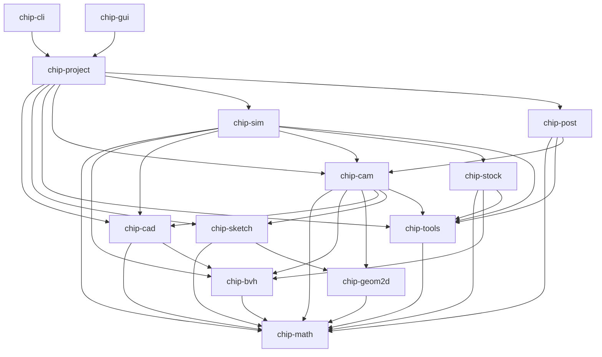
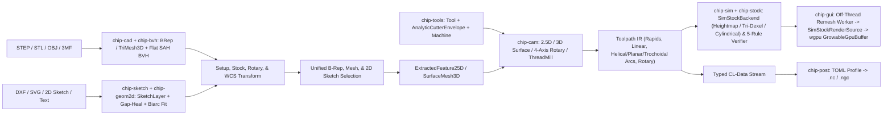

# 01 — System Architecture & Workspace Design

## Architectural Principles
1. **UI-Agnostic Core:** All CAD loading, spatial BVH indexing, exact 2D geometry, 2D sketch/vector processing, volumetric stock kernels, coordinate transforms, toolpath generation, simulation, and post-processing live in standalone library crates with zero `egui` or `wgpu` dependencies (except optional future GPU compute behind an explicit feature flag). Both the desktop GUI and headless CLI consume the exact same engine.
2. **Canonical `f64` Millimeter Kernel:** Every internal coordinate, vector, tolerance, arc radius, and feedrate (mm/min) is stored and computed in `f64` millimeters. Unit conversion happens strictly at UI display/input boundaries, DXF/SVG/mesh import boundaries, and post-processor emission (`G20` vs `G21`).
3. **True Arc Preservation:** 2D boundaries, Bézier biarc fits (`kurbo`), parallel offsets (`cavalier_contours` via `chip-geom2d`), trochoidal peel arcs, helical bores, helical thread mills, and lead-ins preserve analytic line and circular arc segments (`ArcPolyline2D`) all the way through Cutter Location (CL) output so controllers receive smooth `G2`/`G3` moves rather than faceted micro-segments.
4. **CAD-Agnostic Strategy & Stock Boundaries:** `chip-cam` 2.5D strategies operate exclusively on canonical WCS `ExtractedFeature25D` geometry—never directly on 3D `CadDocument` topology—allowing 3D STEP B-Rep selections and 2D `chip-sketch` vector/text entities to share identical machining algorithms. Likewise, `chip-stock` volumetric stock kernels depend only on `chip-math`, `chip-bvh`, and `chip-tools` (zero `chip-cad` or `chip-cam` dependency), breaking any future `chip-cam` ↔ `chip-sim` cycle for 3D rest machining and multi-setup (`G54` → `G55`) stock carryover.
5. **GPU-Compute-Ready Flat Data Layouts & Zero-Copy Rendering:** Spatial BVH nodes (`FlatBvhNode` 32-byte `Pod`, `GpuTriangle` 48-byte `Pod` in `chip-bvh`), volumetric stock buffers (flat fixed-`K` Tri-Dexel span pools, stock-local `f32` heightfield/cylindrical grids, `u32` operation provenance tags in `chip-stock`), and simulation mesh vertices (`SimColoredVertex` `#[repr(C)] bytemuck::Pod`) use tightly-packed GPU-compatible layouts. `chip-sim` drives stock updates through the batched `SimStockBackend` trait (`CpuExactBackend` default, plug-in point for a future `WgpuComputeBackend`), while `chip-gui` consumes `SimStockRenderSource` (`CpuMesh { revision, mesh, stock_model }` now, extensible to `GpuGrid`) via reusable `GrowableGpuBuffer` uploads and GPU `stock_model` rotary transforms.
6. **Explicit Dirty-State, DAG Computation, & Non-Blocking UI:** Document edits mutate lightweight parametric specs instantly (enabling `< 1 ms` Undo/Redo with zero idle document clones) and mark dependent operations (including downstream `FromPrecedingOperations` Rest Machining consumers) `Dirty`. Heavy toolpath generation runs only on explicit user action (`Ctrl+G` or CLI build) over a `rayon` thread pool with cancellation tokens, and interactive simulation stock scrubbing/remeshing runs on a coalescing background worker off the `egui` UI thread.
7. **Permissive Dependency Hygiene:** Enforced via `cargo-deny` (`MIT`, `Apache-2.0`, `BSD-2-Clause`, `BSD-3-Clause`, `MPL-2.0`, `BSL-1.0`, `ISC`, `Zlib`, `Unicode-3.0`; `GPL`/`LGPL`/`AGPL` denied by default).

---

## Cargo Workspace Layout (13 Crates)
```text
ChipCutter/
├── Cargo.toml                  # Workspace root + shared dependency versions (13 crates)
├── deny.toml                   # License & advisory enforcement
├── specs/                      # Living design specifications
├── plans/                      # Sequential milestone implementation plans (M1..M51+)
├── posts/                      # Built-in TOML post-processor profiles (grbl, grblhal_atc, linuxcnc, 4-axis)
├── machines/                   # Reference TOML machine definitions (generic, milo, carvera, voron-cascade)
└── crates/
    ├── chip-math/              # Canonical f64 mm units, tolerances, transforms, 2D line/arc primitives, expression parser
    ├── chip-bvh/               # Pure flat-array binary SAH BVH (FlatBvhNode/GpuTriangle Pod), TriMesh3D raycast/closest-point/slab queries
    ├── chip-geom2d/            # Pure exact 2D arc-polyline offsetting, RegionSet2D booleans/sweeps/nesting, Voronoi medial axis, RDP
    ├── chip-tools/             # Tool geometry, AnalyticCutterEnvelope, material presets, machine definitions, Fusion 360 importer
    ├── chip-cad/               # CadKernel trait, `monstertruck` STEP loader, STL/OBJ/3MF mesh loaders, B-Rep topology & BVH picking
    ├── chip-sketch/            # 2D Sketch Layers, parametric shapes, DXF/SVG importers, gap-healing, TrueType & Hershey text
    ├── chip-stock/             # Pure volumetric stock kernels (HeightfieldStock, flat-pool axis-generic TriDexelStock, CylindricalStock), SimStockBackend, meshers, metrology
    ├── chip-cam/               # Setups, WCS, 2.5D feature extraction, 2.5D/3D/Rotary/ThreadMill strategies, Adaptive, Rest, V-Carve, CL IR
    ├── chip-sim/               # Simulation driver, trapezoidal cycle-time timeline, CAD target adapters, 3D cutter mesh, 5-rule crash/gouge verifier
    ├── chip-post/              # TOML post-processor engine, modal state machine, G93/G94 & quadrant-arc expansion, G-code formatter
    ├── chip-project/           # `.chip.toml` & `.chipz` serialization, DAG JobDispatcher, ToolpathCache, Undo/Redo history, built-in demos
    ├── chip-cli/               # Headless CLI binary (`chipcutter`)
    └── chip-gui/               # `eframe` + `wgpu` + `egui_tiles` desktop application, SimStockRenderSource, off-thread remesh worker
```

---

## Crate Dependency Graph


---

## End-to-End Data Pipeline


---

## Units, Precision, & Expression Engine (`chip-math`)
- **Internal Storage:**
  - Length: `f64` (`1.0 == 1.0 mm`)
  - Angle: `f64` radians internally, degrees in serialized TOML and UI
  - Linear Feed: `f64` (`mm/min`)
  - Spindle Speed: `f64` (`RPM`)
- **Geometric Tolerances:**
  - Curve chaining / coincidence epsilon: `1e-4 mm` (`0.1 µm`)
  - DXF/SVG import gap-healing join tolerance: configurable per import, default `0.05 mm`
  - Bézier-to-biarc / toolpath arc fitting tolerance: configurable, default `0.01 mm` (`0.0004 in`)
  - 3D viewport tessellation chord tolerance: default `0.02 mm` (visual + ray-picking mesh only)
- **Inline Expression & Mixed-Unit Evaluator:**
  - Parameter fields store both the raw user expression string (optional, e.g., `"1/4 in"`, `"tool_d * 0.2"`, `"stock_x / 2"`) and the resolved `f64` millimeter value.
  - Supported unit suffixes: `mm`, `cm`, `in` / `"` (inch), `mil` / `thou` (`0.0254 mm`), `deg`, `rpm`, `mm/min`, `ipm`, `m/min`, `sfm`.
  - Scoped variables available per operation:
    - Tool scope: `tool_d` (diameter), `tool_r` (radius), `flute_len`, `flutes`, `tip_angle`
    - Setup scope: `stock_x`, `stock_y`, `stock_z`, `model_top_z`, `model_bottom_z`
    - Feature scope: `feature_top_z`, `feature_bottom_z`, `hole_d`

---

## Concurrency, DAG Ordering, & Non-Blocking Remeshing Model
- **UI Thread (`chip-gui`):** Never runs STEP/STL/OBJ/3MF/DXF/SVG parsing, tessellation, polygon offsetting, Voronoi construction, simulation sweeps, or interactive stock remeshing synchronously.
- **Background Worker Pool (`chip-project`):** `rayon` thread pool managed by a central `JobDispatcher` in `chip-project`.
- **Two-Wave / Topological DAG Execution:**
  - Independent operations within a Setup generate concurrently across `rayon` workers.
  - Operations using `RestMachiningMode::FromPrecedingOperations` (or two-stage V-Carve flat-endmill + V-bit clearing) execute in topological dependency waves after their upstream roughing toolpaths complete and expose their 2D swept coverage polygons.
  - If the user modifies an operation (or one of its upstream Rest dependencies) while generating, in-flight cancellation tokens abort obsolete work and return affected operations to `Dirty`.
- **Coalescing Off-Thread Stock Remeshing (`chip-gui`):**
  - `panels/simulation/worker.rs` owns the mutable playback `SimulatedStock` (`Heightfield`, `TriDexel`, or `Cylindrical`) on a dedicated background worker thread.
  - Rapid interactive timeline scrubs coalesce via a latest-wins pending slot so stale intermediate frames are skipped without blocking `egui` frames, publishing monotonic `SimStockRenderSource::CpuMesh { revision, mesh: Arc<SimStockMesh>, stock_model }` updates (while rotary angle-only air slews update `stock_model` on the GPU with zero CPU re-tessellation or GPU buffer re-upload).
  - Headless `--capture-*` screenshot automation uses a deterministic synchronous flush (`resolve_viewport_visuals_sync`) so captured frames never render blank or lagged stock.

---

## Core Third-Party Crate Selection
| Responsibility | Crate(s) | License |
|---|---|---|
| GUI Shell & Docking | `eframe`, `egui`, `egui-wgpu`, `egui_tiles`, `rfd` | MIT / Apache-2.0 |
| 3D GPU Rendering & Zero-Copy Pod | `wgpu`, `bytemuck`, `glam` (f32 GPU / f64 math bridge) | MIT / Apache-2.0 |
| STEP & B-Rep Kernel | `monstertruck-io` (`step`), `monstertruck-modeling`, `monstertruck-meshing` | Apache-2.0 |
| 2D Vector, Bézier, & Typography | `dxf` (DXF), `usvg` (SVG), `kurbo` (Bézier/biarc), `skrifa` (TTF/OTF) | MIT / Apache-2.0 |
| 2D Offsetting & Medial Axis (`chip-geom2d`) | `cavalier_contours` (arc-aware booleans/offsets), `boostvoronoi` (segment Voronoi) | MIT / Apache-2.0 / BSL-1.0 |
| Spatial Queries & Hashing | `chip-bvh` (flat SAH BVH), `rstar` (2D sketch R-tree), `sha2`, `zip`, `dirs` | MIT / Apache-2.0 |
| Serialization, Parallelism, & CLI | `serde`, `toml`, `serde_json`, `rayon`, `crossbeam-channel`, `clap` | MIT / Apache-2.0 |
