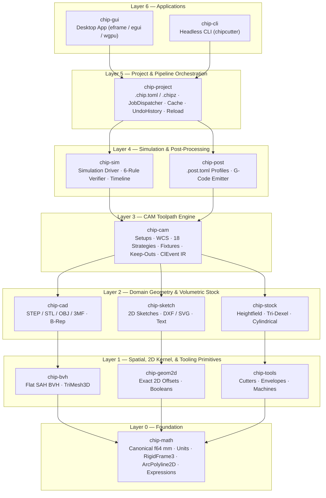
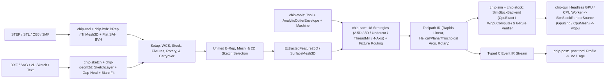

# 01 — System Architecture & Workspace Design

## Architectural Principles
1. **UI-Agnostic Core, Feature-Gated GPU Compute, & Safety Lints:** All CAD loading, spatial BVH indexing, exact 2D geometry, 2D sketch/vector processing, volumetric stock kernels, coordinate transforms, toolpath generation, simulation, and post-processing live in standalone Rust 2024 library crates with zero `egui` dependency. `chip-stock`, `chip-sim`, and `chip-project` remain 100% pure-CPU by default (zero `wgpu` dependency), exposing an optional `gpu-compute` feature (`dep:wgpu` + `dep:pollster` in `chip-stock`, propagated through `chip-sim` and `chip-project`, and enabled by default in `chip-cli` and `chip-gui`, including `chip-gui`'s `flatpak-portal` feature) that automatically falls back to exact CPU execution whenever no compute adapter is available. Both the desktop GUI (`chip-gui`) and headless CLI (`chipcutter`) consume the exact same engine, and workspace lints enforce `unsafe_code = "deny"`, `clippy::unwrap_used = "deny"`, and `clippy::expect_used = "deny"` across all crates.
2. **Canonical `f64` Millimeter Kernel:** Every internal coordinate, vector, tolerance, arc radius, and feedrate (`mm/min`) is stored and computed in `f64` millimeters. Unit conversion happens strictly at UI display/input boundaries, DXF/SVG/mesh import boundaries, and post-processor emission (`G20` vs `G21`).
3. **True Arc Preservation & Typed CL Boundary:** 2D boundaries, Bézier biarc fits (`kurbo`), parallel offsets (`cavalier_contours` via `chip-geom2d`), trochoidal peel arcs, helical bores, helical thread mills, and lead-ins preserve analytic line and circular arc segments (`ArcPolyline2D`) all the way through the typed `ClEvent` Cutter Location IR (`chip-cam` never emits G-code strings) so controllers receive smooth `G2`/`G3` moves via `chip-post`.
4. **CAD-Agnostic Strategy & Stock Boundaries:** `CadKernel` isolates `monstertruck-*` strictly inside `chip-cad`. `chip-cam` 2.5D strategies operate exclusively on canonical WCS `ExtractedFeature25D` geometry—never directly on 3D `CadDocument` topology—allowing 3D STEP B-Rep selections and 2D `chip-sketch` vector/text entities to share identical machining algorithms. Likewise, `chip-stock` volumetric stock kernels depend only on `chip-math`, `chip-bvh`, and `chip-tools` (zero `chip-cad` or `chip-cam` dependency), enabling `chip-cam` to consume `TriDexelStock` directly for multi-setup (`G54` → `G55`) and in-setup indexed rotary 3D rest carryover without creating a `chip-cam` ↔ `chip-sim` runtime cycle (`chip-sim` is a `dev-dependency` of `chip-cam` for test verification only).
5. **GPU-Compute Flat Data Layouts, Device Isolation, & Direct GPU Stock Rendering:** Spatial BVH nodes (`FlatBvhNode` 32-byte `Pod`, `GpuTriangle` 48-byte `Pod` in `chip-bvh`), volumetric stock buffers (flat fixed-`K = 4` `FlatDexelSpan` pools with rare overflow side-table in `TriDexelStock`, stock-local `f32` heightfield/cylindrical grids, `u32` operation provenance tags in `chip-stock`), and simulation mesh vertices (`SimColoredVertex` `#[repr(C)] bytemuck::Pod`) use tightly-packed GPU-compatible layouts. `chip-sim` drives stock updates through the batched `SimStockBackend` trait (`CpuExactBackend` and optional `gpu-compute` `WgpuComputeBackend`). To keep `eframe`'s presentation `wgpu::Device` strictly main-thread-only (preventing `Surface::configure` resize timeouts), background compute sweeps run on an isolated headless `GpuSimContext::shared_headless()`, while `chip-gui` consumes `SimStockRenderSource`:
   - `SimStockRenderSource::GpuGrid { revision, handle, stock_model, color_mode, mesh_skinning }` uploads flat stock snapshots onto the main-thread presentation `GpuSimContext::from_shared` via `GpuStockRenderHandle::from_simulated_stock` (zero CPU mesh tessellation) and renders Heightfield/Cylindrical grids procedurally in WGSL vertex shaders and Tri-Dexel surfaces via GPU compute `tridexel_emit.wgsl` → compact 32-byte `PackedTriDexelQuad` + `draw_indirect`, with `< 0.1 ms` `SimStockVisualUniformsGpu` updates (and `< 0.3 ms` Tri-Dexel GPU re-emission) on color mode, `±tol` Error Heatmap, or crease-preserving `mesh_skinning` changes.
   - `SimStockRenderSource::CpuMesh { revision, mesh, stock_model }` uploads CPU-tessellated meshes via `GrowableSimIndexedMeshGpu` (reusable vertex/index `GrowableGpuBuffer` pools) with GPU `stock_model` rotary transforms when running `CpuExactBackend`.
6. **Explicit Dirty-State, DAG Computation, & Non-Blocking UI:** Document edits mutate lightweight parametric specs instantly (enabling 100-step `< 1 ms` coalescing Undo/Redo via `UndoHistory` with zero idle document clones) and mark dependent operations—including downstream `FromPrecedingOperations` rest consumers and multi-setup / indexed rotary `TriDexelStock` carryover consumers—`Dirty`. Heavy toolpath generation runs only on explicit user action (`Ctrl+G` or CLI `build`) over a `rayon` thread pool with `Arc<AtomicBool>` cancellation tokens, and interactive simulation stock scrubbing/remeshing runs on a coalescing background `StockRemeshWorker` off the `egui` UI thread.
7. **Permissive Dependency Hygiene & Read-Only Built-In Presets:** Enforced via `cargo-deny` (`deny.toml` allows `MIT`, `MIT-0`, `Apache-2.0`, `Apache-2.0 WITH LLVM-exception`, `BSD-2-Clause`, `BSD-3-Clause`, `ISC`, `Zlib`, `MPL-2.0`, `Unicode-3.0`, `Unicode-DFS-2016`, `CC0-1.0`, `BSL-1.0`, `0BSD`, plus the `epaint_default_fonts` font exception `OFL-1.1` / `Ubuntu-font-1.0`; `GPL`/`LGPL`/`AGPL` and wildcard dependencies are denied, and workspace unmaintained advisories are checked). Compiled-in machine definitions and post-processor profiles are strictly read-only and cannot be shadowed by project or user files; user customizations live in OS user config space (`dirs::config_dir()/chipcutter/`).

---

## Cargo Workspace Layout (13 Crates)
```text
ChipCutter/
├── Cargo.toml                  # Workspace root, lints, & shared dependency versions (13 crates, Rust 2024)
├── deny.toml                   # License, wildcard, & advisory enforcement
├── specs/                      # Living design specifications
├── plans/                      # Sequential milestone implementation plans (M1..M83+)
├── posts/                      # 6 built-in TOML post-processor profiles (grbl, grbl_rotary_wrap, grblhal_atc, grblhal_4axis, linuxcnc, linuxcnc_4axis)
├── machines/                   # 7 built-in TOML machine definitions (generic, milo-1.5, milo-2.0, voron-cascade, carvera, carvera-air, carvera-z1)
└── crates/
    ├── chip-math/              # Canonical f64 mm units, tolerances, RigidFrame3, 2D line/arc primitives, expression parser
    ├── chip-bvh/               # Pure flat-array binary SAH BVH (FlatBvhNode/GpuTriangle Pod), TriMesh3D & SegmentBvh spatial queries
    ├── chip-geom2d/            # Pure exact 2D arc-polyline offsetting, RegionSet2D booleans/sweeps/nesting, Voronoi medial axis, RDP
    ├── chip-tools/             # 10 CutterGeometry variants, AnalyticCutterEnvelope, SFM/chipload presets, 7 built-in machines, Fusion 360 importer
    ├── chip-cad/               # CadKernel trait, `monstertruck` STEP + periodic-seam loader, STL/OBJ/3MF loaders, ModelTransform, B-Rep topology, BVH picking, rematch
    ├── chip-sketch/            # 2D Sketch Layers, parametric shapes, DXF/SVG importers, gap-healing, TrueType (`skrifa`) & Hershey text, snapping
    ├── chip-stock/             # Pure volumetric stock kernels (HeightfieldStock, TriDexelStock + rigid transfer, CylindricalStock), GPU BVH/metrics/emit, SimStockBackend
    ├── chip-cam/               # Setups, WCS, 18 strategies (2.5D, 3D Surface, Undercut/Deburr, ThreadMill, 4-Axis Rotary), 3D workholding & safe-rapid avoidance, Flip-Jig/Soft-Jaw wizards, feed optimization, ClEvent IR
    ├── chip-sim/               # Simulation driver, SimProgressTracker, stage timing, trapezoidal timeline, CAD target adapters, 3D cutter mesh, 6-rule verifier (incl. FixtureCollision)
    ├── chip-post/              # 6 built-in + user TOML post profiles, modal state machine, G93/G94, swapped-axis wrap, quadrant-arc/drill expansion, comment sanitization
    ├── chip-project/           # `.chip.toml` (schema_version = 3, auto-migrating v1/v2) & `.chipz` archives, associative reload, multi-setup/rotary carryover pipeline, DAG JobDispatcher, ToolpathCache, UndoHistory, demos
    ├── chip-cli/               # Headless CLI binary (`chipcutter`, 14 subcommands, default `gpu-compute` with CPU fallback)
    └── chip-gui/               # `eframe` + `wgpu` + `egui_tiles` desktop app (`gtk3` + `gpu-compute` default, `flatpak-portal`), ViewportRenderer, off-thread StockRemeshWorker, `prefs.toml`, headless `--capture-*`
```

**Feature Flags:**
- `chip-stock`: `default = []`, `gpu-compute = ["dep:wgpu", "dep:pollster"]`
- `chip-sim`: `default = []`, `gpu-compute = ["chip-stock/gpu-compute"]`
- `chip-project`: `default = []`, `gpu-compute = ["chip-sim/gpu-compute"]`
- `chip-cli`: `default = ["gpu-compute"]`, `gpu-compute = ["chip-sim/gpu-compute", "chip-project/gpu-compute"]`
- `chip-gui`: `default = ["gtk3", "gpu-compute"]`, `gtk3 = ["rfd/gtk3"]`, `flatpak-portal = ["rfd/xdg-portal", "rfd/async-std", "gpu-compute"]`, `gpu-compute = ["chip-sim/gpu-compute", "chip-project/gpu-compute"]`

---

## Layered Crate Architecture

> **Dependency Rule:** Components may only depend on components in **strictly lower layers** (never on peers in the same layer or components in higher layers). Arrows above indicate the primary layer progression; higher layers may also import types directly from any lower layer (for example, `chip-cam` and `chip-gui` also depend directly on `chip-math` and `chip-tools`). `chip-cam` uses `chip-sim` strictly as a `[dev-dependency]` for verification tests (no runtime cycle).

---

## End-to-End Data Pipeline


---

## Units, Precision, & Expression Engine (`chip-math`)
- **Internal Storage:**
  - Length: `f64` (`1.0 == 1.0 mm`)
  - Angle: `f64` radians internally, degrees in serialized TOML and UI
  - Linear Feed: `f64` (`mm/min`)
  - Spindle Speed: `f64` (`RPM`)
- **Geometric Tolerances:**
  - Analytic B-Rep surface/curve classification (`ANALYTIC_CLASSIFY_TOL_MM`): `1e-5 mm` (`0.01 µm`)
  - Curve chaining / coincidence epsilon (`COINCIDENCE_TOL_MM`): `1e-4 mm` (`0.1 µm`)
  - DXF/SVG import gap-healing join tolerance: configurable per import, default `0.05 mm`
  - Bézier-to-biarc / toolpath arc fitting tolerance (`DEFAULT_ARC_FIT_TOL_MM`): configurable, default `0.01 mm` (`0.0004 in`)
  - 3D viewport tessellation chord tolerance (`DEFAULT_TESS_CHORD_TOL_MM`): default `0.02 mm` (visual + ray-picking mesh only)
- **Inline Expression & Mixed-Unit Evaluator (`chip-math::expr`):**
  - Parameter fields (`ParamLength`) store both the optional raw user expression string (e.g., `"1/4 in"`, `"tool_d * 0.2"`, `"stock_x / 2"`) and the resolved `f64` millimeter value.
  - Supported expression unit suffixes:
    - Length: `mm` (`millimeter`/`millimeters`), `cm` (`centimeter`/`centimeters`), `m` (`meter`/`meters`), `um` (`micron`/`microns`), `in` / `"` (`inch`/`inches`), `mil` / `mils` / `thou` (`0.0254 mm`)
    - Angle: `deg` (`degree`/`degrees`), `rad` (`radian`/`radians`)
  - Built-in constant & functions: `pi`, `abs`, `sqrt`, `sin`, `cos`, `tan`, `min`, `max` (guarded by `MAX_EXPR_DEPTH = 64` and `MAX_EXPR_TOKENS = 4_096`).
  - Feedrate (`mm/min` ↔ `ipm`), surface speed (`m/min` ↔ `SFM`), and chipload (`mm/tooth` ↔ `in/tooth`) unit conversions are handled by `DisplayUnit` at UI display/input, import, and post-processor boundaries.
  - Scoped variables available per operation (`EvalContext`):
    - Tool scope: `tool_d` (diameter), `tool_r` (radius), `flute_len`, `flutes`, `tip_angle` (radians)
    - Setup scope: `stock_x`, `stock_y`, `stock_z`, `model_top_z`, `model_bottom_z`, plus `rotary_radius` and `rotary_clearance_r` when 4th-axis rotary mode is enabled
    - Feature scope: `feature_top_z`, `feature_bottom_z`, `hole_d`

---

## Persistence, Bundles, & User Configuration
- **Project Manifest (`.chip.toml`):** Deterministic TOML (`ProjectDocument`, `schema_version = 3`, with lossless auto-migration from `schema_version = 1` and `2`). Stores lightweight parametric references, embedded tool snapshots, `ModelEntry` items (`ModelRole::Part` vs. `ModelRole::Fixture`, optional `unit_override` for meshes, non-destructive `ModelTransform`), `SketchLayer`s, and `Setup`s (WCS, stock, 3D workholding fixtures, rotary config, `carryover_from_setup_id`, operations) with zero embedded binary meshes.
- **Portable Archives (`.chipz`):** Zip-slip-hardened, deterministic ZIP bundles (`MAX_CHIPZ_UNPACK_BYTES = 256 MiB`, `MAX_CHIPZ_ENTRIES = 1_024`) containing `project.chip.toml`, `models/*` (STEP/STL/OBJ/3MF target parts and fixtures), `vectors/*` (DXF/SVG sources), `fonts/*` (custom TTF/OTF files), custom `posts/*.post.toml`, and custom `machines/*.machine.toml`.
- **OS User Configuration Space (`dirs::config_dir()/chipcutter/`):**
  - `prefs.toml` — cross-session `chip-gui` preferences (`theme`, `default_units`, `default_machine_id`, camera/orbit presets, simulation engine/resolution/backend/`sim_mesh_skinning`, docking shares, recent files).
  - `default.tools.toml` — global `chip-tools` library.
  - `machines/*.machine.toml` — user-cloned or imported custom machine definitions (never shadowing built-in machine IDs).
  - `posts/*.post.toml` — user custom post-processor profiles (never shadowing built-in post IDs).

---

## Concurrency, DAG Ordering, & Non-Blocking Remeshing Model
- **UI Thread (`chip-gui`):** Never runs STEP/STL/OBJ/3MF/DXF/SVG parsing, tessellation, polygon offsetting, Voronoi construction, simulation sweeps, or interactive stock remeshing synchronously.
- **Background Worker Pool & Content-Addressed Cache (`chip-project`):** `rayon` thread pool managed by a central `JobDispatcher` communicating over `crossbeam-channel` with epoch guards, `Arc<AtomicBool>` cancellation tokens, and `GenerationProgressSnapshot` reporting. `ToolpathCache` keys every generated toolpath by a deterministic SHA-256 `OperationInputHash` over CAD revision, model hashes, Setup WCS/stock/heights/fixtures, sketches, primary + secondary `clearing_tool`, operation parameters, recursive upstream rest hashes, and carryover digests.
- **Topological DAG Execution:**
  - Independent operations within a Setup generate concurrently across `rayon` workers.
  - Operations using `RestMachiningMode::FromPrecedingOperations` (or two-stage V-Carve flat-endmill + V-bit clearing) execute in topological dependency waves after their upstream roughing toolpaths complete and expose their 2D swept coverage polygons.
  - Multi-setup carryover (`Setup::carryover_from_setup_id`) and in-setup indexed rotary carryover automatically wait for upstream toolpaths, simulate the upstream state into a `TriDexelStock` (`compute_setup_carryover_stock` / `compute_in_setup_carryover_stock`, transferring across Setup WCS frames via `chip-stock/src/tridexel/transfer.rs`), and feed the resulting stock into downstream 3D rest operations.
  - If the user modifies an operation (or any upstream rest/carryover dependency) while generating, `cancel_stale_jobs` aborts obsolete in-flight work and returns affected operations to `Dirty`.
- **Coalescing Off-Thread Stock Scrubbing & Direct GPU Rendering (`chip-gui`):**
  - `panels/simulation/worker.rs` (`StockRemeshWorker`) owns the mutable playback state on a dedicated background worker thread: either an isolated headless compute `WgpuComputeBackend` (`GpuSimContext::shared_headless()`) + VRAM-bounded `GpuCheckpointCache` (when GPU compute is active) or a CPU `SimulatedStock` (`Heightfield`, `TriDexel`, or `Cylindrical`). Full-setup background simulations likewise run on `GpuSimContext::shared_headless()`, keeping `eframe`'s presentation `wgpu::Device` strictly main-thread-only.
  - Rapid interactive timeline scrubs coalesce via a latest-wins pending slot so stale intermediate frames are skipped without blocking `egui` frames:
    - **GPU Direct Path (`SimStockRenderSource::GpuGrid`):** The worker restores GPU checkpoints via `copy_buffer_to_buffer`, dispatches only the short tail-delta sweep on the headless compute device, and publishes a flat `StockRemeshPayload::GpuStockSnapshot(Arc<SimulatedStock>)` to the UI thread. The UI thread uploads those flat buffers onto the presentation device (`GpuSimContext::from_shared`) via `GpuStockRenderHandle::from_simulated_stock` (zero CPU mesh tessellation), rendered by `SimGpuStockRenderer` using procedural vertex-displaced WGSL pipelines (Heightfield / Cylindrical) or indirect-draw `tridexel_emit.wgsl` 32-byte `PackedTriDexelQuad` buffers—with instant `< 0.1 ms` WGSL visual uniform updates (and `< 0.3 ms` Tri-Dexel GPU re-emission) when toggling `color_mode`, `±tol` Error Heatmap, or `mesh_skinning`.
    - **CPU Exact Path (`SimStockRenderSource::CpuMesh`):** The worker publishes monotonic `StockRemeshPayload::CpuMesh(Arc<SimStockMesh>)` updates uploaded via `GrowableSimIndexedMeshGpu` (`GrowableGpuBuffer` vertex/index pools), while rotary angle-only air slews update `stock_model` on the GPU with zero CPU re-tessellation.
  - Headless `--capture-*` screenshot automation uses a deterministic synchronous flush (`resolve_viewport_visuals_sync` + `flush_remesh_sync` + `device.poll(wgpu::PollType::wait_indefinitely())`) so captured frames never render blank or lagged stock.

---

## Core Third-Party Crate Selection
| Responsibility | Crate(s) | License |
|---|---|---|
| GUI Shell, Docking, & Dialogs | `eframe`, `egui`, `egui-wgpu`, `egui_tiles`, `rfd`, `winit` (Linux X11) | MIT / Apache-2.0 |
| 3D GPU Rendering, Compute, & Imaging | `wgpu`, `bytemuck`, `glam`, `pollster`, `image` (PNG) | MIT / Apache-2.0 / Zlib |
| STEP & B-Rep Kernel | `monstertruck-io` (`step`), `monstertruck-modeling`, `monstertruck-meshing`, `monstertruck-topology` | Apache-2.0 |
| 2D Vector, Bézier, & Typography | `dxf` (DXF), `usvg` (SVG), `kurbo` (Bézier/biarc), `skrifa` (TTF/OTF) | MIT / Apache-2.0 |
| 2D Offsetting & Medial Axis (`chip-geom2d`) | `cavalier_contours` (arc-aware booleans/offsets), `boostvoronoi` (segment Voronoi) | MIT / Apache-2.0 / BSL-1.0 |
| Spatial Queries, Hashing, & Packaging | `chip-bvh` (flat SAH BVH), `rstar` (2D sketch R-tree), `sha2`, `zip`, `dirs` | MIT / Apache-2.0 |
| Serialization, Parallelism, Errors, & CLI | `serde`, `toml`, `serde_json`, `rayon`, `crossbeam-channel`, `clap`, `thiserror`, `tracing`, `tracing-subscriber` | MIT / Apache-2.0 |
