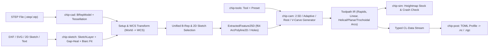

# 01 — System Architecture & Workspace Design

## Architectural Principles
1. **UI-Agnostic Core:** All CAD loading, 2D sketch/vector processing, coordinate transforms, toolpath generation, simulation, and post-processing live in pure-Rust library crates with zero `egui` or `wgpu` dependencies. Both the desktop GUI and headless CLI consume the exact same engine.
2. **Canonical `f64` Millimeter Kernel:** Every internal coordinate, vector, tolerance, arc radius, and feedrate (mm/min) is stored and computed in `f64` millimeters. Unit conversion happens strictly at UI display/input boundaries, DXF/SVG import boundaries, and post-processor emission (`G20` vs `G21`).
3. **True Arc Preservation:** 2D boundaries, Bézier biarc fits (`kurbo`), parallel offsets (`cavalier_contours`), trochoidal peel arcs, helical bores, and lead-ins preserve analytic line and circular arc segments (`ArcPolyline2D`) all the way through Cutter Location (CL) output so controllers receive smooth `G2`/`G3` moves rather than faceted micro-segments.
4. **CAD-Agnostic 2.5D Strategy Boundary:** `chip-cam` strategies operate exclusively on canonical WCS `ExtractedFeature25D` geometry—never directly on 3D `CadDocument` topology—allowing 3D STEP B-Rep selections and 2D `chip-sketch` vector/text entities to share identical machining algorithms.
5. **Explicit Dirty-State & DAG Computation:** Document edits mutate lightweight parametric specs instantly (enabling cheap Undo/Redo) and mark dependent operations (including downstream `FromPrecedingOperations` Rest Machining consumers) `Dirty`. Heavy toolpath generation runs only on explicit user action (`Ctrl+G` or CLI build) over a `rayon` thread pool with cancellation tokens.
6. **Permissive Dependency Hygiene:** Enforced via `cargo-deny` (`MIT`, `Apache-2.0`, `BSD-2-Clause`, `BSD-3-Clause`, `MPL-2.0`, `BSL-1.0`, `ISC`, `Zlib`, `Unicode-3.0`; `GPL`/`LGPL`/`AGPL` denied by default).

---

## Cargo Workspace Layout
```text
ChipCutter/
├── Cargo.toml                  # Workspace root + shared dependency versions
├── deny.toml                   # License & advisory enforcement
├── specs/                      # Living design specifications
├── plans/                      # Sequential milestone implementation plans (M1..M9)
├── posts/                      # Built-in TOML post-processor profiles (grbl, grblhal_atc, linuxcnc)
└── crates/
    ├── chip-math/              # Units, f64 tolerances, transforms, 2D line/arc primitives, expression parser
    ├── chip-cad/               # CadKernel trait, `monstertruck` STEP loader, B-Rep topology IDs, tessellation, reload matching
    ├── chip-sketch/            # (v2) 2D Sketch Layers, parametric shapes, DXF/SVG importers, gap-healing, TrueType & Hershey text
    ├── chip-tools/             # Tool geometry, material presets, SFM/chipload & chip-thinning math, Fusion 360 JSON importer
    ├── chip-cam/               # Setups, WCS, 2.5D feature extraction, 6 operation strategies, Adaptive, Rest Machining, V-Carve, CL IR
    ├── chip-sim/               # Motion time estimator, 2.5D heightmap dexel stock removal, crash/gouge verifier
    ├── chip-post/              # TOML post-processor engine, modal state machine, G-code formatter
    ├── chip-project/           # `.chip.toml` & `.chipz` serialization, pipeline service, DAG dirty-state graph, Undo/Redo history
    ├── chip-cli/               # Headless CLI binary (`chipcutter`)
    └── chip-gui/               # `eframe` + `wgpu` + `egui_tiles` desktop application
```

---

## End-to-End Data Pipeline


---

## Units, Precision, & Expression Engine (`chip-math`)
- **Internal Storage:**
  - Length: `f64` (`1.0 == 1.0 mm`)
  - Angle: `f64` radians internally, degrees in serialized TOML and UI
  - Linear Feed: `f64` (`mm/min`)
  - Spindle Speed: `f64` (`RPM`)
- **Geometric Tolerances:**
  - Curve chaining / coincidence epsilon: `1e-4 mm` (`0.1 µm`)
  - DXF/SVG import gap-healing join tolerance: configurable per import, default `0.05 mm`
  - Bézier-to-biarc / toolpath arc fitting tolerance: configurable, default `0.01 mm` (`0.0004 in`)
  - 3D viewport tessellation chord tolerance: default `0.02 mm` (visual + ray-picking mesh only)
- **Inline Expression & Mixed-Unit Evaluator:**
  - Parameter fields store both the raw user expression string (optional, e.g., `"1/4 in"`, `"tool_d * 0.2"`, `"stock_x / 2"`) and the resolved `f64` millimeter value.
  - Supported unit suffixes: `mm`, `cm`, `in` / `"` (inch), `mil` / `thou` (`0.0254 mm`), `deg`, `rpm`, `mm/min`, `ipm`, `m/min`, `sfm`.
  - Scoped variables available per operation:
    - Tool scope: `tool_d` (diameter), `tool_r` (radius), `flute_len`, `flutes`, `tip_angle`
    - Setup scope: `stock_x`, `stock_y`, `stock_z`, `model_top_z`, `model_bottom_z`
    - Feature scope: `feature_top_z`, `feature_bottom_z`, `hole_d`

---

## Concurrency, DAG Ordering, & Cancellation Model
- **UI Thread (`chip-gui`):** Never runs STEP/DXF/SVG parsing, tessellation, polygon offsetting, Voronoi construction, or heightmap simulation synchronously.
- **Background Worker Pool:** `rayon` thread pool managed by a central `JobDispatcher` in `chip-project`.
- **Two-Wave / Topological DAG Execution:**
  - Independent operations within a Setup generate concurrently across `rayon` workers.
  - Operations using `RestMachiningMode::FromPrecedingOperations` (or two-stage V-Carve flat-endmill + V-bit clearing) execute in topological dependency waves after their upstream roughing toolpaths complete and expose their 2D swept coverage polygons.
  - If the user modifies an operation (or one of its upstream Rest dependencies) while generating, in-flight cancellation tokens abort obsolete work and return affected operations to `Dirty`.

---

## Core Third-Party Crate Selection
| Responsibility | Crate(s) | License |
|---|---|---|
| GUI Shell & Docking | `eframe`, `egui`, `egui-wgpu`, `egui_tiles`, `rfd` | MIT / Apache-2.0 |
| 3D GPU Rendering | `wgpu`, `bytemuck`, `glam` (f32 GPU / f64 math bridge) | MIT / Apache-2.0 |
| STEP & B-Rep Kernel | `monstertruck-io` (`step`), `monstertruck-modeling`, `monstertruck-meshing` | Apache-2.0 |
| 2D Vector, Bézier, & Typography *(v2)* | `dxf` (DXF), `usvg` (SVG), `kurbo` (Bézier/biarc), `ttf-parser` (TTF/OTF) | MIT / Apache-2.0 |
| 2D Offsetting & Medial Axis | `cavalier_contours` (arc-aware booleans/offsets), `boostvoronoi` *(v2)* (segment Voronoi) | MIT / Apache-2.0 / BSL-1.0 |
| Spatial Queries & Hashing | `rstar` (R-tree spatial index), `sha2`, `zip`, `dirs` | MIT / Apache-2.0 |
| Serialization, Parallelism, & CLI | `serde`, `toml`, `serde_json`, `rayon`, `crossbeam-channel`, `clap` | MIT / Apache-2.0 |
