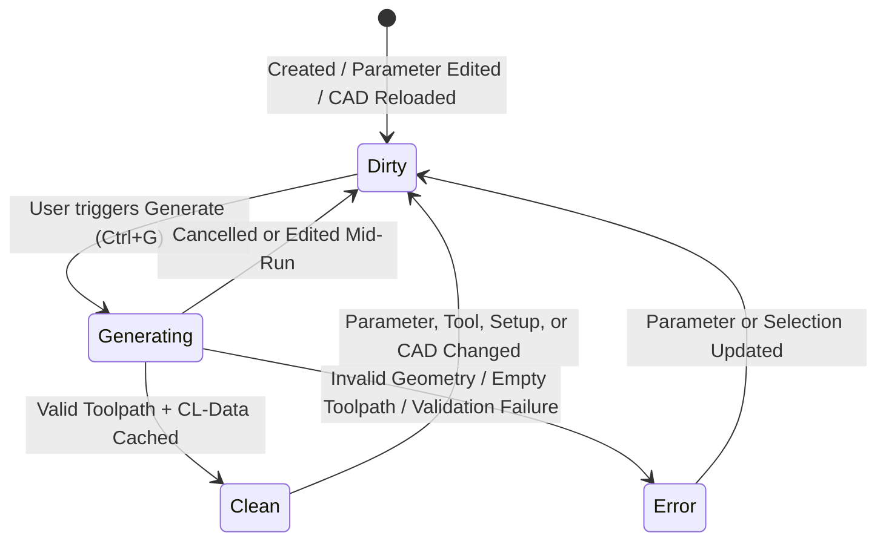

# 05 — 2.5D Machining Operations & Toolpath Algorithms

## Operation Lifecycle & Common Architecture (`chip-cam`)

### Explicit State Machine

- Operations can also be toggled **Suppressed / Enabled** (suppressed operations are skipped during toolpath generation, simulation, and G-code post-processing).
- Operations inside a Setup can be reordered via drag-and-drop in the CAM tree.

### Common Operation Parameters
Every 2.5D operation shares five standardized parameter groups:
1. **Tool & Feeds/Speeds:** Selected `ToolId`, optional `PresetId`, and local overrides (`RPM`, `feed`, `plunge`, `ramp`, `lead`, `coolant`).
2. **Geometry:** Ordered list of B-Rep selections (`FaceId`, `LoopId`, `EdgeId`, `CylinderHole`) with chain direction arrows and side flip toggles visible in the 3D viewport.
3. **Heights:** `Clearance`, `Retract`, `Feed`, `Top`, and `Bottom` Z heights (each referencing Setup planes, Selection, Stock, or Model + signed offset expression).
4. **Passes:** Multiple Z stepdowns (`max_stepdown`, optional `even_stepdowns` boolean), `stock_to_leave_radial`, `stock_to_leave_axial`, and finishing pass parameters.
5. **Linking:** Safe retract policy (`Full Clearance`, `Minimum Retract`), entry strategy (plunge, linear ramp, helical ramp, pre-drilled entry point), and horizontal/vertical lead-in & lead-out arcs/lines.

---

## v1 Operation Specifications

### 1. Facing
Surfaces the top of the stock down to a flat target Z face (typically `Model Top`).
- **Geometry:** Defaults automatically to the Setup's XY Stock boundary (or a selected planar face boundary).
- **Parameters:**
  - `pass_direction_deg` (default `0°` along X, or auto along longest stock axis)
  - `stepover` (default `0.7 * tool_d`)
  - `pass_extension` (distance cutter center extends past stock edge before turning around, default `0.55 * tool_d`)
  - `cut_mode`: `Both Ways (Zig-Zag)` with smooth U-turn `G2`/`G3` linking arcs *(default)* | `One Way (Climb)` | `One Way (Conventional)`
  - `max_stepdown` & optional `finishing_stepdown`

---

### 2. 2D Contour / Profile
Cuts along closed loops or open edge chains on the outside, inside, or centerline.
- **Compensation:** Computer-calculated (`Left / Climb`, `Right / Conventional`, `Center / Off`) using exact tool radius + `stock_to_leave_radial`. *(Optional `Wear` cutter compensation flag `G41`/`G42` metadata in CL-data for LinuxCNC).*
- **Passes:**
  - **Depth Passes:** `max_stepdown` (with `even_stepdowns` option) OR continuous **Spiral Ramp** around closed contours.
  - **Side Roughing + Finishing:** `roughing_passes` count + `roughing_stepover`, followed by optional `finish_passes` at `finish_stepover` and `finish_feedrate`, plus `repeat_finish_pass` (spring pass).
- **Entry & Exit (Lead-In / Lead-Out):**
  - Horizontal lead-in arc (`radius`, `sweep_angle_deg`) + linear tangent segment, plus vertical lead-in arc.
  - Overlap distance at contour seam (`overlap_mm`, default `0.5 mm`) so lead-in/lead-out witnesses blend cleanly.
  - Linear ramp along contour (`ramp_angle_deg`, default `2°–3°`) when plunging into closed slots without side clearance.
- **Holding Tabs (Bridges):**
  - **Placement Mode:**
    - `Automatic` (by tab count or target spacing along perimeter, automatically avoiding tight corners and arcs smaller than `2 * tool_d`).
    - `Manual Interactive` (click anywhere on the 3D contour edge in the viewport to add/drag/remove tab anchors; persisted as normalized parameter `s ∈ [0, 1]` + 3D point signature).
  - **Tab Profile:**
    - `Rectangular` (`width`, `height` measured up from Bottom Z): cutter retracts vertically, crosses tab, plunges vertically.
    - `Triangular / Ramped` (`width`, `height`, `ramp_angle`): smooth 3D linear Z-ramp up to tab apex and back down—eliminating dwell marks, plunge shock, and wood burning.

---

### 3. 2D Pocket
Clears flat-bottomed enclosed cavities (with arbitrary nested islands) and open-edge pockets/steps.
- **2D Offset Engine:** Built on `cavalier_contours` (`Polyline<f64>` with bulge factors `tan(θ/4)`), preserving true circular arcs through inward/outward parallel offsets and boolean clipping.
- **Clearing Strategies (behind `PocketStrategy` trait):**
  1. **Contour-Parallel Offset *(Default)*:**
     - Computes offset rings inward from pocket outer boundary and outward from island boundaries, organized into an **Offset Region Tree** so disconnected sub-pockets clear completely before retracting.
     - Orders passes Inside-Out (default for closed pockets after helical center entry) or Outside-In (default when entering from an open stock edge).
     - Smooth tangent transition moves between adjacent offset rings to avoid sharp `90°` stepover spikes.
  2. **Zig-Zag / Raster Clearing:**
     - Parallel linear scanlines at `pass_angle_deg` clipped against the offset pocket boundary, followed by a contour cleanup perimeter pass.
  *(Note: `PocketStrategy` trait takes `(BoundaryWithIslands, Tool, EngagementParams) -> Vec<PocketPass2D>` so constant-engagement Adaptive/Trochoidal clearing drops in cleanly in v2.)*
- **Open-Edge Pockets:**
  - Edges touching air/stock exterior are tagged `open`: the boundary is extended outward by `tool_r + overhang` along open segments, allowing the cutter to enter horizontally from outside the stock at full depth without helical plunging!
- **Closed-Pocket Entry:**
  - **Helical Ramp *(Default)*:** Automatically locates the largest inscribed circle inside each pocket region (via medial/offset pole), checks `helix_diameter` against `min_ramp_diameter`, and spirals down at `ramp_angle_deg` before expanding outward. Falls back automatically to linear profile ramp if pocket is narrower than min helix diameter (or errors if smaller than `tool_d`).

---

### 4. Drilling & Helical Bore Milling
Machines cylindrical holes selected from the STEP B-Rep (or explicit hole centers), sorted automatically via nearest-neighbor / 2-opt TSP path ordering to minimize rapid travel.

#### A. Drilling Modes (when `tool_d == hole_d` or spot drilling)
- **Spot / Simple Drill:** Plunge straight to Bottom Z at `plunge_feedrate`, optional `dwell_seconds`, rapid retract (`G81`/`G82` or expanded `G1`/`G0`).
- **Chip-Breaking Partial Retract:** Step by `peck_depth`, retract modestly (`chip_break_retract`, e.g., `0.5 mm`) to snap stringy chips (`G73` or expanded).
- **Deep-Hole Full Peck Drill:** Step by `peck_depth` (with optional decreasing peck factor & minimum peck), full rapid retract to `Retract` / `Feed` plane to evacuate flutes, rapid back to `previous_z + clearance` before feeding (`G83` or expanded).
- **Drill Tip Breakthrough Compensation:** Optional toggle adding `(tool_d / 2) / tan(point_angle / 2) + breakthrough_extra` so the full diameter clears through-holes.

#### B. Helical Bore Milling (when using an endmill with `tool_d < hole_d`)
- Essential when machining arbitrary metric/imperial hole sizes + counterbores with a single endmill!
- Helically interpolates (`G2`/`G3` with simultaneous `Z` feed) at radius `R_path = (hole_d - tool_d) / 2 - stock_to_leave_radial` using `pitch_per_rev` (or `ramp_angle_deg`), performs a flat `360°` cleanup circle at `Bottom Z`, optional radial finish pass + spring pass, and arcs smoothly toward hole center before `G0` retracting so the cutter never drags up the finished bore wall.
- For wide bores (`hole_d > 2 * tool_d - overlap`), automatically steps radially outward from a central helical core so no uncut pin is left in the middle!

---

### 5. Edge Chamfering & 2D Curve Trace / Engraving
Uses a Chamfer Mill / Spot Drill / V-Bit (or Ball/Flat endmill for Trace).

#### A. Edge Chamfer
- **Two Selection Modes:**
  1. **Sharp Unmodeled CAD Edge:** User selects sharp `90°` top edges on the STEP model and specifies desired `chamfer_width` (e.g., `0.5 mm`) and `tip_offset` (how far past the edge bottom the V-tip sits so cutting happens cleanly mid-flute rather than at the zero-speed tip).
  2. **Modeled `45°` (or angled) Chamfer Face/Lower Edge:** User selects the modeled chamfer face or bottom edge; `chamfer_width` is inferred directly from the B-Rep face geometry, and `tip_offset` positions the cutter flute along the sloped face.
- **Kinematics:** Given tool `included_angle = 2θ`, `tip_diameter`, `chamfer_width = w`, and `tip_offset = d_tip`:
  - `axial_drop = w / tan(θ) + d_tip`
  - `radial_offset = (tip_diameter / 2.0) + d_tip * tan(θ)` (when offsetting from the upper chamfer edge).
- Includes basic adjacent-wall collision check against vertical bosses if `tip_offset` would plunge into a floor.

#### B. 2D Curve Trace / Engraving
- Follows 3D/2D selected B-Rep edges on-center (`Compensation = Off` or `Left`/`Right`) with `axial_offset` depth below the curve, multiple stepdowns, and lead-in/out—ideal for scribing alignment marks, O-ring grooves, or slot channels.
