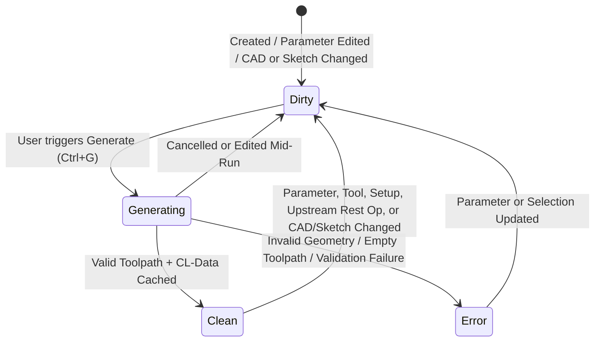

# 05 — 2.5D Machining Operations & Toolpath Algorithms

## Operation Lifecycle & Common Architecture (`chip-cam`)

### Explicit State Machine

- Operations can also be toggled **Suppressed / Enabled** (suppressed operations are skipped during toolpath generation, simulation, Rest Machining coverage, and G-code post-processing).
- Operations inside a Setup can be reordered via drag-and-drop in the CAM tree (automatically marking downstream `FromPrecedingOperations` Rest Machining operations `Dirty` when cut order changes).

### Common Operation Parameters
Every 2.5D operation shares five standardized parameter groups:
1. **Tool & Feeds/Speeds:** Selected `ToolId`, optional `PresetId`, and local overrides (`RPM`, `feed`, `plunge`, `ramp`, `lead`, `coolant`).
2. **Geometry:** Ordered list of selections from either **3D STEP B-Rep topology** (`FaceId`, `LoopId`, `EdgeId`, `CylinderHole`) or **2D `SketchLayer` entities** (`SketchRegionId`, `SketchEntityId`, `SketchPointPattern`), all normalizing into CAD-agnostic `ExtractedFeature25D` primitives with chain direction arrows and side flip toggles visible in the viewport.
3. **Heights:** `Clearance`, `Retract`, `Feed`, `Top`, and `Bottom` Z heights (each referencing Setup planes, Selection, Stock, or Model + signed offset expression).
4. **Passes:** Multiple Z stepdowns (`max_stepdown`, optional `even_stepdowns` boolean), `stock_to_leave_radial`, `stock_to_leave_axial`, **Rest Machining** configuration (on Pocket/Adaptive, Contour, and V-Carve), opt-in `avoid_model_overhangs` 3D overhang avoidance on 2.5D strategies (`false` by default for byte-identical legacy projects), and finishing pass parameters.
5. **Linking:** Safe retract policy (`Full Clearance`, `Minimum Retract`), entry strategy (plunge, linear ramp, helical ramp, open-air side entry), and horizontal/vertical lead-in & lead-out arcs/lines.

---

## Operation Specifications

### 1. Facing
Surfaces the top of the stock down to a flat target Z face (typically `Model Top` or `WCS Origin`).
- **Geometry & Cutting Area (`MachiningBoundaryConfig` — *Phase 22*):** Uses the shared `MachiningBoundaryConfig` (`StockBounds` *(default)*, `ModelSilhouette` via true projected 2D mesh silhouette, or `SelectedRegions` clipping facing scanlines to exact selected planar face polygons + raised islands instead of collapsing selections to an `Aabb2`), paired with `ToolContainmentMode` (`ToolOutsideBoundary` default for clean edge roll-off, `ToolCenterOnBoundary`, `ToolInsideBoundary`) and signed `boundary_offset`.
- **Parameters:**
  - `pass_direction_deg` (default `0°` along X, or auto along longest stock axis)
  - `stepover` (default `0.7 * tool_d`)
  - `pass_extension` (distance cutter center extends past stock edge before turning around, default `0.55 * tool_d`)
  - `cut_mode`: `Both Ways (Zig-Zag)` with smooth U-turn `G2`/`G3` linking arcs *(default)* | `One Way (Climb)` | `One Way (Conventional)`
  - `max_stepdown` & optional `finishing_stepdown`

---

### 2. 2D Contour / Profile
Cuts along closed loops or open chains (from 3D B-Rep edges or 2D Sketch curves) on the outside, inside, or centerline.
- **Cutting Area Controls (*Phase 22*):** Supports optional `clip_to_stock_bounds` (clipping generated 2D profile toolpaths strictly within the Setup Stock XY footprint) and `open_chain_extension` (tangentially extending open profile start/end segments past stock edges for clean lead-in/lead-out entry).
- **Compensation:** Computer-calculated (`Left / Climb`, `Right / Conventional`, `Center / Off`) using exact tool radius + `stock_to_leave_radial`. *(Optional `Wear` cutter compensation flag `G41`/`G42` metadata in CL-data for LinuxCNC).*
- **Passes:**
  - **Depth Passes:** `max_stepdown` (with `even_stepdowns` option) OR continuous **Spiral Ramp** around closed contours.
  - **Side Roughing + Finishing:** `roughing_passes` count + `roughing_stepover`, followed by optional `finish_passes` at `finish_stepover` and `finish_feedrate`, plus `repeat_finish_pass` (spring pass).
  - **Corner Rest Machining:** When Rest Machining is enabled on a 2D Contour, restricts profiling/multipass roughing solely to tight inside corners and narrow channels left uncut by the larger reference tool or preceding roughing operations (entering and exiting each corner segment via smooth tangential arcs).
- **Entry & Exit (Lead-In / Lead-Out):**
  - Horizontal lead-in arc (`radius`, `sweep_angle_deg`) + linear tangent segment, plus vertical lead-in arc.
  - Overlap distance at contour seam (`overlap_mm`, default `0.5 mm`) so lead-in/lead-out witnesses blend cleanly.
  - Linear ramp along contour (`ramp_angle_deg`, default `2°–3°`) when plunging into closed slots without side clearance.
- **Holding Tabs (Bridges):**
  - **Placement Mode:**
    - `Automatic` (by tab count or target spacing along perimeter, automatically avoiding tight corners and arcs smaller than `2 * tool_d`).
    - `Manual Interactive` (click anywhere on the 3D/2D contour edge in the viewport to add/drag/remove tab anchors; persisted as normalized parameter `s ∈ [0, 1]` + 3D point signature).
  - **Tab Profile:**
    - `Rectangular` (`width`, `height` measured up from Bottom Z): cutter retracts vertically, crosses tab, plunges vertically.
    - `Triangular / Ramped` (`width`, `height`, `ramp_angle`): smooth 3D linear Z-ramp up to tab apex and back down—eliminating dwell marks, plunge shock, and wood burning.

---

### 3. 2D Pocket & 2D Adaptive Clearing
Clears flat-bottomed enclosed cavities (with arbitrary nested islands) and open-edge pockets/steps/shoulders.
- **2D Offset Engine:** Built on `cavalier_contours` (`Polyline<f64>` with bulge factors `tan(θ/4)`), preserving true circular arcs through inward/outward parallel offsets and boolean operations.
- **Clearing Strategies (`PocketStrategy`):**
  1. **Contour-Parallel Offset *(Default for Traditional 2D Pocket)*:**
     - Computes offset rings inward from pocket outer boundary and outward from island boundaries, organized into an **Offset Region Tree** so disconnected sub-pockets clear completely before retracting.
     - Orders passes Inside-Out (default for closed pockets after helical center entry) or Outside-In (default when entering from an open stock edge).
     - Smooth tangent transition moves between adjacent offset rings to avoid sharp `90°` stepover spikes.
  2. **Zig-Zag / Raster Clearing:**
     - Parallel linear scanlines at `pass_angle_deg` clipped against the offset pocket boundary, followed by a contour cleanup perimeter pass.
  3. **Adaptive / Trochoidal Clearing *(v2 High-Efficiency Milling — exposed in UI as both `PocketStrategy::Adaptive` and top-level `2D Adaptive` toolbar shortcut)*:**
     - Designed for deep axial engagement (`max_stepdown` typically `1.0x–2.0x tool_d`) at controlled low radial engagement (`optimal_load` $a_e$, default `0.20 * tool_d`), preventing `180°` full-slot engagement spikes in sharp corners and narrow channels.
     - **Engagement-Bounded Wavefront / Trochoidal Peel Algorithm:**
       1. Initializes the cleared 2D cavity state $M_0$: either an outside-stock air region (for open-edge pockets/shoulders, entering horizontally from air at full Z depth!) or the circular cavity created by a central helical ramp at the pocket's maximum inscribed circle (`boostvoronoi` medial-axis pole).
       2. Iteratively advances the machined wavefront $M_k \to M_{k+1}$ inside the target offset boundary $T$: computes candidate step-out arcs bounded by `optimal_load` ($a_e$) and clips/modulates cutter centers against $\text{Offset}(M_k, a_e)$ so instantaneous radial engagement angle satisfies $\theta_{\text{eng}} \le \arccos(1 - 2 a_e / D) + \varepsilon$ everywhere—automatically peeling tight corners and narrow slots with C1-smooth trochoidal crescent passes (`G2`/`G3` + `G1`).
       3. Enforces consistent **Climb** *(default)* or **Conventional** cut direction across every peel pass (`both_ways_adaptive` optional toggle for light-duty wood/plastics).
     - **Micro-Lift Low-Clearance Linking:**
       - Instead of retracting to `Retract Height` after each one-way trochoidal peel arc, the cutter arcs tangentially away from the cut wall (`lead_out_radius`, default `0.1 * tool_d`), lifts vertically by `micro_lift_z` (default `0.25 mm`), rapids/feeds back across the already-cleared cavity $M_k$ at `no_engagement_feedrate` (default `2.5 * cutting_feedrate`, routing around islands inside $M_k$ or falling back to `Retract Height` if obstructed), drops back to cutting Z, and arcs tangentially into the next peel pass.
     - **Automatic Radial Chip-Thinning Compensation:**
       - Optional `auto_chip_thinning: bool` toggle: when `optimal_load < 0.5 * tool_d`, scales cutting feedrate by $\frac{D}{2\sqrt{a_e(D - a_e)}}$ (clamped by `max_thinning_feed_multiplier`, default `2.0x`) so actual chip thickness matches the tool preset's target `feed_per_tooth`.
- **Open-Edge Pockets & Boss-Clearing Mode (*Phase 22*):**
  - **Pocket Area Mode (`PocketBoundaryMode`):** `SelectedPockets` *(default, clear inside selected faces/loops)* OR `ClearOutsideSelectedToStock` *(treat selected planar faces or closed 2D contours as raised bosses/islands left standing and clear all surrounding stock out to the Setup Stock XY boundary with open-air entry)*.
  - **Open Outer Boundary (`treat_outer_boundary_as_open`):** For 2D Sketch and `ClosedLoop` selections in `SelectedPockets` mode, optionally tags the outer perimeter as open air so the cutter enters horizontally from outside without helical plunging.
  - Edges touching air/stock exterior are tagged `open`: the boundary is extended outward by `tool_r + overhang` along open segments, allowing horizontal air entry without helical plunging.
- **Closed-Pocket Entry:**
  - **Helical Ramp *(Default)*:** Locates the largest inscribed circle inside each connected pocket/rest region, checks `helix_diameter` against `min_ramp_diameter`, and spirals down at `ramp_angle_deg` before expanding outward. Falls back automatically to linear profile/slot ramp when narrower than min helix diameter (or errors cleanly if narrower than `tool_d`).

---

### 4. Drilling & Helical Bore Milling
Machines cylindrical holes selected from the STEP B-Rep or 2D Sketch `Circle` / `PointPattern` entities, sorted automatically via nearest-neighbor / 2-opt TSP path ordering to minimize rapid travel.

#### A. Drilling Modes (when `tool_d == hole_d` or spot drilling)
- **Spot / Simple Drill:** Plunge straight to Bottom Z at `plunge_feedrate`, optional `dwell_seconds`, rapid retract (`G81`/`G82` or expanded `G1`/`G0`).
- **Chip-Breaking Partial Retract:** Step by `peck_depth`, retract modestly (`chip_break_retract`, e.g., `0.5 mm`) to snap stringy chips (`G73` or expanded).
- **Deep-Hole Full Peck Drill:** Step by `peck_depth` (with optional decreasing peck factor & minimum peck), full rapid retract to `Retract` / `Feed` plane to evacuate flutes, rapid back to `previous_z + clearance` before feeding (`G83` or expanded).
- **Drill Tip Breakthrough Compensation:** Optional toggle adding `(tool_d / 2) / tan(point_angle / 2) + breakthrough_extra` so the full diameter clears through-holes.

#### B. Helical Bore Milling (when using an endmill with `tool_d < hole_d`)
- Helically interpolates (`G2`/`G3` with simultaneous `Z` feed) at radius `R_path = (hole_d - tool_d) / 2 - stock_to_leave_radial` using `pitch_per_rev` (or `ramp_angle_deg`), performs a flat `360°` cleanup circle at `Bottom Z`, optional radial finish pass + spring pass, and arcs smoothly toward hole center before `G0` retracting so the cutter never drags up the finished bore wall.
- For wide bores (`hole_d > 2 * tool_d - overlap`), automatically steps radially outward from a central helical core so no uncut pin is left in the middle.

---

### 5. Edge Chamfering & 2D Curve Trace / Engraving
Uses a Chamfer Mill / Spot Drill / V-Bit (or Ball/Flat endmill for Trace).

#### A. Edge Chamfer
- **Two Selection Modes:**
  1. **Sharp Unmodeled Edge:** User selects sharp `90°` top B-Rep edges (or closed 2D Sketch contours) and specifies desired `chamfer_width` (e.g., `0.5 mm`) and `tip_offset`.
  2. **Modeled `45°` (or angled) Chamfer Face/Lower Edge:** User selects the modeled chamfer B-Rep face; `chamfer_width` is inferred directly from the B-Rep geometry, and `tip_offset` positions the cutter flute along the sloped face.
- **Kinematics:** Given tool `included_angle = 2θ`, `tip_diameter`, `chamfer_width = w`, and `tip_offset = d_tip`:
  - `axial_drop = w / tan(θ) + d_tip`
  - `radial_offset = (tip_diameter / 2.0) + d_tip * tan(θ)`
- Includes adjacent-floor clearance checks against lower step floors if `tip_offset` would gouge an adjacent shelf.

#### B. 2D Curve Trace / Engraving
- Follows selected B-Rep edges or 2D Sketch curves / **Single-Line Hershey Text** strokes on-center (`Compensation = Off` or `Left`/`Right`) with `axial_offset` depth below the curve, multiple stepdowns, and lead-in/out.

---

### 6. V-Carving & Bevel Inlay *(v2)*
Machines crisp variable-width lettering, logos, scrollwork, and mated V-inlays from closed 2D regions (with arbitrary nested islands) using a **Chamfer / V-Bit** (`included_angle = 2θ`, `tip_diameter = d_tip`).

#### A. Medial-Axis Variable-Depth Kinematics (`boostvoronoi`)
1. Discretizes curved spans of the closed outer loop and inner island loops within fine chord tolerance and constructs the exact interior **Segment Voronoi Diagram** (`boostvoronoi`), filtering out exterior half-planes and reflex-vertex artifact bisectors to form the **2D Medial Axis Graph**.
2. At any medial point $p(s)$ with minimum boundary clearance radius $r(s)$:
   $$z_{\text{tip}}(s) = z_{\text{top}} - \frac{\max\!\bigl(0,\; r(s) - d_{\text{tip}} / 2\bigr)}{\tan(\theta)}$$
   so the conical V-flutes simultaneously kiss both opposing boundary walls at `z_top`, rising smoothly along acute corner bisectors all the way to `z_top` for razor-sharp square/serif corners!
3. Supports multi-pass `max_stepdown` Z-layering when total V-bit depth exceeds safe single-pass axial engagement in hardwood, brass, or aluminum.

#### B. Flat-Bottom Max Depth & Optional Two-Stage Area Clearance
- **`flat_depth` ($d_{\max}$, optional):** Clamps maximum carve depth to $z_{\text{flat}} = z_{\text{top}} - d_{\max}$, corresponding to maximum V-bevel horizontal offset $r_{\max} = d_{\max}\tan(\theta) + d_{\text{tip}}/2$.
  - Where region half-width $r(s) \le r_{\max}$, follows pure variable-depth medial-axis V-carving.
  - Where $r(s) > r_{\max}$, traces the offset bevel perimeter at `z_flat` plus diagonal 3D corner-sharpening climbs into every convex corner.
- **Optional Flat Area Clearance Tool (`clearing_tool_id: Option<ToolId>`):**
  - When no `clearing_tool_id` is chosen, the V-bit clears narrow flat-bottom pockets itself using `vbit_flat_stepover`.
  - When a **Flat Endmill** `clearing_tool_id` is specified (with its own preset/feeds and `clearing_radial_allowance`), `VCarve` emits a coordinated **two-stage operation** (or paired sub-passes ordered automatically by tool):
    1. **Stage 1 (Flat Endmill):** Clears the wide interior flat pocket core (`OffsetInward(Region, r_max)`) using Contour-Parallel or Adaptive pocket clearing down to `z_flat`.
    2. **Stage 2 (V-Bit):** Uses exact 2D Rest Machining around Stage 1's swept flat-endmill coverage to machine only the sloped perimeter bevels, tight corners unreached by the flat endmill radius, and narrow medial strokes—cutting sign/inlay cycle times by `5x–10x`!

#### C. V-Inlay Plug Mode (`inlay_mode`)
- Optional `VInlayPlug { start_depth, glue_gap_bottom, plate_clearance }` mode: shifts the effective trace boundary outward to `start_depth` (`male plug engagement depth`) and inverts region islands inside a bounding pocket frame so male hardwood/metal inlay plugs seat tightly into female V-carved cavities after bandsawing off the backing plate.

---

## 2.5D Rest Machining Architecture *(v2)*

Available on **2D Pocket / 2D Adaptive**, **2D Contour**, and **V-Carve** to eliminate air-cutting when stepping down from a large roughing endmill to smaller detail cutters:

| Mode | Configuration | Exact 2D Coverage Subtraction (`cavalier_contours`) |
|---|---|---|
| **`Disabled`** *(Default)* | None | Machines the full selected feature geometry. |
| **`FromPreviousTool`** | `prev_tool_diameter`, `prev_stock_to_leave_radial`, `rest_overlap_mm` (default `0.25 mm`), `min_rest_width_mm` | Analytically computes the 2D region reachable by the reference cutter: $C_{\text{prev}} = \text{OffsetOutward}(\text{OffsetInward}(T,\; R_{\text{prev}} + s_{\text{prev}}),\; R_{\text{prev}} - \delta_{\text{overlap}})$, then machines $R_{\text{rest}} = T \setminus C_{\text{prev}}$ (pruning micro-slivers thinner than `min_rest_width_mm`). Fast, stateless, and parallelizable! |
| **`FromPrecedingOperations`** | `source`: `AllPrecedingInSetup` \| `Explicit(Vec<OperationId>)`, `rest_overlap_mm`, `min_rest_width_mm` | Unions the exact 2D swept cutter footprints (at Z depths covering the current operation's cut range) of enabled upstream operations in the Setup—strictly scoped to matching `Indexed3Plus1` angles so cross-angle 2D coordinates are never mixed—shrinks that union inward by `rest_overlap_mm` so entries overlap cleanly without uncut cusps, and subtracts it from $T$. Automatically registers a DAG dependency in `chip-project` so editing, reordering, or suppressing an upstream operation marks downstream Rest operations `Dirty`. Includes exact island-wall rest cleanup verification so nested bosses and internal pocket corners finish cleanly without uncut slivers or wall gouges. For cross-angle `Indexed3Plus1` 3D roughing (`0°` → `120°` → `240°`), `chip-project` automatically chains sequential in-setup volumetric `TriDexelStock` carryover via `TriDexelStock::transform_to_frame`! |

### 2.5D Overhang Collision Guard & Opt-In Model Avoidance *(Phase 20)*
- Every 2.5D strategy (`Facing`, `Contour2D`, `Pocket2D`, `DrillBore`, `ChamferTrace`) runs a fast post-generation BVH check (`check_2d_toolpath_against_overhangs`) using the tool's full flute/shank/holder envelope whenever 3D models are present, emitting a clear non-blocking warning if any cutting or plunge move passes beneath overhanging 3D solid geometry (while ignoring flush prismatic floor/wall contact).
- When `PassesConfig::avoid_model_overhangs = true`, 2.5D strategies project overhanging model geometry into 2D avoidance masks using the full-assembly `PushCutterField` to trim 2D contours/pockets/facing passes and skip occluded hole columns cleanly without gouging overhanging helical blades or cantilevered flanges.

---

## Engagement-Aware Feedrate Optimization *(Phase 16)*

Implemented as a shared, UI-agnostic `ClEvent` post-pass (`crates/chip-cam/src/feed_opt.rs`) configured via an opt-in, schema-safe `FeedOptimizationConfig` on `PassesParams` (`enabled = false` by default, `skip_serializing_if = "FeedOptimizationConfig::is_default"` so existing `.chip.toml` projects and Phase 1–2 golden snapshots remain 100% byte-identical):

- **Exact Internal-Arc Scaling (`internal_arc_scaling`):** For planar `G17` cutting arcs (`MotionRole::Cut` / `FinishCut`) with `R_tool < R_arc < 4 * R_tool`, scales centerline feedrate by:
  $$F_{\text{center}} = F_{\text{nom}} \cdot \operatorname{clamp}\!\left(\frac{R_{\text{arc}} - R_{\text{tool}}}{R_{\text{arc}}},\; f_{\min},\; 1.0\right)$$
  so the cutting edge chipload stays constant inside concave fillets and pocket corners.
- **Sharp-Corner Lookahead Slowdown (`corner_slowdown`):** Detects linear cutting deflection angles $\theta \ge \theta_{\text{thresh}}$ (`corner_angle_threshold_deg`, default `25°`), splits segments cleanly within `slowdown_distance` (default `tool_d * 0.5`) with micro-segment guards preserving exact path geometry and endpoints, decelerating monotonically into the corner apex (floored at `min_feed_fraction`, default `0.35`) and recovering smoothly after exit.
- **Constant-Chipload Radial Chip-Thinning Boost (`chip_thinning_boost`):** Optionally boosts straight/low-curvature light-engagement passes up to `max_thinning_multiplier` (default `1.5×`, clamped `1.0..=2.5`) while automatically throttling back down inside corners and internal arcs.
- **Safety Invariants:** Never modifies `G0` rapids, `MotionRole::Plunge` / `Ramp` / `LeadIn` / `LeadOut` / `LinkTransition` / `TabRamp`, `DrillBore` canned cycles, or `ThreadMill` centerline-compensated helical moves. `SimulationTimeline` exposes `min_cutting_feed_mm_min`, `max_cutting_feed_mm_min`, and `feed_modulated_segments` telemetry.
- **V-Carve Z-Chord Fidelity:** `VCarve` medial-axis corner climbs refine variable-depth 3D Z-chords within `<= 0.005 mm` so narrow serif tips carve crisply without apex blunting.

---

## 3-Axis Sculpted Surface Milling *(Phase 5, Phase 16, Phase 20, & Phase 22)*

All 3-axis surface strategies (`Adaptive3D`, `Waterline3D`, `Parallel3D`, `Scallop3D`, `Pencil3D`) operate directly on canonical `f64` triangle meshes (`STL`/`OBJ`/`3MF`) and tessellated STEP B-Rep solids indexed by `chip-bvh`'s flat SAH `FlatBvh` using exact analytical `drop_cutter_z_with_scratch` and `push_cutter_region_z` kernels:

- **Unified 2D XY Machining Boundary & True Projected Model Silhouette (`MachiningBoundaryConfig`, `resolve_3d_containment_region_detailed` — *Phase 22*):**
  - All 3-axis strategies (`Adaptive3D`, `Waterline3D`, `Parallel3D`, `Scallop3D`, `Pencil3D`), `Undercut3D`, `Deburr3D` (constraining `Auto-Detect Edges`), and `Facing` share a backward-compatible `#[serde(flatten)]` `MachiningBoundaryConfig` (`boundary_mode`: `StockBox` | `ModelSilhouette` | `SelectedRegions`, `tool_containment`: `ToolInsideBoundary` | `ToolCenterOnBoundary` | `ToolOutsideBoundary`, and signed `boundary_offset`).
  - `ModelSilhouette` computes the **true projected 2D XY silhouette polygon** of the 3D mesh via `project_surface_z_slab_xy` (instead of a rectangular AABB), while `StockBox` preserves true circular XY footprints for Z-axis cylindrical stock. Both `nominal_region` and `effective_region` are returned together in `ResolvedBoundary2D` so toolpath generation and live 3D viewport previews agree identically, with structured warnings when `SelectedRegions` has no selections.

- **Full-Assembly Overhang & Shank/Holder Clearance (`SurfaceCutterProfile`, `PushCutterField`, `project_surface_z_slab_xy`):**
  - `SurfaceCutterProfile::from_tool` incorporates multi-tier upper-shank (`shank_diameter_mm > cutting_diameter_mm`, `dz >= flute_length_mm`) and collet/holder (`dz >= stickout_length_mm`) envelopes directly into analytical `drop_cutter_z` and monotonic `PushCutterField` queries—automatically lifting or offsetting paths away from overhanging helical blades without shank rubs or holder crashes, and emitting reach-limit warnings when upper tiers restrict depth.
  - `Adaptive3D` and `Waterline3D` volumetric carryover excess-stock masks subtract the exact continuous swept Z-slab target silhouette (`project_surface_z_slab_xy`) across `[z_level, z_level + stepdown]` instead of sparse 1–2 Z-plane contours, preventing false excess-stock slivers on rapidly twisting helical lofts.
- **Zero-Gouge 3D Convex Chord Refinement & Overhang-Cliff Splitting (`refine_convex_chords_3d`, `simplify_3d_polyline_gouge_safe`, `split_chains_at_overhang_cliffs`):**
  - Evaluates exact `drop_cutter_z_with_scratch` at chord midpoints (and quarter-points on chords `> 0.25 mm`) for every chord with `xy_dist > 0.03 mm`, recursively bisecting up to depth 5 whenever convex surface crests protrude above the chord by `> sag_tol` (`<= 0.003 mm`) or concave valley bridging exceeds `smooth_tol`.
  - Gouge-safe RDP decimation (`simplify_3d_polyline_gouge_safe`) guarantees simplified chords never dip `> 0.002 mm` below any dropped vertex or exact surface midpoint, caps per-chord `|dz|` on curved-tip cutters (`Ball`, `BullNose`, `V-Bit`), and verifies low-clearance stay-down links (`emit_surface_safe_link`) against exact `drop_cutter_z` clearance.
  - `Parallel3D` and `Scallop3D` detect vertical overhang drop-off discontinuities (`is_overhang_shadow_transition`) and split finishing chains cleanly at overhang cliffs—linking across the drop-off via safe retract + `plunge_feed` instead of diving down open overhang voids at full `cut_feed`.
- **Curvature-Aware `Scallop3D`:** Computes a high-resolution (up to `120,000`-cell, `base_cell` down to `0.15 mm`) Fast Marching Eikonal geodesic distance field using discontinuity-aware one-sided local surface slope weights $\sec(\theta)$ across overhang air gaps, extracts iso-contours with clean loop closure, projects every vertex onto exact `drop_cutter_z`, splits overhang cliffs, and applies `refine_convex_chords_3d` + `simplify_3d_polyline_gouge_safe`.
- **Local-Offset `Waterline3D` Adaptive Stepdowns:** Computes true local 2D Hausdorff / point-to-boundary contour offset `dr_max` between adjacent Z-slice avoidance boundaries (`prev_avoid` vs. `cur_avoid`) to insert cusp-bounded intermediate Z-levels precisely where localized shallow crowns, shelves, or fillets widen—paired with flat-plateau detection (`detect_flat_plateaus`) and collision-free helical/contour ramping.
- **3D `Adaptive3D` Roughing:** Combines Z-level `push_cutter_region_z` slices with narrow-band fine step-up terraces, flat-shelf alignment (`<= 0.005 mm`), engagement-bounded trochoidal clearing, and micro-lift linking.
- **Overhang-Shadow Suppression & Sub-Cell Quadratic Ridge Centering in `Pencil3D` / 3D Rest Masks:** Extracts concave bi-tangent valleys from the exact morphological rest residual `delta_z(x, y) = z_drop(ref_ball) - z_drop(cur_cutter)`, suppresses false overhang-shadow residual bands above open air voids (`suppress_overhang_shadow_residuals`) while preserving 100% sensitivity on genuine concave fillets and solid wall corners, thins valleys via priority-ordered topology-preserving thinning, and applies local 1D quadratic sub-cell refinement perpendicular to the valley tangent against exact `drop_cutter_z`.

---

## 4th-Axis Rotary Milling *(Phase 5, Phase 16, Phase 20, & Phase 22)*

Supports `TwoLinearPlusRotary` (`Z+X+A` / `Z+Y+B`), `Indexed3Plus1`, and `Simultaneous4Axis` (`X+Y+Z+A/B`) rotary Setups (`Rotary2Linear`, `Rotary4AxisSim`, `OperationRotaryMode::WrapCylinder`, and `OperationRotaryMode::Indexed3Plus1`):

- **Unified `-U / +U` Axial Boundary, Radial Envelope, & Mandatory Chuck Keep-Out Guard (`RotaryAxialBoundaryConfig`, `resolve_rotary_window` — *Phase 22*):**
  - Both `Rotary2Linear` and `Rotary4AxisSim` share a backward-compatible `#[serde(flatten)]` `RotaryAxialBoundaryConfig` supporting four axial boundary sources (`StockBounds`, `ModelBounds`, `SelectedGeometry` projecting 3D faces/loops/edges/sketches onto `-U..+U`, and `ExplicitRange { explicit_u_start, explicit_u_end }`), axial `ToolContainmentMode` (`ToolInside` / `ToolCenter` / `ToolOutside`), signed `-U`/`+U` margins (`> 0` trims inward, `< 0` extends outward for shoulder relief), and angular sector bounds `[start_angle_deg, end_angle_deg]`.
  - `heights.top_z_wcs` acts as an explicit outer radial roughing ceiling `r_ceiling` (eliminating air-cutting on stepped shafts) paired with `heights.bottom_z_wcs` as core radius floor `r_floor`.
  - A mandatory hard rotary chuck keep-out plane (`rotary_chuck_guard_u`, enforcing `tool_r + 0.5 mm` clearance from the chuck face) clamps native rotary windows and is validated across `WrapCylinder` and `Indexed3Plus1` operations (`validate_toolpath_rotary_chuck_clearance`), preventing chuck collisions even under negative margins or `ToolOutside` containment.

- **Exact Direct BVH Rotary Drop-Cutter (`drop_cutter_rotary_at` / `drop_cutter_rotary_z_rel`):** Queries `base_mesh`'s `FlatBvh` directly in parallel (`rayon`) at arbitrary `(u, θ, c_cross)` by rotating only the narrow local cutter search volume/candidate triangles into part space—eliminating quantized grid-corner staircase lifts and per-angle full-mesh rebuilds.
- **Adaptive Midpoint Chord-Sagitta Subdivision & Verified Partial-Sector `ZigZag` Linking:** Along every emitted spiral, axial-parallel, or helical flowline strip (`Rotary2Linear` and `Rotary4AxisSim`), recursively evaluates exact chord midpoints whenever convex peak sagitta exceeds `4 µm` (`2.5 µm` in 4-axis) or concave valley faceting exceeds `smooth_tol`, followed by tight convex-safe decimation (`max_convex_dip <= 0.002 mm`). Partial-sector (`< 360°`) `ZigZag` passes precompute `drop_cutter_rotary_z_rel`-verified axial `(u_prev -> u_cur)` `LinkTransition` strips (`step <= 0.25 mm`, clamped to each radial roughing shell) so diagonal helical blade crests are never clipped at sector endpoints.
- **Slope-Compensated Cusp-Height Rotary Stepover:** When `use_cusp_height` is enabled on `Rotary2Linear` or `Rotary4AxisSim`, scales the analytical cutter cusp stepover by local axial/circumferential flank slope `cos(φ)` (`estimate_rotary_flank_cos_phi`) so steep helical flute walls and eccentric cam lobes achieve smooth, uniform finish without spiral ridges.
- **Overhang-Aware Multi-Offset Auto-Tilt (`Rotary4AxisSim`) & Axial-Undercut Diagnostics:** Computes a C¹-smoothed cross-axis lateral offset field `c_cross(u, θ)` from local circumferential surface normals (`SurfaceNormalAutoTilt`) or fixed lateral shift (`FixedLateralOffset`). When steep or overhanging circumferential blade walls are present, probes a symmetric fan of candidate lateral offsets `c ∈ [-c_lim, +c_lim]` via `drop_cutter_rotary_z_rel` at cliff and adjacent groove cells to reach cleanly beneath overhanging helical crests while keeping `c_cross(u, θ)` C¹-smooth, then evaluates exact off-centerline `drop_cutter_rotary_z_rel` heights with exact `G93` inverse-time feedrates. Post-generation reachability diagnostics (`detect_rotary_axial_undercut_warning`) warn when significant axial (`u`-direction) undercut surface area cannot be reached from vertical cylindrical poses and recommend an indexed `Undercut3D` (`LollipopEndmill`) pass.

---

## 3D Edge Deburring & Undercut Milling Strategies *(Phase 18)*

Phase 18 adds four specialized machining strategies built on exact `f64` B-Rep topology, `chip-bvh` `FlatBvh` collision checking, and relieved-neck `AnalyticCutterEnvelope` math—all producing pure typed `ClEvent` streams verified in volumetric `TriDexelStock` (CPU & GPU):

### 1. 3D Edge Deburring & Non-Planar Chamfering (`OperationKind::Deburr3D`)
- **Exact 3D Edge Chains:** Follows arbitrary curved, sloped, stepped, and multi-edge 3D STEP B-Rep chains from explicit edge/loop selections or automatic sharp-edge detection (`auto_detect_edges`, filtering dihedral angles `>= min_dihedral_angle_deg` while skipping tangent fillet seams and optional pure vertical walls via `exclude_vertical_edges`).
- **Multi-Cutter Contact Kinematics:** Solves exact 3D bisector contact (`solve_deburr_tool_tip`) for **Chamfer Mill** (`chamfer_width`, `tip_offset`), **Ball Endmill**, and **Lollipop Endmill**—including downward-facing underside overhang rim back-chamfering (`allow_underside_back_chamfer = true`, validating upper-hemisphere contact below the sphere-to-neck join and relieved-neck wall clearance).
- **Automatic Neighbor-Wall Collision Trimming:** Evaluates full cutter, relieved neck, and shank clearance against the target `FlatBvh` (plus `wall_clearance`) with `<= 0.02 mm` binary boundary refinement so deburring stops cleanly before adjacent vertical bosses, steps, and inside corners, transitioning via tangent lead-in/lead-out moves, configurable `chord_tolerance_mm`, `multiple_passes`, and optional `spring_pass`.

### 2. Slot, Keyway, & T-Slot Undercut Milling (`OperationKind::SlotUndercut`)
- **Modes & Presets:** Supports `SlotUndercutMode::{TSlot, Keyway, SideGroove}` with built-in **DIN 650** (`M6`, `M8`, `M10`), **ASME B5.1** (`1/4"`, `3/8"`), and **DIN 6885** (`4 mm`, `6 mm`, `8 mm`) presets alongside custom dimensions, accepting explicit 2D/3D centerlines or modeled B-Rep slot floor `PlanarFace` selections.
- **Hard Physical Safety & Roof Guards:** Rejects invalid cutter/slot combinations before generation (`cutter_d <= slot_width`, `cutting_thickness <= slot_height`, `neck_length >= total_depth`, `neck_diameter < throat_width`, and full lateral-offset neck clearance `max_lat + neck_r <= throat_width / 2`).
- **Roof-Safe Entry/Exit Choreography (`UndercutEntryMode`):** Never vertically plunges or retracts beneath an overhanging roof; enters and exits strictly in verified open air past an open slot end (`OpenEnd`, `BothEndsThrough` extended by `entry_extension`) or inside a verified pre-cleared entry bore (`EntryBoreCenter`, `bore_dia >= cutter_d + 0.5 mm`), executing multi-level axial Z passes, progressive lateral roughing stepovers, `finish_allowance`, and optional `spring_pass` before returning laterally to throat centerline and exiting horizontally.

### 3. Dovetail Slot & Rail Milling (`OperationKind::Dovetail`)
- **Modes:** Machines both internal female dovetail slots (`DovetailMode::InternalSlot`) beneath pre-cleared vertical throats and external male dovetail guideways (`DovetailMode::ExternalRail`) from open air.
- **Exact Flank & Clearance Validation:** Enforces exact cutter-to-feature angle match (`|tool.side_angle_deg - side_angle_deg| <= 0.5°`, including modeled angled B-Rep faces), `cutting_height >= dovetail_depth`, `neck_length >= total_depth`, and exact upper-flank throat fit via `CutterGeometry::dovetail_top_diameter_mm` (accounting for bottom `corner_radius_mm`).
- **Progressive Flank Passes:** Steps laterally outward (internal slot) or inward (external rail) by `radial_stepover` down to `finish_allowance` + optional `spring_pass`, pulling back to centerline / open air prior to every `+Z` retract.

### 4. 3D Lollipop Undercut Finishing (`OperationKind::Undercut3D`)
- **Overhang Surface Discovery:** Identifies downward-facing overhanging 3D triangles (`n_z <= -sin(min_overhang_angle_deg)`) within the active Z height band (and optional 2D containment region) on STEP solids or triangle meshes.
- **Upper-Hemisphere Contact & Neck-Clearance Clipping:** Slices horizontal Z-levels (`z_stepdown` or spherical cusp-derived `use_cusp_height` / `target_cusp`), solves exact upper-hemisphere tangential contact `p_center = p_surf + (R + stock_to_leave) * n_surf`, verifies sphere, relieved-neck (`r_neck + neck_clearance`), and shank clearance against all overhanging ceilings via `FlatBvh` (automatically trimming unreachable deep recesses), and emits verified horizontal `lead_out_distance` open-air pull-aways before every `+Z` retract.
