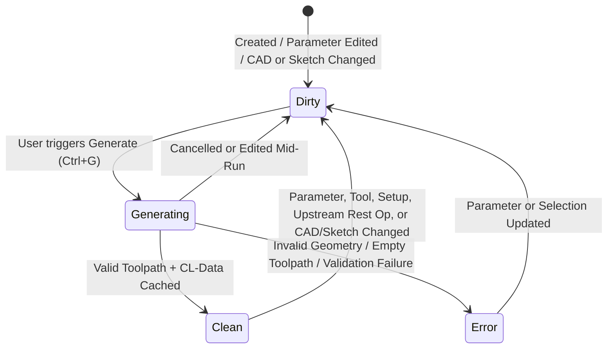

# 05 — 2.5D Machining Operations & Toolpath Algorithms

## Operation Lifecycle & Common Architecture (`chip-cam`)

### Explicit State Machine

- Operations can also be toggled **Suppressed / Enabled** (suppressed operations are skipped during toolpath generation, simulation, Rest Machining coverage, and G-code post-processing).
- Operations inside a Setup can be reordered via drag-and-drop in the CAM tree (automatically marking downstream `FromPrecedingOperations` Rest Machining operations `Dirty` when cut order changes).

### Common Operation Parameters
Every 2.5D operation shares five standardized parameter groups:
1. **Tool & Feeds/Speeds:** Selected `ToolId`, optional `PresetId`, and local overrides (`RPM`, `feed`, `plunge`, `ramp`, `lead`, `coolant`).
2. **Geometry:** Ordered list of selections from either **3D STEP B-Rep topology** (`FaceId`, `LoopId`, `EdgeId`, `CylinderHole`) or **2D `SketchLayer` entities** (`SketchRegionId`, `SketchEntityId`, `SketchPointPattern`), all normalizing into CAD-agnostic `ExtractedFeature25D` primitives with chain direction arrows and side flip toggles visible in the viewport.
3. **Heights:** `Clearance`, `Retract`, `Feed`, `Top`, and `Bottom` Z heights (each referencing Setup planes, Selection, Stock, or Model + signed offset expression).
4. **Passes:** Multiple Z stepdowns (`max_stepdown`, optional `even_stepdowns` boolean), `stock_to_leave_radial`, `stock_to_leave_axial`, **Rest Machining** configuration (on Pocket/Adaptive, Contour, and V-Carve), and finishing pass parameters.
5. **Linking:** Safe retract policy (`Full Clearance`, `Minimum Retract`), entry strategy (plunge, linear ramp, helical ramp, open-air side entry), and horizontal/vertical lead-in & lead-out arcs/lines.

---

## Operation Specifications

### 1. Facing
Surfaces the top of the stock down to a flat target Z face (typically `Model Top` or `WCS Origin`).
- **Geometry:** Defaults automatically to the Setup's XY Stock boundary (or a selected planar B-Rep face / closed 2D Sketch boundary).
- **Parameters:**
  - `pass_direction_deg` (default `0°` along X, or auto along longest stock axis)
  - `stepover` (default `0.7 * tool_d`)
  - `pass_extension` (distance cutter center extends past stock edge before turning around, default `0.55 * tool_d`)
  - `cut_mode`: `Both Ways (Zig-Zag)` with smooth U-turn `G2`/`G3` linking arcs *(default)* | `One Way (Climb)` | `One Way (Conventional)`
  - `max_stepdown` & optional `finishing_stepdown`

---

### 2. 2D Contour / Profile
Cuts along closed loops or open chains (from 3D B-Rep edges or 2D Sketch curves) on the outside, inside, or centerline.
- **Compensation:** Computer-calculated (`Left / Climb`, `Right / Conventional`, `Center / Off`) using exact tool radius + `stock_to_leave_radial`. *(Optional `Wear` cutter compensation flag `G41`/`G42` metadata in CL-data for LinuxCNC).*
- **Passes:**
  - **Depth Passes:** `max_stepdown` (with `even_stepdowns` option) OR continuous **Spiral Ramp** around closed contours.
  - **Side Roughing + Finishing:** `roughing_passes` count + `roughing_stepover`, followed by optional `finish_passes` at `finish_stepover` and `finish_feedrate`, plus `repeat_finish_pass` (spring pass).
  - **Corner Rest Machining:** When Rest Machining is enabled on a 2D Contour, restricts profiling/multipass roughing solely to tight inside corners and narrow channels left uncut by the larger reference tool or preceding roughing operations (entering and exiting each corner segment via smooth tangential arcs).
- **Entry & Exit (Lead-In / Lead-Out):**
  - Horizontal lead-in arc (`radius`, `sweep_angle_deg`) + linear tangent segment, plus vertical lead-in arc.
  - Overlap distance at contour seam (`overlap_mm`, default `0.5 mm`) so lead-in/lead-out witnesses blend cleanly.
  - Linear ramp along contour (`ramp_angle_deg`, default `2°–3°`) when plunging into closed slots without side clearance.
- **Holding Tabs (Bridges):**
  - **Placement Mode:**
    - `Automatic` (by tab count or target spacing along perimeter, automatically avoiding tight corners and arcs smaller than `2 * tool_d`).
    - `Manual Interactive` (click anywhere on the 3D/2D contour edge in the viewport to add/drag/remove tab anchors; persisted as normalized parameter `s ∈ [0, 1]` + 3D point signature).
  - **Tab Profile:**
    - `Rectangular` (`width`, `height` measured up from Bottom Z): cutter retracts vertically, crosses tab, plunges vertically.
    - `Triangular / Ramped` (`width`, `height`, `ramp_angle`): smooth 3D linear Z-ramp up to tab apex and back down—eliminating dwell marks, plunge shock, and wood burning.

---

### 3. 2D Pocket & 2D Adaptive Clearing
Clears flat-bottomed enclosed cavities (with arbitrary nested islands) and open-edge pockets/steps/shoulders.
- **2D Offset Engine:** Built on `cavalier_contours` (`Polyline<f64>` with bulge factors `tan(θ/4)`), preserving true circular arcs through inward/outward parallel offsets and boolean operations.
- **Clearing Strategies (`PocketStrategy`):**
  1. **Contour-Parallel Offset *(Default for Traditional 2D Pocket)*:**
     - Computes offset rings inward from pocket outer boundary and outward from island boundaries, organized into an **Offset Region Tree** so disconnected sub-pockets clear completely before retracting.
     - Orders passes Inside-Out (default for closed pockets after helical center entry) or Outside-In (default when entering from an open stock edge).
     - Smooth tangent transition moves between adjacent offset rings to avoid sharp `90°` stepover spikes.
  2. **Zig-Zag / Raster Clearing:**
     - Parallel linear scanlines at `pass_angle_deg` clipped against the offset pocket boundary, followed by a contour cleanup perimeter pass.
  3. **Adaptive / Trochoidal Clearing *(v2 High-Efficiency Milling — exposed in UI as both `PocketStrategy::Adaptive` and top-level `2D Adaptive` toolbar shortcut)*:**
     - Designed for deep axial engagement (`max_stepdown` typically `1.0x–2.0x tool_d`) at controlled low radial engagement (`optimal_load` $a_e$, default `0.20 * tool_d`), preventing `180°` full-slot engagement spikes in sharp corners and narrow channels.
     - **Engagement-Bounded Wavefront / Trochoidal Peel Algorithm:**
       1. Initializes the cleared 2D cavity state $M_0$: either an outside-stock air region (for open-edge pockets/shoulders, entering horizontally from air at full Z depth!) or the circular cavity created by a central helical ramp at the pocket's maximum inscribed circle (`boostvoronoi` medial-axis pole).
       2. Iteratively advances the machined wavefront $M_k \to M_{k+1}$ inside the target offset boundary $T$: computes candidate step-out arcs bounded by `optimal_load` ($a_e$) and clips/modulates cutter centers against $\text{Offset}(M_k, a_e)$ so instantaneous radial engagement angle satisfies $\theta_{\text{eng}} \le \arccos(1 - 2 a_e / D) + \varepsilon$ everywhere—automatically peeling tight corners and narrow slots with C1-smooth trochoidal crescent passes (`G2`/`G3` + `G1`).
       3. Enforces consistent **Climb** *(default)* or **Conventional** cut direction across every peel pass (`both_ways_adaptive` optional toggle for light-duty wood/plastics).
     - **Micro-Lift Low-Clearance Linking:**
       - Instead of retracting to `Retract Height` after each one-way trochoidal peel arc, the cutter arcs tangentially away from the cut wall (`lead_out_radius`, default `0.1 * tool_d`), lifts vertically by `micro_lift_z` (default `0.25 mm`), rapids/feeds back across the already-cleared cavity $M_k$ at `no_engagement_feedrate` (default `2.5 * cutting_feedrate`, routing around islands inside $M_k$ or falling back to `Retract Height` if obstructed), drops back to cutting Z, and arcs tangentially into the next peel pass.
     - **Automatic Radial Chip-Thinning Compensation:**
       - Optional `auto_chip_thinning: bool` toggle: when `optimal_load < 0.5 * tool_d`, scales cutting feedrate by $\frac{D}{2\sqrt{a_e(D - a_e)}}$ (clamped by `max_thinning_feed_multiplier`, default `2.0x`) so actual chip thickness matches the tool preset's target `feed_per_tooth`.
- **Open-Edge Pockets:**
  - Edges touching air/stock exterior are tagged `open`: the boundary is extended outward by `tool_r + overhang` along open segments, allowing horizontal air entry without helical plunging.
- **Closed-Pocket Entry:**
  - **Helical Ramp *(Default)*:** Locates the largest inscribed circle inside each connected pocket/rest region, checks `helix_diameter` against `min_ramp_diameter`, and spirals down at `ramp_angle_deg` before expanding outward. Falls back automatically to linear profile/slot ramp when narrower than min helix diameter (or errors cleanly if narrower than `tool_d`).

---

### 4. Drilling & Helical Bore Milling
Machines cylindrical holes selected from the STEP B-Rep or 2D Sketch `Circle` / `PointPattern` entities, sorted automatically via nearest-neighbor / 2-opt TSP path ordering to minimize rapid travel.

#### A. Drilling Modes (when `tool_d == hole_d` or spot drilling)
- **Spot / Simple Drill:** Plunge straight to Bottom Z at `plunge_feedrate`, optional `dwell_seconds`, rapid retract (`G81`/`G82` or expanded `G1`/`G0`).
- **Chip-Breaking Partial Retract:** Step by `peck_depth`, retract modestly (`chip_break_retract`, e.g., `0.5 mm`) to snap stringy chips (`G73` or expanded).
- **Deep-Hole Full Peck Drill:** Step by `peck_depth` (with optional decreasing peck factor & minimum peck), full rapid retract to `Retract` / `Feed` plane to evacuate flutes, rapid back to `previous_z + clearance` before feeding (`G83` or expanded).
- **Drill Tip Breakthrough Compensation:** Optional toggle adding `(tool_d / 2) / tan(point_angle / 2) + breakthrough_extra` so the full diameter clears through-holes.

#### B. Helical Bore Milling (when using an endmill with `tool_d < hole_d`)
- Helically interpolates (`G2`/`G3` with simultaneous `Z` feed) at radius `R_path = (hole_d - tool_d) / 2 - stock_to_leave_radial` using `pitch_per_rev` (or `ramp_angle_deg`), performs a flat `360°` cleanup circle at `Bottom Z`, optional radial finish pass + spring pass, and arcs smoothly toward hole center before `G0` retracting so the cutter never drags up the finished bore wall.
- For wide bores (`hole_d > 2 * tool_d - overlap`), automatically steps radially outward from a central helical core so no uncut pin is left in the middle.

---

### 5. Edge Chamfering & 2D Curve Trace / Engraving
Uses a Chamfer Mill / Spot Drill / V-Bit (or Ball/Flat endmill for Trace).

#### A. Edge Chamfer
- **Two Selection Modes:**
  1. **Sharp Unmodeled Edge:** User selects sharp `90°` top B-Rep edges (or closed 2D Sketch contours) and specifies desired `chamfer_width` (e.g., `0.5 mm`) and `tip_offset`.
  2. **Modeled `45°` (or angled) Chamfer Face/Lower Edge:** User selects the modeled chamfer B-Rep face; `chamfer_width` is inferred directly from the B-Rep geometry, and `tip_offset` positions the cutter flute along the sloped face.
- **Kinematics:** Given tool `included_angle = 2θ`, `tip_diameter`, `chamfer_width = w`, and `tip_offset = d_tip`:
  - `axial_drop = w / tan(θ) + d_tip`
  - `radial_offset = (tip_diameter / 2.0) + d_tip * tan(θ)`
- Includes adjacent-floor clearance checks against lower step floors if `tip_offset` would gouge an adjacent shelf.

#### B. 2D Curve Trace / Engraving
- Follows selected B-Rep edges or 2D Sketch curves / **Single-Line Hershey Text** strokes on-center (`Compensation = Off` or `Left`/`Right`) with `axial_offset` depth below the curve, multiple stepdowns, and lead-in/out.

---

### 6. V-Carving & Bevel Inlay *(v2)*
Machines crisp variable-width lettering, logos, scrollwork, and mated V-inlays from closed 2D regions (with arbitrary nested islands) using a **Chamfer / V-Bit** (`included_angle = 2θ`, `tip_diameter = d_tip`).

#### A. Medial-Axis Variable-Depth Kinematics (`boostvoronoi`)
1. Discretizes curved spans of the closed outer loop and inner island loops within fine chord tolerance and constructs the exact interior **Segment Voronoi Diagram** (`boostvoronoi`), filtering out exterior half-planes and reflex-vertex artifact bisectors to form the **2D Medial Axis Graph**.
2. At any medial point $p(s)$ with minimum boundary clearance radius $r(s)$:
   $$z_{\text{tip}}(s) = z_{\text{top}} - \frac{\max\!\bigl(0,\; r(s) - d_{\text{tip}} / 2\bigr)}{\tan(\theta)}$$
   so the conical V-flutes simultaneously kiss both opposing boundary walls at `z_top`, rising smoothly along acute corner bisectors all the way to `z_top` for razor-sharp square/serif corners!
3. Supports multi-pass `max_stepdown` Z-layering when total V-bit depth exceeds safe single-pass axial engagement in hardwood, brass, or aluminum.

#### B. Flat-Bottom Max Depth & Optional Two-Stage Area Clearance
- **`flat_depth` ($d_{\max}$, optional):** Clamps maximum carve depth to $z_{\text{flat}} = z_{\text{top}} - d_{\max}$, corresponding to maximum V-bevel horizontal offset $r_{\max} = d_{\max}\tan(\theta) + d_{\text{tip}}/2$.
  - Where region half-width $r(s) \le r_{\max}$, follows pure variable-depth medial-axis V-carving.
  - Where $r(s) > r_{\max}$, traces the offset bevel perimeter at `z_flat` plus diagonal 3D corner-sharpening climbs into every convex corner.
- **Optional Flat Area Clearance Tool (`clearing_tool_id: Option<ToolId>`):**
  - When no `clearing_tool_id` is chosen, the V-bit clears narrow flat-bottom pockets itself using `vbit_flat_stepover`.
  - When a **Flat Endmill** `clearing_tool_id` is specified (with its own preset/feeds and `clearing_radial_allowance`), `VCarve` emits a coordinated **two-stage operation** (or paired sub-passes ordered automatically by tool):
    1. **Stage 1 (Flat Endmill):** Clears the wide interior flat pocket core (`OffsetInward(Region, r_max)`) using Contour-Parallel or Adaptive pocket clearing down to `z_flat`.
    2. **Stage 2 (V-Bit):** Uses exact 2D Rest Machining around Stage 1's swept flat-endmill coverage to machine only the sloped perimeter bevels, tight corners unreached by the flat endmill radius, and narrow medial strokes—cutting sign/inlay cycle times by `5x–10x`!

#### C. V-Inlay Plug Mode (`inlay_mode`)
- Optional `VInlayPlug { start_depth, glue_gap_bottom, plate_clearance }` mode: shifts the effective trace boundary outward to `start_depth` (`male plug engagement depth`) and inverts region islands inside a bounding pocket frame so male hardwood/metal inlay plugs seat tightly into female V-carved cavities after bandsawing off the backing plate.

---

## 2.5D Rest Machining Architecture *(v2)*

Available on **2D Pocket / 2D Adaptive**, **2D Contour**, and **V-Carve** to eliminate air-cutting when stepping down from a large roughing endmill to smaller detail cutters:

| Mode | Configuration | Exact 2D Coverage Subtraction (`cavalier_contours`) |
|---|---|---|
| **`Disabled`** *(Default)* | None | Machines the full selected feature geometry. |
| **`FromPreviousTool`** | `prev_tool_diameter`, `prev_stock_to_leave_radial`, `rest_overlap_mm` (default `0.25 mm`), `min_rest_width_mm` | Analytically computes the 2D region reachable by the reference cutter: $C_{\text{prev}} = \text{OffsetOutward}(\text{OffsetInward}(T,\; R_{\text{prev}} + s_{\text{prev}}),\; R_{\text{prev}} - \delta_{\text{overlap}})$, then machines $R_{\text{rest}} = T \setminus C_{\text{prev}}$ (pruning micro-slivers thinner than `min_rest_width_mm`). Fast, stateless, and parallelizable! |
| **`FromPrecedingOperations`** | `source`: `AllPrecedingInSetup` \| `Explicit(Vec<OperationId>)`, `rest_overlap_mm`, `min_rest_width_mm` | Unions the exact 2D swept cutter footprints (at Z depths covering the current operation's cut range) of enabled upstream operations in the Setup, shrinks that union inward by `rest_overlap_mm` so entries overlap cleanly without uncut cusps, and subtracts it from $T$. Automatically registers a DAG dependency in `chip-project` so editing, reordering, or suppressing an upstream operation marks downstream Rest operations `Dirty`. |
