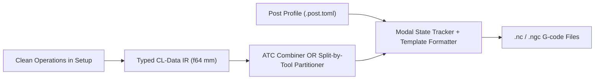

# 07 — Post-Processing & G-Code Generation

## Architecture (`chip-post`)
Toolpath generators in `chip-cam` never emit G-code strings directly. Instead, they emit a strongly typed **Cutter Location (CL) Event Stream** (`Vec<ClEvent>`). `chip-post` consumes that stream along with a user-editable **TOML Post-Processor Profile** to produce dialect-specific G-code.



---

## Typed Cutter Location (`ClEvent`) IR
```text
ClProgram
 ├── HeaderMetadata (project name, setup name, stock dims, WCS origin description, total est. time, tool table summary)
 └── Sequence of ClEvent:
      ├── SetupStart { setup_name, wcs_slot }
      ├── OperationStart { op_name, strategy_name, est_time_sec }
      ├── ToolChange { tool_number, length_offset, tool_desc, is_first_tool }
      ├── SpindleStart { rpm, direction: CW | CCW }
      ├── SpindleStop
      ├── Coolant { mode: Off | Flood | Mist | Air }
      ├── CutterComp { mode: Off | WearLeft | WearRight }
      ├── RapidMove { x, y, z }
      ├── LinearMove { x, y, z, feed_mm_min, role: Plunge | Ramp | LeadIn | Cut | LeadOut }
      ├── ArcMove { plane: XY | XZ | YZ, dir: CW | CCW, end_xyz, center_offset_ijk, radius, turns, feed_mm_min }
      ├── DrillCycle { kind: Spot | Simple | ChipBreak | DeepPeck, xyz_bottom, r_plane_z, peck_q, dwell_sec, feed_mm_min }
      ├── Dwell { seconds }
      ├── Comment(String)
      ├── OperationEnd
      └── ProgramEnd
```

---

## User-Editable TOML Post-Processor Profiles
Post profiles live in built-in defaults (`posts/*.post.toml`) plus a user override directory so CNC operators can customize start/end blocks, `M6` macros, or formatting rules in any text editor without recompiling ChipCutter.

### Configurable Profile Capabilities
1. **Output Units & Formatting:**
   - `units`: `"mm"` (`G21`, default `3`–`4` decimals) or `"inch"` (`G20`, default `4`–`5` decimals), automatically scaling all coordinates, `IJK` offsets, and feedrates (`mm/min` -> `in/min`).
   - Leading/trailing zero suppression, optional `N` line numbering (`N10`, `N20`), comment style (`(parentheses)` vs `; semicolon`, sanitizing nested parentheses automatically).
2. **Modal State Machine:**
   - Tracks active motion group (`G0`/`G1`/`G2`/`G3`), active plane (`G17`/`G18`/`G19`), `X`/`Y`/`Z` coordinates, and `F` feedrate—emitting words only when changed (or forcing full output after tool changes / operation headers per config).
3. **Arc Formatting & Helical Rules:**
   - `arc_center_mode`: `"incremental_ijk"` *(default, avoids R-word 180° ill-conditioning)* | `"absolute_ijk"` | `"radius"`.
   - `max_arc_sweep_deg`: `180.0` or `90.0` (automatically splits full `360°` circles/helices into quadrants or semicircles so controllers never misinterpret `start == end` full circles!).
   - `allow_helical_arcs`: `true` *(default for GRBL 1.1+ and LinuxCNC)* | `false` (linearizes 3D helices within chord tolerance if disabled).
4. **Canned Cycles vs. Expanded Motion:**
   - `expand_drill_cycles`: `true` (expands `DrillCycle` events into explicit `G0`/`G1`/`G4` peck motions—required for vanilla GRBL) or `false` (emits native `G81`/`G82`/`G83`/`G73` + `G80` for LinuxCNC).
5. **Tool Change Policy (ATC vs. Hobby Single-Tool Split):**
   - `tool_change_mode`:
     - `"m6"` — Emits a single G-code file containing all operations in order, inserting the `tool_change_block` (`M5`, safe retract, `T{tool_num} M6`, `G43 H{len_offset}`) whenever `tool_number` changes.
     - `"split_files_by_tool"` — Automatically partitions consecutive operations sharing the same tool into numbered output files (e.g., `bracket_op1_01_T1_6mm_flat.nc`, `bracket_op1_02_T4_90deg_chamfer.nc`) for routers/mills without an automatic tool changer or tool-setter macro!
     - `"ignore_if_single_tool"` — Suppresses `M6` when the entire job uses one tool.
6. **Customizable Template Blocks:**
   - Simple `{variable}` placeholder templates for `program_header`, `operation_header`, `tool_change_block`, `spindle_start_block`, and `program_footer`.

---

## Structured G-Code Header Summary
Because v1 omits separate HTML/PDF setup sheets, every exported `.nc`/`.ngc` file begins with a clean, machine-safe comment block giving the operator everything needed at the controller:
```gcode
( ========================================================== )
( Generated by ChipCutter v0.1.0                             )
( Project:      motor_mount.chip.toml                        )
( Setup:        Setup 1 - Top Op [WCS: G54]                  )
( WCS Zero:     Stock Top, Front-Left Corner                 )
( Stock Box:    X=104.000  Y=84.000  Z=15.000 mm             )
( Safe Z:       Clearance=25.000  Retract=20.000 mm          )
( Tools Used:                                                )
(   T1: 6.000mm 3FL Flat Endmill [Min Stickout: 18.0mm]      )
(   T2: 6.000mm 90deg Chamfer Mill [Min Stickout: 10.0mm]    )
( Est. Cycle:   00:14:32                                     )
( ========================================================== )
```

---

## Built-In v1 Post-Processor Profiles

### 1. `grbl.post.toml` (GRBL 1.1 / grblHAL / FluidNC)
- Default file extension: `.nc`
- Safe startup block: `G90 G94 G17 G21` (no unsupported `G40`/`G49`/`G80` codes that trigger GRBL errors if unsupported; `G54` emitted when WCS selected).
- Comments: Semicolon `;` or stripped/clean `( ... )` restricted under GRBL's line-length limit (`<= 80` chars per line!).
- Drill cycles: `expand_drill_cycles = true` (explicit `G0`/`G1` peck motions).
- Arcs: Incremental `I J K`, quadrant splitting (`90°`), helical `G2`/`G3 X Y Z I J` enabled.
- Tool changes: Defaults to `"split_files_by_tool"` for classic GRBL, with a 1-click preset variant (`grblhal_atc.post.toml`) enabling `M6` for grblHAL / FluidNC tool-setter setups.

### 2. `linuxcnc.post.toml` (LinuxCNC RS274NGC)
- Default file extension: `.ngc`
- Safe startup block: `G17 G21 G40 G49 G54 G80 G90 G94 G64 P0.025` (includes configurable path blending tolerance `G64 P..` so high-speed paths don't round corners excessively!).
- Comments: `( ... )` RS274NGC compliant.
- WCS: `G54`–`G59`, `G59.1`–`G59.3`.
- Tool changes: `T{tool} M6` followed by `G43 H{offset}`.
- Drill cycles: Native `G81`, `G82`, `G83`, `G73` with `G98`/`G99` retract mode and `G80` cancel.
- Footer: Coolant off `M9`, spindle stop `M5`, safe Z retract (`G53 G0 Z0` optional toggle), `M2` / `%`.
