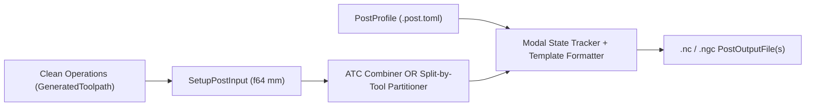

# 07 — Post-Processing & G-Code Generation

## Architecture (`chip-post`)
Toolpath generators in `chip-cam` never emit G-code strings directly. Instead, each operation produces a `GeneratedToolpath` containing a strongly typed **Cutter Location (CL) Event Stream** (`Vec<ClEvent>`). `chip-post` consumes a `SetupPostInput` (Setup metadata, stock/rotary config, and ordered `OperationPostInput { op, tool, toolpath }` entries) along with a **TOML Post-Processor Profile** (`PostProfile`) to produce one or more dialect-specific `PostOutputFile` G-code outputs.



---

## Typed Cutter Location (`ClEvent`) IR (`crates/chip-cam/src/cl_data.rs`)
```text
SetupPostInput
 ├── Setup metadata (project_name, setup_name, wcs_slot, wcs_origin_description, stock, rotary, clearance_z_wcs, retract_z_wcs)
 └── operations: Vec<OperationPostInput { op, tool, toolpath: GeneratedToolpath }>
      └── toolpath.events: Vec<ClEvent>:
           ├── SetupStart { setup_name, wcs_slot }
           ├── OperationStart { op_id, op_name, strategy_name, est_time_sec }
           ├── ToolChange { tool_number, length_offset, diameter_offset, tool_desc, is_first_tool }
           ├── SpindleStart { rpm, direction: SpindleDirection::{Cw, Ccw} }
           ├── SpindleStop
           ├── Coolant { mode: CoolantMode::{Disabled, Flood, Mist, AirBlast} }
           ├── CutterComp { mode: CutterCompMode::{Off, WearLeft, WearRight} }
           ├── RapidMove { end_wcs: DVec3 }
           ├── LinearMove { end_wcs: DVec3, feed_mm_min, role: MotionRole }
           │    (MotionRole: Plunge | Ramp | LeadIn | Cut | FinishCut | LeadOut | TabRamp | LinkTransition)
           ├── ArcMove { plane: ArcPlane::{XY, XZ, YZ}, dir: ArcDir::{CW, CCW}, end_wcs: DVec3,
           │             center_offset_ijk: DVec3, radius_mm, turns, feed_mm_min, role: MotionRole }
           ├── DrillCycle { kind: DrillCycleKind::{Spot, Simple, ChipBreak, DeepPeck},
           │                bottom_wcs: DVec3, r_plane_z_wcs, clear_z_wcs, peck_q_mm,
           │                decreasing_factor, min_peck_mm, chip_break_retract_mm, dwell_sec, feed_mm_min }
           ├── RotaryIndex { angle_deg, rapid, feed_deg_min }
           ├── RotaryRapidMove { end_wcs: DVec3, rotary_deg }
           ├── RotaryLinearMove { end_wcs: DVec3, rotary_deg, feed_mm_min, effective_radius_mm, role: MotionRole }
           ├── Dwell { seconds }
           ├── Comment(String)
           ├── OperationEnd
           └── ProgramEnd
```

---

## User-Editable TOML Post-Processor Profiles (`PostProfile`)
Six built-in profiles are compiled directly into `chip-post` (`posts/*.post.toml`) and complemented by user custom profiles in `~/.config/chipcutter/posts/` (`dirs::config_dir()/chipcutter/posts`), so operators can clone, edit, import, and export custom `.post.toml` dialects without recompiling ChipCutter.

### Configurable Profile Capabilities
1. **Output Units & Formatting:**
   - `units`: `PostUnits::Mm` (`"mm"`, `G21`, default `3`–`4` decimals) or `PostUnits::Inch` (`"inch"`, `G20`), automatically scaling all coordinates, `IJK` offsets, `G64 P..` blend tolerance, and feedrates (`mm/min` -> `in/min`).
   - `suppress_trailing_zeros`, optional `line_numbers: Option<LineNumberConfig { start, increment }>` (`N10`, `N20`), optional `max_line_length`, and `comment_style` (`Parentheses` `( ... )` vs. `Semicolon` `; ...`, sanitizing nested parentheses and control characters automatically).
2. **Modal State Machine:**
   - Tracks active motion group (`G0`/`G1`/`G2`/`G3`), active plane (`G17`/`G18`/`G19`), feed mode (`G93`/`G94`), active canned cycle (`G80` auto-cancel), `X`/`Y`/`Z`/rotary coordinates, and `F` feedrate—emitting words only when changed (forcing full output after tool changes, operation headers, and canned-cycle exits).
3. **Arc Formatting & Helical Rules:**
   - `arc_center_mode`: `IncrementalIjk` (`"incremental_ijk"`, default, avoids R-word 180° ill-conditioning) | `AbsoluteIjk` (`"absolute_ijk"`) | `Radius` (`"radius"`).
   - `max_arc_sweep_deg`: e.g. `180.0` or `90.0` (automatically splits full `360°` circles/helices into quadrants or semicircles with 1-ULP boundary tolerance so controllers never misinterpret `start == end` full circles).
   - `allow_helical_arcs`: `true` *(default for GRBL 1.1+ and LinuxCNC)* | `false` (linearizes 3D helices within `helical_linearize_tol_mm` when disabled).
4. **Canned Cycles vs. Expanded Motion:**
   - `expand_drill_cycles`: `true` (expands `DrillCycle` events into explicit `G0`/`G1`/`G4` peck motions—required for vanilla GRBL) or `false` (emits native `G81`/`G82`/`G83`/`G73` with `G98`/`G99` retract mode + `G80` cancel for LinuxCNC).
   - **Decreasing-Peck Auto-Expansion:** Whenever a `ChipBreak` or `DeepPeck` drill cycle uses a decreasing peck schedule (`decreasing_factor < 0.999`), `chip-post` automatically expands it into explicit `G0`/`G1`/`G4` peck moves even when `expand_drill_cycles = false`.
5. **Tool Change Policy (`ToolChangeMode`):**
   - `"m6"` (`M6`) — Emits a single G-code file containing all operations in order, inserting `tool_change_block` (`M5`, `T{tool_number} M6`, optional `G43 H{length_offset}`) whenever `tool_number` changes.
   - `"split_files_by_tool"` (`SplitFilesByTool`) — Automatically partitions consecutive operations sharing the same tool into numbered output files (e.g., `bracket_01_T1_6mm_flat.nc`, `bracket_02_T4_90deg_chamfer.nc`) for routers/mills without an automatic tool changer or tool-setter macro.
   - `"ignore_if_single_tool"` (`IgnoreIfSingleTool`) — Suppresses `M6` when the entire job uses one tool.
6. **Customizable Template Blocks:**
   - `{variable}` placeholder templates for `program_header`, `operation_header`, `tool_change_block`, `spindle_start_block`, `operation_footer`, and `program_footer`.
7. **4th-Axis Rotary Post-Processing (`[rotary]` `RotaryPostConfig`):**
   - `enabled`: activates rotary formatting on a profile (`skip_serializing_if = "RotaryPostConfig::is_disabled"`).
   - `axis_letter`: default `'A'` (overridden by the Setup's resolved `A`/`B`/`C` rotary axis letter when present).
   - `angle_decimals`: angular coordinate precision (default `3`).
   - `supports_g93_inverse_time` & `use_g93_for_simultaneous`: when both are `true`, simultaneous `RotaryLinearMove` blocks with angular travel automatically switch into `G93` inverse-time feed mode (`compute_inverse_time_feed_g93`), emitting a mandatory explicit `F` word on every `G93` block per RS274NGC and automatically restoring `G94` (`units/min`) before any pure linear, `RotaryIndex`, canned drill, or footer block.
   - `max_rotary_feed_deg_min`: clamps angular slew/cutting feedrate (`deg/min`, default `3600.0`; `7200.0` on `linuxcnc_4axis`).
   - `unwind_mode: RotaryUnwindMode`: fallback rotary angle wrap/unwind policy (`ContinuousMultiTurn`, etc.) when not specified by the Setup.
   - `swap_linear_axis: Option<SwapAxisTarget::{ReplaceY, ReplaceX}>`: maps rotary angular travel onto a linear stepper channel (`mm = theta_rad * R_eff`) for 3-axis controllers driving a rotary chuck off the `Y` or `X` axis, emitting zero rotary-letter words.

---

## Profile Persistence, Read-Only Built-In Protection, & Security Guards

- **Source Precedence (`PostProfileSource`):** Every loaded `PostProfile` tracks its origin: `BuiltIn`, `UserConfig`, `ProjectOrBundle`, or `ExplicitFile`.
  - Built-in profiles (`is_builtin = true`) are **strictly read-only**: attempting to save, overwrite, clone onto, or delete a reserved built-in ID returns `PostError::BuiltInReadOnly`, and untrusted project/bundle `.post.toml` files can never shadow built-in IDs.
  - Custom profiles in the user config directory (`~/.config/chipcutter/posts/`, resolved via `user_post_profiles_dir`) take precedence over untrusted project/bundle custom posts.
  - `resolve_post_profile` resolves strictly by profile ID (refusing arbitrary filesystem paths from untrusted project data), whereas `resolve_post_profile_cli_override` explicitly allows operator-chosen `.post.toml` file paths (`PostProfileSource::ExplicitFile`).
- **User-Config Persistence APIs:** `clone_post_profile`, `save_user_post_profile`, and `delete_user_post_profile` (plus `export_post_profile_to_path` and `import_post_profile_from_path`) manage custom profiles in `~/.config/chipcutter/posts/<id>.post.toml` with validated slug IDs (`validate_post_id`).
- **Output & G-Code Safety Guards:**
  - `sanitize_file_extension` strips path traversal and non-alphanumeric characters from profile extensions (falling back to `"nc"`), and `validate_safe_output_filename` rejects path separators, `..`, or unsafe names (`PostError::UnsafeOutputFilename`).
  - `LineWriter` and comment/template sanitizers prevent G-code injection via newlines or closing parentheses in operation/tool/project names (`PostError::UnsafeGCodeLine`), fail closed on `NaN`/infinite coordinates or feeds (`PostError::NonFiniteValue`), and enforce `max_line_length` strictly on emitted code lines (`PostError::LineTooLong`, truncating comment lines cleanly to fit).

---

## Structured G-Code Header Summary
Every exported `.nc`/`.ngc` file begins with a machine-safe comment block generated by `emit_structured_header` (embedding `env!("CARGO_PKG_VERSION")`, `Stock:` dimensions, an optional `Rotary 4th:` line on rotary Setups, tool stickouts, and formatted cycle time):
```gcode
( ========================================================== )
( Generated by ChipCutter v0.23.0                            )
( Project:      motor_mount.chip.toml                        )
( Setup:        Setup 1 - Top Op [WCS: G54]                  )
( WCS Zero:     Stock Top, Front-Left Corner                 )
( Stock:        X=104.000  Y=84.000  Z=15.000 mm             )
( Rotary 4th:   A-Axis (X-Axis) | Simultaneous 4-Axis | Clearance R=32mm )
( Safe Z:       Clearance=25.000  Retract=20.000 mm          )
( Tools Used:                                                )
(   T1: 6mm 3FL Flat Endmill [Stickout: 18mm]                )
(   T2: 6mm 90deg Chamfer Mill [Stickout: 10mm]              )
( Est. Cycle:   00:14:32                                     )
( ========================================================== )
```
*(The `Rotary 4th:` line is emitted only when `setup_in.rotary` is `Some(...)`; `Stock:` prints `X=.. Y=.. Z=..` for box stock or `Cyl(Axis) D=.. L=..` for cylindrical stock.)*

---

## Built-In Post-Processor Profiles (6 Compiled-In Profiles)

1. **`grbl` (`posts/grbl.post.toml`) — GRBL 1.1 / FluidNC (Split by Tool):**
   - Extension `.nc`, `units = "mm"`, `coord_decimals = 3`, `suppress_trailing_zeros = true`, `comment_style = "parentheses"`, `max_line_length = 80`.
   - Startup: `G90 G94 G17 G21` + `{wcs_code}` (standard `G54`–`G59`, no unsupported `G40`/`G43`/`G49`/`G80`).
   - Incremental `I J K`, `max_arc_sweep_deg = 90.0`, helical arcs enabled, `expand_drill_cycles = true`, `tool_change_mode = "split_files_by_tool"`.
   - Footer: `M5`, `M30`.

2. **`grblhal_atc` (`posts/grblhal_atc.post.toml`) — grblHAL / FluidNC (ATC / M6 Macro):**
   - Extension `.nc`, `comment_style = "parentheses"`, `max_line_length = 80`, `allow_extended_wcs = true`, `expand_drill_cycles = true`, `max_arc_sweep_deg = 90.0`.
   - Single combined file with `tool_change_mode = "m6"` (`M5`, `T{tool_number} M6`) and footer `M9`, `M5`, `G53 G0 Z0`, `M30`.

3. **`linuxcnc` (`posts/linuxcnc.post.toml`) — LinuxCNC (RS274NGC):**
   - Extension `.ngc`, `coord_decimals = 4`, `feed_decimals = 1`, `suppress_trailing_zeros = false`, `comment_style = "parentheses"`, `path_blend_tol_mm = 0.025`.
   - Startup: `%` + `G17 G21 G40 G49 {wcs_code} G80 G90 G94 G64 P0.0250` (`G54`–`G59.3`).
   - Tool changes: `M9`, `M5`, `T{tool_number} M6`, `G43 H{length_offset}`; `use_cutter_comp_g41_g42 = true`; `max_arc_sweep_deg = 180.0`.
   - Native `G81`/`G82`/`G83`/`G73` canned cycles (`expand_drill_cycles = false`, auto-expanding decreasing-peck cycles), `operation_footer = ["G80"]`, program footer `M9`, `M5`, `G53 G0 Z0`, `M2`, `%`.

4. **`linuxcnc_4axis` (`posts/linuxcnc_4axis.post.toml`) — LinuxCNC 4-Axis (XYZA / G93):**
   - Extends the `linuxcnc` RS274NGC profile with `[rotary]` enabled (`axis_letter = "A"`, `angle_decimals = 3`, `supports_g93_inverse_time = true`, `use_g93_for_simultaneous = true`, `max_rotary_feed_deg_min = 7200.0`, `unwind_mode = "continuous_multi_turn"`) and `G94` restoration in `program_footer`.

5. **`grblhal_4axis` (`posts/grblhal_4axis.post.toml`) — grblHAL / FluidNC 4-Axis (XYZA / G93):**
   - Extends `grblhal_atc` (`<= 80` chars/line, `feed_decimals = 1`, `M6`, expanded drill cycles, `G53 G0 Z0`, `M30`) with `[rotary]` enabled (`axis_letter = "A"`, `angle_decimals = 3`, `supports_g93_inverse_time = true`, `use_g93_for_simultaneous = true`, `max_rotary_feed_deg_min = 3600.0`, `unwind_mode = "continuous_multi_turn"`) and `G94` in `program_footer`.

6. **`grbl_rotary_wrap` (`posts/grbl_rotary_wrap.post.toml`) — GRBL 3-Axis Rotary Wrap (Y-Swapped):**
   - Based on `grbl` (`<= 80` chars/line, `split_files_by_tool`, expanded drill cycles, `M5`, `M30`) with `[rotary]` enabled and `swap_linear_axis = "replace_y"`, mapping rotary angular commands (`theta_rad * R_eff`) onto linear `Y` travel for standard 3-axis GRBL controllers running a rotary chuck on the Y stepper driver.
