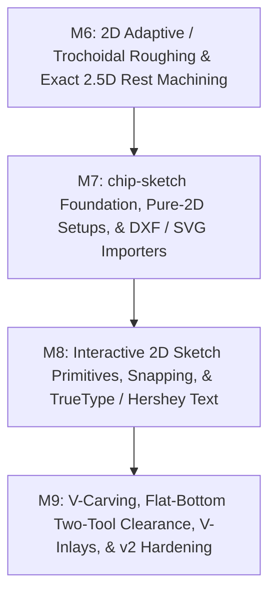

# 10 — Implementation Roadmap & Horizon

## Phased v1 Milestones (Completed — M1–M5)
ChipCutter v1 was delivered across five sequential vertical-slice milestones, followed by a comprehensive pre-v2 workspace modularization and CAD-decoupling refactor:

- **Milestone 1:** `chip-math`, `chip-cad` (`monstertruck` STEP loader + analytic classifier + BVH ray-picker), and `chip-gui` (`eframe` + `wgpu` + `egui_tiles` 3D viewport).
- **Milestone 2:** Multi-Setup WCS & 27-point stock, interactive 3D feature picking, `chip-tools` (SFM/chipload + Fusion 360 import), `.chip.toml` v1, and instant Undo/Redo.
- **Milestone 3:** Background `rayon` dispatcher + Facing, Drilling/Helical Bore, 2D Contour (with ramps & holding tabs), 2D Pocket (offset + zig-zag), and Edge Chamfer/Trace.
- **Milestone 4:** `chip-sim` trapezoidal timeline, 2.5D Z-heightmap stock removal & 5-rule crash/gouge oracle, and `chip-post` (GRBL, grblHAL ATC, LinuxCNC).
- **Milestone 5:** Associative `GeometricSignature` STEP reload (`v1 -> v2`), `.chipz` portable bundles, headless `chipcutter` CLI, and golden G-code snapshot suite.

---

## Phased v2 Engineering Milestones (Active — M6–M9)

ChipCutter v2 delivers **High-Efficiency 2D Adaptive Roughing + 2.5D Rest Machining** and **Complete 2D Vector / Sketch / Typography / V-Carving Workflows** (including standalone pure-2D router/panel projects without requiring a 3D STEP model) across four sequential milestones stored in `plans/`:

### Milestone 6 — 2D Adaptive / Trochoidal Roughing & 2.5D Rest Machining (`plans/06-milestone-6-plan.md`)
- **`chip-tools`:** Add optional `optimal_load` (`ae_adaptive`) to `CuttingPreset` + radial chip-thinning feedrate compensation helper (`max_thinning_feed_multiplier`).
- **`chip-cam` — 2D Adaptive Clearing (`PocketStrategy::Adaptive`):**
  - Medial-axis (`boostvoronoi`) maximum inscribed circle helical entry (plus open-edge horizontal air entry).
  - Engagement-bounded wavefront / trochoidal crescent peel generator maintaining radial width of cut $\le a_{e,\text{opt}} + \varepsilon$ with zero `180°` corner-burying spikes.
  - Micro-lift low-clearance linking (`micro_lift_z`, tangential lead-out/in arcs, island-safe `no_engagement_feedrate` return traverses).
- **`chip-cam` & `chip-project` — Exact 2.5D Rest Machining:**
  - `RestMachiningMode::FromPreviousTool` (stateless analytic `cavalier_contours` coverage subtraction with `rest_overlap_mm` on 2D Pocket/Adaptive and 2D Contour).
  - `RestMachiningMode::FromPrecedingOperations` (exact 2D swept toolpath coverage extraction, topological DAG wave scheduling in `JobDispatcher`, and automatic downstream `Dirty` invalidation when upstream operations change or reorder).
- **`chip-gui` & Verification:** `2D Adaptive` toolbar shortcut, Adaptive & Rest Machining Inspector UI, and `chip-sim` oracle tests verifying bounded radial engagement, rapid-safe micro-lifts, and complete corner cleanup.

### Milestone 7 — `chip-sketch` Foundation, Pure-2D Projects, & DXF / SVG Import (`plans/07-milestone-7-plan.md`)
- **Workspace & Schema (`schema_version = 2`):**
  - Create pure-Rust `chip-sketch` crate (`dxf`, `usvg`, `kurbo`, `rstar`, `cavalier_contours`) with zero UI dependencies.
  - Upgrade `.chip.toml` to `schema_version = 2` with lossless `v1 -> v2` auto-migration and `.chipz` `vectors/` asset bundling.
- **Pure-2D Setups (`models = []`):**
  - Support projects with zero STEP models: `Model / Sheet XY` WCS orientation, Fixed Sheet Stock and Relative-to-Sketch-Bounds Stock (+ explicit `Sheet Thickness Z`), and `chip-sim` pure-2D stock simulation.
- **DXF & SVG Import Engine:**
  - DXF importer (`LINE`, `ARC`, `CIRCLE`, `LWPOLYLINE` bulge arcs, `SPLINE`, `ELLIPSE`, `INSERT` blocks, `$INSUNITS`, layer preservation).
  - SVG importer (`usvg` path/shape/transform flattening, physical units + `96`/`72`/`90` DPI scaling, `+Y up` normalization).
  - Shared `kurbo` cubic-Bézier-to-biarc `ArcPolyline2D` fitter, duplicate segment remover, R-tree gap-healing chainer (`join_tolerance_mm`), and outer-loop + island `PlanarVectorRegion` hierarchy.
- **CLI & GUI Integration:**
  - `chipcutter inspect <file.dxf|file.svg>` and `chipcutter import-2d` CLI subcommands.
  - `wgpu` 2D Sketch curve/region rendering pass, unified 2D region/loop/chain picking into `ExtractedFeature25D`, and GUI DXF/SVG Import Modal with live scale & gap-healing preview.

### Milestone 8 — Interactive 2D Sketch Primitives & CAM Typography (`plans/08-milestone-8-plan.md`)
- **Parametric 2D Sketch Entities (`chip-sketch`):**
  - Expression-driven `Rectangle` (with corner fillets), `Circle`, `Slot`, `RegularPolygon`, `Polyline`, and `PointPattern` (single, linear grid, and bolt-circle feeding directly into Drilling & Helical Bore).
  - Associative `SketchAnchor::PlanarFace` anchoring onto 3D STEP faces (including `GeometricSignature` re-binding on STEP reload!).
- **Dual-Mode Typography (`ttf-parser` + Hershey):**
  - Bundled OFL sans-serif outline font + custom `.ttf`/`.otf` loading (`.chipz` `fonts/` bundling), kerning, alignment, Bézier-to-arc conversion, and boolean counter-island classification.
  - Built-in public-domain single-line Hershey engraving fonts (`SimplexSans`, `DuplexRoman`, `Mono`, `Script`) for 1-pass `2D Trace` part numbering.
- **Interactive Viewport Sketching (`chip-gui`):**
  - `Sketches` browser tree, `Look At Active Sketch` camera action, interactive viewport creation tools with Grid/Origin/Endpoint/Midpoint/Center/Stock snapping, and expression-backed Entity Inspector.

### Milestone 9 — V-Carving, Flat-Bottom Clearance, V-Inlays, & v2 Release Hardening (`plans/09-milestone-9-plan.md`)
- **V-Carve & Bevel Inlay Engine (`chip-cam` — `OperationKind::VCarve`):**
  - Interior Segment Voronoi / 2D Medial Axis construction (`boostvoronoi`) over closed outer + island vector/text regions.
  - Variable-depth 3D V-bit toolpath generation with razor-sharp corner-climb kinematics and multi-stepdown `max_stepdown` Z layering.
  - `flat_depth` clamping + **Optional Two-Stage Flat Endmill Area Clearance** (`clearing_tool_id` pocket clearing Stage 1 + Rest-Machined V-bit bevel/corner Stage 2, seamlessly handled by `chip-sim` and `chip-post` ATC / split-file modes!).
  - **V-Inlay Plug Mode** (`start_depth` + `glue_gap_bottom` male inlay generation).
- **v2 End-to-End Verification & Documentation:**
  - `chip-sim` sloped V-carve heightmap verification (Fine/Ultra resolution) asserting zero rapid crashes and exact bevel geometry.
  - New v2 golden G-code snapshots (Adaptive + Rest Machining + Pure-2D DXF/Text Two-Tool V-Carve) while keeping all v1 golden snapshots byte-for-byte intact.
  - Updated `README.md`, `ARCHITECTURE.md`, and v2 sample demo projects in `chip-project::demos`.

---

## Deferred Horizon (v3 and Beyond)
1. **3-Axis Surface Milling & Mesh Support (v3):**
   - Importing **STL / OBJ / 3MF** meshes alongside STEP solids.
   - 3D Waterline (Z-level), Parallel/Raster 3D finishing, Scallop, Pencil, and 3D Adaptive roughing strategies.
2. **Advanced Workholding & Multi-Setup Volumetric Stock (v3):**
   - 3D fixture/vise/clamp collision bodies with automatic safe-rapid routing.
   - Carrying simulated stock across flipped setups via tri-dexel volumetric stock.
3. **Ecosystem & Extensibility (v3+):**
   - Optional OpenCASCADE (`opencascade-rs`) `CadKernel` feature backend.
   - Additional controller dialects (Fanuc/Haas, Mach4, Masso, Centroid), thread milling, and printable HTML/PDF setup sheets.
