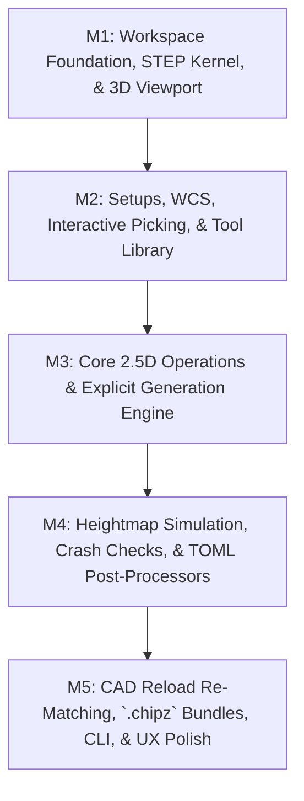

# 10 — Implementation Roadmap & v2+ Horizon

## Phased v1 Milestones
To keep risk low and maintain a runnable, testable vertical slice early, v1 implementation is structured into five sequential milestones:

### Milestone 1 — Foundation, STEP Import, & `wgpu` CAD Viewport
- Cargo workspace (`chip-math`, `chip-cad`, `chip-gui`, `deny.toml` license checks).
- Unit/expression evaluator (`f64` mm canonical + mixed `in`/`mm` formula parsing).
- `CadKernel` trait + `truck` STEP importer with analytic Plane/Cylinder/Line/CircleArc classification and `FaceId`/`EdgeId` tessellation.
- `eframe` + `wgpu` + `egui_tiles` shell with orthographic/perspective camera, ViewCube, mouse presets (Fusion/SolidWorks/FreeCAD), shaded B-Rep + crisp topological edge rendering, and BVH hover/click ray-picking.

### Milestone 2 — Setups, WCS, Selection Engine, & Tool Library
- Multi-Setup model: box/cylinder stock, B-Rep face/edge WCS axis alignment, 27-point stock/model WCS origin picker, Z-height planes visualization.
- Selection modes: planar faces, closed loops, open chains, cylindrical holes, same-diameter/coplanar helpers, and automatic Z-top/bottom inference.
- `chip-tools`: Cutter types, per-material presets, SFM/chipload live calculator, `.tools.toml` persistence, and Fusion 360 `.json` importer.
- `.chip.toml` serialization + instant document Undo/Redo (`Ctrl+Z`/`Ctrl+Y`).

### Milestone 3 — 2.5D Toolpath Engine & Explicit `Ctrl+G` Dispatcher
- Background `rayon` job dispatcher, cancellation tokens, and `Clean`/`Dirty`/`Generating`/`Error` tree state.
- **Facing** & **Drilling + Helical Bore Milling** (simplest vertical slice through CL-data).
- **2D Contour / Profile** (arc-preserving `cavalier_contours` offsetting, lead-in/out, ramps, multi-depth passes, auto & click-on-contour rectangular/triangular holding tabs).
- **2D Pocket** (closed pockets with islands, open-edge pockets, helical/linear entry, contour-parallel & zig-zag strategies).
- **Edge Chamfering & 2D Curve Trace** (sharp-edge and modeled-chamfer kinematics with `tip_offset`).

### Milestone 4 — Simulation, Crash Verification, & Post-Processing
- Animated 3D toolpath + cutter/shank/holder playback, timeline scrubber, and cycle time estimator.
- 2.5D Z-heightmap stock material removal mesh + automated rapid-into-stock crash, target-model gouge, and flute-length verification diagnostics.
- `chip-post`: Typed CL-data consumer, TOML post profile loader, ATC (`M6`) + split-file-per-tool modes, structured G-code header summary comments, and built-in **GRBL / grblHAL / FluidNC** and **LinuxCNC** posts.

### Milestone 5 — Associative Reload, Headless CLI, & Release Hardening
- Geometric signature storage and automatic re-matching + dirty/warning workflow on "Reload STEP Model".
- Portable `.chipz` archive export/import.
- `chipcutter` headless CLI (`validate`, `build`, `simulate`, `tools import-fusion`).
- Synthetic STEP fixture suite, `chip-sim` invariant oracle tests, and golden G-code regression tests.

---

## Deferred Horizon (v2 and Beyond)
The v1 architecture intentionally preserves clean extension points for future releases without premature complexity in v1:

1. **2D Support & Vector Imports (v2):**
   - Planar 2D Sketch Layers anchored to Setup XY or planar B-Rep faces.
   - **DXF** and **SVG** file importers with gap-healing/chaining, basic 2D primitives (rect, circle, slot, line), TrueType/Hershey engraving text, and **V-Carving** (medial-axis variable-depth V-bit toolpaths).
2. **Adaptive / Trochoidal Roughing & Rest Machining (v2):**
   - Constant radial tool engagement (`PocketStrategy` implementation) for high-speed aluminum/steel roughing, plus rest-machining awareness from previous larger tools.
3. **3-Axis Surface Milling & Mesh Support (v2/v3):**
   - Importing **STL / OBJ / 3MF** meshes alongside STEP solids.
   - 3D Waterline (Z-level), Parallel/Raster 3D finishing, Scallop, and 3D Adaptive roughing strategies.
4. **Advanced Workholding & Multi-Setup Rest Stock (v2/v3):**
   - 3D fixture/vise/clamp collision bodies with automatic safe-rapid routing.
   - Carrying simulated stock across flipped setups (via tri-dexel volumetric stock).
5. **Ecosystem & Extensibility:**
   - Optional OpenCASCADE (`opencascade-rs`) `CadKernel` feature backend for exotic NURBS STEP edge cases.
   - Optional printable HTML/PDF operator setup sheets and additional controller posts (Fanuc/Haas, Mach4, Masso, Centroid).
